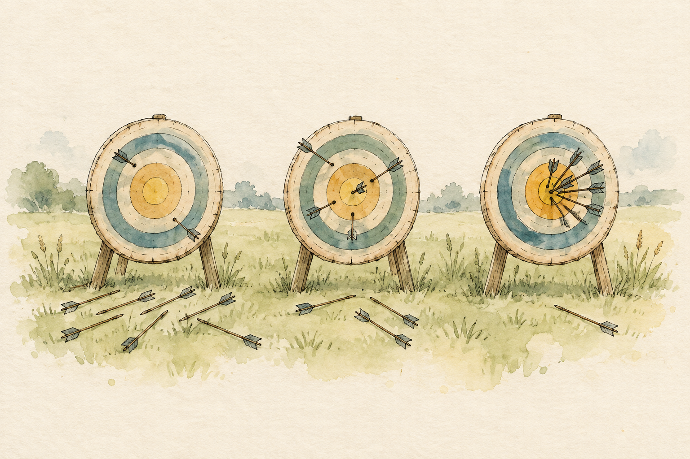

# Measuring behavior: attempts, crossing times and shares of time {#sec-beta-robust-regression}

```{r}
#| include: false

library(ggplot2)
library(here)
library(brms)
library(ggdist)
library(patchwork)
library(gt)
library(broom)

# The book's shared plot theme (this also loads the legend helpers)
Plot_theme <- source("functions/plot_theme.R")
Plot_theme <- Plot_theme$value

# The hanging wire test: one row per mouse and day, three attempts per row
wire_raw <- read.csv(here("project/AnalysisData/Wire_TrainingSum.csv"))
wire_raw <- wire_raw[wire_raw$Genotype %in% c("Klf4-KO", "WildType-Control"), ]

# One row per attempt: nine per mouse (3 days x 3 attempts)
attempts <- do.call(rbind, lapply(1:3, function(k) {
  data.frame(
    mouse = wire_raw$ReCode,
    genotype = factor(ifelse(wire_raw$Genotype == "Klf4-KO", "KO", "WT"), levels = c("WT", "KO")),
    day = wire_raw$Day,
    attempt = k,
    position = wire_raw[[paste0("Trial", k, "_Position")]],
    wire = wire_raw[[paste0("Trial", k, "_Wire")]],
    success = wire_raw[[paste0("Trial", k, "_Success")]]
  )
}))

# One row per mouse: successes out of nine attempts (3 days x 3 attempts)
counts <- aggregate(success ~ mouse + genotype, data = attempts, FUN = sum)
names(counts) <- c("mouse", "genotype", "n_ok")
counts$n_trials <- 9

# Crossing times of the attempts a mouse completed, on the log scale. Centering day and
# attempt at their middle value makes the intercept describe a mid-training attempt.
crossings <- attempts[attempts$success == 1 & attempts$wire > 0, ]
crossings$log_wire <- log(crossings$wire)
crossings$day_c <- crossings$day - 2
crossings$attempt_c <- crossings$attempt - 2

# One colour per genotype, safe for colour-blind readers
group_cols <- c(WT = "#D55E00", KO = "#0072B2")

# Median and 95% credible interval, formatted for inline reporting
summ <- function(x, digits = 2) {
  sprintf(paste0("%.", digits, "f [%.", digits, "f, %.", digits, "f]"),
          median(x), quantile(x, 0.025), quantile(x, 0.975))
}
```

Two chapters ago I made you a promise about noise, and I want to start by collecting on it. In @sec-logistic-regression a binomial model looked at proportions built from hundreds of cells and declared them far too variable to be believed, and I told you that a single yes or no per mouse could never show that problem, but that the several attempts each mouse made on the wire could. This chapter returns to the wire for the first of its jobs. It is also the last chapter of the part on generalized linear models, so I'd like it to do two things: close the overdispersion thread with the tool that was waiting for it, and then look at two kinds of continuous outcome we haven't touched, one with a habit of throwing the occasional wild value at you and one squeezed between 0 and 1.

Here is the plan. We start with the 63 mice of @sec-logistic-regression, the `Klf4-KO` and `WildType-Control` animals of the hanging wire test, and ask two questions of them: how many of its nine attempts does a mouse complete, and does genotype change that? And, when it does make it across, how long does the crossing take? Then I leave the wire for a different bench, the open field, to ask a third question: what share of a five-minute session does a mouse spend in the center of the arena, and what does a stroke do to it? The first outcome is a proportion built from trials, the second is a distribution that sometimes misbehaves, and the third is a proportion that is itself the measurement. Each needs a different family, and each one is a small, clean change to the recipe you already know: pick a family, keep the linear predictor, choose the link.

## Nine attempts per mouse: the binomial isn't enough

Every mouse made three attempts a day for three days, and each attempt was scored as completed or not. The natural summary, the one you would compute in a spreadsheet, is the number of completed attempts out of nine. That's a [binomial]{style="color:green; font-weight:bold;"} outcome: a count of successes out of a known number of trials, which is exactly the situation the binomial family of @sec-logistic-regression was made for. The question: **does genotype change a mouse's chance of completing an attempt?**

::: callout-note
### Nine attempts, three days, one probability

Collapsing the nine attempts into a count gives one row per mouse, so the 63 rows are independent animals, which is what a binomial needs between rows. What it also assumes is that the nine attempts of one mouse are interchangeable: the same probability on day 1 as on day 3. They aren't, quite: mice practice. I'll ignore the days here to keep the focus on the family, and the repeated structure comes back as something to model, not to average away, in the multilevel part of the book. @sec-multilevel-glmm is where that happens.
:::

I'll start where the cell proportions of @sec-logistic-regression did, with the plain binomial, and with a prior chosen the way that chapter taught: `Normal(0, 1.5)` on the log-odds scale for both the intercept and the coefficient, which spreads its belief over the whole range of probabilities without insisting on the extremes. `brms` writes the number of trials into the formula, and `glm()` takes a two-column matrix of successes and failures.

```{r}
# Priors on the log-odds scale, as in the logistic chapter
prior_logit <- c(
  prior(normal(0, 1.5), class = "Intercept"),
  prior(normal(0, 1.5), class = "b")
)

# Plain binomial: successes out of nine trials (cached)
fit_binom <- brm(
  n_ok | trials(n_trials) ~ genotype,
  data = counts,
  family = binomial(),
  prior = prior_logit,
  seed = 123,
  file = "models/beta-robust-regression_fit1.rds",
  file_refit = "never"
)
```

::: panel-tabset
### brms

```{r}
# Posterior summary on the log-odds scale
summary(fit_binom)
```

### glm

```{r}
# The same model by maximum likelihood; successes and failures as two columns
glm_binom <- glm(cbind(n_ok, n_trials - n_ok) ~ genotype,
                 family = binomial(), data = counts)

tidy(glm_binom, conf.int = TRUE)
```
:::

The coefficients read the way they did last time (log-odds, and `genotypeKO` is the change in the log-odds of completing an attempt for a KO mouse), and sampling is healthy. What I want to check isn't the mean, it's the noise. A binomial with nine trials and a given success probability has a variance it cannot escape: $9\,p(1-p)$. If every mouse of a genotype had the same chance of completing an attempt, the number of completed attempts across mice would be spread out about that much and no more. Let's ask the fitted model to generate a fresh set of 63 mice many times over, count how many mice would complete 0, 1, 2 ... 9 attempts in each replicate, and put the real counts next to the model's 95% band.

```{r}
#| include: false

# Tabulate, for each posterior-predictive replicate, how many mice completed 0..9 attempts
count_band <- function(fit, label) {
  yrep <- posterior_predict(fit, ndraws = 1000)
  tab <- t(apply(yrep, 1, function(r) tabulate(r + 1, nbins = 10)))
  data.frame(k = 0:9,
             lo = apply(tab, 2, quantile, probs = 0.025),
             mid = apply(tab, 2, median),
             hi = apply(tab, 2, quantile, probs = 0.975),
             model = label)
}
observed_counts <- data.frame(k = 0:9, n = tabulate(counts$n_ok + 1, nbins = 10))
```

I'll draw the picture in a moment, once there is a second model to put next to it. First, one number, because it's the sharper statement. Comparing the raw variance of the counts with the binomial's would mislead, because genotype already spreads the mice apart; the fair question is whether there is scatter left over *after* the model has used it. The [dispersion statistic]{style="color:green; font-weight:bold;"} answers it: the sum of squared Pearson residuals over the residual degrees of freedom, which we met in @sec-logistic-regression and which should be about 1 for a well-specified model, comes out at `r round(sum(residuals(glm_binom, type = "pearson")^2) / df.residual(glm_binom), 2)`.

```{r}
# Observed variance over the variance a binomial allows, within each genotype
disp_by_group <- tapply(counts$n_ok, counts$genotype, function(x) var(x) / (9 * (mean(x) / 9) * (1 - mean(x) / 9)))
```

That is overdispersion again, and this time it is a few-fold, not the factor of a hundred we found in the cell counts. Within each genotype, the variance of the counts is about `r round(disp_by_group["WT"], 1)` times the binomial's for the wild types and `r round(disp_by_group["KO"], 1)` times for the KO mice. It's the kind you would miss if you only fitted the model and read the coefficient table. Where does it come from? The same place as before. A binomial assumes that every mouse of the same genotype has the *same* probability of completing an attempt. But mice aren't identical: some are simply better on the wire, for reasons that are not in your model, and a good mouse completes all nine attempts and a poor one only five or six, more often than a common probability would allow.

## A binomial whose probability varies: the beta-binomial

Here is an analogy I find helpful. Imagine a shooting range, with nine arrows per archer. If all the archers had the same skill, the number of hits would follow a binomial. But the archers differ. The *number of hits* of a randomly chosen archer is then noisy twice: once because each shot is a coin flip with that archer's own hit probability, and again because the hit probability itself differs between archers. Averaging over the second source of noise gives a wider distribution than a binomial can produce with any single probability. Swap archers for mice and arrows for attempts on the wire, and you have our data.

{#fig-beta-targets fig-align="center" width="90%" fig-alt="Watercolor sketch of three archery targets on wooden stands in a meadow. The left target has two arrows in its rings and seven lying in the grass, the middle one has about five in the rings, and the right one has a tight cluster of arrows at the center."}

To describe the second source of noise we need a distribution for probabilities, one that lives on the interval from 0 to 1. The natural candidate is the [beta distribution]{style="color:green; font-weight:bold;"}, which we'll spend the next section getting to know properly. Suppose each mouse's own chance of completing an attempt, $p_i$, is drawn from a beta distribution with mean $\mu_i$ and a precision $\phi$ (larger means the mice are more alike), and given $p_i$, the number of completed attempts is binomial. Integrating $p_i$ out leaves the [beta-binomial]{style="color:green; font-weight:bold;"} [@mcelreath2020]:

$$
p_i \sim \text{Beta}(\mu_i \phi, (1 - \mu_i)\phi), \quad y_i \mid p_i \sim \text{Binomial}(n_i, p_i) \quad \Rightarrow \quad \text{Var}(y_i) = n_i \mu_i (1 - \mu_i)\left[1 + (n_i - 1)\rho\right], \quad \rho = \frac{1}{\phi + 1}
$$ {#eq-betabinom}

The bracket is the price of the mouse-to-mouse differences. When $\phi$ is huge, $\rho$ is close to zero and the bracket is 1: the beta-binomial becomes the plain binomial, with the same variance. When $\phi$ is small, the mice are very different from each other and the variance grows by up to a factor of $n_i$. And $\rho$ has a friendly reading: it is the correlation between two attempts of the same mouse. If I tell you that a mouse completed the first attempt, $\rho$ measures how much better than average your bet on the second attempt should be. It is the same overdispersion as the negative binomial's, and it is worth noticing that it is the same *idea*: a Poisson whose rate varies gave us the negative binomial, and a binomial whose probability varies gives us the beta-binomial.

Two new priors are needed. The mean part keeps the `Normal(0, 1.5)` choices of before. For $\phi$, `brms` defaults to a nearly flat gamma, and I'd rather not have that: with only nine attempts per mouse, the data speak weakly about how variable the mice are. `Gamma(2, 0.1)` has a mean of 20 and puts 95% of its mass between about 2.4 and 56, which in terms of $\rho$ means anything from a correlation of 0.02 between attempts to about 0.3, a range that covers everything from "mice are nearly interchangeable" to "mice are quite different" without allowing the absurd. The frequentist counterpart is `glmmTMB`'s `betabinomial`, since `glm()` has no beta-binomial and neither has `parsnip`. On the `brms` side there is a `beta_binomial()` family, and I'm not going to use it, for a reason worth a short detour.

::: callout-warning
### When the two tabs disagree

My first draft of this chapter used the built-in `beta_binomial()`. Its point estimates matched `glmmTMB`'s, and its posterior standard deviations were several times smaller (for the genotype coefficient, -1.57 with a standard deviation of 0.08, against -1.58 with a standard error of 0.66), for a model that should be *less* certain than the plain binomial, not more. That is exactly the discrepancy the side-by-side tabs are for. I found the cause by reading the Stan program that `stancode()` returns: in the `brms` version this book pins (2.22.0), the generated code hands the whole vector of trial counts to the likelihood of every single mouse, so each mouse is counted as many times as there are mice. I don't know whether later versions fix it, so on your machine, look at `stancode()` before trusting a family you haven't compared with something else.

The workaround is to write the same likelihood as a [custom family]{style="color:green; font-weight:bold;"}, following the recipe in the `brms` vignette on custom response distributions. It takes a few lines: a Stan function for the beta-binomial with the mean-precision parametrization, and three small R functions so that `posterior_predict()`, `posterior_epred()` and `pp_check()` know how to use it. Everything after this point in the section behaves as if it were a built-in family.
:::

```{r}
# Beta-binomial with mean-precision parametrization, as a custom brms family.
# The number of trials enters through vint(), an integer variable in the data.
# (the family is declared here; the Stan code and R helpers follow)
beta_binomial2 <- custom_family(
  "beta_binomial2", dpars = c("mu", "phi"),
  links = c("logit", "log"), lb = c(NA, 0),
  type = "int", vars = "vint1[n]"
)

# The likelihood itself, written in Stan
stan_bb <- stanvar(scode = "
  real beta_binomial2_lpmf(int y, real mu, real phi, int T) {
    return beta_binomial_lpmf(y | T, mu * phi, (1 - mu) * phi);
  }
", block = "functions")

# R-side functions: how to compute the log-likelihood, simulate new counts,
# and get the expected count from posterior draws of mu and phi
log_lik_beta_binomial2 <- function(i, prep) {
  mu <- brms::get_dpar(prep, "mu", i = i)
  phi <- brms::get_dpar(prep, "phi", i = i)
  T <- prep$data$vint1[i]
  y <- prep$data$Y[i]
  lchoose(T, y) + lbeta(y + mu * phi, T - y + (1 - mu) * phi) - lbeta(mu * phi, (1 - mu) * phi)
}

posterior_predict_beta_binomial2 <- function(i, prep, ...) {
  mu <- brms::get_dpar(prep, "mu", i = i)
  phi <- brms::get_dpar(prep, "phi", i = i)
  rbinom(length(mu), prep$data$vint1[i], rbeta(length(mu), mu * phi, (1 - mu) * phi))
}

posterior_epred_beta_binomial2 <- function(prep) {
  mu <- brms::get_dpar(prep, "mu")
  mu * matrix(prep$data$vint1, nrow(mu), ncol(mu), byrow = TRUE)
}
```

```{r}
# Same priors as before, plus one for the precision phi
prior_bb <- c(prior_logit, prior(gamma(2, 0.1), class = "phi"))

# Beta-binomial through the custom family; trials enter as an integer variable (cached)
fit_bb <- brm(
  n_ok | vint(n_trials) ~ genotype,
  data = counts,
  family = beta_binomial2,
  stanvars = stan_bb,
  prior = prior_bb,
  seed = 123,
  file = "models/beta-robust-regression_fit2.rds",
  file_refit = "never"
)
```

::: panel-tabset
### brms

```{r}
# Posterior summary, including phi
summary(fit_bb)
```

### glmmTMB

```{r}
library(glmmTMB)

# The same model by maximum likelihood
glmm_bb <- glmmTMB(cbind(n_ok, n_trials - n_ok) ~ genotype,
                   family = betabinomial, data = counts)

summary(glmm_bb)
```
:::

```{r}
# Posterior draws; rho is the correlation between two attempts of one mouse
draws_bb <- as.data.frame(posterior::as_draws_df(fit_bb))
rho_bb <- 1 / (draws_bb$phi + 1)
```

Now the check (@fig-beta_ppc_counts_both). The same picture as before, for both models, with the real counts as bars. I draw bars for the data and points with lines for the model because this is the one place where counts of mice are the thing plotted; the bars say "this is what happened" and the intervals say "this is what the model believed".

```{r}
#| label: fig-beta_ppc_counts_both
#| fig-cap: How many mice completed each number of attempts (bars), against the range each model expects in a new sample of 63 mice (points and lines are the median and 95% predictive interval). The binomial (left) expects a crowd of mice at 7 or 8 completed attempts that isn't there, and has no room for the many perfect scores; the beta-binomial (right) covers both.
#| fig-width: 8
#| fig-height: 3.8
#| warning: false

# Predictive band of each model, side by side
band <- rbind(count_band(fit_binom, "Binomial"), count_band(fit_bb, "Beta-binomial"))
band$model <- factor(band$model, levels = c("Binomial", "Beta-binomial"))

# The observed bars are the same in both panels
observed_by_model <- merge(observed_counts, data.frame(model = levels(band$model)))
observed_by_model$model <- factor(observed_by_model$model, levels = levels(band$model))

# Observed counts as grey bars; the model's median and 95% interval as points and lines
ggplot(band, aes(x = k)) +
  geom_col(data = observed_by_model, aes(y = n), fill = "grey80", width = 0.7) +
  geom_pointrange(aes(y = mid, ymin = lo, ymax = hi), color = "#0072B2", size = 0.4) +
  facet_wrap(~model) +
  scale_x_continuous(breaks = 0:9) +
  labs(x = "Completed attempts out of 9", y = "Number of mice") +
  Plot_theme
```

```{r}
# Mice with a perfect score, and what each model's band says about that bar
perfect_obs <- sum(counts$n_ok == 9)
bands_perfect <- band[band$k == 9, ]
```

The bars are the mice we have, and the bands are what each model believes about a fresh sample of 63. Look at the right end. `r perfect_obs` mice completed all nine attempts, which is the largest bar by far; the binomial's band for that bar runs from `r round(bands_perfect$lo[1])` to `r round(bands_perfect$hi[1])`, so the real count falls outside it, and the beta-binomial's runs from `r round(bands_perfect$lo[2])` to `r round(bands_perfect$hi[2])`, which includes it. Now look just to its left. The binomial expects a crowd of mice with 7 or 8 completed attempts, and the real data have only a few; a handful of mice completed even fewer, where the binomial expects almost nobody. That's the shape "mice are individuals" predicts: the mice split into those that complete nearly everything and those that don't, instead of crowding around a common middle. A summary check gives the same message in one number (@fig-beta_ppc_sd).

```{r}
#| include: false

# Observed spread of the counts, and the share of replicates at least that spread out
set.seed(1)
sd_obs <- sd(counts$n_ok)
share_sd_binom <- mean(apply(posterior_predict(fit_binom, ndraws = 1000), 1, sd) >= sd_obs)
share_sd_bb <- mean(apply(posterior_predict(fit_bb, ndraws = 1000), 1, sd) >= sd_obs)
```

```{r}
#| label: fig-beta_ppc_sd
#| fig-cap: Standard deviation of the number of completed attempts across mice, in replicated data (histograms) against the observed value (line). Left, binomial; right, beta-binomial.
#| fig-width: 8
#| fig-height: 3.2
#| warning: false
#| message: false

# Replicated standard deviations for each model against the observed one
p_sd1 <- pp_check(fit_binom, type = "stat", stat = "sd", ndraws = 500) +
  labs(title = "Binomial", x = "SD of completed attempts")
p_sd2 <- pp_check(fit_bb, type = "stat", stat = "sd", ndraws = 500) +
  labs(title = "Beta-binomial", x = "SD of completed attempts")

p_sd1 + p_sd2
```

Under the binomial, `r round(100 * share_sd_binom)`% of the replicated samples are as spread out as the real mice (the observed value lies beyond all of them); under the beta-binomial it is `r round(100 * share_sd_bb)`%, comfortably in the middle. I'd normally add a leave-one-out comparison here, as in @sec-count-regression, and I'll leave it out on purpose: `loo()` for the beta-binomial in `brms` needs the `extraDistr` package, which this book doesn't otherwise use, and the two checks above already make the case more directly than a difference in elpd would. (A comparison is a relative statement; the check is what tells you the winner is credible.)

What has the beta-binomial actually told us about the mice? Its `phi` is `r summ(draws_bb$phi, 1)`, which means a correlation between two attempts of the same mouse of $\rho$ = `r summ(rho_bb)`. That is not small: once you know a mouse completed one attempt, you should be a great deal more confident that it completes the next. With nine attempts per mouse, it inflates the variance of a mouse's count by a factor of $1 + 8\rho$, about `r round(1 + 8 * median(rho_bb), 1)`, which is the excess the dispersion statistic detected. It is also a number that a mouse-level model, in the multilevel part of the book, will make explicit instead of leaving it buried in one parameter (@sec-multilevel-glmm).

One caution about that number. The posterior for `phi` sits at the *low* end of the prior I chose, which had its mode at 10 and put only 2.5% of its mass below about 2.4, so I should check that the prior isn't doing the work. Here is the same model with a flatter prior, `Gamma(1, 0.05)`, an exponential with a mean of 20 and no preference for any particular value (@fig-beta-targets pictures the mouse-to-mouse spread this prior is about).

```{r}
# Sensitivity check: the same model with a flatter prior on phi (cached)
fit_bb_flat <- brm(
  n_ok | vint(n_trials) ~ genotype,
  data = counts,
  family = beta_binomial2,
  stanvars = stan_bb,
  prior = c(prior_logit, prior(gamma(1, 0.05), class = "phi")),
  seed = 123,
  file = "models/beta-robust-regression_fit11.rds",
  file_refit = "never"
)

draws_bb_flat <- as.data.frame(posterior::as_draws_df(fit_bb_flat))
```

With the flatter prior, `phi` is `r summ(draws_bb_flat$phi, 1)` and the genotype coefficient is `r summ(draws_bb_flat$b_genotypeKO)`, against `r summ(draws_bb$phi, 1)` and `r summ(draws_bb$b_genotypeKO)` before. The two agree: the conclusion that the mice differ a great deal from one another doesn't depend on my choice of prior, and the data are asking for it.

The mean model is where the science lives, so let's read it. The genotype effect on the log-odds scale is `r summ(draws_bb$b_genotypeKO)`, and, as in @sec-logistic-regression, the sentence for a colleague is on the probability scale, computed as an average predictive comparison over the mice we actually studied. `posterior_epred()` returns the expected number of completed attempts, so I divide by nine to get a probability.

```{r}
# Every mouse as KO and as WT; the average difference in probability is the effect
nd_ko <- transform(counts, genotype = factor("KO", levels = levels(counts$genotype)))
nd_wt <- transform(counts, genotype = factor("WT", levels = levels(counts$genotype)))

apc_bb <- rowMeans(posterior_epred(fit_bb, newdata = nd_ko) / 9 -
                     posterior_epred(fit_bb, newdata = nd_wt) / 9)
apc_binom <- rowMeans(posterior_epred(fit_binom, newdata = nd_ko) / 9 -
                        posterior_epred(fit_binom, newdata = nd_wt) / 9)
```

On average across these mice, the chance of completing an attempt was `r summ(100 * apc_bb, 0)` percentage points different for KO mice under the beta-binomial (negative means KO mice complete less often). The plain binomial, which ignores the mouse-to-mouse spread, reports `r summ(100 * apc_binom, 0)`: nearly the same centre, and an interval about `r round(diff(quantile(apc_bb, c(0.025, 0.975))) / diff(quantile(apc_binom, c(0.025, 0.975))), 1)` times as wide under the beta-binomial. That's as it should be: a model that lets mice differ from one another knows less about the genotype than one that assumes they are interchangeable, and the second one's narrower interval was a claim to precision that the data did not support. The centre of the estimate is a matter of the design and the data. The width of the interval is a matter of the family.

::: {.callout-note title="How to report it"}
**Results.** Across the `r nrow(counts)` mice, the probability of completing an attempt on the hanging wire differed by `r summ(100 * apc_bb, 0)` percentage points in Klf4-KO mice compared with wild types (average predictive comparison; posterior median and 95% credible interval; negative values mean fewer completed attempts). Mice differed from one another beyond binomial variation (correlation between attempts of one mouse, ρ = `r summ(rho_bb)`).

**Methods.** The number of completed attempts out of nine was modeled with a beta-binomial likelihood (mean-precision parametrization, logit link, genotype as predictor). Priors were Normal(0, 1.5) for the intercept and the genotype coefficient and Gamma(2, 0.1) for the precision. A plain binomial model showed overdispersion (dispersion statistic `r round(sum(residuals(glm_binom, type = "pearson")^2) / df.residual(glm_binom), 1)`) and failed posterior predictive checks of the number of perfect scores and of the standard deviation.
:::

## A different kind of trouble: crossing times and the odd one out

Now for a different kind of trouble, one that has nothing to do with proportions. Every attempt that a mouse completes has a crossing time: the seconds from the start of the attempt until it reached the platform. You've almost certainly seen the histogram of a time like this: a hump and a long right tail. **Does genotype change how long a crossing takes, and do mice speed up with practice?** I'll use only the attempts a mouse completed, and I'll come back to what that leaves out. Before any model, here is the distribution of the `r nrow(crossings)` crossing times, on the seconds scale and on the log scale (@fig-beta_rt_raw). I use a histogram from `ggplot2` because with hundreds of attempts the shape of the distribution is the question; a boxplot would hide the hump and a bar of the mean with an asterisk would hide everything, including the odd record we are about to meet.

```{r}
#| label: fig-beta_rt_raw
#| fig-cap: Distribution of the completed crossing times, in seconds (left) and on the log scale (right). The vertical line marks the median.
#| fig-width: 8
#| fig-height: 3.4
#| warning: false

# Histogram of the times in seconds and of their logs
p_rt_raw <- ggplot(crossings, aes(x = wire)) +
  geom_histogram(bins = 50, fill = "#0072B2", color = "white") +
  geom_vline(xintercept = median(crossings$wire), linetype = "dashed") +
  labs(x = "Crossing time (s)", y = "Attempts") +
  Plot_theme

p_rt_log <- ggplot(crossings, aes(x = log_wire)) +
  geom_histogram(bins = 50, fill = "#0072B2", color = "white") +
  geom_vline(xintercept = median(crossings$log_wire), linetype = "dashed") +
  labs(x = "log(crossing time in s)", y = "Attempts") +
  Plot_theme

p_rt_raw + p_rt_log
```

```{r}
# The odd record, and how many records are impossible by the file's own logic
fastest <- crossings[which.min(crossings$wire), ]
n_impossible <- sum(attempts$position > attempts$wire)
# Intraclass correlation from a random-intercept model: between-mouse variance over total
# variance (a one-way ANOVA's share of sums of squares would also count residual noise)
m_icc <- glmmTMB(log_wire ~ 1 + (1 | mouse), data = crossings)
var_mouse <- as.numeric(VarCorr(m_icc)$cond$mouse[1, 1])
icc_wire <- var_mouse / (var_mouse + sigma(m_icc)^2)
```

There are two features here and it matters to separate them. The first is the [skew]{style="color:green; font-weight:bold;"}: a time is positive, and the natural way for it to vary is multiplicatively, a slow mouse is 20% slower, not four seconds slower. Taking logs turns multiplication into addition, and it's why the bulk of the distribution on the right looks like a decent hump. That is a *transformation* problem and the log deals with it. The second feature is a single point at the far left of the log scale: one attempt, by mouse `r fastest$mouse` on day `r fastest$day`, recorded a crossing time of `r fastest$wire` second, for an attempt in which the same row records `r fastest$position` seconds to get into position. That is impossible if the total time includes getting into position, and the file has `r n_impossible` such record among these two genotypes. I don't know what happened (a typo, a stopwatch pressed late), and neither will the model. The real distribution has no cluster of "lapses" the way a distracted-animal dataset might; it has one value that doesn't belong.

::: callout-tip
### Why not model the raw seconds with a Student-*t*?

Because the two problems are different and deserve different tools. A Student-*t* on raw times would be asked to handle the skew *and* the odd value with the same parameter, and it does the first badly. So I take logs, which handles the skew honestly, and leave the Student-*t* the job it's for: the extreme values that are left. (Reaction-time modelers also use the lognormal and its cousin the shifted lognormal, which build the skew into the likelihood instead of the transformation. That's a legitimate alternative that this chapter doesn't pursue.)
:::

::: callout-warning
### Two shortcuts in this section, on purpose

First, I use only completed attempts. A failed attempt has no crossing time: the clock stops at the 60-second cap, so its recorded time is a lower bound, not a measurement. Dropping those attempts means the model describes how long a crossing takes *when the mouse makes it*, and says nothing about how long it would have taken the ones that failed. The principled repair is a censored regression, which treats the 60 seconds as "at least this long", and it is a topic for @sec-missing-data-measurement-error.

Second, I treat the `r nrow(crossings)` attempts as independent observations, and they are not: they come from `r length(unique(crossings$mouse))` mice, and about `r round(100 * icc_wire)`% of the variance of the log crossing time is between mice, not between attempts of the same mouse. The model will behave as if it had `r nrow(crossings)` independent observations of the genotype effect, and it has `r length(unique(crossings$mouse))` mice. Its interval for genotype will be narrower than it should be. That's the shortcut of this section, deferred on purpose to the multilevel part of the book (@sec-multilevel-glmm).
:::

### The Gaussian on log crossing times

Start with what you'd do by default. The outcome is `log_wire`, the predictors are `genotype`, `day_c` (the day of training, centred on day 2) and `attempt_c` (the attempt within the day, centred on the second), because mice usually get faster with practice. Priors on the log scale: the intercept is the log of the crossing time of a wild-type mouse on a mid-training attempt, and `Normal(3, 0.7)` is centred on 20 seconds and covers roughly 5 to 80, which is wider than anything the test allows; the coefficients get `Normal(0, 0.5)`, which puts 95% of its mass between about 0.4 and 2.7 times the crossing time per unit, since a coefficient on the log scale is a proportional change. For `sigma` I use an `Exponential(2)`, which puts most of its mass at values below one on the log scale.

```{r}
# Priors on the log-time scale
prior_rt <- c(
  prior(normal(3, 0.7), class = "Intercept"),
  prior(normal(0, 0.5), class = "b"),
  prior(exponential(2), class = "sigma")
)

# Gaussian model for the log crossing time (cached)
fit_rt_gauss <- brm(
  log_wire ~ genotype + day_c + attempt_c,
  data = crossings,
  prior = prior_rt,
  seed = 123,
  file = "models/beta-robust-regression_fit6.rds",
  file_refit = "never"
)
```

::: panel-tabset
### brms

```{r}
# Posterior summary
summary(fit_rt_gauss)
```

### lm

```{r}
# The same model by least squares
lm_rt <- lm(log_wire ~ genotype + day_c + attempt_c, data = crossings)

tidy(lm_rt, conf.int = TRUE)
```
:::

Sampling is healthy and the coefficients are reasonable. The trouble, as always, is what the model believes about the data it hasn't seen. A Gaussian says that a value more than three standard deviations from its expected value is a once-in-a-thousand event. To see how it copes with the odd one out, I'll ask it what it expects the *fastest* crossing in a set of this many attempts to be, and compare it with the fastest one we saw.

```{r}
#| label: fig-beta_rt_ppc_gauss
#| fig-cap: Posterior predictive checks for the Gaussian model of log crossing times. Left, densities of replicated data (light lines) against the observed density (dark line). Right, fastest crossing in replicated data (histogram) against the observed fastest crossing (line).
#| fig-width: 8
#| fig-height: 3.8
#| warning: false
#| message: false

# Left: densities of replicated data; right: the fastest crossing in replicated data
p_rt1 <- pp_check(fit_rt_gauss, ndraws = 50) +
  labs(x = "log(crossing time)")
p_rt2 <- pp_check(fit_rt_gauss, type = "stat", stat = "min", ndraws = 500) +
  labs(x = "Fastest crossing, log(time)")

p_rt1 + p_rt2 + plot_layout(widths = c(1.4, 1))
```

The density overlay is the gentle version of the message: the replicated densities follow the bulk of the data reasonably well, which is the evidence for the log transformation, though not perfectly (the observed density is flatter on top and has a shoulder on the right that the replicates smooth over). The right panel is the blunt version. The fastest crossing that the model generates in a set of this size is nowhere near the one we recorded, which sits beyond the whole histogram. And a Gaussian pays for an inability to expect such a point twice: it stretches `sigma` to be less surprised, and it pulls the fitted values a little toward it.

### Student-*t*: a Gaussian that isn't shocked

Here is the picture I use for the [Student-*t* distribution]{style="color:green; font-weight:bold;"}. A Gaussian is a colleague who is never surprised until suddenly, at three standard deviations, they are astonished. The Student-*t* is a colleague who has seen a few things: they expect the bulk of the data to look like a bell, and they have made peace with the occasional extreme value. The dial that sets how much they've seen is $\nu$, the *degrees of freedom*. A small $\nu$ (say 3 to 5) is a very worldly colleague, with heavy tails that give extreme values a real chance; as $\nu$ grows, the tails thin, and for $\nu$ above about 30 the Student-*t* is practically indistinguishable from a Gaussian [@kruschke2015]. The mean and the scale parameter play the roles of the mean and `sigma` of the Gaussian, so the regression part is *exactly* the same:

$$
y_i \sim \text{Student-}t(\nu, \mu_i, \sigma), \qquad \mu_i = \beta_0 + \beta_1 x_{1i} + \dots
$$ {#eq-student}

(@fig-beta-pegs shows the idea with one peg.) What makes this a [robust regression]{style="color:green; font-weight:bold;"} is what happens to the outliers: a Gaussian penalizes a far point quadratically, so a single wild value can drag the fitted line toward itself; the Student-*t*'s heavy tail gives the same point a lot of probability density, and so the model has no need to bend the coefficients to accommodate it [@kruschke2015]. And $\nu$ is estimated from the data, which means the model decides for itself how heavy-tailed it needs to be. The prior for $\nu$ needs some thought, because a handful of extreme points can't say much about tails. `brms` defaults to `Gamma(2, 0.1)`, which has a mean of 20 and allows small values if the data ask for them, and that's what I'll use, with a sensitivity check afterward.

{#fig-beta-pegs fig-align="center" width="90%" fig-alt="Watercolor sketch of two wooden boards each with a row of seven pegs and one peg raised near the right end. On the left board a taut ochre string curves up toward the raised peg, on the right board a loose teal string stays nearly level and rises only at the very end."}

```{r}
# Same priors plus one for nu, the degrees of freedom
prior_rt_t <- c(prior_rt, prior(gamma(2, 0.1), class = "nu"))

# Same regression, Student-t likelihood (cached)
fit_rt_t <- brm(
  log_wire ~ genotype + day_c + attempt_c,
  data = crossings,
  family = student(),
  prior = prior_rt_t,
  seed = 123,
  file = "models/beta-robust-regression_fit7.rds",
  file_refit = "never"
)
```

::: panel-tabset
### brms

```{r}
# Posterior summary, including nu
summary(fit_rt_t)
```

### glmmTMB

```{r}
# The same model by maximum likelihood
glmm_rt_t <- glmmTMB(log_wire ~ genotype + day_c + attempt_c, family = t_family(),
                     data = crossings)

summary(glmm_rt_t)
```
:::

```{r}
# Posterior draws of both models, for the comparison
draws_rt_t <- as.data.frame(posterior::as_draws_df(fit_rt_t))
draws_rt_g <- as.data.frame(posterior::as_draws_df(fit_rt_gauss))
```

The change to look for first is in the tail parameter. $\nu$ comes out at `r summ(draws_rt_t$nu, 1)`. With one clear outlier in `r nrow(crossings)` attempts, there is little for the tails to learn from, and I'd read that interval as "not very heavy-tailed, and not very sure", not as a property of mouse neurobiology. The second change is in the scale. A Student-*t*'s `sigma` isn't a standard deviation (that is $\sigma\sqrt{\nu/(\nu-2)}$), but it is the scale of the *bulk* of the data, and it moves from `r round(median(draws_rt_g$sigma), 2)` in the Gaussian to `r round(median(draws_rt_t$sigma), 2)` in the Student-*t*: the model no longer stretches the whole bell to fit a single point. @tbl-beta_rt_compare puts the two models' estimates for the coefficients side by side.

```{r}
#| label: tbl-beta_rt_compare
#| tbl-cap: Coefficients (log scale) and scale parameter of the Gaussian and Student-t models for log crossing time (posterior median and 95% credible interval)

# Median and interval of each coefficient from one set of draws
cmp_coef <- function(d) {
  c(Intercept = summ(d$b_Intercept), `KO vs wild-type` = summ(d$b_genotypeKO),
    `Day (per day)` = summ(d$b_day_c, 3), `Attempt (per attempt)` = summ(d$b_attempt_c, 3),
    `sigma` = summ(d$sigma))
}

gt(data.frame(
  Parameter = names(cmp_coef(draws_rt_g)),
  Gaussian = unname(cmp_coef(draws_rt_g)),
  `Student-t` = unname(cmp_coef(draws_rt_t)),
  check.names = FALSE
))
```

Read the table for what *didn't* happen. The coefficients that matter to the science, the genotype difference and the effect of practice, barely move between the two models, and the intervals are about the same. That is the usual fate of robust regression on a dataset with a single odd value out of hundreds: it doesn't overturn a conclusion, it confirms that the conclusion wasn't hanging on that value. A Student-*t* that agrees with the Gaussian is a *sensitivity analysis* that passed, and I find that more useful than the dramatic examples in textbooks, because it is the thing you will actually see.

```{r}
#| include: false

# Fastest crossing in each replicate, and how often it reaches the observed one
set.seed(2)
min_rep_t <- apply(posterior_predict(fit_rt_t, ndraws = 500), 1, min)
min_rep_g <- apply(posterior_predict(fit_rt_gauss, ndraws = 500), 1, min)
share_min_t <- mean(min_rep_t <= min(crossings$log_wire))
share_min_g <- mean(min_rep_g <= min(crossings$log_wire))
```

```{r}
#| label: fig-beta_rt_ppc_t
#| fig-cap: Posterior predictive checks for the Student-t model of log crossing times (same layout as the Gaussian check)
#| fig-width: 8
#| fig-height: 3.8
#| warning: false
#| message: false

# Same two checks as before, now for the Student-t model
p_rt3 <- pp_check(fit_rt_t, ndraws = 50) +
  labs(x = "log(crossing time)")
p_rt4 <- pp_check(fit_rt_t, type = "stat", stat = "min", ndraws = 500) +
  labs(x = "Fastest crossing, log(time)")

p_rt3 + p_rt4 + plot_layout(widths = c(1.4, 1))
```

The right panel needs a careful reading, because it is the check the Gaussian failed. The observed fastest crossing is `r round(min(crossings$wire), 0)` second, which is a log of `r round(min(crossings$log_wire), 1)`. In a typical replicate the Gaussian's fastest crossing takes about `r round(exp(median(min_rep_g)), 1)` seconds, and the Student-*t*'s about `r round(exp(median(min_rep_t)), 1)`. The Student-*t* gets closer, and it does so by giving the left tail room to reach: the observed value is no longer beyond all of the replicates, since `r round(100 * share_min_t)`% of the Student-*t* replicates reach it, against `r round(100 * share_min_g)`% for the Gaussian, so it sits at the edge of what the model can produce, not outside it. The same room exists on the slow side, so the model is also more tolerant of slow values than the data seem to need. It's a good model of the bulk, which is what we need for the genotype and practice effects, and a single point can't tell it how heavy the tails really are.

Leave-one-out cross-validation gives a third view (@tbl-beta_loo_rt), for the same outcome, so the comparison is legitimate. I also report how many attempts have a Pareto-$k$ above 0.7, the signal from @sec-count-regression that the approximation is unreliable for that observation.

```{r}
#| label: tbl-beta_loo_rt
#| tbl-cap: Leave-one-out comparison of the Gaussian and Student-t models for log crossing time, with the number of attempts whose Pareto-k exceeds 0.7 in each
#| warning: false

# Leave-one-out comparison and the number of unreliable observations
loo_rt_g <- loo(fit_rt_gauss)
loo_rt_t <- loo(fit_rt_t)
cmp_rt <- loo_compare(list("Gaussian" = loo_rt_g, "Student-t" = loo_rt_t))

loos_rt <- list("Gaussian" = loo_rt_g, "Student-t" = loo_rt_t)
n_bad <- vapply(loos_rt, function(l) sum(loo::pareto_k_values(l) > 0.7), numeric(1))

gt(data.frame(
  Model = rownames(cmp_rt),
  `elpd difference` = round(cmp_rt[, "elpd_diff"], 1),
  `SE of difference` = round(cmp_rt[, "se_diff"], 1),
  `Attempts with Pareto-k above 0.7` = unname(n_bad[rownames(cmp_rt)]),
  check.names = FALSE
))
```

```{r}
best_rt <- rownames(cmp_rt)[1]
```

The model with the higher elpd is the `r best_rt`, by `r round(abs(cmp_rt[2, "elpd_diff"]), 1)` units against a standard error of `r round(cmp_rt[2, "se_diff"], 1)`: `r if (abs(cmp_rt[2, "elpd_diff"]) < cmp_rt[2, "se_diff"]) "smaller than its own uncertainty, so predictive accuracy does not separate the two models" else "larger than its own uncertainty"`. The Gaussian has `r n_bad["Gaussian"]` attempt(s) with a problematic Pareto-$k$ and the Student-*t* has `r n_bad["Student-t"]`. As always, the comparison is a *relative* statement; with one odd value among hundreds of attempts, I wouldn't expect cross-validation to pick a winner, and it's the predictive check above that carries the argument.

::: callout-warning
### "Robust" is not "delete the outliers"

There's a tempting alternative to everything in this section: find the odd value, drop it, and fit the Gaussian on what's left. Here the temptation has a better excuse than usual, because the value is *impossible* by the file's own logic, and I'll show you what that alternative gives. But notice the two things wrong with it as a habit. The first is that "odd" needs a threshold, and any threshold is a decision made after looking at the outcome, in a direction that tends to favour the hypothesis. The second is that the model then reports uncertainty as if the deleted value had never happened. A robust likelihood keeps every attempt and lets $\nu$ report how much of that noise there is. If a value has a *known cause*, a time that is shorter than the same attempt's own positioning time, that's a reason to exclude it, and you write down why. If the only reason is that it looks big, that is what the tail of the Student-*t* is for.
:::

Since this value does have a known cause, here is the Gaussian refitted without the attempts whose position time exceeds their total time, next to the other two.

```{r}
# Remove only the attempts that are impossible by the file's own logic
crossings_clean <- crossings[crossings$position <= crossings$wire, ]

# Gaussian refitted without them (cached)
fit_rt_gauss_clean <- brm(
  log_wire ~ genotype + day_c + attempt_c,
  data = crossings_clean,
  prior = prior_rt,
  seed = 123,
  file = "models/beta-robust-regression_fit10.rds",
  file_refit = "never"
)
```

### How sensitive is $\nu$ to the prior?

I said I'd check, and the parameter that most deserves it is the one that a single extreme point has to identify. I'll refit with two other priors on $\nu$ from the literature, and the result is in @tbl-beta_rt_sensitivity. One is @kruschke2015's, an exponential prior on $\nu - 1$ with a mean of 29, which spreads prior mass over both the heavy-tailed and near-Gaussian regimes. The other fixes $\nu$ at 7, a value that a number of practitioners use as a pragmatic default when the data are too few to estimate it.

```{r}
# Student-t with Kruschke's prior on nu (cached)
fit_rt_t_kruschke <- brm(
  log_wire ~ genotype + day_c + attempt_c,
  data = crossings,
  family = student(),
  # Rate 1/29, written as a number because brms does not parse "1/29" here
  prior = c(prior_rt, prior(exponential(0.0345), class = "nu")),
  seed = 123,
  file = "models/beta-robust-regression_fit8.rds",
  file_refit = "never"
)

# Student-t with nu fixed at 7 (cached)
fit_rt_t_nu7 <- brm(
  bf(log_wire ~ genotype + day_c + attempt_c, nu = 7),
  data = crossings,
  family = student(),
  prior = prior_rt,
  seed = 123,
  file = "models/beta-robust-regression_fit9.rds",
  file_refit = "never"
)
```

```{r}
#| label: tbl-beta_rt_sensitivity
#| tbl-cap: Effect of genotype on log crossing time, and the tail parameter, under every way of handling the odd value that this chapter tried

# Genotype effect and nu from one fit
get_group <- function(m) summ(as.data.frame(posterior::as_draws_df(m))$b_genotypeKO)
get_nu <- function(m) {
  d <- as.data.frame(posterior::as_draws_df(m))
  if ("nu" %in% names(d)) summ(d$nu, 1) else "not estimated"
}

fits_sens <- list("Gaussian, all attempts" = fit_rt_gauss,
                  "Gaussian, impossible record removed" = fit_rt_gauss_clean,
                  "Student-t, Gamma(2, 0.1) on nu (used)" = fit_rt_t,
                  "Student-t, exponential, mean 29 (Kruschke)" = fit_rt_t_kruschke,
                  "Student-t, nu fixed at 7" = fit_rt_t_nu7)

gt(data.frame(
  `Handling of the odd value` = names(fits_sens),
  `KO vs wild-type (log scale)` = vapply(fits_sens, get_group, character(1)),
  `ν` = vapply(fits_sens, get_nu, character(1)),
  check.names = FALSE
))
```

The genotype coefficient moves very little across the five, which is the sign of a conclusion that isn't riding on a delicate choice. Removing the impossible record by hand and letting the Student-*t* absorb it give essentially the same answer, and that is the argument for the robust model: it did automatically, and without a judgement call, what a careful analyst would have done by hand. I would still report $\nu$ with its interval and not give it a biological interpretation. What matters is that the conclusion about genotype doesn't wait for it.

### Reading the effect

A coefficient on the log scale is a proportional change, so exponentiating it gives a *ratio of crossing times*, which is the way a person thinks about speed: "KO crossings take X times as long".

```{r}
# Back-transform the log-scale coefficient into a ratio of crossing times
rt_ratio <- exp(draws_rt_t$b_genotypeKO)
```

KO mice take `r summ(rt_ratio)` times as long to cross as wild-type mice on the same day and attempt, which is `r summ(100 * (rt_ratio - 1), 0)`% longer; the same reading for practice is that each additional day multiplies the crossing time by `r summ(exp(draws_rt_t$b_day_c), 2)`. These are ratios of *typical* crossing times (medians on the seconds scale, since the mean of the log is the log of the median), which is what I would want to report about a variable that is skewed. Remember what the two shortcuts above did to that interval: it's too narrow, because the model counted `r nrow(crossings)` attempts as if they came from as many mice, and it describes only completed crossings.

::: {.callout-note title="How to report it"}
**Results.** Completed crossings by Klf4-KO mice took `r summ(rt_ratio)` times as long as those of wild-type mice at the same day and attempt (ratio of typical crossing times; posterior median and 95% credible interval). Each additional training day multiplied the crossing time by `r summ(exp(draws_rt_t$b_day_c), 2)`.

**Methods.** Log crossing times of the `r nrow(crossings)` completed attempts were modeled with a Student-t likelihood, with genotype, day and attempt as predictors (Normal(3, 0.7) for the intercept, Normal(0, 0.5) for the coefficients, Exponential(2) for the scale and Gamma(2, 0.1) for the degrees of freedom). Attempts were treated as independent and failed attempts were excluded; both limit the interpretation. Results were the same with a Gaussian likelihood, with the one impossible record removed and with other priors for the degrees of freedom.
:::

## When the proportion is the measurement: the beta distribution

Back to proportions, now of the other kind. The beta-binomial was a rescue for a proportion built from a known number of trials; the other kind is the one that, by the nature of the experiment, is *itself* the measurement. For it I'm going to leave the wire for a different bench: the open field. A mouse is placed in an arena and a tracking system records where it spends five minutes. The software splits the arena into zones and reports the seconds spent in each, and the one I care about is the center. Mice are cautious animals: they hug the walls and cross the middle only when they feel safe enough, so the share of the session spent in the center is a classic readout of exploratory drive against anxiety, and exactly the kind of thing a brain injury could change. **Does the first day after an ischemic stroke change how much of the session a mouse spends in the center, and does it do so differently in mice that lack Klf4?**

{#fig-beta-openfield fig-align="center" width="55%" fig-alt="Watercolor view from above of a square wooden open-field arena with a pale teal center square. A small white mouse sits near the top right wall, and a dashed trail with arrows follows the walls all the way around, with one short loop into the center square."}

### What one row is, and a column that wasn't what it said

The file is `OpenField_Summary.csv`, which I put together myself. One row is one animal on one test day. Animals were tested 0, 1, 4, 8, 15 and 22 days after ischemia (DPI, as in the histology data; most of them on all six days), and day 0 is the baseline, before any lesion. The groups are genotypes with their treatments (`Tmx` marks animals injected with tamoxifen). I'll use four of them: wild-type and Klf4-KO mice, each either sham-operated (the groups with `Sham` in their name) or with ischemia. Three of the zones, center, arena and borders, split the session between them, so their times should add up to the five minutes; a fourth, walls, is the time spent exploring the walls and is not part of that split. These are different animals from the wire mice (the two files share no identifiers), so nothing in this section is the same mouse as in the sections before it.

```{r}
# Read the open-field summary (column names contain spaces and colons)
of_raw <- read.csv(here("project/AnalysisData/OpenField_Summary.csv"), check.names = FALSE)

# One row per animal and test day; the time in each zone is in seconds. Animals are
# identified by the Animal column (the box below explains why not ReCode).
of <- data.frame(
  animal = sub("^0+", "", sub("^M", "", of_raw$Animal)),
  recode = of_raw$ReCode,
  label = of_raw$Treatment,
  dpi = of_raw$DPI,
  center = of_raw[["Center : time"]],
  arena = of_raw[["Arena : time"]],
  borders = of_raw[["Borders : time"]]
)

# The three zones split the session, so together they should add up to about 300 s
of$tracked <- of$center + of$arena + of$borders
```

(@fig-beta-openfield shows what the mouse is doing while the tracker counts.) Before using any column as an identifier, I run the check that any identifier must pass: *can the same animal have different treatments on different days?* It cannot, so the number of different labels per animal should be one, whatever the column.

```{r}
# A rule that the design guarantees: one animal, one treatment
labels_per <- function(id) tapply(of$label, id, function(x) length(unique(x)))

n_recode <- length(unique(of$recode))
n_recode_multi <- sum(labels_per(of$recode) > 1)
n_animal <- length(unique(of$animal))
n_animal_multi <- sum(labels_per(of$animal) > 1)
n_animal_6 <- sum(table(of$animal) == 6)

# For the few animals whose label changes, use the label held in most of their sessions
of$group_maj <- ave(of$label, of$animal, FUN = function(x) names(which.max(table(x))))
n_changed <- sum(of$label != of$group_maj)
```

::: callout-warning
### A column that did not mean what it said

I meant `ReCode` to be the column that identifies each animal, and for a while I trusted it. It fails the check above for `r n_recode_multi` of its `r n_recode` codes: M011, for example, is a Klf4-KO mouse on day 0, a wild-type on day 1 and a sham-operated floxed mouse on day 4. Nothing about the file looked wrong before I asked: no `ReCode` is repeated within a day, no cell is empty, every value is plausible. The error is invisible row by row. It only shows up when you check a rule that the *design* guarantees (the treatment of an animal does not change) instead of a rule about the cells (no duplicates, no blanks).

`Animal`, the other column that looks like an identifier, mostly passes: `r n_animal` animals, `r n_animal_6` of them with all six days, and `r n_animal_multi` whose treatment label changes across days. Those are real errors in the labels, and I can't tell from the file which label is the right one. So I did three things. I did not touch the CSV: the raw file stays as it came, and every decision lives in code, as in @sec-eda-data-quality. I identified animals by `Animal`. And for the animals whose label changes, I gave each the label it has in most of its sessions, which alters `r n_changed` of `r nrow(of)` rows; at the end of the section I'll show that nothing that follows depends on that choice. The habit to take away is to write down, as a rule in code, every fact that the design guarantees, and to run it before you model anything.
:::

Now the sample of this section, and the three decisions that define it. I made all three after looking at the data, so I'll test them at the end (@tbl-beta_sensitivity) rather than ask you to trust them.

```{r}
# The four groups used in this section
groups4 <- c("WildType", "WT-Sham", "Klf4-KO", "KO-Sham")

# The sample of this section: day 1, four groups, sessions with enough tracked time
make_day1 <- function(min_tracked = 270, labels = c("majority", "recorded")) {
  labels <- match.arg(labels)
  g <- if (labels == "majority") of$group_maj else of$label
  # A session with nothing tracked has no share to compute, so it never qualifies
  keep <- of$dpi == 1 & g %in% groups4 & of$tracked > 0 & of$tracked >= min_tracked
  x <- of[keep, ]
  g <- g[keep]
  x$genotype <- factor(ifelse(grepl("KO", g), "KO", "WT"), levels = c("WT", "KO"))
  x$surgery <- factor(ifelse(grepl("Sham", g), "sham", "ischemia"), levels = c("sham", "ischemia"))
  x$group <- factor(paste(x$genotype, x$surgery),
                    levels = c("WT sham", "WT ischemia", "KO sham", "KO ischemia"))
  # The outcome: the share of the tracked time spent in the center
  x$share <- x$center / x$tracked
  x
}

# The analysis sample, and the same without the zeros (the beta cannot take them)
oft <- make_day1()
oft_pos <- oft[oft$share > 0, ]
```

**Day 1.** I looked at the mean share in the center for every group on every day, and day 1 is where the ischemic animals differ from the sham ones; on the later days the groups are close, and day 0 is the baseline. Choosing the day after seeing where the effect is, is a forking path, the same confession I made about the window of days in @sec-linear-regression-single-continuous. Read what follows as "what happens on day 1", not as the test of a prediction I made in advance. It has one convenient side effect: one row per animal on that day keeps the rows independent. The other five days of the same animals are the repeated structure that the multilevel part of the book is for (@sec-multilevel-varying-intercepts).

**Tracked time.** A session lasts 300 seconds, and the three zone times should add up to it. Most do, within ten seconds, but a tail of sessions falls short, which I read as the tracking system losing the animal for part of the session (@fig-beta_tracked).

```{r}
#| label: fig-beta_tracked
#| fig-cap: Tracked time of each day-1 session (the sum of the center, arena and borders times). The dashed line marks the 270 s below which a session is excluded.
#| fig-width: 6.5
#| fig-height: 3.2
#| warning: false

# All day-1 sessions, before applying the tracked-time threshold
day1_all <- make_day1(min_tracked = 0)

# Histogram of tracked time; the dashed line is the exclusion threshold
ggplot(day1_all, aes(x = tracked)) +
  geom_histogram(binwidth = 10, boundary = 300, fill = "#0072B2", color = "white") +
  geom_vline(xintercept = 270, linetype = "dashed") +
  labs(x = "Tracked time (s)", y = "Sessions") +
  Plot_theme
```

There is no clean gap between the sessions that were tracked well and the ones that were not, so any threshold is a judgement. I took 270 seconds, losing up to a tenth of the session, and it removes `r nrow(day1_all) - nrow(oft)` of the `r nrow(day1_all)` sessions of these four groups, about a fifth of them. The share is then the center time over the *tracked* time, not over 300, so that a session that lost a few seconds isn't penalized for them.

**Zeros.** Three mice recorded exactly 0 seconds in the center: they never entered it in five minutes. I keep them. Dropping them would be tempting, because the beta distribution can't take a zero (more on that below), but all three are Klf4-KO mice, so deleting them would take the lowest values out of exactly one group and bias its comparison. I'll model them instead.

```{r}
#| include: false

# Counts used in the text: zeros, group sizes, means and SDs of the share
n_zero <- sum(oft$share == 0)
zero_groups <- table(oft$group[oft$share == 0])
group_n <- table(oft$group)
share_means <- tapply(oft$share, oft$group, mean)
share_sds <- tapply(oft$share, oft$group, sd)
```

That leaves `r nrow(oft)` animals: `r group_n["WT sham"]` wild-type and `r group_n["KO sham"]` Klf4-KO mice with sham surgery, and `r group_n["WT ischemia"]` and `r group_n["KO ischemia"]` with ischemia. The sham groups are small, and I'll keep that in mind when I read the intervals. Let me look at every animal before any model (@fig-beta_share_raw). Each mouse is a jittered point, and the black bar is only the group mean: with four to seventeen mice per group, every animal is worth seeing, and a bar with an asterisk would hide the zeros and the very different spreads that drive this section.

```{r}
#| label: fig-beta_share_raw
#| fig-cap: Share of the tracked time that each mouse spent in the center of the open field on day 1, by group (the bar marks the mean)
#| fig-width: 6.5
#| fig-height: 3.8
#| warning: false

# Every mouse as a point with each group's mean as a bar
set.seed(1)
ggplot(oft, aes(x = group, y = share, color = genotype, shape = surgery)) +
  geom_jitter(width = 0.12, size = 2.5, alpha = 0.85) +
  stat_summary(fun = mean, geom = "crossbar", width = 0.5, linewidth = 0.4,
               color = "black", inherit.aes = FALSE, aes(x = group, y = share)) +
  scale_color_manual(values = group_cols) +
  scale_y_continuous(limits = c(0, 1), breaks = seq(0, 1, 0.25)) +
  labs(x = NULL, y = "Share of tracked time\nin the center") +
  Plot_theme +
  legend_none()
```

The sham mice, of both genotypes, sit within a few points of a few percent: a mean of `r round(100 * share_means["WT sham"])`% for wild types and `r round(100 * share_means["KO sham"])`% for Klf4-KO, with standard deviations of `r round(100 * share_sds["WT sham"])` and `r round(100 * share_sds["KO sham"])` points. The ischemic mice are a different animal altogether: a wild-type mean of `r round(100 * share_means["WT ischemia"])`% with a standard deviation of `r round(100 * share_sds["WT ischemia"])` points, and Klf4-KO mice with a mean of `r round(100 * share_means["KO ischemia"])`% and a standard deviation of `r round(100 * share_sds["KO ischemia"])`, ranging from none at all to nearly everything. A Gaussian model would have to describe all four groups with one `sigma`, and the groups don't scatter alike. This is a proportion with a wall at zero, and the scatter depends on how far from the wall a group sits.

The [beta distribution]{style="color:green; font-weight:bold;"} has exactly those properties, and it lives between 0 and 1 by construction. It has two parameters, and there are two ways to write them. The classical one uses two positive shape numbers, $\alpha$ and $\beta$; the one that suits regression, which goes back to @ferrari2004, uses the *mean* $\mu$ and a [precision]{style="color:green; font-weight:bold;"} $\phi$, with $\alpha = \mu\phi$ and $\beta = (1-\mu)\phi$. You met $\phi$ in the beta-binomial: it's the same precision, and it is the "sample size equivalent" of the distribution, larger values pack the values closer around $\mu$. The variance depends on the mean in the way our intuition wanted [@inchausti2023]:

$$
y_i \sim \text{Beta}(\mu_i\phi, (1-\mu_i)\phi), \qquad \text{logit}(\mu_i) = \beta_0 + \beta_1 x_{1i} + \dots, \qquad \text{Var}(y_i) = \frac{\mu_i(1-\mu_i)}{1+\phi}
$$ {#eq-beta}

This is @eq-glm with a beta family and the logit link of @sec-logistic-regression: the linear predictor lives on the unbounded log-odds scale and the inverse logit brings it back to the small room of (0, 1). Here is what the family does as the mean moves, at a fixed precision (@fig-beta_shapes).

```{r}
#| label: fig-beta_shapes
#| fig-cap: Beta distributions with the same precision ($\phi$ = 15) and four different means. The shape, and not only the location, changes with the mean.
#| fig-width: 8
#| fig-height: 2.8
#| warning: false

# Beta densities at four means with the same precision (phi = 15)
shapes <- do.call(rbind, lapply(c(0.1, 0.35, 0.5, 0.85), function(m) {
  x <- seq(0.003, 0.997, length.out = 300)
  data.frame(x = x, density = dbeta(x, m * 15, (1 - m) * 15),
             mu = paste("mean =", m))
}))
shapes$mu <- factor(shapes$mu, levels = unique(shapes$mu))

ggplot(shapes, aes(x = x, y = density)) +
  geom_area(fill = "#0072B2", alpha = 0.3) +
  geom_line(color = "#0072B2", linewidth = 0.9) +
  facet_wrap(~mu, nrow = 1) +
  scale_x_continuous(breaks = c(0, 0.5, 1)) +
  labs(x = "Proportion", y = "Density") +
  Plot_theme
```

Pay attention to the outer panels: near 0.1 the distribution is a pile against the left wall with a tail to the right, and near 0.85 it is the mirror image. Our sham mice live in the first panel. Nobody had to *tell* the model about the wall; it comes with the family. And note the other thing the family does: at the same precision, a mean near 0.5 has far more room to spread than a mean near 0.05, which is a first hint of why the groups scatter differently.

### A prior for the mean and one for the precision

The intercept is the logit of the mean share for a sham-operated wild-type mouse. Mice spend little of their time in the center, so I expect the shams at a few percent to a tenth, and I'll use `Normal(-2, 1.5)`: centred on a mean share of 12%, with 95% of its mass between about 0.7% and 72%. That is deliberately wide, but far from "anything goes". The coefficients get `Normal(0, 1)`, which allows odds ratios from about 1/7 to 7. For $\phi$ I'll start with `Gamma(2, 0.1)`, a mean of 20 with 95% of its mass between about 2 and 56: from a very diffuse beta to a tightly concentrated one. And, as always in this book, I don't ask you to trust my numbers on faith: here is what these priors say about the proportion itself, before any mouse (@fig-beta_prior_predictive).

```{r}
#| label: fig-beta_prior_predictive
#| fig-cap: What the priors say about the share of time in the center, before seeing data (draws from the prior predictive distribution of a sham-operated wild-type mouse)
#| fig-width: 6
#| fig-height: 3.2
#| warning: false

# Prior predictive: draw mean and precision from the priors, then a share from the beta
set.seed(3)
n_sim <- 5000
mu_sim <- plogis(rnorm(n_sim, -2, 1.5))
phi_sim <- rgamma(n_sim, 2, 0.1)
prior_pred <- data.frame(y = rbeta(n_sim, mu_sim * phi_sim, (1 - mu_sim) * phi_sim))

ggplot(prior_pred, aes(x = y)) +
  geom_histogram(bins = 30, fill = "#0072B2", color = "white") +
  labs(x = "Simulated share of time in the center", y = "Prior draws") +
  Plot_theme
```

The prior piles up toward the low end and tapers toward one, and every draw is a legitimate proportion. That's the behaviour I want from a weakly informative prior on a bounded outcome: it expects a cautious mouse, and it rules out nothing a mouse could do.

### One precision for every group

The beta needs a proportion strictly between 0 and 1, and three mice recorded exactly 0, so for now I fit the `r nrow(oft_pos)` mice with a positive share, and I come back to the three at the end of the section. The mean model has the two factors and their interaction, `genotype * surgery`, which is what the question asks: the interaction is how differently ischemia acts in the two genotypes. I fit the Gaussian, with default priors, next to the beta, as the alternative to compare against on the same outcome.

```{r}
# Priors for the mean part, then the beta's precision
prior_mu <- c(
  prior(normal(-2, 1.5), class = "Intercept"),
  prior(normal(0, 1), class = "b")
)
prior_beta <- c(prior_mu, prior(gamma(2, 0.1), class = "phi"))

# Gaussian on the raw share, as the alternative (cached)
fit_share_gauss <- brm(
  share ~ genotype * surgery,
  data = oft_pos,
  seed = 123,
  file = "models/beta-robust-regression_fit3.rds",
  file_refit = "never"
)

# Beta with one precision for every group (cached)
fit_share <- brm(
  share ~ genotype * surgery,
  data = oft_pos,
  family = Beta(),
  prior = prior_beta,
  seed = 123,
  file = "models/beta-robust-regression_fit4.rds",
  file_refit = "never"
)
```

`parsnip` has no engine for the beta family, so there's no `parsnip` tab here; the frequentist counterpart in `glmmTMB` uses `beta_family()`, and I'll say more in the frequentist-equivalent note.

::: panel-tabset
### brms

```{r}
# Posterior summary on the logit scale
summary(fit_share)
```

### glmmTMB

```{r}
# The same model by maximum likelihood
glmm_share <- glmmTMB(share ~ genotype * surgery, family = beta_family(), data = oft_pos)

summary(glmm_share)
```
:::

```{r}
# Posterior draws of the one-precision model
draws_share <- as.data.frame(posterior::as_draws_df(fit_share))
```

Sampling is healthy. The `Intercept` (`r round(fixef(fit_share)["Intercept", "Estimate"], 2)`) is the log-odds of the mean share for a sham-operated wild-type mouse, a mean of about `r round(100 * plogis(median(draws_share$b_Intercept)))`%. The effect of ischemia in wild-type mice (`surgeryischemia`) is `r summ(draws_share$b_surgeryischemia)` log-odds, and the one precision `phi` is `r summ(draws_share$phi, 1)`. Before reading any further into it, let's ask the model whether it could have produced our data. The check is the one the family itself makes a claim about, the spread, so I'll compare the standard deviation of the real mice with that of replicated mice, group by group. (A density overlay per group is the usual first look, but with four to seventeen mice per group it is a wobbly picture, and the standard deviation says the same thing more plainly.)

```{r}
#| label: fig-beta_share_ppc
#| fig-cap: Posterior predictive check for the beta model with one precision. Standard deviation of the share in replicated data (histograms) against the observed value (line), in each group.
#| fig-width: 8
#| fig-height: 4.2
#| warning: false
#| message: false

# The four-group variable is not in the model, so I call bayesplot directly
# Replicated vs observed standard deviation, one panel per group
ppc_share <- function(fit, d) {
  set.seed(5)
  yrep <- posterior_predict(fit, ndraws = 500)
  bayesplot::ppc_stat_grouped(d$share, yrep, group = d$group, stat = "sd") +
    labs(x = "SD of the share")
}

# Run the check for the one-precision model
ppc_share(fit_share, oft_pos)
```

```{r}
# Median standard deviation, in replicated data, of each group
sd_by_group <- function(fit, d) {
  set.seed(4)
  yrep <- posterior_predict(fit, ndraws = 500)
  sapply(levels(d$group), function(g) median(apply(yrep[, d$group == g, drop = FALSE], 1, sd)))
}
sd_obs <- tapply(oft_pos$share, oft_pos$group, sd)
sd_const <- sd_by_group(fit_share, oft_pos)
```

The check (@fig-beta_share_ppc) fails, and it fails where you would expect. In the two sham groups the observed standard deviations are `r round(sd_obs["WT sham"], 3)` and `r round(sd_obs["KO sham"], 3)`, and the model, which has to give every group the same precision, generates replicates with a typical standard deviation of `r round(sd_const["WT sham"], 3)` and `r round(sd_const["KO sham"], 3)`: several times too wide. The precision it settled on is a compromise between tightly packed sham mice and widely scattered ischemic ones, and it is wrong for both.

### Letting the precision depend on the surgery

Here is the useful thing about the beta: $\phi$ is a parameter like any other and can have its own linear predictor, on the log scale so that it stays positive. If sham and ischemic mice have different precisions, I can say so. I'll give the intercept for `phi` a `Normal(3, 1.5)`, centred on a precision of about 20 with 95% of its mass between 1 and 400, and the coefficient a `Normal(0, 1.5)`, which allows the ischemic precision to be anywhere from nineteen times smaller to nineteen times larger than the sham one. I let the precision depend on the surgery, and not on genotype, because the surgery is what separates the tight groups from the loose ones in the figure.

```{r}
# Priors for the mean part plus a model for phi (log scale)
prior_beta_phi <- c(
  prior_mu,
  prior(normal(3, 1.5), class = "Intercept", dpar = "phi"),
  prior(normal(0, 1.5), class = "b", dpar = "phi")
)

# Beta with its own precision for sham and ischemia (cached)
fit_share_phi <- brm(
  bf(share ~ genotype * surgery, phi ~ surgery),
  data = oft_pos,
  family = Beta(),
  prior = prior_beta_phi,
  seed = 123,
  file = "models/beta-robust-regression_fit5.rds",
  file_refit = "never"
)
```

::: panel-tabset
### brms

```{r}
# Posterior summary: mean part and phi part
summary(fit_share_phi)
```

### glmmTMB

```{r}
# The same model by maximum likelihood
glmm_share_phi <- glmmTMB(share ~ genotype * surgery, dispformula = ~ surgery,
                          family = beta_family(), data = oft_pos)

summary(glmm_share_phi)
```
:::

```{r}
# Precision of each surgery group, back from the log scale
draws_share_phi <- as.data.frame(posterior::as_draws_df(fit_share_phi))
phi_sham <- exp(draws_share_phi$b_phi_Intercept)
phi_isch <- exp(draws_share_phi$b_phi_Intercept + draws_share_phi$b_phi_surgeryischemia)
sd_phi <- sd_by_group(fit_share_phi, oft_pos)
```

The precision of the sham mice is about `r round(median(phi_sham))` and that of the ischemic mice about `r round(median(phi_isch), 1)`: the sham animals are roughly `r round(median(phi_sham / phi_isch))` times more tightly packed. And look at what happened to the thing we came for. The effect of ischemia in wild-type mice is now `r summ(draws_share_phi$b_surgeryischemia)` log-odds, against `r summ(draws_share$b_surgeryischemia)` when every group had to share one precision. A model that forced the wrong variance structure on the data didn't just get the spread wrong: it understated the effect by more than half. In a beta the mean and the precision are tied together (the mean enters the variance), so they are not estimated independently of each other, and getting one wrong cost us the other. This is the lesson of the whole part in a sentence: the family is a statement about the noise, and when the noise is wrong, the mean can be wrong too.

```{r}
#| label: tbl-beta_sd_group
#| tbl-cap: Standard deviation of the share of time in the center, by group, in the data and in the replicates of each model (median over replicates)

gt(data.frame(
  Group = levels(oft_pos$group),
  Observed = round(unname(sd_obs), 3),
  `One precision` = round(unname(sd_const), 3),
  `Precision by surgery` = round(unname(sd_phi), 3),
  check.names = FALSE
))
```

@tbl-beta_sd_group is the check from before, in numbers. With one precision, the replicates for the sham groups are several times too spread; with a precision for each surgery, they land much closer to the observed values (the five Klf4-KO sham mice are still a little more spread out in the replicates than in the data, which is not surprising with so few animals). Leave-one-out cross-validation (@tbl-beta_loo_share), for the same `r nrow(oft_pos)` mice and the same outcome, agrees.

```{r}
#| label: tbl-beta_loo_share
#| tbl-cap: Leave-one-out comparison of the three models for the share of time in the center (higher elpd is better)
#| warning: false

# Leave-one-out comparison of the three models
loo_share <- list("Gaussian" = loo(fit_share_gauss), "Beta, one precision" = loo(fit_share),
                  "Beta, precision by surgery" = loo(fit_share_phi))
cmp_share <- loo_compare(loo_share)
n_bad_share <- vapply(loo_share, function(l) sum(loo::pareto_k_values(l) > 0.7), numeric(1))

gt(data.frame(
  Model = rownames(cmp_share),
  `elpd difference` = round(cmp_share[, "elpd_diff"], 1),
  `SE of difference` = round(cmp_share[, "se_diff"], 1),
  `Mice with Pareto-k above 0.7` = unname(n_bad_share[rownames(cmp_share)]),
  check.names = FALSE
))
```

```{r}
best_share <- rownames(cmp_share)[1]
```

The model that comes out ahead is the `r best_share`, by `r round(abs(cmp_share[2, "elpd_diff"]), 1)` elpd units over the next one, against a standard error of `r round(cmp_share[2, "se_diff"], 1)`. One mouse has a problematic Pareto-$k$ in every model, so I would not lean on the exact size of the differences, but the ranking is not close. As always, that is a *relative* statement; it's the predictive check that says the winner is a credible description of the data, and the table of standard deviations above is where it earns that.

### Three mice that never went to the center

Back to the zeros. A zero here is a mouse that spent five minutes without once entering the center, and it is not the same thing as a mouse that spent a tenth of a second there. It is the same structural-zero problem we met in @sec-count-regression, and the solution is the same idea: a [zero-inflated beta]{style="color:green; font-weight:bold;"} (`zero_inflated_beta()` in `brms`) adds a separate model for the probability of an exact zero, with the beta describing everything else. (When values of exactly 1 are possible too there is a `zero_one_inflated_beta()`, and what I would *not* do is nudge the offending values to 0.001 or 0.999, a move that's both popular and arbitrary, because the model's answer will depend on how big a nudge you chose.) Our three zeros are all Klf4-KO mice, so I'll let the probability of a zero depend on genotype. With three zeros in one group and none in the other, the data cannot say how big that difference is, and I'll give the probability of a zero the logit-scale priors of @sec-logistic-regression: `Normal(-2, 1.5)` for the intercept, a few percent being a plausible rate for a mouse that never enters the center, and `Normal(0, 1.5)` for the genotype coefficient.

```{r}
# Add priors for the probability of an exact zero (logit scale)
prior_zib <- c(
  prior_beta_phi,
  prior(normal(-2, 1.5), class = "Intercept", dpar = "zi"),
  prior(normal(0, 1.5), class = "b", dpar = "zi")
)

# Zero-inflated beta on all mice, zeros included (cached)
fit_zib <- brm(
  bf(share ~ genotype * surgery, phi ~ surgery, zi ~ genotype),
  data = oft,
  family = zero_inflated_beta(),
  prior = prior_zib,
  control = list(adapt_delta = 0.95),
  seed = 123,
  file = "models/beta-robust-regression_fit12.rds",
  file_refit = "never"
)
```

::: panel-tabset
### brms

```{r}
# Posterior summary: mean, precision and zero parts
summary(fit_zib)
```

### glmmTMB

```{r}
# The same model by maximum likelihood (it warns about the complete separation)
glmm_zib <- suppressWarnings(
  glmmTMB(share ~ genotype * surgery, ziformula = ~ genotype, dispformula = ~ surgery,
          family = beta_family(), data = oft)
)

summary(glmm_zib)
```
:::

```{r}
# Probability of never entering the center, by genotype, from the zero part
draws_zib <- as.data.frame(posterior::as_draws_df(fit_zib))
p0_wt <- plogis(draws_zib$b_zi_Intercept)
p0_ko <- plogis(draws_zib$b_zi_Intercept + draws_zib$b_zi_genotypeKO)
p0_diff <- 100 * (p0_ko - p0_wt)
zi_glmm <- summary(glmm_zib)$coefficients$zi["genotypeKO", c("Estimate", "Std. Error")]
```

The probability of never entering the center is `r summ(100 * p0_wt, 0)`% for wild-type mice and `r summ(100 * p0_ko, 0)`% for Klf4-KO mice (percentages, median and 95% interval). The difference between the two genotypes is `r summ(p0_diff, 0)` percentage points, and the posterior probability that Klf4-KO mice are more likely to never enter the center is `r round(100 * mean(p0_diff > 0))`%: an interval that includes zero, as it has to with three mice behind it, so I would call this suggestive and not settled. The mean model barely moved when the three mice came back (an ischemia effect of `r summ(draws_zib$b_surgeryischemia)` log-odds, against `r summ(draws_share_phi$b_surgeryischemia)` without them), which is what you'd expect: the beta part describes the mice that did enter. What the zero part adds is a statement about the mice that didn't, which the beta on its own had no way to make.

### Reading the effect

The coefficients live on the logit scale, so the report follows the recipe of @sec-logistic-regression, with one change: with a zero part, the *expected* share of a mouse mixes the two processes, the chance of a zero and the beta's mean, and `posterior_epred()` returns exactly that mixture. I'll ask for it in each of the four groups, and take differences between them, so each quantity arrives with its uncertainty (@fig-beta_share_effect). I draw the expected share as a half-eye, with the observed mice on top, because the half-eye shows the whole posterior and not only its center, and a bar with an asterisk would reduce it to one yes or no; the contrasts go in a second panel so that the reader sees the difference of differences, which is the quantity the question asks about.

```{r}
# The four groups, and the expected share in each (zeros and beta mixed together)
nd4 <- expand.grid(genotype = factor(c("WT", "KO"), levels = c("WT", "KO")),
                   surgery = factor(c("sham", "ischemia"), levels = c("sham", "ischemia")))
nd4$group <- factor(paste(nd4$genotype, nd4$surgery), levels = levels(oft$group))

e4 <- posterior_epred(fit_zib, newdata = nd4)
colnames(e4) <- as.character(nd4$group)

# Ischemia minus sham within each genotype, and the difference of those differences
diff_wt <- e4[, "WT ischemia"] - e4[, "WT sham"]
diff_ko <- e4[, "KO ischemia"] - e4[, "KO sham"]
diff_diff <- diff_ko - diff_wt
```

```{r}
#| label: fig-beta_share_effect
#| fig-cap: The effect of ischemia on the share of time in the center on day 1. Left, the expected share of each group (half-eyes with 50% and 95% intervals) with the observed mice. Right, the difference between ischemic and sham mice within each genotype, and the difference between those two differences.
#| fig-width: 8.5
#| fig-height: 3.8
#| warning: false

# Left panel: expected share per group with the observed mice on top
means_long <- data.frame(group = factor(rep(colnames(e4), each = nrow(e4)), levels = levels(oft$group)),
                         p = as.vector(e4))
means_long$genotype <- ifelse(grepl("KO", means_long$group), "KO", "WT")

set.seed(1)
p_means <- ggplot(means_long, aes(x = group, y = p, fill = genotype)) +
  stat_halfeye(.width = c(0.5, 0.95), point_interval = "median_qi", alpha = 0.6) +
  geom_jitter(data = oft, inherit.aes = FALSE,
              aes(x = group, y = share, color = genotype, shape = surgery),
              width = 0.06, size = 1.6, alpha = 0.6) +
  scale_fill_manual(values = group_cols) +
  scale_color_manual(values = group_cols) +
  scale_y_continuous(limits = c(0, 1)) +
  labs(x = NULL, y = "Expected share\nin the center") +
  Plot_theme +
  legend_none() +
  theme(axis.text.x = element_text(angle = 30, hjust = 1))

# Right panel: the three contrasts, in percentage points
contrast_long <- data.frame(
  contrast = factor(rep(c("Ischemia - sham,\nwild type", "Ischemia - sham,\nKlf4-KO", "Difference of\nthe two"),
                        each = nrow(e4)),
                    levels = c("Difference of\nthe two", "Ischemia - sham,\nKlf4-KO", "Ischemia - sham,\nwild type")),
  pp = 100 * c(diff_wt, diff_ko, diff_diff)
)

p_diff <- ggplot(contrast_long, aes(x = pp, y = contrast)) +
  stat_halfeye(.width = c(0.5, 0.95), fill = "#0072B2", point_interval = "median_qi") +
  geom_vline(xintercept = 0, linetype = "dashed", color = "grey40") +
  labs(x = "Percentage points", y = NULL) +
  Plot_theme

p_means + p_diff + plot_layout(widths = c(1.2, 1))
```

In wild-type mice, ischemia raised the expected share of the time in the center by `r summ(100 * diff_wt, 0)` percentage points on day 1, and the posterior probability that the difference is positive is `r if (mean(diff_wt > 0) > 0.999) "above 99.9" else sprintf("%.1f", 100 * mean(diff_wt > 0))`%. In Klf4-KO mice it was `r summ(100 * diff_ko, 0)` points (probability of being positive `r if (mean(diff_ko > 0) > 0.999) "above 99.9" else sprintf("%.1f", 100 * mean(diff_ko > 0))`%). The difference between the two, which is what "does it act differently in the two genotypes?" asks, is `r summ(100 * diff_diff, 0)` points, an interval that comfortably includes zero. The honest summary is that ischemia clearly changed where wild-type mice spend their time, that it changed it in Klf4-KO mice in the same direction and perhaps by less, and that with `r group_n["KO sham"]` Klf4-KO sham mice and `r group_n["WT sham"]` wild-type ones, this experiment cannot tell those two stories apart. On the odds scale, the ischemia effect in wild types is `r summ(exp(draws_zib$b_surgeryischemia))` times.

::: {.callout-note title="How to report it"}
**Results.** On day 1, ischemia increased the expected share of the session spent in the center by `r summ(100 * diff_wt, 0)` percentage points in wild-type mice and by `r summ(100 * diff_ko, 0)` points in Klf4-KO mice (posterior median and 95% credible interval). The difference between the two genotypes was `r summ(100 * diff_diff, 0)` points, so the experiment cannot tell whether the effect differs by genotype. The probability of never entering the center was `r summ(100 * p0_wt, 0)`% in wild types and `r summ(100 * p0_ko, 0)`% in Klf4-KO mice.

**Methods.** The share of tracked time in the center (`r nrow(oft)` mice, sessions with at least 270 s tracked) was modeled with a zero-inflated beta likelihood, with genotype, surgery and their interaction on the mean, surgery on the precision and genotype on the probability of an exact zero. Day 1 and the tracking threshold were chosen after inspecting the data; results did not change with thresholds of 250 s or none, or with the labels as recorded.
:::

### Do my three decisions matter?

I made three choices after looking at the data: the 270-second threshold, the majority label for the few animals whose label changes, and day 1 itself (which I can't test without choosing another day, so I'll leave it as the caveat it is). The first two I can vary. Here is the same model refitted with a looser threshold, with no threshold at all, and with the labels exactly as recorded for the day, so that you can see whether any of them moves the answer.

```{r}
# The same model refitted under alternative decisions (cached)
fit_zib_250 <- update(fit_zib, newdata = make_day1(min_tracked = 250),
                      file = "models/beta-robust-regression_fit13.rds", file_refit = "never")
fit_zib_all <- update(fit_zib, newdata = make_day1(min_tracked = 0),
                      file = "models/beta-robust-regression_fit14.rds", file_refit = "never")
fit_zib_rec <- update(fit_zib, newdata = make_day1(labels = "recorded"),
                      file = "models/beta-robust-regression_fit15.rds", file_refit = "never")
```

```{r}
#| label: tbl-beta_sensitivity
#| tbl-cap: Effect of ischemia in wild-type mice and its difference in Klf4-KO mice (log-odds, posterior median and 95% credible interval) under alternative decisions about which sessions and which labels to use

# Collect the fits and extract the two quantities of interest
fits_dec <- list("As used (270 s, majority label)" = fit_zib,
                 "Threshold of 250 s" = fit_zib_250,
                 "No threshold" = fit_zib_all,
                 "Labels as recorded on day 1" = fit_zib_rec)

get_row <- function(m) {
  d <- as.data.frame(posterior::as_draws_df(m))
  c(n = nrow(m$data), wt = summ(d$b_surgeryischemia), inter = summ(d[["b_genotypeKO:surgeryischemia"]]))
}
sens_dec <- do.call(rbind, lapply(fits_dec, get_row))

gt(data.frame(
  Decision = names(fits_dec),
  Mice = sens_dec[, "n"],
  `Ischemia in wild type` = sens_dec[, "wt"],
  `Extra effect in Klf4-KO` = sens_dec[, "inter"],
  check.names = FALSE
))
```

The effect of ischemia in wild-type mice stays clearly positive under all four, and the interaction keeps its wide interval around zero under all four. That is what I wanted to be able to say: the conclusion doesn't depend on the two choices I could vary, even though both of them were mine. That table is what you can show instead of the usual alternative with a messy file, which is to quietly drop whatever looks odd and report the clean result.

```{r}
#| include: false

# Shrinkage a prior of Normal(0, 1) or Normal(0, 1.5) exerts on each maximum-likelihood estimate
se_isch <- summary(glmm_share_phi)$coefficients$cond["surgeryischemia", "Std. Error"]
shrink_isch <- 1^2 / (1^2 + se_isch^2)
est_isch <- fixef(glmm_share_phi)$cond["surgeryischemia"]
est_bb <- fixef(glmm_bb)$cond["genotypeKO"]
se_bb <- summary(glmm_bb)$coefficients$cond["genotypeKO", "Std. Error"]
shrink_bb <- 1.5^2 / (1.5^2 + se_bb^2)
```

::: callout-tip
### Frequentist equivalent

This chapter is where the `parsnip` tabs stop, and I'd rather tell you than pretend: `parsnip` has no engine for the beta family, for the beta-binomial, or for a Student-*t* likelihood. The frequentist counterparts live in `glmmTMB`, which is already a dependency of this book, in the families `beta_family()`, `betabinomial`, and `t_family()`. (The `betareg` package is the classical home of beta regression [@ferrari2004]; I used `glmmTMB` because we'd already met it, and because, unlike `betareg`, it will carry over to the multilevel models of the next part.) For robust regression, the older alternative is `MASS::rlm()`, an M-estimator that down-weights extreme points, which is a different device with a similar aim and does not estimate a tail parameter.

The two philosophies land close, again, for the reason of every chapter since @sec-linear-regression-what: with weakly informative priors and a few dozen mice or a few hundred attempts, the likelihood does most of the work. For the effect of ischemia in wild-type mice on the share of time in the center, `glmmTMB` gives `r round(fixef(glmm_share_phi)$cond["surgeryischemia"], 2)` log-odds against `r round(median(draws_share_phi$b_surgeryischemia), 2)` in `brms`; for the effect on the log crossing time, `r round(fixef(glmm_rt_t)$cond["genotypeKO"], 3)` against `r round(median(draws_rt_t$b_genotypeKO), 3)`; and for the genotype effect on the log-odds of completing an attempt in the beta-binomial, `r round(est_bb, 2)` (standard error `r round(se_bb, 2)`) against `r round(median(draws_bb$b_genotypeKO), 2)` (posterior standard deviation `r round(sd(draws_bb$b_genotypeKO), 2)`). The two gaps in the log-odds have a mostly ordinary cause, a prior pulling an estimate toward zero (the usual normal-normal arithmetic). For the ischemia effect, a `Normal(0, 1)` prior against a standard error of `r round(se_isch, 2)` shrinks an estimate by a factor of about `r round(shrink_isch, 2)`, which turns `r round(est_isch, 2)` into about `r round(est_isch * shrink_isch, 2)`; for the beta-binomial, a `Normal(0, 1.5)` prior against a standard error of `r round(se_bb, 2)` shrinks it by about `r round(shrink_bb, 2)`, which turns `r round(est_bb, 2)` into about `r round(est_bb * shrink_bb, 2)`. The spreads are of the same order too, which, as the warning box in the beta-binomial section showed, is worth checking rather than assuming. There are two places where they part company. One is `phi`: `glmmTMB` reports a point estimate of `r round(sigma(glmm_bb), 1)` and `brms` a posterior median of `r round(median(draws_bb$phi), 1)` with an interval from `r round(quantile(draws_bb$phi, 0.025), 0)` to `r round(quantile(draws_bb$phi, 0.975), 0)`. The other is the zero part of the zero-inflated beta, and it is the more dramatic one. All three zeros are Klf4-KO mice, so genotype separates the zeros from the non-zeros completely, the situation of the separation example in @sec-logistic-regression. `glmmTMB` reports a genotype coefficient of `r round(zi_glmm[1], 1)` with a standard error of `r format(round(zi_glmm[2]), big.mark = ",")`: not an estimate, but the algorithm running off to infinity, as maximum likelihood does when a predictor predicts an outcome perfectly. `brms`, with its weakly informative prior, gives `r summ(draws_zib$b_zi_genotypeKO)` log-odds, a finite and honest statement of how little three mice can say.

The differences are the ones the book has been building toward. First, the precision of the beta-binomial is estimated from 63 mice, each with nine attempts, and its posterior is wide and skewed (see the interval above); a maximum-likelihood point estimate and a posterior median are two summaries of a skewed thing, and a weakly informative prior on $\phi$ keeps it from wandering to enormous values (which would mean "no overdispersion") when a sample happens to be tame. Second, the tail parameter $\nu$ of the Student-*t* is a parameter that maximum likelihood can find hard to pin down when the data have few extreme values, because its likelihood is then flat over a wide range of large values and the estimate can run off to the boundary. Here there is a single extreme value, and that is exactly the situation where a prior does something practical and not only philosophical. Third, intervals for the Bayesian effects come out directly as statements about the parameter, and the average predictive comparison and the ratio of crossing times inherit their uncertainty from the same draws, which with `glmmTMB` would take the delta method or a bootstrap.
:::

## Can we trust the sampling?

A good many `brms` fits went by in this chapter (@tbl-beta_mcmc), one of them with a custom likelihood I wrote myself, and I said "sampling is healthy" in passing about several of them. A custom family is exactly where I'd like something firmer than my word, so here are the three checks of @sec-mcmc-model-checking for every fit: Rhat below 1.01, both effective sample sizes above 400, and no divergent transitions.

```{r}
#| label: tbl-beta_mcmc
#| tbl-cap: MCMC diagnostics for every model fitted in this chapter

# mcmc_check() reports Rhat, effective sample sizes and divergences per model
source("functions/mcmc_check.R")

beta_checks <- mcmc_check(list(
  "Binomial" = fit_binom,
  "Beta-binomial (custom family)" = fit_bb,
  "Beta-binomial, flatter prior on phi" = fit_bb_flat,
  "Gaussian, log crossing time" = fit_rt_gauss,
  "Student-t, Gamma(2, 0.1) on nu" = fit_rt_t,
  "Student-t, Kruschke prior on nu" = fit_rt_t_kruschke,
  "Student-t, nu fixed at 7" = fit_rt_t_nu7,
  "Gaussian, impossible record removed" = fit_rt_gauss_clean,
  "Gaussian, share of time in the center" = fit_share_gauss,
  "Beta, one precision" = fit_share,
  "Beta, precision by surgery" = fit_share_phi,
  "Zero-inflated beta" = fit_zib,
  "Zero-inflated beta, threshold of 250 s" = fit_zib_250,
  "Zero-inflated beta, no threshold" = fit_zib_all,
  "Zero-inflated beta, labels as recorded" = fit_zib_rec
))
# Stop the render if any model fails a check
stopifnot(all(beta_checks$ok))

gt(beta_checks) |>
  fmt_number(columns = max_rhat, decimals = 3) |>
  fmt_number(columns = c(min_ess_bulk, min_ess_tail), decimals = 0)
```

All `r nrow(beta_checks)` pass: the worst Rhat is `r sprintf("%.3f", max(beta_checks$max_rhat))`, the smallest effective sample size is `r round(min(beta_checks$min_ess_bulk, beta_checks$min_ess_tail))`, and there are `r sum(beta_checks$divergences)` divergent transitions in total. That includes the custom beta-binomial, whose sampler behaves like a built-in family's; what I could not take on trust there was the likelihood, which is why it went through the side-by-side check against `glmmTMB` earlier instead.

## Where this leaves us, and where we go from here

We came into this chapter with a promise about the noise, and it took three families to keep it. A **beta-binomial** is a binomial whose probability varies from mouse to mouse, and its precision $\phi$, through $\rho = 1/(\phi+1)$, says how much: the same idea as the negative binomial, applied to successes out of trials, and the tool that was waiting for the overdispersion that @sec-logistic-regression found in the cell proportions and could not repair; here we met it on the wire attempts, where nine attempts per mouse make it visible. A **Student-*t*** likelihood, on the log scale where a time behaves, lets the model be honest about an occasional wild value without either deleting it or letting it drag the estimate. On these data, the honest finding was that it changed little, and that is a result worth knowing how to report: a robust model that agrees with the plain one is a sensitivity analysis, not a failure to find something. And a **beta** regression is for a proportion that is the measurement itself, with a variance that depends on the mean and a shape that bends at the walls. On the open-field data it taught the sharpest lesson of the chapter: when the groups scatter differently, giving the precision its own linear predictor changed not only the spread but the size of the effect, and a **zero-inflated** beta gave the mice that never entered the center a place in the model.

Step back from the chapter to the whole of this part. The mean model changed very little between chapters: a group, a day, a genotype, entered as a linear predictor and read through a link. What kept changing was the family, which is a statement about the noise, and in every case the noise, not the mean, was what broke first: cells that varied more than a Poisson allows, a pile of zeros in spike counts that turned out to be neurons differing from one another, not silence, mice that differ from each other beyond a binomial, and groups that don't scatter alike. Choosing a family is choosing a model of variability, and the honest way to choose is to ask the fitted model what data it believes in and see whether we recognize them.

And there is something else all these chapters have in common, and I flagged it in each of them. In every one I treated observations as independent when they weren't: the 59 hippocampal neurons of the spike counts come from three patients, the attempts of the wire test come from 63 mice, nine each, the open-field mice were tested on six days, and, if you look back at the histology arc, the cells we count come from sections that come from animals. Each shortcut made the intervals narrower than the data deserve, and each time I told you the repair was for later. Later has arrived. The next part begins with the chapter where the structure that this whole part has been ignoring becomes the thing we model, and where the pseudoreplication of cells within animals, the problem that motivated this book in the first place, gets its own chapter, @sec-multilevel-varying-intercepts. The families you have just met come with you: they come back, with the mouse as a level of the model (@sec-multilevel-glmm).
