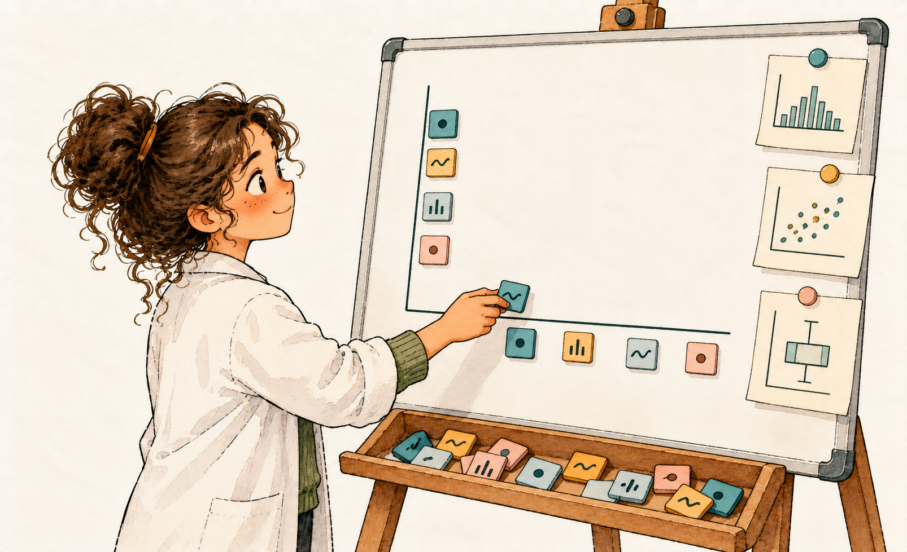

# EDA using GwalkR {#sec-eda-gwalkr}

By the end of the last chapter, you had a full page of firm opinions about `cell_data`: it isn't normal, it isn't linear against DPI, and PDGFR-β and GFAP seem to be telling a related story. Those are solid conclusions, but notice that every single one of them arrived because I picked the geom. I decided we'd look at a density plot first, then a scatter plot, then a raincloud plot, in that order, for those two variables specifically. That's exactly how directed EDA is supposed to work, and I'd do it the same way again.

But I'll be honest about something every experienced data analyst quietly knows: the questions worth asking about a new dataset rarely show up in the order you'd plan for them. Sometimes you just want to grab the data and drag things around (try a boxplot here, a histogram there, swap the x and y axis on a whim) before you've committed to a specific question at all. You don't want to write a `ggplot()` call for every idle curiosity; you want to poke.

That's the gap [GWalkR](https://github.com/Kanaries/GWalkR) [@gwalkr] fills. Think of it as handing your dataframe to a sharp-eyed collaborator who doesn't write R but has excellent visual instincts. They'd want to drag `DPI` onto one axis, `Gfap_IntDen` onto the other, try a color split by treatment group, and see what jumps out, all without asking you to write a single line of code first. GWalkR gives you exactly that: a Tableau- or Power BI-style drag-and-drop interface, running entirely inside your R session, directly on `cell_data` (@fig-eda-gwalkr-board).

{#fig-eda-gwalkr-board fig-align="center" width="90%" fig-alt="Watercolor sketch of a researcher in a lab coat and green sweater lifting a small colored tile from a wooden tray toward the horizontal axis of a white magnetic board. Other tiles with tiny icons sit along both axes, and three small pinned sketches of a histogram, a scatter plot and a box plot hang at the board's right edge."}

## Turning the data loose

I want to be clear about what this buys you and what it doesn't. GWalkR is not a replacement for the deliberate, question-first EDA from the last chapter; it's a complement, best used *before* you've settled on what to look for, or when you suspect there's something in the data you haven't thought to ask about yet. It's a tool for generating hypotheses, not for reporting them. Once GWalkR shows you something interesting, the right next step is almost always to go build that specific view properly in `ggplot2`, the way we did in @sec-eda-ggplot, so it's reproducible and citable rather than a screenshot of a session that's already closed.

With that expectation set, firing it up takes three lines:

::: {.content-visible when-format="html"}
```{r}
library(GWalkR)
library(here)

# Read the cell data (one row per animal)
cell_data <- read.csv(here("project/AnalysisData/Cells_Gfap-Pdgfrb.csv"))

# Open the drag-and-drop explorer on the whole table
gwalkr(cell_data)
```
:::

::: callout-note
### A quick note for the print/PDF edition

GWalkR is an interactive, point-and-click widget: there's no static chart I can freeze onto this page that would give you the actual experience of dragging variables around and watching the plot rebuild itself. Rather than fake it with a screenshot that goes stale the moment you'd want to try something different, I've left this section HTML-only. If you're reading the PDF, this is the one part of the book worth switching to [the web edition](index.qmd) for; everything else reads the same either way.
:::

## Where this leaves us

Free exploration like this is great at surfacing "huh, that's odd" moments, but it doesn't replace a stated question and a deliberate answer. Sooner or later, GWalkR is going to show you two columns that seem to move together, and dragging them around a scatterplot won't tell you whether that's a real relationship worth building into a model, or two ways of measuring almost the same thing in disguise. That's a sharper question than a point-and-click widget can browse its way to: *which of these variables are quietly telling me the same story twice?* Answering it properly is exactly where we're headed next.
