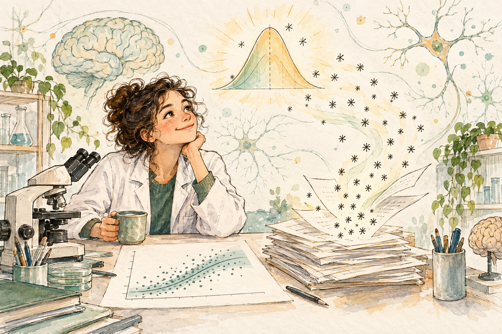
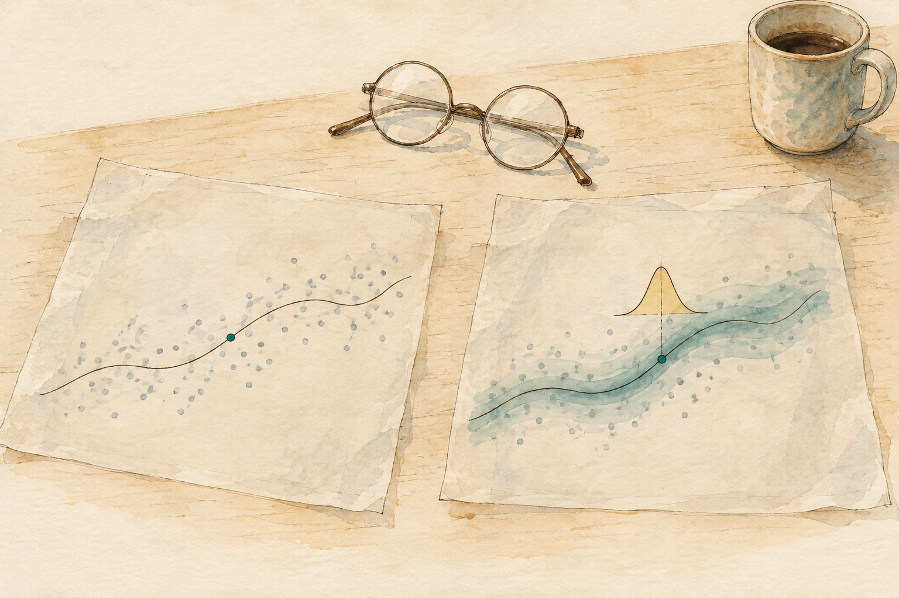

# Welcome {.unnumbered}

Picture a quiet afternoon at the bench. The sections are stained, imaged, and quantified; the spreadsheet is open; the lab meeting is on Thursday. You have two groups, and someone (a reviewer, a labmate, your own nagging conscience) asks whether the difference between them is "real." You reach for the t-test you were taught in a methods course, out comes a p-value, and somewhere in the back of your mind a small voice asks: *but what did that number actually tell me?*

If that voice sounds familiar, this book was written for you. @fig-welcome-asterisks is the picture I keep in mind: the asterisks drift away, and what stays behind is a model.

{#fig-welcome-asterisks fig-align="center" width="100%" fig-alt="Watercolor sketch of a smiling scientist in a lab coat resting their chin on one hand at a bench with a microscope and a mug, gazing up at a glowing bell-shaped distribution while little asterisks float off a stack of papers like dandelion seeds. A scatterplot with a fitted curve and an uncertainty band lies on the desk, and brain and neuron doodles fill the background."}

## Who is talking

I'm Daniel, and I'm a neuroscientist, not a statistician. That matters more than it might seem. Most statistics books are written by people who think about data for a living and are explaining it to people who are (reasonably) not thrilled to be there. This one is written from the other side of the table. I spent most of my research career trying to understand how the brain scars, and sometimes recovers, after an injury like a stroke, the last stretch of it (until 2024) at the Laboratory of Neurovascular Interactions at Université Laval, in Quebec. My days were spent with tissue, microscopes, and images, not with proofs. Today I work as a research data curator at the Digital Research Alliance of Canada, where I help scientists prepare their datasets so that other people can find them, understand them, and reuse them.

The statistics came later, and they came out of necessity. During my doctoral studies at the International Graduate School of Neuroscience in Bochum, Germany, I kept running into the same uncomfortable realization: the tools I had been taught (t-tests, ANOVAs, and the p-values they produce) did not answer the questions I was actually asking. I wanted to know how large an effect was, how uncertain I should be about it, and what the data could and couldn't tell me about a process that unfolds over time and across tissue. What I got back was a verdict on a null hypothesis nobody believed in the first place. So I did what a stubborn graduate student does: I started teaching myself statistical modeling, and I ended up somewhere I didn't expect.

That somewhere was probability. Once I understood that a model is a small story about how the data came to exist, and that Bayesian inference is simply the disciplined way of asking what that story implies once you've seen the evidence, I was hooked. I still am. It changed how I design experiments, how I read papers, and how I argue with myself about my own results. Since then I've blended it with image processing and machine learning (including automated, unbiased cell-counting pipelines in Python, so nobody has to count nuclei by hand ever again), and I also lecture on research design and data management for a doctoral program in behavioral neuroscience in Bogotá. This book is, in a way, everything I wished someone had handed me back in Bochum.

So you won't find me talking about "subjects" and "treatments" in the abstract. You'll find glial scars after cerebral ischemia, mice crossing a hanging wire, spike counts, the messy and beautiful stuff we actually measure. When a technical term shows up, I'll try to give you something familiar to hang it on before I give you its formal name, and I'll try not to water down the math or the assumptions while I do it. Warm, yes. Sloppy, never.

## What makes this book different

Four decisions shape everything that follows.

**Bayesian first, frequentist always alongside.** The main line of the book is [Bayesian modeling with `brms`]{style="color:green; font-weight:bold;"}, which fits models with MCMC and hands back a full posterior distribution instead of a single number and a p-value. I have a firm opinion about why, and I lay it out in the next section. But I don't pretend the other tradition doesn't exist: it is the language of most of the papers you'll read and review. So every applied model is shown side by side with its frequentist counterpart (`parsnip`, `lm`, and `glm` early on, `lme4` and `glmmTMB` once we get to multilevel models), and each chapter closes by saying where the two agree and where they part ways. Small samples, weakly identified effects, and priors that steady an estimate a frequentist fit can't stabilize are the places where the difference is worth knowing. The comparison is there so you can see the models for yourself, and so you can read the frequentist literature with a critical eye. @fig-welcome-lenses is the whole idea in one picture.

{#fig-welcome-lenses fig-align="center" width="90%" fig-alt="Watercolor sketch of two sheets of tracing paper on a wooden desk, each laid over the same scatter of dots. The left sheet shows a single thin fitted line with one teal point; the right sheet shows the fitted line wrapped in a wide teal uncertainty band with a small ochre bell curve rising from one point. A pair of round spectacles and a coffee mug rest at the top of the desk."}

**Real neuroscience, not `mtcars`.** The examples come from real experimental data, in a small set of datasets that recur and grow more demanding as the book goes on, starting with a histology study of the glial response after ischemia. You'll get to know these datasets the way you know your own: their quirks, their limits, and the questions they can and can't answer.

**Practice before theory.** Every chapter opens on a question you might really ask and a dataset that might really answer it. The theory arrives when the question needs it, not before. If you've ever closed a stats textbook at page 40 because you still hadn't seen a single thing you cared about, you'll understand why.

**Figures and sentences you can reuse.** Most papers in our field show bars with asterisks, a bar with an error whisker, or a boxplot. The figures here show every animal and the uncertainty around the estimate instead, and the first time each kind of figure appears I say which package draws it, why it takes that form, and what a bar with asterisks would have hidden. Where a result is interpreted, a box called "How to report it" gives the sentence you could paste into a Results section, in place of "there is a significant difference between X and Y."

## Who this book is for

For the bench neuroscientist who got tired of the ritual: run the test, look for the asterisk, write "significant" or "n.s.," move on. I did it myself for years, and nobody ever explained to me what the alternative looked like. This book is that explanation, in R, on data that looks like yours.

## Where I stand

I want to be upfront about my position, because you'll feel it on every page. A results section full of asterisks and verdicts of "significant" or "not significant" does not answer a scientific question. It answers a much smaller and stranger one (how surprising would these data be if an effect of exactly zero were true?) and then dresses the answer up as a discovery. What actually answers scientific questions are [mathematical and statistical models]{style="color:green; font-weight:bold;"}: explicit, testable claims about how a process works and how it could have produced the numbers in front of us. And those are precisely what we scientists rarely build, rarely show, and rarely discuss, because we are busy hunting for the asterisk.

I think that gets our job backwards. Our task is to [generate theoretically grounded statistical models that could plausibly have produced our data]{style="text-decoration: underline;"}, and then to ask, honestly, how well they do it, where they fail, and how uncertain we remain. I don't know a better tool for that job than Bayesian statistics. It makes you state your assumptions as priors and likelihoods instead of hiding them inside a default test. It treats uncertainty as the answer instead of an inconvenience. And it lets you write down a model shaped like your experiment, however tangled that experiment is, instead of bending your experiment to fit a test that already existed. That is the position this book argues for. You are welcome to disagree, and the side-by-side frequentist fits are there so you can check my reasoning against the alternative rather than take my word for it. (@sec-appendix-p-values collects the argument against p-values in one place.)

A fair caution about the target of my criticism: it is the ritual of significance testing, not every tool that happens to be frequentist. A well-built frequentist model is still a model, and we'll fit plenty of them. What I object to is what happens when the model disappears and only the asterisk is left.

You don't need a statistics background. You do need some curiosity, and a little patience with R. If you're new to the language, don't worry: I explain each piece of code before it runs, and the point is always the question, not the syntax. If you already know your way around a model, I hope the side-by-side comparisons and the honest failures (models that don't fit, assumptions that break) will still teach you something. I'm an admirer of the way @mcelreath2020 taught a generation to think about models as stories about how data get made, and that spirit runs through these pages.

## How to read it

The book lives in two forms built from the same source: an interactive HTML edition and a PDF. In the HTML version you'll sometimes find figures you can hover over and tools you can play with; in the PDF, every interactive element has a static counterpart (or a note pointing you to the web edition when there's no sensible static version), so nothing important is lost.

More important than the format: [nothing is hidden]{style="text-decoration: underline;"}. And I want to argue for that plainly, rather than just mention it as a nice habit, because I think a model is only worth building if someone other than its author can actually check it.

For most of the history of modern science, trust was the default setting: a paper described what was done, a journal put its name behind it, and we took the results on faith, methods section included. That era needs to end, and honestly, it already is ending, just not gracefully. Outright fraud keeps surfacing in prestigious labs and flagship journals with a regularity that should alarm you more than it currently does. Underneath the outright fraud sits something more common and, in a way, more corrosive: an incentive structure that rewards a steady stream of publications rather than a steady stream of *correct* ones, where the paper is the product and whether its claims are actually true becomes somebody else's problem, indefinitely deferred. Neuroscience has its own well-documented version of this. A field-wide audit found the typical study powered at around 20%, meaning most published neuroscience experiments had roughly a one-in-five chance of detecting the very effect they claimed to find, even if that effect were completely real [@button2013]. That's not a rounding error. That's a discipline that had, for a long stretch, made peace with running experiments unlikely to work and calling the ones that did "discoveries."

A statistical model is one of the few outputs of this whole enterprise that can actually be held accountable, because it makes an explicit, falsifiable claim: given this data and these assumptions, here is exactly what I believe and how sure I am of it. A results section built around "statistically significant" and a tidy narrative wrapped around that verdict cannot be checked the same way. It's a story, told persuasively, with the receipts left in a drawer nobody else is allowed to open. I think that has the priority backwards. The model, and the data it was fit to, deserve to be a primary output of a scientific project in their own right [@munafo2017]: sitting in the open, next to the paper, not locked away as "available upon reasonable request", so that "trust me" stops being an acceptable substitute for "here, check for yourself."

My current job makes this concrete for me daily: I spend my time helping researchers make their datasets reusable by people they'll never meet, and I've watched how much science quietly evaporates when data can't be understood a year later, even by the people who collected it. Since I'm asking you to trust the models in this book, the least I can do is put every step where you can inspect it. (@sec-appendix-open-science tells the longer version of this argument.) All the code is on the page and reproducible, and the source lives in the book's repository. There is no "and here the magic happens" step. The slow Bayesian fits are cached so the book doesn't have to refit its chains every time it's built, but you can delete the cached files and rerun them yourself, and I encourage you to. Break things. Change a prior. See what moves. @fig-welcome-watch is the picture of that promise: every gear in view.

{#fig-welcome-watch fig-align="center" width="90%" fig-alt="Watercolor sketch of an open brass pocket-watch with a glass back showing teal and ochre gears, the central one marked with a small bell curve. A screwdriver, tweezers and a loose teal gear lie beside it, and a stack of notebooks fades into the background."}

::: callout-tip
Read it in order the first time. The chapters build on one another, and the datasets return with more complicated questions, so a later chapter will sometimes ask you to remember what we learned about the same data earlier. After that, treat it like a reference and jump around.
:::

## A quick look at where we're going

The book has six parts, plus a web-only collection of exercises and a back section with appendices, a glossary and an index. I'll keep this brief, because each part opens with its own introduction that tells the story properly.

1.  **Foundations.** What it means to model, and the mechanics of Bayesian inference itself: priors, likelihoods, posteriors, how MCMC gets you there, and how to check whether you should trust the result.
2.  **Data exploration.** Before any model, learn to look. Distributions, relationships, anomalies, and the habits that keep you from feeding a model something it shouldn't eat.
3.  **Linear models.** The workhorse. From a single predictor to several, and how far a straight line can be trusted.
4.  **Generalized linear models.** What to do when the outcome is a count, a yes or a no, a proportion, or a crossing time with the odd extreme value: the shapes neuroscience data usually takes, and the one recipe that handles them.
5.  **Multilevel and advanced models.** Where the real structure of our experiments lives: cells in sections in animals, trials in neurons, measurements over time, values the microscope could not see. This is where I think the book earns its keep, and it's still under construction as I write this.
6.  **Spatial and structural analysis.** Tissue has geometry. Do cells cluster, avoid each other, or follow a vessel? How do the shapes of cells and vascular networks differ between groups? This part is also still ahead.

After the parts, **Exercises** (web edition only) will grow into a collection of reanalyses of interesting published datasets. At the back, the **glossary** explains in more depth the concepts that carry the book, and the **index of key terms** points to every chapter where each one is defined or used.

That deserves honesty: the book is a work in progress. Some chapters are polished, some are drafts, and some are still ideas on a whiteboard. In the menu, the chapters that are only a title are the ones still ahead. I'd rather show you the real state of things than pretend it's finished.

Ready? Let's go look at some data.
