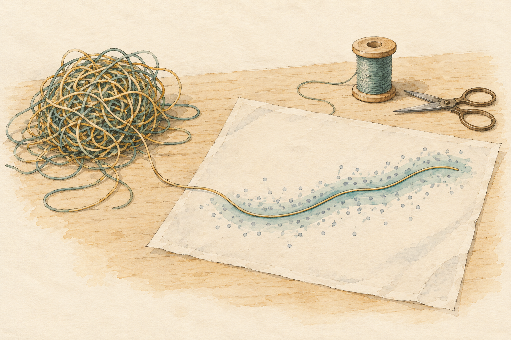
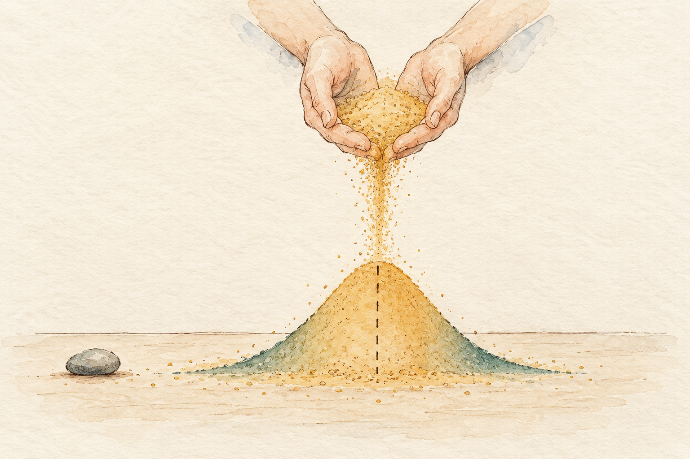
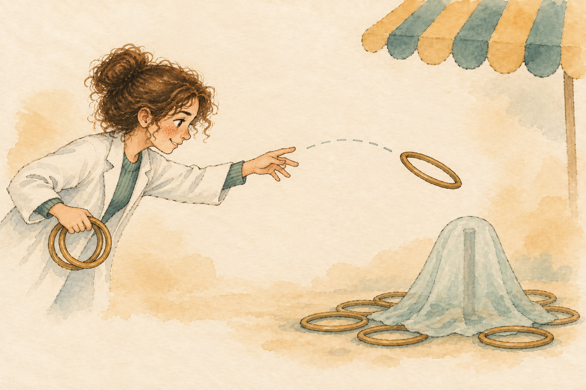

# Why model? A first worked example {#sec-intro-applied-modeling}

```{r}
#| include: false

library(ggplot2)

Plot_theme <- source("functions/plot_theme.R")
Plot_theme <- Plot_theme$value
```

You've probably had this exact moment: you're staring at a plot of your own data, treatment group next to control, and a labmate leans over your shoulder and says "yeah, those look pretty different." You both nod, and the conversation moves on, without either of you ever writing down what "different" means or how sure you actually are about it. I've had that exact conversation more times than I'd like to admit, and it's the reason this book exists.

Statistical models are how we make that moment rigorous instead of just vibes-based. Whether we're studying the firing of individual neurons, the number of cells in a specific brain region, or the expression of extracellular matrix molecules, a model gives shape to our scientific inferences and forces us to say precisely what we mean. I invite you to think of statistical modeling as the recognition that our data is not merely a collection of disconnected points, but the result of an underlying process that we, as scientists, want to bring to light. Embracing that perspective is crucial to understanding the job we actually do as researchers. We are not here to calculate p-values and declare "there is a significant difference." We are here to uncover which process could have plausibly generated the data sitting in front of us.

::: callout-tip
### Why not p-values?
You'll notice this book barely mentions p-values, and rarely kindly when it does. That's not a stylistic tic. A p-value doesn't actually answer either question a scientist has: "how big is this effect?" and "how sure am I?" It only tells you how surprising your data would be if the effect were exactly zero, which is rarely the question anyone is asking. Worse, treating "p < 0.05" as a lexicographic gate, significant first and everything else (prior evidence, plausibility, study quality) a distant second, is precisely the practice a task force of the American Statistical Association singled out as corrosive to the field [@wasserstein2019], and that a follow-up paper argued should be abandoned outright rather than patched with a stricter threshold [@mcshane2019]. @sec-appendix-p-values unpacks exactly why; for now, just notice that every model in this book reports an effect size and an interval instead.
:::

Let me push on that a little harder, because it's easy to nod along and then go run a t-test anyway. When we measure cell counts in a proliferation assay or assess marker intensity to understand protein expression, we are observing outcomes that emerge from a biological mechanism we are trying to describe using a statistical model. Newton let us know that the force of gravity decreases as the square of the distance. Thank goodness he didn't just tell us that the Sun exerts a "significantly greater" force on the Earth than on Mars. That would certainly not have helped us to explore the red planet. The mathematical model he built did.

{#fig-intro-orbits fig-align="center" width="85%" fig-alt="Watercolor sketch of a notebook page with an ink diagram of the Sun, Earth and Mars on elliptical orbits, a dashed arc with a small paper rocket leading from Earth to Mars, and a small apple resting in the lower corner of the page."}

Our modeling strategy has to be theoretically motivated, not just descriptive. We're not here to capture a trend, we're here to propose a hypothesis about the data's origin. Say we're examining cerebral ischemia's effect on astrocyte activation: a theoretically motivated model might build in assumptions about how the tissue responds over time, or account for baseline differences between animals. Those choices aren't decoration bolted onto the model afterward; they shape its structure and how we read its parameters once it's fit. Rather than describing associations or handing out verdicts of "significantly different" from an uninformative metric, a well-conceived model tries to approximate the biological system itself, turning a scientific question into something quantifiable and testable. All models are wrong, of course (none of them captures reality as it actually is), but some are genuinely useful for understanding neurobiology, and some aren't, and that difference is worth caring about.

The process of building these theoretically motivated models in neuroscience involves several steps, from defining hypotheses, stating assumptions, and selecting variables, to fitting models and interpreting results. Our model acts as a bridge between our data and the biological phenomena we seek to understand. In this chapter, we touch the surface of statistical modeling to familiarize ourselves with the general steps and tools we'll use throughout the book, and we do it by working through one complete example from start to finish, rather than staying in the abstract.

## Why statistical modeling is the way

{#fig-intro-tangle fig-align="center" width="90%" fig-alt="Watercolor sketch of a tangled ball of ochre and teal thread on a wooden bench, with one thread pulled free and laid across a sheet of dotted paper as a smooth curve through the dots, surrounded by a soft teal band. A wooden spool and scissors rest nearby."}

You know this feeling already: you've got a spreadsheet full of cell counts, fluorescence intensities, area measurements, morphological scores (a small mountain of numbers that took months of bench work to produce), and it just sits there, refusing to tell you anything on its own. That's not a failure of your data. Basic neuroscience research produces exactly this kind of complex, noisy, hard-won data, and it has enormous potential to reveal how the nervous system actually works. But it won't do that unassisted: it's shaped by the biological process you're trying to understand, by the experimental conditions you imposed, and by an overlay of noise and variability that's genuinely difficult to see through by eye alone. Turning that pile of numbers into an answer is your job, not the spreadsheet's.

The most powerful tool we have for that job is statistical modeling. Remember Newton's model of gravity from a few paragraphs ago? Same idea, much smaller scale: a statistical model is a simplified mathematical stand-in for reality, good enough to be useful even though it isn't the thing itself. Take a study of cerebral ischemia's effect on astrocyte activation: the data might include marker intensities from sham-operated and ischemic animals, with all the inherent messiness of an in-vivo experiment. By modeling it, we can quantify how the injury changes astrocyte activation while keeping the uncertainty in that estimate honest, rather than collapsing it into a single yes/no verdict. We're not chasing asterisks on a graph; we're trying to recover the parameters of whatever process actually generated the numbers in front of us.

Beyond quantifying a marker, then, statistical modeling embodies a theoretical proposition: that the injury affects this marker in a predictable way, and that we can uncover parameters describing both the size of that effect and how sure we are about it. Skip the theoretical grounding, and statistical analysis reduces to pattern recognition dressed up with asterisks and p-values, disconnected from the actual scientific question. A few of the everyday headaches this kind of modeling can actually help you with:

-   **Biological variability:** You ran the exact same protocol on two cohorts of animals, same strain, same age, same surgeon, same day, and they still didn't behave identically. That's not sloppy technique; it's biology being biology, and no amount of standardization erases it. A good model doesn't pretend this variability away; it estimates it.

-   **Experimental/technical noise:** Even the measurement itself isn't perfectly faithful. Image a slide on a good day versus a rushed one: slightly different laser power, a slightly different focal plane, and the same tissue reads out a different fluorescence intensity. Statistical modeling gives you a principled way to say how much of that wobble is the instrument talking, and how much is the biology.

-   **Confounding factors:** Maybe half your sections were processed months after the other half, on a different antibody lot. You can't undo that after the fact, but a well-specified model can account for it, so the effect you report is actually the injury's effect, not a batch effect wearing the injury's clothes.

## The R, Stan, and brms ecosystem

Here's a scene you'll recognize: you finally know what model you want to fit. You know what you're comparing, what you're controlling for, and now you have to actually get R to do it. This is where I introduce the two tools that will do that work for the rest of the book, plus a small mental model of what's happening underneath, so the output feels earned rather than magic.

Think of fitting a Bayesian model the way you'd think of asking a genuinely thorough colleague for their opinion on your hypothesis. You tell them what you already believed walking in (that's the *prior*), and you show them the data. Instead of handing you back a single number, they hand you back a whole spread of plausible answers, weighted by how well each one actually fits everything you showed them: the values that fit well are heavily represented, the ones that don't are barely there at all. That spread is the *posterior distribution*, and keeping the whole shape of it, instead of collapsing it into one estimate, is the entire point of doing this the Bayesian way. The machinery that actually produces that spread (drawing thousands of plausible parameter values and letting them accumulate into that shape) is called Markov Chain Monte Carlo, or MCMC, and we'll get comfortable with what's happening inside it over the next couple of chapters. For now, what matters is the tool: `brms` [@brms] lets us hand R a familiar model formula and have it write and run the underlying [Stan](https://mc-stan.org/) code for us, so we get that full posterior without hand-coding any of the sampling ourselves.

{#fig-intro-sand-posterior fig-align="center" width="85%" fig-alt="Watercolor sketch of two cupped hands pouring ochre sand onto a table, where it forms a bell-shaped pile with teal-tinted edges and a dashed vertical line at its center. A single small pebble sits alone to one side."}

::: callout-tip
### Are priors just "subjective"?
Here's the objection you'll hear the moment you mention priors to a skeptical colleague: "isn't that just you putting your thumb on the scale before you've even looked at the data?" It's a fair question, and it deserves a real answer instead of an eye-roll. A prior isn't a guess pulled out of thin air. In this book it's almost always a summary of scientific knowledge that already exists: what a plausible GFAP intensity looks like from the published literature, what effect sizes are even biologically possible given how astrogliosis actually works, what your own pilot data already told you. That's not bias smuggled into the analysis; it's information, and refusing to use information you already have isn't more objective. It's just wasteful. A frequentist analysis, by construction, treats every experiment as though it were the first one anyone had ever run on the question: everything you already know has to stay outside the model and get folded in informally, in the discussion section, instead of shaping the inference itself. Bayesian inference lets you put that prior knowledge exactly where it belongs: inside the model, doing real work, written down explicitly where a reader can see it, question it, and check how much it actually mattered [@mcelreath2020]. That's not a weakness of the framework relative to frequentist statistics. It's arguably its single biggest advantage.
:::

`parsnip` [@parsnip] plays a more modest, workmanlike role: it's a common interface so the same model specification can be fitted by different engines (`lm` for ordinary least squares, or a penalized-regression engine if you ever needed one) without rewriting your code every time you change your mind about how to fit it. It's part of the `tidymodels` ecosystem [@kuhn2020], and it's our frequentist counterpart throughout the book.

This book leans on `brms` as its primary line: that full posterior, and the ability to fold real prior scientific knowledge into the model, is why we anchor interpretation there. But every applied model gets fit both ways, Bayesian and frequentist side by side, in the same spirit as @inchausti2023's dual treatment of these approaches for life scientists. Seeing where the two agree, and later in the book, seeing exactly where and why they part ways, will teach you more about what each one is actually doing than learning either in isolation ever would.

## A first worked example: does ischemia activate astrocytes?

Let's put this into practice with a real question and real data. After a cerebral ischemic injury, astrocytes become reactive, a process called astrogliosis, commonly tracked by staining for GFAP (glial fibrillary acidic protein). A natural first question is about as simple as questions get: **does the injury actually increase GFAP intensity, compared to an animal that underwent the same surgical procedure without the arterial occlusion (a sham surgery)?**

We'll use the `cell_data` table (the same dataset we will return to throughout the linear-models part of this book), restricted to two groups measured close in time: sham-operated animals (`SHAM`) at day 0, and ischemic animals (`MCAO`) at day 3 post-injury, the earliest post-ischemic timepoint in the dataset.

```{r}
library(here)

cell_data <- read.csv(here("project/AnalysisData/Cells_Gfap-Pdgfrb.csv"))

cell_data_sub <- subset(cell_data, DPI %in% c(0, 3))
cell_data_sub$Condition <- factor(cell_data_sub$Condition, levels = c("SHAM", "MCAO"))
```

```{r}
#| label: tbl-intro_cell_data_tbl
#| tbl-cap: Sham vs. ischemic animals, GFAP intensity

library(gt)
gt(cell_data_sub[, c("MouseID", "DPI", "Condition", "Gfap_Intensity")])
```

A quick visualization already tells us most of the story. With only seven sham and eight ischemic animals, a boxplot would be lying to you a little: quartiles and whiskers imply a stability that seven points just don't have. So we plot the animals themselves and nothing else, and let the model do the summarizing:

```{r}
#| label: fig-intro_gfap_points
#| fig-cap: GFAP intensity by condition
#| fig-width: 5
#| fig-height: 5

ggplot(
  data = cell_data_sub,
  aes(x = Condition, y = Gfap_Intensity, color = Condition)
) +
  geom_jitter(width = 0.08, size = 2.5) +
  scale_color_manual(values = c("SHAM" = "#0072B2", "MCAO" = "#D55E00")) +
  labs(x = "", y = "GFAP intensity") +
  Plot_theme +
  theme(legend.position = "none")
```

The two groups barely overlap. Now let's put a number, and an uncertainty, on that difference. Statistically, comparing two groups is nothing more than a linear regression with a single categorical predictor. If we code $\text{Condition}_i$ as an indicator that is $0$ for `SHAM` and $1$ for `MCAO`, the model is:

$$
\text{Gfap}_i = \beta_0 + \beta_1 \cdot \text{Condition}_i + \epsilon_i, \quad \epsilon_i \sim \mathcal{N}(0, \sigma^2)
$$

Here $\beta_0$ is the expected GFAP intensity for a sham animal (when $\text{Condition}_i = 0$), and $\beta_1$ is how much that expectation shifts for an ischemic animal. This is exactly the same model a two-sample t-test relies on: a t-test is a special case of this linear model with one categorical predictor with two levels [@gelman2020].

Let me be blunt about why this notation is worth your effort, because it's tempting to wave it off as something only the statistician in the room needs. It isn't. If you do science (if you generate data, analyze it, and put your name on the conclusions), reading $\beta_0$ and $\beta_1$ and saying plainly what each one means, and how sure you are of it, isn't optional literacy. It's the job. Every animal in that dataset, every hour of surgery and staining and imaging, was bought with public money on the promise that someone would actually answer the question it was collected to answer. Squinting at a plot to count asterisks and calling that an answer is how we keep spending that money to ask the same question badly, over and over, without ever quite answering it. Learning to read a coefficient and its interval is the entire difference between reporting a result and understanding one. That's the standard this book is going to hold you to from here on.

A plain `lm()` would give us a single number for $\beta_1$ and a confidence interval built on an asymptotic approximation, usually fine with a large sample, shakier with the fifteen animals we actually have here. `brms` fits the same linear model, but instead of one interval it hands back the full posterior distribution: every plausible value for the effect, weighted by how well it explains what we saw. One more thing worth flagging honestly before we run it: we haven't told `brms` anything about what a plausible GFAP effect looks like, so it falls back to its own defaults: an essentially flat prior on $\beta_1$ itself, and a mildly regularizing one on the intercept and residual noise. That's a deliberate choice for this first model, not an oversight: eliciting priors on purpose is the whole subject of @sec-priors-regularization, and seeing what "no real prior information" looks like first gives us something to compare that against.

::: panel-tabset
### brms

```{r}
library(brms)

brms_model <- brm(
  Gfap_Intensity ~ Condition,
  data = cell_data_sub,
  seed = 123,
  file = "models/intro-applied-modeling_fit1.rds",
  file_refit = "never"
)

summary(brms_model)
```

Before trusting any of these numbers, it's worth a glance at whether the sampler actually did its job: Rhat sits at 1.00 for every parameter (comfortably under the 1.01 threshold that indicates the chains agree with each other), both bulk and tail effective sample sizes are well past 2,000 (far above the 400 we'd want as a minimum), and there's no divergent-transition warning anywhere in the output. That's what a trustworthy fit looks like: cheap to check, and worth checking every single time, not just when something looks off.

### parsnip

```{r}
library(parsnip)
library(broom)

parsnip_model <- linear_reg() %>%
  set_engine("lm") %>%
  fit(Gfap_Intensity ~ Condition, data = cell_data_sub)

tidy(parsnip_model, conf.int = TRUE)
```
:::

Both approaches point to the same story, and it's worth reading the actual numbers rather than skimming past them to the stars in a table. The intercept ($\beta_0$) recovers the average GFAP intensity in sham animals at essentially the same value in both fits (30.03 for `brms`, 30.0 for `lm`), and the `ConditionMCAO` coefficient ($\beta_1$) puts the increase three days after ischemia at 107.50 (`brms`) and 107 (`lm`): a sham animal sits around 30 units of GFAP intensity, and an ischemic one sits around 137. The 95% intervals agree just as closely: $[84.31, 131.80]$ for the credible interval, $[84.5, 130]$ for the confidence interval, comfortably clear of zero either way.

So let's actually answer the question we opened this chapter with, using exactly those numbers and nothing else: three days after ischemia, GFAP intensity rises to roughly four times its sham baseline, and the credible interval above tells us that's a real, well-pinned-down increase, not a shrug dressed up in decimal places. Notice what that sentence didn't need. It didn't say "ischemia had a significant effect on GFAP intensity." That sentence would have told you nothing at all: not how big the effect is, not how sure we are of it, not whether it's biologically trivial or dramatic. The coefficient and its interval *are* the answer. "Significant" is just noise standing where an answer belongs.

But notice what I just did in that same paragraph: I quoted the credible interval and could just as easily have quoted the confidence interval instead, as if the two meant the same thing because they land on nearly the same numbers. That's usually where people stop looking, treating "the effect and its 95% interval" as one interchangeable idea. It isn't, and it's worth slowing down here, on the very first model in the book, rather than letting that habit start early.

Picture a carnival ring-toss game where the stake is fixed in the ground and hidden from you. The game is designed so that, over a long run of players, 95% of the tossed rings land around the stake. You throw one ring. Did *yours* land around the stake? You genuinely can't tell: all you know is the long-run batting average of the game itself, not this particular throw. That's a **confidence interval**. In frequentist statistics, $\beta_1$ is a fixed, unknown constant (the stake), and probability describes the long-run behavior of the procedure across many hypothetical repeats of the experiment, not this one throw of it [@gelman2020]. Once we've calculated one specific interval, like `parsnip`'s `conf.low`/`conf.high` above, the true effect either sits inside it or it doesn't: the probability at that point is 0 or 1, not 95% [@kruschke2015]. Reading it as "there's a 95% probability the true effect is in $[84.3, 131.8]$" is a well-known misstep, sometimes called the frequentist fallacy, and one that shows up constantly in the neuroscience literature, usually from people who never had a reason to doubt it.

{#fig-intro-ring-toss fig-align="center" width="90%" fig-alt="Watercolor sketch of a researcher in a white lab coat and green sweater tossing a ring at a carnival game. The stake is hidden under a translucent teal veil, with many earlier rings lying clustered around it, and a striped ochre and teal awning frames the top corner."}

The Bayesian version is a genuinely different game. Go back to the thorough colleague from the last section: you showed them this exact dataset, and they handed you back a whole distribution of plausible effect sizes, weighted by how well each one fits what you showed them. When they draw a boundary capturing 95% of that distribution, they *are* making a direct probability statement about the effect itself: given this data and these priors, there's a 95% probability the true effect sits in that range [@mcelreath2020]. That's `brms`'s `l-95% CI`/`u-95% CI`, and it's called a **credible interval** precisely because it earns the interpretation people instinctively (and wrongly) give to the frequentist one. One more precision worth having early: `brms` reports this particular flavor of credible interval, an **equal-tailed interval** that trims 2.5% off each tail of the posterior, rather than the narrower **highest-density interval (HDI)** you'll see reported elsewhere. The two agree when the posterior is roughly symmetric, as it is here, but can disagree for skewed posteriors, where the HDI is the more honest summary [@kruschke2015].

A table of quantiles makes that distribution easy to describe but easy to misread as another hard-edged bound, exactly the interpretation we just spent two paragraphs arguing against. So let's actually look at the posterior instead of just quoting two numbers from it: the full shape is the point, not just where it happens to cross 95%.

```{r}
#| label: fig-intro_posterior_halfeye
#| fig-cap: Posterior distribution for the MCAO effect on GFAP intensity
#| fig-width: 6
#| fig-height: 3.5

library(ggdist)
library(posterior)

draws <- as_draws_df(brms_model)

ggplot(draws, aes(x = b_ConditionMCAO, y = 0)) +
  stat_halfeye(.width = c(0.5, 0.95), fill = "#D55E00", point_interval = "median_qi") +
  geom_vline(xintercept = 0, linetype = "dashed", color = "grey40") +
  labs(x = "Posterior for the MCAO effect on GFAP intensity", y = NULL) +
  Plot_theme +
  theme(axis.text.y = element_blank(), axis.ticks.y = element_blank())
```

Every value on that curve is a plausible size for the ischemia effect, weighted by how well it fits the data and the (flat, in this case) prior: the dot marks the posterior median, the thick and thin bars the 50% and 95% credible intervals, and the dashed line at zero is nowhere near the bulk of the distribution. That shape, not a single interval quoted in isolation, is what "95% probability the effect is in this range" actually looks like.

::: callout-tip
### Frequentist equivalent

`brms` and `lm` land on almost identical numbers here, and now we can say exactly why: with a flat prior on $\beta_1$, the posterior is shaped by the likelihood alone, and the likelihood is precisely what `lm` maximizes to get its own estimate. Diffuse-to-flat priors letting the data do essentially all the work is the general reason Bayesian and frequentist point estimates tend to agree in large, well-behaved samples. That won't always hold. Later in the book, once we work with smaller samples, rarer outcomes, or hierarchical structure, you'll see the two approaches diverge more visibly, and the reason will be an actual, informative prior doing regularizing work that the frequentist fit has no mechanism to do.
:::

That's the whole workflow in miniature: ask a real question, look at the data, write down a model that encodes the question, fit it, and interpret the parameters, not a p-value. Notice what we deliberately skipped: we never asked whether this model's predictions actually resemble the data we started with, we just trusted the coefficients. That's not an oversight, it's next chapter's job: a **posterior predictive check** is exactly the tool for that question, and it deserves its own careful treatment rather than a rushed paragraph here. Everything in the rest of Part 1 is about doing each of these steps more carefully: what a Bayesian model actually represents (@sec-bayesian-core-workflow), how to choose priors deliberately instead of by default (@sec-priors-regularization), and how to check whether a fitted model actually describes the data well (@sec-mcmc-model-checking).

