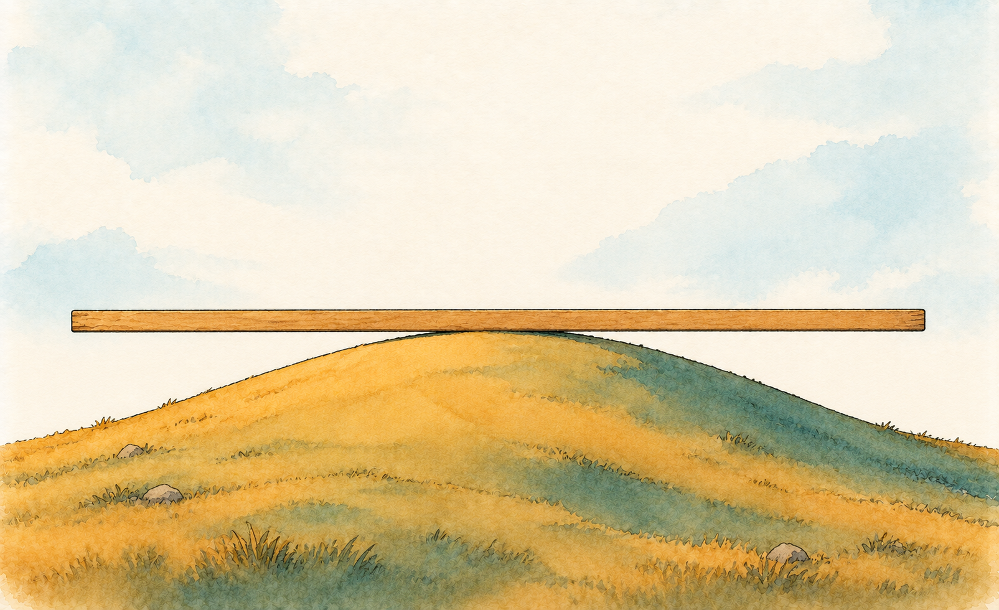

# Checking whether the line deserves your trust {#sec-linear-regression-assumptions}

```{r}
#| include: false

library(ggplot2)
library(gt)
library(here)
library(patchwork)

# The book's shared plot theme (this also loads the legend helpers)
Plot_theme <- source("functions/plot_theme.R")
Plot_theme <- Plot_theme$value

# Read the cell data (one row per animal)
cell_data <- read.csv(here("project/AnalysisData/Cells_Gfap-Pdgfrb.csv"))

# Day as a number (for the straight line) and as a category (for per-day summaries)
cell_data$DPI <- as.numeric(cell_data$DPI)
cell_data$DPI_f <- factor(cell_data$DPI)

# SHAM first, so it is the reference level
cell_data$Condition <- factor(cell_data$Condition, levels = c("SHAM", "MCAO"))
```

We ended the last chapter admitting something uncomfortable out loud: the line in @fig-what_intercept_slope, drawn straight across every DPI from 0 to 30, is almost certainly the wrong model for how tissue area behaves after ischemia. We said we would come back to that. This is us coming back to it.

Here's the part your computer will never tell you: `lm()` and `brm()` don't check whether a straight line makes sense for your data before fitting one. They fit it, coefficients and all, whether or not the result means anything. Checking is your job, and it's the whole subject of this chapter. But first, a word about the word.

Textbooks say that linear regression "has assumptions," as if they were printed on the equation. They are not. $y = \beta_0 + \beta_1 x + \epsilon$ is inert; it believes nothing about your mice. McElreath's image for this is the golem, a clay robot that does exactly what its instructions say and has no wisdom about whether those instructions suit the situation [@mcelreath2020]. The assumptions belong to whoever picks up the golem. When you fit a line to answer a research question, you are the one betting that the line is a fair description of the process behind your data, and what the mathematics contributes is the fine print on what that bet buys.

Think of the spec sheet of a pipette: accuracy within one percent, for water, at 20 °C. That is a guarantee with conditions attached. The pipette doesn't know you are dispensing cold glycerol; reading the conditions is your job. A regression works the same way, and each "assumption" is the condition under which one particular guarantee holds. If the model has the right shape and your predictor is unrelated to the leftover error, the slope is right on average. If the errors are independent and share one spread, the usual standard errors are right [@huntingtonklein2021]. Which guarantees you need depends on what you intend to claim. Gelman, Hill, and Vehtari are explicit about this: unequal variance matters when you use the model to predict and hardly at all when you estimate the line, and reading a coefficient as a causal effect needs further conditions that a line alone never supplies [@gelman2020]. So choosing the claim is part of the bet too.

They also rank the conditions by how much they matter: validity, representativeness, additivity and linearity, independence of errors, equal variance, and normality of errors [@gelman2020]. Look at the order. The two that matter most are the two that no residual plot can check, because they are about the link between your data and your question. @tbl-assumptions_map lays out the whole list, what each condition protects, and whether the data can speak to it. This chapter follows that order: the conditions only you can check, then the four a picture can help with, and finally a practical trap, redundant predictors, which is not on their list but bites in this dataset.

::: callout-warning
Neither R, `brms`, SPSS, nor STATA will pop up a warning window telling you your assumptions are violated. Verifying them is a modeling step, not an afterthought, as much a part of "fitting a model" as writing the formula.
:::

| Condition | What it protects | Can the data check it? |
|:--------------------|:-----------------------------|:------------------------|
| Validity | That you are answering your question: the measure reflects the phenomenon and the model includes what matters | No. It rests on your knowledge of the measurement |
| Representativeness | That the result speaks about the population you care about | No. It depends on how the animals were sampled |
| Linearity and additivity | That a slope means one thing across the whole range, and that predictions are right on average | In part: residual plots and posterior predictive checks |
| Independence of errors | That the usual standard errors and intervals are right | Mostly no. It is a fact about the design, and plots only help if you already know the structure |
| Equal variance | That uncertainty is reported honestly, above all for predictions | In part: residuals by group, posterior predictive checks of the spread |
| Normality of errors | That prediction intervals for a single new animal are right (it barely matters for the line) | In part, and it is the least important |
| Further conditions for a causal reading | That a coefficient is an effect and not only an association: comparable groups, no unmeasured confounding, no spillover between animals | No. They are argued from the experimental design |
| *Not on the list:* redundant predictors | Whether the individual coefficients can be read at all | Yes: the variance inflation factor |

: The conditions behind a linear regression, what each protects, and whether the data can check it. {#tbl-assumptions_map}

## The conditions only you can check

A ruler can be perfectly precise and still be measuring the wrong table. That is the heart of [validity]{style="color:green; font-weight:bold;"}: the data you analyze have to map onto the question you are asking. In this dataset the question is about tissue loss after ischemia, and the outcome is `Tissue_Area`, the area of tissue measured on a section. Whether the area of a section stands for tissue loss in the whole brain is a question about the measurement, answered by the person who made it, and nothing in `r nrow(cell_data)` numbers can confirm or deny it. The design wrinkle you are about to meet is a validity matter too: all `r sum(cell_data$Condition == "SHAM")` shams sit at day 0, so any comparison across time is also a comparison across conditions.

[Representativeness]{style="color:green; font-weight:bold;"} asks who the line speaks for. This one speaks for animals like these, in this lab, under this surgical protocol. Whether it speaks for another strain, another age or another occlusion model is not in the data, however many animals you add.

Reading a coefficient as an *effect* needs more still. To say that ischemia changed tissue area, and not merely that the two go together, you need groups that were comparable before the intervention (randomization gives you that by design) and no spillover from one animal's treatment to another's [@gelman2020]. Those are facts about the experiment, and the CSV does not contain them.

None of these conditions can be checked by software, and none by a plot of residuals. You check them by knowing your experiment, writing down what you rely on, and letting your reader see it. That is the part of "assuming" that truly belongs to the human, and it is why a methods section that says "assumptions were met" says so little (we come back to this later in the chapter, and in @sec-appendix-assumption-tests). What follows are the conditions where a picture can help.

## Linearity

Think about your own weight over your lifetime. From birth through childhood, it climbs at a fairly steady clip: roughly one straight line, age in, weight out. Push that same line into adolescence, adulthood, and beyond, though, and it falls apart: diet, activity, metabolism, and a dozen other things start pulling weight around in ways age alone can't predict, and the trajectory plateaus, wobbles, sometimes reverses. The relationship didn't stop being real. It stopped being a *straight* one. That is [linearity]{style="color:green; font-weight:bold;"} as an assumption, not as a definition: a linear regression doesn't ask "is $x$ related to $y$?" It assumes the specific shape of that relationship is a straight line, given by @eq-linear-regression-simple, and everything downstream (the coefficients, their uncertainty, any prediction you make from them) inherits that assumption whether it's true or not.

You've already watched this assumption look shaky, on real data, in the last chapter. @fig-what_intercept_slope fit one straight line across the full 0 to 30 DPI range of `cell_data`, and we flagged, without proving it, that this was probably the wrong call. Let's prove it. But first, one fact about who is in this dataset, because it changes how every plot below reads. @tbl-assumptions_dpi_summary lists each DPI group, the condition of the animals in it, and what tissue area looks like there.

```{r}
#| label: tbl-assumptions_dpi_summary
#| tbl-cap: Who is in each DPI group, and tissue area (mm²) in each

# Stop the render if any day mixes conditions (the text relies on each day being one group)
stopifnot(all(tapply(cell_data$Condition, cell_data$DPI, function(x) length(unique(x))) == 1))

# One row per day: its condition, number of animals, mean and SD of tissue area
dpi_summary <- do.call(rbind, lapply(split(cell_data, cell_data$DPI), function(g) {
  data.frame(
    DPI = g$DPI[1],
    Condition = as.character(g$Condition[1]),
    n = nrow(g),
    mean_area = mean(g$Tissue_Area),
    sd_area = sd(g$Tissue_Area)
  )
}))

# Show the summary as a table
gt(dpi_summary) |>
  cols_label(DPI = "DPI", Condition = "Condition", n = "n", mean_area = "Mean (mm²)", sd_area = "SD (mm²)") |>
  fmt_number(columns = c(mean_area, sd_area), decimals = 2)
```

Notice who sits where. All `r dpi_summary$n[dpi_summary$DPI == 0]` `SHAM` animals are at day 0, and every `MCAO` animal is at day 3 or later. So "day 0" here means sham surgery, not ischemic tissue at the moment of injury, and the intercept of any line through this file is a sham mean (`r round(dpi_summary$mean_area[dpi_summary$DPI == 0], 1)` mm²). It also means that the step from day 0 to day 3 mixes two things, time and being injured, that this file cannot pull apart. We meet this limit of the design again in @sec-linear-regression-multiple, where it decides which questions the data can answer.

Now the model. I use `lm()` for the residual checks because a residual is a residual whichever engine produced it, and with a flat prior the residuals of a `brms` fit are essentially the same ones (we check that later in this chapter). What matters is what we do with them. If a straight line were the right description, then at every day the line should be right on average, and whatever is left over, the [residuals]{style="color:green; font-weight:bold;"} (our estimates of the error terms $\epsilon_i$ from the last chapter: the observed value minus the line's prediction), should scatter around zero without any pattern. Plotting the residuals instead of the raw data is useful precisely because it subtracts the line: the trend disappears, and what remains is the line's mistakes, laid out where the eye can see them.

```{r}
# Straight line through tissue area, fitted across the whole time course
linearity_model <- lm(Tissue_Area ~ DPI, data = cell_data)
```

```{r}
#| include: false

# Per-day numbers quoted in the text below
resid_means <- tapply(residuals(linearity_model), cell_data$DPI, mean)
area_means <- tapply(cell_data$Tissue_Area, cell_data$DPI, mean)
area_sds <- tapply(cell_data$Tissue_Area, cell_data$DPI, sd)
day3_gap <- t.test(cell_data$Tissue_Area[cell_data$DPI == 3], cell_data$Tissue_Area[cell_data$DPI == 0])
day3_diff <- unname(day3_gap$estimate[1] - day3_gap$estimate[2])
slope_7_14 <- unname((area_means["14"] - area_means["7"]) / 7)
slope_14_30 <- unname((area_means["30"] - area_means["14"]) / 16)
```

Here are the residuals by day (@fig-assumptions_linearity_residuals). Triangles are sham animals, circles are `MCAO`, and each orange diamond is the mean residual of its day. Every animal is drawn (`geom_jitter()` nudges points sideways so they do not overlap) and the day means come from `stat_summary()`; a bar chart of mean residuals would hide exactly what we want to see, which is whether the animals of a day sit mostly on one side of zero.

```{r}
#| label: fig-assumptions_linearity_residuals
#| fig-cap: Residuals from the straight line through tissue area, by day post-injury. Orange diamonds mark the mean residual of each day. If the line were right on average at every day, they would sit on the dashed line.
#| fig-alt: Scatter of residuals in mm² against days post-injury at 0, 3, 7, 14 and 30. The orange group means fall below zero at days 0 and 14 and above zero at days 3 and 30.
#| fig-width: 7
#| fig-height: 4.5

# One residual per animal, with its day and condition
resid_df <- data.frame(
  DPI = cell_data$DPI,
  Condition = cell_data$Condition,
  residual = residuals(linearity_model)
)

# Every animal as a point (shape = condition), the day mean as an orange diamond,
# and a dashed line at zero (the line is right on average if diamonds sit on it)
ggplot(resid_df, aes(x = DPI, y = residual)) +
  geom_hline(yintercept = 0, linetype = "dashed", color = "grey40") +
  geom_jitter(aes(shape = Condition), width = 0.6, height = 0, color = "#0072B2", alpha = 0.6, size = 2) +
  stat_summary(fun = mean, geom = "point", shape = 18, size = 5, color = "#D55E00") +
  scale_shape_manual(values = c(SHAM = 17, MCAO = 16)) +
  scale_x_continuous(breaks = c(0, 3, 7, 14, 30)) +
  labs(x = "Days post-injury (DPI)", y = "Residual (mm²)") +
  Plot_theme
```

If the line were a good description, the orange diamonds would sit on the dashed line. They don't. The line overshoots day 0 (the shams sit `r round(abs(resid_means["0"]), 1)` mm² below it) and day 14 (`r round(abs(resid_means["14"]), 1)` mm² below), and it undershoots day 3 (`r round(resid_means["3"], 1)` mm² above) and, by less, day 30. Read left to right, the mean residuals go down, up, up a little, down, up. That is not noise around a line. It is a shape the line has no way to produce.

Here is the biology I read into that shape, and I hold it loosely. Tissue area is higher at day 3 than in the shams (by about `r round(day3_diff, 1)` mm²) and then falls, but not at a constant rate: about `r round(abs(slope_7_14), 2)` mm² per day between days 7 and 14, and only about `r round(abs(slope_14_30), 2)` mm² per day between days 14 and 30. An early bump followed by a decline that flattens is what I would expect from acute edema, tissue that swells before it degenerates, followed by atrophy that levels off. But the day-3 bump rests on eight animals with a standard deviation of `r round(area_sds["3"], 1)` mm², compared with seven shams. That gap of `r round(day3_diff, 1)` mm² has a standard error of about `r round(day3_gap$stderr, 1)`, and it compares different animals under different conditions. So "edema" is my reading of the shape, not something this dataset can prove. What the dataset does prove is the failure of linearity itself: the residuals have structure, and no straight line can follow a bump followed by a plateau (@fig-assumptions-ruler).

{#fig-assumptions-ruler fig-align="center" width="90%" fig-alt="Watercolor sketch of an arch-shaped ochre and teal hill under a pale sky, with a long straight wooden ruler resting only on its crest and clear gaps between the ruler and the ground at both ends."}

::: callout-tip
Real biological relationships are under no obligation to be straight lines, and a line forced onto a curve doesn't just fit a little worse: it hands you a single slope for a process that, in different stretches of time, is doing different things. Knowing your system well enough to *expect* a shape like this before you plot it is what turns a diagnostic check into something more than guesswork.
:::

A tempting fix here, and one plenty of tutorials reach for immediately, is a log or square-root transform to force the curvature into a straight line. I'd rather not reach for that by default. Pablo Inchausti calls these "esoteric transformations" [@inchausti2023], and I agree with his objection: they often buy linearity at the cost of interpretability, leaving you with coefficients for "log tissue area" that no longer mean anything to a biologist. Better tools exist for exactly this (nonlinear and multilevel growth models, covered in @sec-longitudinal-timeseries), so a distorting transformation is rarely the best option available to you anymore.

## Independence

Picture a mouse run three times on a rotarod, with the time to fall recorded each time. Those three numbers are not three independent draws; they are one mouse's motor learning curve sampled three times, and treating them as independent observations quietly triples your apparent sample size without earning it (@fig-assumptions-candle). That is the intuition behind [independence]{style="color:green; font-weight:bold;"}: each observation should bring its own information, not echo a neighbor. Formally, the error terms $\epsilon_i$ must be uncorrelated across observations. This is the condition you will least often check with a plot, because it is a fact about how the data were collected: you know it, or fail to know it, before you open R.

{#fig-assumptions-candle fig-align="center" width="85%" fig-alt="Watercolor sketch of a single lit candle on a wooden bench between two small standing mirrors, each showing a paler flame, so three flames are visible. A small wooden tally stick carved with three strokes leans against the bench in front."}

Dependence comes in two flavors worth keeping apart. The rotarod is a case of clustering: rows that share an animal resemble each other more than rows from different animals. The other flavor is serial: values taken close together in time resemble each other, as with a reading logged every minute. Clustering is the one you will meet most often at the bench. @fig-assumptions_independence below shows it with real data.

Is `cell_data` at risk? Not here, and by design: it has `r nrow(cell_data)` rows and `r length(unique(cell_data$MouseID))` different `MouseID`s, one row per animal, so no two rows share a mouse. That is what lets this whole part treat every row as an independent observation. The moment you go below the animal level, with several sections per animal or several cells per section, rows start sharing an animal and the rotarod problem is back. Fixing that is the job of @sec-multilevel-varying-intercepts, once you have the machinery it needs. For now, a small simulation makes the failure visible without it.

```{r}
#| label: fig-assumptions_independence
#| fig-cap: "Completed crossing times of the hanging wire test (log scale), one column per mouse, ordered by the mouse's own average. The black bar is that average. Points of one mouse sit together, so they are not independent draws."
#| fig-alt: "Strip chart with 63 mice along the horizontal axis, ordered from fastest to slowest on average. Each mouse has up to nine grey points and a short black bar at its mean. The columns of points rise from left to right, and within each column the points are much closer to each other than to the points of distant mice."
#| fig-width: 9
#| fig-height: 3.8
#| warning: false
#| message: false

library(glmmTMB)

# The hanging wire test (introduced properly in the logistic regression chapter):
# up to nine attempts per mouse (3 days x 3 attempts); keep completed attempts only
wire_raw <- read.csv(here("project/AnalysisData/Wire_TrainingSum.csv"))
wire_raw <- wire_raw[wire_raw$Genotype %in% c("Klf4-KO", "WildType-Control"), ]

# One row per attempt, with the crossing time in seconds
wire_long <- do.call(rbind, lapply(1:3, function(k) {
  data.frame(mouse = wire_raw$ReCode,
             wire = wire_raw[[paste0("Trial", k, "_Wire")]],
             success = wire_raw[[paste0("Trial", k, "_Success")]])
}))
wire_long <- wire_long[wire_long$success == 1 & wire_long$wire > 0, ]
wire_long$log_wire <- log(wire_long$wire)

# Order the mice by their own average, so the clustering shows as a staircase
mouse_means <- tapply(wire_long$log_wire, wire_long$mouse, mean)
wire_long$mouse_ord <- factor(wire_long$mouse, levels = names(sort(mouse_means)))
means_df <- data.frame(mouse_ord = factor(names(sort(mouse_means)), levels = names(sort(mouse_means))),
                       m = sort(mouse_means))

# Every attempt as a grey point; each mouse's average as a black bar
ggplot(wire_long, aes(x = mouse_ord, y = exp(log_wire))) +
  geom_point(color = "grey55", alpha = 0.7, size = 1.4) +
  geom_crossbar(data = means_df, aes(y = exp(m), ymin = exp(m), ymax = exp(m)),
                width = 0.8, linewidth = 0.3) +
  scale_y_log10() +
  labs(x = "Mice (ordered by their own average)", y = "Crossing time (s, log scale)") +
  Plot_theme +
  theme(axis.text.x = element_blank(), axis.ticks.x = element_blank())
```

```{r}
# Share of the variance of the log crossing time that lies between mice (intraclass correlation)
m_icc <- glmmTMB(log_wire ~ 1 + (1 | mouse), data = wire_long)
var_mouse <- as.numeric(VarCorr(m_icc)$cond$mouse[1, 1])
icc_wire <- var_mouse / (var_mouse + sigma(m_icc)^2)

# Design effect: how many times too optimistic is the apparent sample size
rows_per_mouse <- nrow(wire_long) / length(unique(wire_long$mouse))
design_effect <- 1 + (rows_per_mouse - 1) * icc_wire
```

Look at @fig-assumptions_independence. The staircase of black bars is by construction, because I ordered the mice by their own average. What is not by construction is how tight each column is compared with the whole range: if the `r nrow(wire_long)` attempts were independent draws from one common distribution, every column would be as spread out as the whole picture. Instead each mouse's points huddle around its own bar, because some mice are simply fast and others slow. About `r round(100 * icc_wire)`% of the variance of the log crossing time lies between mice, which is called the [intraclass correlation]{style="color:green; font-weight:bold;"}. With about `r round(rows_per_mouse, 1)` completed attempts per mouse, that inflates the variance of an average by a factor of roughly `r round(design_effect, 1)` (the design effect, $1 + (m - 1)\,\rho$, with $m$ the rows per mouse and $\rho$ the intraclass correlation), so these `r nrow(wire_long)` rows carry about as much information about a difference between mice as `r round(nrow(wire_long) / design_effect)` independent ones. A model that treats them as `r nrow(wire_long)` independent pieces of evidence counts the same information several times over, and its intervals will be narrower than the evidence deserves. This is not a rare mistake: repeated measures from the same animal, subject or preparation get treated as independent observations often enough that it is worth naming as its own failure mode, separate from "wrong shape" or "wrong variance". The serial flavor, where each value inherits part of the previous one, has the same consequence, and @sec-longitudinal-timeseries checks which of the two flavors the days of the same animal actually show. The appendix turns this idea into an experiment with a known truth, and shows how little a test of the residuals can tell you about it: @sec-appendix-assumption-tests.

## Homoscedasticity

Think of a bench balance. Weigh something light and it is good to a milligram; weigh something near its capacity and it wobbles by a few hundred. You would never write "balance error: plus or minus half a milligram" on the label and be done, because the honest margin depends on what you are weighing. A linear model, by default, writes exactly that label: one leftover spread, $\sigma$, for every animal at every day. [Homoscedasticity]{style="color:green; font-weight:bold;"} is the assumption that this single number is honest, that the spread of the residuals is the same wherever you look along the predictor. Its opposite, [heteroscedasticity]{style="color:green; font-weight:bold;"}, is a balance that wobbles more as the load grows.

What breaks when it fails is the margin the model reports. One $\sigma$ for all days means that predictions of where a new animal would land are too narrow where the real spread is large and too wide where it is small. Gelman, Hill, and Vehtari put the stakes precisely: unequal variance is an issue when you use the model for probabilistic prediction, but mild violations are rarely a major problem for estimating the line itself [@gelman2020]. Huntington-Klein adds the part about uncertainty: errors that do not share one spread leave the coefficients themselves fine, but make the usual formula for their standard error wrong [@huntingtonklein2021]. So this is worth checking, and the residuals we already have let us do it. Here they are again (@fig-assumptions_homoscedasticity), this time for two outcomes from the same animals: tissue area, and GFAP integrated density, the marker whose spread we eyeballed back in the exploration part. Each bar is the mean of a day's residuals plus and minus one standard deviation, so the length of the bar is the spread.

```{r}
#| label: fig-assumptions_homoscedasticity
#| fig-cap: Residual spread by DPI for two straight-line fits, one for tissue area and one for GFAP integrated density. Orange bars show the mean residual of each day plus and minus one standard deviation.
#| fig-alt: Two panels of residuals against days post-injury. In the tissue area panel the day 3 residuals are much more spread out than at other days. In the GFAP panel the spread is tiny at day 0 and grows by about tenfold from day 7 onward.
#| fig-width: 10
#| fig-height: 4.5

# A second straight-line fit, for GFAP integrated density
gfap_model <- lm(Gfap_IntDen ~ DPI, data = cell_data)

# Residuals of both fits in one long table, labelled by outcome
spread_df <- rbind(
  data.frame(outcome = "Tissue area (mm²)", DPI_f = cell_data$DPI_f, Condition = cell_data$Condition,
             residual = residuals(linearity_model)),
  data.frame(outcome = "GFAP integrated density", DPI_f = cell_data$DPI_f, Condition = cell_data$Condition,
             residual = residuals(gfap_model))
)

# Keep the panels in a fixed order
spread_df$outcome <- factor(spread_df$outcome, levels = c("Tissue area (mm²)", "GFAP integrated density"))

# Mean of the residuals plus and minus one SD, for the orange bars
mean_pm_sd <- function(x) data.frame(y = mean(x), ymin = mean(x) - sd(x), ymax = mean(x) + sd(x))

# Residuals by day for both outcomes; a longer orange bar means a wider spread
ggplot(spread_df, aes(x = DPI_f, y = residual)) +
  geom_hline(yintercept = 0, linetype = "dashed", color = "grey40") +
  geom_jitter(aes(shape = Condition), width = 0.15, height = 0, color = "#0072B2", alpha = 0.6, size = 2) +
  stat_summary(fun.data = mean_pm_sd, geom = "pointrange", color = "#D55E00", linewidth = 0.9, size = 0.8) +
  scale_shape_manual(values = c(SHAM = 17, MCAO = 16)) +
  facet_wrap(~outcome, scales = "free_y") +
  labs(x = "Days post-injury (DPI)", y = "Residual") +
  Plot_theme +
  theme(strip.text = element_text(size = 14))
```

```{r}
#| include: false

# Residual SD per day, for the text below
sd_tissue <- tapply(residuals(linearity_model), cell_data$DPI, sd)
sd_gfap <- tapply(residuals(gfap_model), cell_data$DPI, sd)
```

In the left panel, the spread of tissue area is about `r round(sd_tissue["0"], 1)` mm² at day 0, between `r round(min(sd_tissue[c("7", "14", "30")]), 1)` and `r round(max(sd_tissue[c("7", "14", "30")]), 1)` mm² at days 7, 14 and 30, and `r round(sd_tissue["3"], 1)` mm² at day 3: roughly three times wider than its neighbors. In the right panel, GFAP is the textbook case: the spread grows from about `r round(sd_gfap["0"])` at day 0 to `r round(sd_gfap["3"])` at day 3 and to between `r round(min(sd_gfap[c("7", "14", "30")]))` and `r round(max(sd_gfap[c("7", "14", "30")]))` from day 7 on, a tenfold change. That is the trumpet from @fig-eda-ggplot-trumpet, now measured on a model's residuals instead of eyeballed. Tissue area misbehaves differently, with one unusually wide day instead of a steady widening. Two outcomes from the same animals, two different ways of breaking the same assumption.

For GFAP, the story I told in the exploration part still holds: a system that is stable at baseline and that diverges between animals as injury, degeneration and repair play out. For tissue area, a wide day 3 fits the idea that the first days are when animals differ most in how much their tissue swells, but as before, that is a reading, and it rests on eight animals.

Rather than reach for a log transform to flatten this spread, the more direct answer is to let the model's spread itself depend on the predictor, a distributional model, which we build properly in @sec-multivariate-distributional-regression. We meet the day-3 spread again, left open on purpose, in @sec-linear-regression-multiple. The short version worth holding onto: heteroscedasticity is not a defect to transform away. It is information about where your data are more and less trustworthy, and a model that can say so is more honest than one that cannot.

## Normality of residuals

The [normality]{style="color:green; font-weight:bold;"} assumption is narrower than it sounds, and it's worth being precise about what it does and doesn't cover: it is a statement about the *residuals* (the leftover error), not about the predictors, and not about the raw response variable itself. Picture weighing the same brain section five times on a good balance: the readings differ a little, mostly by tiny amounts and rarely by large ones, and they fall on either side of the truth about equally. That bell of small mistakes is what the assumption describes, and it is the leftover mistakes of the line, not the weights themselves, that are supposed to look like it.

::: callout-warning
Normality applies to the model's residuals, not to the predictors or the response. A skewed response can still produce nicely normal residuals once the model accounts for what's driving that skew, and, as you're about to see, residuals can look normal even when something else about the model is badly wrong.
:::

Here is a genuinely useful, slightly humbling thing to notice: the same `linearity_model` we just used to expose two separate problems (a curve it can't follow, and a spread that isn't constant for either outcome) still produces residuals that look, well, fine. I draw two views of them (@fig-assumptions_normality) because each shows something the other hides. The histogram gives you the shape at a glance and makes an outlier hard to miss. The Q-Q plot lines up the sorted residuals against the values a perfectly normal sample would give, so a normal sample hugs the diagonal, and the tails, which matter most for predictions, get stretched out where you can inspect them.

```{r}
#| label: fig-assumptions_normality
#| fig-cap: Histogram (A) and Q-Q plot (B) of the residuals from the straight line through tissue area
#| fig-alt: A roughly bell-shaped histogram of residuals in mm² next to a Q-Q plot whose points follow the diagonal line closely, with small departures at both ends.
#| fig-width: 10
#| fig-height: 4.5

# The residuals of the tissue-area line, in a table of their own
res_df <- data.frame(residual = residuals(linearity_model))

# Panel A: histogram of the residuals
p_hist <- ggplot(res_df, aes(x = residual)) +
  geom_histogram(bins = 12, fill = "#0072B2", alpha = 0.8, color = "white") +
  labs(x = "Residual (mm²)", y = "Count") +
  Plot_theme

# Panel B: Q-Q plot, sorted residuals against what a normal sample would give
p_qq <- ggplot(res_df, aes(sample = residual)) +
  stat_qq(color = "#0072B2", alpha = 0.7) +
  stat_qq_line(color = "#D55E00", linewidth = 1) +
  labs(x = "Theoretical quantiles", y = "Sample quantiles (mm²)") +
  Plot_theme

# Side by side, tagged A and B
p_hist + p_qq + plot_annotation(tag_levels = "A")
```

```{r}
#| include: false

# Shapiro-Wilk test of the residuals, quoted in the text
shapiro_res <- shapiro.test(residuals(linearity_model))
```

Both panels look about as a normal sample should: roughly bell-shaped, close to the diagonal, with a few points wandering at the ends, as `r nrow(cell_data)` points will. A Shapiro-Wilk test says the same (W = `r round(shapiro_res$statistic, 2)`, p = `r round(shapiro_res$p.value, 2)`), but I include it mostly to show how little a test adds here: with `r nrow(cell_data)` animals it has little power to detect anything, so failing to reject normality is not evidence for it. And yet we know this model is misspecified: we just spent two sections showing that its linearity and homoscedasticity assumptions both fail. That is the point worth sitting with. Normality checks one specific thing, and it has nothing useful to say about whether the *shape* of your model is right. A residual histogram that looks like a perfect bell curve is not a clean bill of health; it is one condition cleared, and the one that Gelman, Hill, and Vehtari rank last.

So why doesn't this book spend more time on residual normality? Because $\hat{\beta}_0$ and $\hat{\beta}_1$ are themselves weighted averages of the data, and a weighted average of enough observations tends toward a normal sampling distribution by the central limit theorem, regardless of how the individual residuals are shaped: skewed, bimodal, whatever. That's why Gelman, Hill, and Vehtari are comfortable saying, bluntly, that "for the purpose of estimating the regression line (as compared to predicting individual data points), the assumption of normality is typically barely important at all," and they do not recommend diagnostics of residual normality at all [@gelman2020]. Inchausti treats minor departures from normality as tolerable once your sample size is reasonable [@inchausti2023]. I still draw the two plots once, for a reason that is about prediction rather than about the line: the one place this protection genuinely runs out is when your goal shifts from estimating the line to predicting where one *new*, individual animal will land. An individual prediction interval depends on the actual shape of the residual tail, not just the mean, and no amount of sample size fixes that if the tail is badly behaved.

{#fig-fitmodels fig-align="center" width="85%" fig-alt="Watercolor sketch of two identical tailor's dummies on wooden stands, the left one in an oversized, sagging teal jacket and the right one in a well-fitted teal jacket, with a pincushion, scissors and a yellow measuring tape on a small table between them."}

There are, broadly, two ways to respond to a model that doesn't quite fit, as @fig-fitmodels suggests. One is the ritualistic option: keep using the same linear regression regardless of what the data actually look like, and stretch its robustness as far as it will go. The other is to become the kind of modeling tailor who reaches for the tool built for the shape of the data in front of them: nonlinear terms, varying variance, whatever the biology actually calls for. Over the next few chapters, you'll have an entire wardrobe to choose from. There's rarely a good reason to keep reaching for the one ill-fitting suit.

For outcomes where normal residuals genuinely aren't realistic to expect (reaction times with a long right tail, for instance), @sec-beta-robust-regression covers robust alternatives like Student-t regression directly, rather than asking you to force normality onto data that was never going to give it to you.

## Why this chapter draws pictures instead of running tests

You may be wondering why I have mostly drawn pictures when there is a test with a name for each of these assumptions. This is the habit I most want you to leave the book without, so let me be fair to the tests first, and run the usual ones on the model we have been picking apart. Nothing is hidden: the same straight line through tissue area, the same `r nrow(cell_data)` animals.

```{r}
#| label: tbl-assumptions_tests
#| tbl-cap: The usual battery of assumption tests, run on the straight line through tissue area, with the size of each departure and what the design and the biology already told us

# Fixed seed for the shuffled-rows test
set.seed(11)

# RESET-style curvature test: does adding powers of the fitted values help?
fitted_vals <- fitted(linearity_model)
reset_fit <- lm(Tissue_Area ~ DPI + I(fitted_vals^2) + I(fitted_vals^3), data = cell_data)

# Same data with the rows in random order
shuffled <- cell_data[sample(nrow(cell_data)), ]
shuffled_resid <- residuals(lm(Tissue_Area ~ DPI, data = shuffled))

# The six tests: name and p-value
test_battery <- data.frame(
  test = c("Shapiro-Wilk (shape of the residuals)",
           "Non-constant variance score test (spread changing with the fitted value)",
           "Levene's test (spread differing between the five days)",
           "Curvature test, RESET-style (does a curve in the fitted values help?)",
           "Lag-1 autocorrelation test, rows in file order (do neighbors resemble each other?)",
           "Lag-1 autocorrelation test, rows shuffled"),
  p = c(shapiro.test(residuals(linearity_model))$p.value,
        car::ncvTest(linearity_model)$p,
        car::leveneTest(Tissue_Area ~ DPI_f, data = cell_data)[1, "Pr(>F)"],
        anova(linearity_model, reset_fit)$`Pr(>F)`[2],
        Box.test(residuals(linearity_model), lag = 1, type = "Ljung-Box")$p.value,
        Box.test(shuffled_resid, lag = 1, type = "Ljung-Box")$p.value)
)

# Print very small p-values as "< 0.001"
format_p <- function(p) ifelse(p < 0.001, "< 0.001", sprintf("%.3f", p))
test_battery$p_text <- format_p(test_battery$p)

# Size of each departure, in units that mean something (lag-1 correlation, spread ratio)
lag1 <- function(r) cor(head(r, -1), tail(r, -1))
spread_by_day <- tapply(residuals(linearity_model), cell_data$DPI, sd)
spread_ratio <- max(spread_by_day) / min(spread_by_day)
shapiro_w <- unname(shapiro.test(residuals(linearity_model))$statistic)

test_battery$how_big <- c(
  sprintf("W = %.2f (1 would be perfectly normal)", shapiro_w),
  "A chi-square statistic with no biological scale",
  sprintf("Spread differs %.1f-fold between the widest and the narrowest day", spread_ratio),
  sprintf("Residual SD falls from %.1f to %.1f mm² once curvature is allowed", sigma(linearity_model), sigma(reset_fit)),
  sprintf("Lag-1 correlation of the residuals: %.2f", lag1(residuals(linearity_model))),
  sprintf("Lag-1 correlation of the residuals: %.2f", lag1(shuffled_resid))
)

# What the design and the biology already told us, for each test
test_battery$known <- c(
  "Nothing relevant here: normality barely matters for the line",
  "The spread changes with time (exploration part)",
  "The same: the spread was expected to change with time",
  "A bump followed by a plateau is not a straight line",
  "Each row is a different animal (one row per animal)",
  "The same"
)

# Show the four columns as a table
gt(test_battery[, c("test", "p_text", "how_big", "known")]) |>
  cols_label(test = "Test (and what it looks at)", p_text = "p-value",
             how_big = "How big the departure is", known = "What I knew before running it") |>
  cols_align(align = "right", columns = p_text)
```

```{r}
#| include: false

# How many same-day blocks the file has, against what random order would give
set.seed(12)
n_runs <- length(rle(cell_data$DPI)$lengths)
n_runs_random <- mean(replicate(2000, length(rle(sample(cell_data$DPI))$lengths)))
```

Six rows, and none of them answers the question you actually have: is this departure big enough to matter? Each p-value answers something narrower than its label suggests. Shapiro-Wilk (p = `r format_p(test_battery$p[1])`) asks how surprising residuals this far from a bell would be if they were exactly normal, and the shape of the residuals is not where our problems are. The variance score test (p = `r format_p(test_battery$p[2])`) is built to detect a spread that grows or shrinks steadily with the fitted value. Ours does neither: one day is wide and the rest are not. It was aimed at the wrong target, so its p-value is silence, not reassurance. Levene's test is the only one aimed at our problem, and with 7 to 12 animals per day it lands at p = `r format_p(test_battery$p[3])`, a hair below a line that has no biological meaning: a p-value of 0.053 would have described the same data. The curvature test rejects firmly (p `r format_p(test_battery$p[4])`), which is correct, but we did not need it to know that a bump followed by a plateau is not a straight line. And the autocorrelation test flips from p = `r format_p(test_battery$p[5])` to p = `r format_p(test_battery$p[6])` when the rows are shuffled, which changes nothing about the animals or the model. The rows of this file are stored in blocks of the same day (`r n_runs` blocks, against about `r round(n_runs_random)` you would expect in random order), and because the line's mistakes are shared by animals of the same day, neighbors in the file have similar leftovers. The test cannot tell that apart from dependence between animals, so its verdict depends on how a spreadsheet happened to be sorted.

Now compare what the numbers added with what we already had. Before running any test, the design told us that day 0 is a sham group, and the exploration part told us the spread changes with time (last column of the table). The plots then showed how big each departure is, in units a biologist can weigh (the column before it): the line misses a day's mean by up to `r round(max(abs(resid_means)), 1)` mm², and the spread differs `r round(spread_ratio, 1)`-fold between days. In this analysis, no p-value changed a modeling decision, and two of them (Shapiro-Wilk and the variance score test) would have pushed us toward the wrong one by saying that nothing was wrong. There is also a reason this cannot be repaired with a better test. To call an assumption "met" you would have to say how much departure you can tolerate, and that margin comes from your science, not from the data. A p-value skips that step without telling you, and then draws its verdict at an arbitrary line (@sec-appendix-p-values says why that line has no special standing).

That is a small example of three problems that run deeper, and the appendix measures each of them with data where the truth is known (@sec-appendix-assumption-tests).

1. **The null hypothesis is never true.** Every one of these tests starts from "the assumption holds exactly." The authors of *Bayesian Workflow* put the alternative plainly: the aim is not to reject null hypotheses, since we know in advance that nearly all our models are wrong, but to explore how they fail, and graphs of the data against the fitted model are the most useful tool for it [@gelman2026]. A small p-value says a deviation is detectable, not that it matters. A large one says nothing was detected, not that nothing is there.
2. **The alarm follows your sample size, not the damage.** With few observations a test cannot see problems; with many it flags trivial ones. The central-limit-theorem argument above runs the opposite way, so tests are loudest exactly where the problem matters least. And for independence, the one condition no residual plot can settle, a test works only if you already know the structure it is supposed to find.
3. **Choosing a method by testing distorts the method.** Box compared testing variances before comparing means to putting to sea in a rowing boat to find out whether the water is calm enough for an ocean liner [@box1953], and later work has confirmed that such preliminary tests change the error rates of the analysis that follows [@rochon2012; @harrell2015].

None of this is new. Anscombe made the case for pictures over summary numbers in 1973 with four datasets that share the same fitted line and look nothing alike [@anscombe1973]. And the alternative to testing is neither "no checking" nor "trust the biologist." It is a division of labor.

**Knowledge decides what to expect, and it comes first.** McElreath is blunt that the validity of an inference relies on information outside the data, and that no statistical analysis can verify all of our assumptions [@mcelreath2020]. Huntington-Klein says the same about the assumptions that identify an effect: we argue about whether they apply, because we cannot test them [@huntingtonklein2021]. And Gelman and colleagues recommend letting the logic of the design and of causal identification choose the predictors wherever it can, rather than abstract statistical criteria [@gelman2026]. Harrell goes furthest: he recommends fully pre-specified models and warns that using the outcome to decide what to keep corrupts the inference that follows [@harrell2015]. I should be honest that this chapter bends that rule, because we looked at the residuals of the outcome to learn the shape. The defense is not that we did not look. It is that the exploration part told us, before any model, to expect a nonlinear time course and a spread that changes with time, that we say so here, and that the next chapter reports its choice of window and why, instead of hiding it.

**Data then show whether, how much and where the model misses.** That is the job of the pictures, and of the posterior predictive checks below, with tools that show size and shape. **Finally, you relax the assumption and see whether your answer moves.** The *Bayesian Workflow* authors prefer continuous model expansion, a final model that bridges between alternatives, to hard choices between them [@gelman2026]; McElreath asks you to judge whether a particular failure matters, not whether the model is true [@mcelreath2020]; Kruschke points out that in Bayesian software you can relax the usual normal-and-equal-variance assumptions directly [@kruschke2015]; and Inchausti, whose dual approach this book follows, relies on graphical diagnostics when he fits his models and skips formal pretests [@inchausti2023].

So these are the three questions I would ask in place of a battery of tests. What do the biology and the design lead me to expect? How big is the departure, in the units I care about? And does my answer move when I relax the assumption? The appendix works through the last one on this dataset: freeing the mean and the spread of each day changes the answer a reader would care about, while Student-t errors change nothing.

## Reading the same assumptions as a Bayesian

There is another way to ask whether a model describes your data, and you met it in @sec-mcmc-model-checking: let the fitted model write fake datasets and lay them next to the real one. If the model is a good description, its fakes should look like your data. If the real data stick out somewhere the fakes never go, an assumption is failing in the open. It is the same detective work as a residual plot, except that instead of one leftover per animal you compare whole replicated datasets, one for every posterior draw.

I fit the same full-range line with `brms`. As in @sec-intro-applied-modeling, I leave the default priors on purpose: the point here is the check, not the prior (@sec-priors-regularization is where priors get chosen deliberately), and with `r nrow(cell_data)` animals and a diffuse prior the likelihood does nearly all the work.

```{r}
library(brms)
library(posterior)

# The same straight line fitted with brms, default priors (cached in models/)
assumptions_fit <- brm(
  Tissue_Area ~ DPI,
  data = cell_data,
  seed = 123,
  file = "models/linear-regression-assumptions_fit1.rds",
  file_refit = "never"
)
```

```{r}
#| include: false

# Sampler checks; stop the render if any fails
assumptions_diag <- summarise_draws(as_draws_df(assumptions_fit), "rhat", "ess_bulk", "ess_tail")
assumptions_diag <- subset(assumptions_diag, variable %in% c("b_Intercept", "b_DPI", "sigma"))
n_divergent <- sum(subset(nuts_params(assumptions_fit), Parameter == "divergent__")$Value)

stopifnot(max(assumptions_diag$rhat) < 1.01, min(assumptions_diag$ess_bulk) > 400, min(assumptions_diag$ess_tail) > 400, n_divergent == 0)
```

The fit passes the three sampler checks from @sec-mcmc-model-checking: the largest Rhat is `r sprintf("%.3f", max(assumptions_diag$rhat))`, the smallest bulk and tail effective sample sizes are `r round(min(assumptions_diag$ess_bulk))` and `r round(min(assumptions_diag$ess_tail))`, and there are `r n_divergent` divergent transitions. Now the check itself. A residual plot looked at the mean residual of each day and at its spread. The posterior predictive version asks the same two questions of the model directly: if the fitted line were the true process, what mean and what spread would we expect to see on each day, and are the real ones among them? That is `pp_check()` with `type = "stat_grouped"`, once for the mean (the linearity question) and once for the standard deviation (the spread question), as in @fig-assumptions_ppc.

```{r}
#| label: fig-assumptions_ppc
#| fig-cap: Posterior predictive checks by day. Pale bars are the distribution of the statistic across 1,000 replicated datasets from the fitted straight line, and the dark line is the real value. Panel A uses the mean (linearity), panel B the standard deviation (spread).
#| fig-alt: Two rows of small histograms, one per day post-injury. In the top row, the observed mean falls in the far right tail at day 3 and in the far left tail at day 14. In the bottom row, the observed standard deviation falls in the far left tail at days 0, 7, 14 and 30.
#| fig-width: 10
#| fig-height: 8.5

# Fixed seed for the replicated datasets
set.seed(123)

# Panel titles ("Day 3") and a theme piece that hides the meaningless count axis
day_label <- as_labeller(function(x) paste("Day", x))
no_counts <- theme(strip.text = element_text(size = 12), axis.text.y = element_blank(),
                   axis.ticks.y = element_blank(), axis.line.y = element_blank())

# Panel A: the mean of each day, real value against 1000 replicated datasets
p_mean <- pp_check(assumptions_fit, type = "stat_grouped", stat = "mean", group = "DPI", ndraws = 1000) +
  facet_wrap(~group, scales = "free", labeller = day_label) +
  labs(x = "Mean tissue area (mm²)") +
  Plot_theme + no_counts

# Panel B: the same for the standard deviation of each day
p_sd <- pp_check(assumptions_fit, type = "stat_grouped", stat = "sd", group = "DPI", ndraws = 1000) +
  facet_wrap(~group, scales = "free", labeller = day_label) +
  labs(x = "SD of tissue area (mm²)") +
  Plot_theme + no_counts + theme(legend.position = "none")

# One panel row on top of the other, tagged A and B
p_mean / p_sd + plot_annotation(tag_levels = "A")
```

```{r}
#| include: false

# Replicated datasets, and a helper: how often does a replicated day statistic
# reach the real one? (quoted in the text below)
set.seed(123)
yrep <- posterior_predict(assumptions_fit, ndraws = 2000)
share_at_least <- function(stat, day) {
  idx <- cell_data$DPI == day
  mean(apply(yrep[, idx, drop = FALSE], 1, stat) >= stat(cell_data$Tissue_Area[idx]))
}
pct <- function(p) sprintf("%.1f%%", 100 * p)
```

Panel A is the linearity story told again. Days 0, 7 and 30 sit comfortably inside their clouds, but day 3 and day 14 do not: only `r pct(share_at_least(mean, 3))` of the replicated day-3 means were as large as the real one, and `r pct(share_at_least(mean, 14))` of the replicated day-14 means were larger than the real one. A straight line that is right on average at three days out of five and badly off at the other two is not a line I would summarize this experiment with.

Panel B is where the Bayesian lens adds something the residual plot didn't say in so many words. The model has a single $\sigma$ (about `r round(sigma(linearity_model), 1)` mm²), so it expects every day to be about equally variable. The real animals are much more tightly packed than that on four of five days: for day 0, `r pct(share_at_least(sd, 0))` of replicated datasets had a larger spread than the real shams. The one day that is more variable than the model expects, day 3, is only moderately surprising on its own (`r pct(share_at_least(sd, 3))` of replicated spreads were as large as the real one). The cleaner way to say what the residual plots showed is that one $\sigma$ is too big for four days and somewhat too small for one, because it is averaging over all of them.

@sec-mcmc-model-checking made the point that a failed check is not an automatic verdict: whether a failure matters depends on what you want from the model. For the GFAP model there, a few impossible negative predictions did not matter for the target, a difference between group means. Here the target would be a single rate of tissue change over thirty days, and the checks say the line is wrong on average at two of five time points. That one I would not report.

::: callout-tip
### Frequentist equivalent

The residual plots in the sections before this one are the frequentist version of these checks, and the two fits agree on the line itself: the intercept is `r round(coef(linearity_model)[1], 2)` mm² in `lm()` and `r round(fixef(assumptions_fit)["Intercept", "Estimate"], 2)` in `brms`, the slope `r round(coef(linearity_model)[2], 3)` and `r round(fixef(assumptions_fit)["DPI", "Estimate"], 3)` mm² per day. As in @sec-intro-applied-modeling, a diffuse prior lets the likelihood do the work, so the agreement is expected. The two lenses would only start to disagree with small samples or with priors that say something. What differs is the check, not the line: residuals ask what is left over for each animal, while posterior predictive checks ask whether the model could have produced data like ours.
:::

## Redundant predictors

Imagine reading the temperature of one beaker with two thermometers, one in Celsius and one in Fahrenheit, and asking what temperature does to enzyme activity. The model has to split the credit between two instruments that say exactly the same thing, and it can't: any weight it takes from one it can hand to the other without changing a single prediction, so the individual coefficients become unstable even though the fit itself is fine. That is [multicollinearity]{style="color:green; font-weight:bold;"}: predictors correlated strongly enough that they carry largely redundant information about the response. It only comes up once you have two or more predictors (@fig-assumptions-thermometers).

{#fig-assumptions-thermometers fig-align="center" width="85%" fig-alt="Watercolor sketch of two identical lab thermometers standing in the same glass beaker of pale-teal water, both showing the same level, with a closed notebook and a pencil beside the beaker on a wooden bench."}

Redundant predictors are not on Gelman, Hill, and Vehtari's list of regression assumptions [@gelman2020], and the omission is instructive. Collinearity does not by itself make the model's predictions wrong; it makes the individual coefficients hard to read, which is a problem of precision and interpretation rather than of validity.

You've already done the legwork for this one, back in @sec-eda-ggpairs: a pairwise correlation matrix on this dataset showed `Pdgfrb_Area` and `Pdgfrb_IntDen`, and `Gfap_Area` and `Gfap_IntDen`, each strongly correlated (Pearson's $r$ of `r sprintf("%.2f", cor(cell_data$Pdgfrb_Area, cell_data$Pdgfrb_IntDen))` and `r sprintf("%.2f", cor(cell_data$Gfap_Area, cell_data$Gfap_IntDen))`, respectively). Each pair is a pair of thermometers: two measurements of the same underlying signal. That was a general finding, made before any model was on the table. With an actual regression model in front of us, the question sharpens from "are these correlated?" to "how much is that correlation distorting *this* model's coefficients?" The [variance inflation factor]{style="color:green; font-weight:bold;"} (VIF) answers exactly that. For a predictor $j$, you regress it on all the other predictors, take the $R_j^2$ of that regression (how well the others can already reproduce it), and compute:

$$
\text{VIF}_j = \frac{1}{1 - R_j^2}
$$ {#eq-vif}

A predictor the others can't reproduce at all has $R_j^2 = 0$ and a VIF of 1. As $R_j^2$ approaches 1, the VIF explodes. Its meaning is direct: the variance of that predictor's coefficient is VIF times larger than it would be if the predictor were unrelated to the others, so its standard error is $\sqrt{\text{VIF}}$ times larger. I keep only the columns involved, so the model call is easy to read, and fit a model for tissue area with one PDGFR-β and both GFAP predictors.

```{r}
library(car)

# Keep only the columns involved
cell_data_sub <- subset(cell_data, select = c(Tissue_Area, Pdgfrb_Area, Pdgfrb_IntDen, Gfap_Area, Gfap_IntDen))

# Tissue area as a function of one PDGFR-beta and both GFAP measures
model <- lm(Tissue_Area ~ Pdgfrb_Area + Gfap_Area + Gfap_IntDen, data = cell_data_sub)

# Variance inflation factor of each predictor
vif_values <- vif(model)
vif_values
```

`Gfap_Area` and `Gfap_IntDen` carry VIFs of about `r round(vif_values["Gfap_Area"])` and `r round(vif_values["Gfap_IntDen"])`, against `r round(vif_values["Pdgfrb_Area"], 1)` for `Pdgfrb_Area` [@car]. A VIF of 50 means a standard error about `r round(sqrt(vif_values["Gfap_IntDen"]), 1)` times larger than it would otherwise be. A common rule of thumb flags a VIF above 5, and above 10 as serious. These are rules of thumb and not tests, and it matters what they warn about: collinearity does not invalidate predictions for new animals that share the correlation structure of the ones you measured; it inflates the standard errors of the individual coefficients, so the model cannot say which of the two predictors deserves the credit [@harrell2015; @huntingtonklein2021]. This is not a subtle warning: it is the two GFAP predictors actively fighting each other for credit over the same underlying signal.

The most direct fix is simply to drop one. Including both `Gfap_Area` and `Gfap_IntDen` adds no real information the model didn't already have from the other, while inflating standard errors and destabilizing both coefficients. Which one to drop is a judgment call, not a statistical one: weigh which is easier to measure reliably, which is more interpretable for your specific question, and which better matches the biological quantity you actually care about. (If you ever find yourself choosing between age and a genuine preference for pistachio gelato as competing predictors, go with age; it generalizes better across studies.) Feature engineering [@kuhn2021], building a new composite variable from the correlated pair instead of just discarding one, is the other real option, and one we'll return to once multiple-predictor models are the norm rather than the exception.

::: callout-tip
When multicollinearity forces a choice, favor the predictor that's easier to measure reliably and more directly tied to the biological question, not just whichever has the smaller VIF.
:::

## Where this leaves us

Assumptions are bets, not properties of an equation, and this chapter has been a tour of the bets you place when you draw a line through tissue area. The two that matter most, validity and representativeness, no plot can check; you settle them by knowing your experiment, and in this dataset they come with a wrinkle you can now see: "day 0" is a different group of animals, the shams, and not the same animals at an earlier time. Of the conditions a picture can help with, linearity fails (the line is clearly wrong on average at two of five days, in a shape no straight line can follow), the spread is not constant (one wide day for tissue area, a steady widening for GFAP), and normality looks fine, which is exactly why it can't be the only thing you check. Independence holds by design in this file, because each row is a different animal, and stops holding the moment you go below the animal level. Redundant predictors become a problem as soon as both GFAP measures share a model. The real lesson is that these checks are not boxes to tick: passing one tells you nothing about the others, and the usual battery of tests, as @tbl-assumptions_tests showed, can contradict itself on the same model. The Bayesian and frequentist versions of the pictures tell the same story, because they ask the same questions of the same line. If you remember one sentence for your own methods sections, make it this one: say what you checked, how, what you found and what you did about it, instead of writing that assumptions were met.

::: {.callout-note title="How to report it"}
**Methods.** We fitted a straight line for tissue area against days post-injury across the whole time course and checked it with residuals by day and with posterior predictive checks of the mean and standard deviation of each day. The line was wrong on average by up to `r round(max(abs(resid_means)), 1)` mm² at some days, and the residual spread differed `r round(spread_ratio, 1)`-fold between the widest and the narrowest day, so we did not interpret this model and restricted the analysis to the window where a straight line is a defensible description. Sham animals were measured only at day 0, so day and condition cannot be separated at that point.
:::

None of this means the line from @fig-what_intercept_slope was a wasted exercise, and it doesn't mean linear regression is the wrong tool for this dataset. It means the *full* 0 to 30 DPI range was the wrong range to ask it to cover in one go. @sec-linear-regression-single-continuous picks this exact problem back up, does the one thing this chapter's diagnostics recommend (restrict the range to where a straight line is a defensible description of the biology) and, unlike this chapter, takes it all the way through to a fitted, interpreted, `brms`-and-`parsnip` model with something to say about the effect of time on tissue area.
