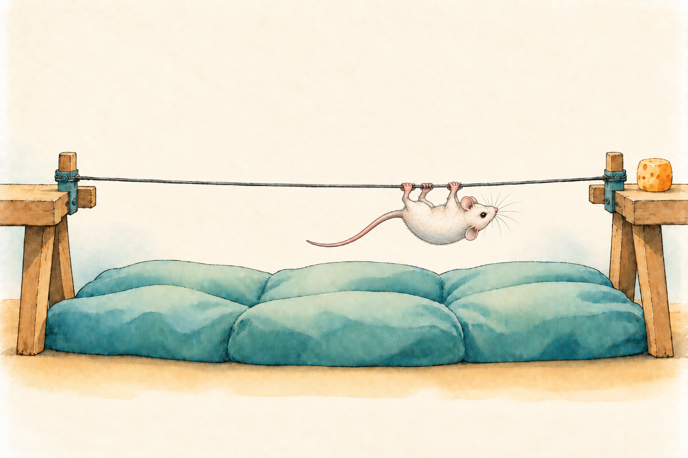
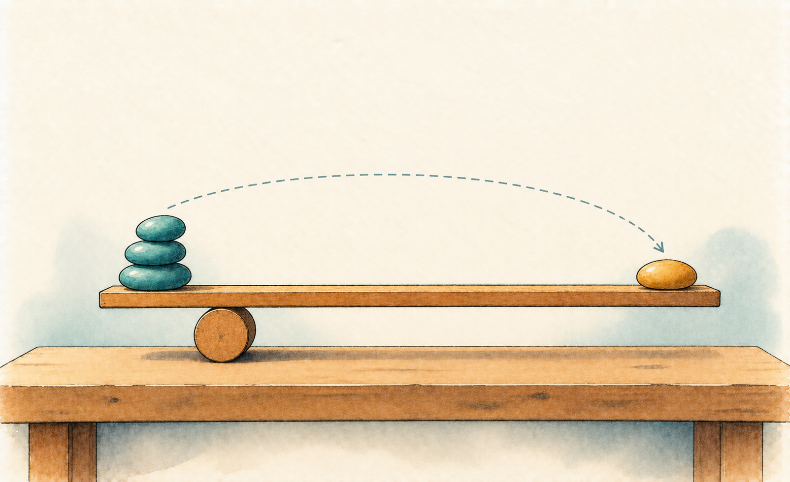

# Estimating how likely a mouse is to cross the wire {#sec-logistic-regression}

```{r}
#| include: false

library(ggplot2)
library(here)

Plot_theme <- source("functions/plot_theme.R")
Plot_theme <- Plot_theme$value

cell_data <- read.csv(here("project/AnalysisData/Cells_Gfap-Pdgfrb.csv"))
```

@sec-glm-intro gave the recipe: pick a family, keep the linear predictor, choose a link. It also promised that the logit link deserved to be taken on its own terms. This chapter keeps that promise, and it does so with the smallest possible amount of data per animal: one yes or no.

That's a real change of scene from a continuous measurement. A single yes/no, a mouse that crossed a wire or fell, a neuron that fired in the window or didn't, is the coarsest measurement in science, and it's the one you meet most often at the bench. So the questions this chapter answers are the ones you'd actually be asked: how much does a genotype change the *chance* of success, how do I say that in a sentence a reviewer can use, and how do I know the model behind it isn't fooling me? Near the end, we pool many yes/no answers into a proportion, using the cell counts you already know.

## A wire, three attempts, and one yes or no per mouse

Here is the experiment. In the hanging wire test, a mouse is put on a wire and has to cross it to reach a platform on the other side. Each mouse gets three attempts per day, on three consecutive days, and for each attempt the file records how long the mouse took to get into position (`Position`), how long it took to cross (`Wire`), and whether it made it (`Success`, 1 or 0). The test stops at 60 seconds, so a mouse that never makes it is recorded at 60. The file, `project/AnalysisData/Wire_TrainingSum.csv`, has 118 mice from seven genotype groups, one row per mouse and day, 354 rows in all. These are real data, and the mice come in the numbers neuroscience experiments usually have: dozens, not hundreds.

{#fig-logistic-wire fig-align="center" width="90%" fig-alt="Watercolor sketch of a small white mouse hanging beneath a thin wire strung between two wooden platforms, gripping it with its paws and stretching its tail behind, with a piece of cheese on the right platform and a soft teal cushion below."}

I'll use two of the seven groups, `Klf4-KO` and `WildType-Control`, because they ran in the same four sessions and so are the natural comparison. The other groups stay in the file; one of them will show up later in the chapter, for a reason you'll appreciate once you've met the problem.

The question is a plain one, and it's the kind of question a motor test is run to answer: after a day of practice, **do the KO mice still stumble on the wire more often than the wild-type controls, and does how a mouse did on day 1 explain it?** To turn that into one yes/no per mouse, I'll define the outcome as `completed_all`: 1 if the mouse completed all six crossings of days 2 and 3, 0 if it failed at least one. And I'll use one predictor besides genotype, `wire1`: the mean time a mouse took on the wire on day 1, over its three attempts, in seconds (a value near 60 means the mouse mostly didn't make it). It's the mean of the recorded times, so a failed attempt counts at whatever time was written down, usually the 60-second cap.

```{r}
wire_raw <- read.csv(here("project/AnalysisData/Wire_TrainingSum.csv"))
wire_raw <- wire_raw[wire_raw$Genotype %in% c("Klf4-KO", "WildType-Control"), ]
wire_raw$n_ok <- with(wire_raw, Trial1_Success + Trial2_Success + Trial3_Success)

day1 <- wire_raw[wire_raw$Day == 1, ]
later <- aggregate(n_ok ~ ReCode, data = wire_raw[wire_raw$Day %in% c(2, 3), ], FUN = sum)

wire <- data.frame(
  mouse = day1$ReCode,
  genotype = factor(ifelse(day1$Genotype == "Klf4-KO", "KO", "WT"), levels = c("WT", "KO")),
  session = day1$Sesion,
  wire1 = rowMeans(day1[, c("Trial1_Wire", "Trial2_Wire", "Trial3_Wire")])
)
# 1 = completed all six crossings of days 2 and 3
wire$completed_all <- as.integer(later$n_ok[match(wire$mouse, later$ReCode)] == 6)
# Centering at 25 s and counting in tens of seconds makes the intercept describe a typical day-1 time
wire$wire1_c <- (wire$wire1 - 25) / 10

stopifnot(nrow(wire) == 63, !anyNA(wire))
```

This is one row per mouse, so the 63 rows are independent animals. That wasn't automatic: the file itself has three rows per mouse (one per day) and three attempts per row, and treating those as independent observations would count each mouse several times. Collapsing to one yes/no per mouse is the price of a model that counts each mouse once. It throws away how *many* crossings failed, which a count of successes out of six would keep, and the section on successes out of trials later in the chapter shows the tool for that. The structure of repeated attempts comes back, as a structure to model instead of avoid, in the multilevel part of the book. <!-- TODO: link @sec-multilevel-glmm once that chapter exists. -->

One more thing about these data, so you can hold me to it: the mice ran in sessions (batches that were handled together), and I ignore that here. With so few mice that didn't complete, there is no room to estimate session effects, and I'll say what that costs when we get there.

```{r}
pass_n <- table(wire$genotype, wire$completed_all)
pass_rate <- tapply(wire$completed_all, wire$genotype, mean)
n_events <- sum(wire$completed_all == 0)
```

In the raw counts, `r round(100 * pass_rate["WT"])`% of the wild-type mice (`r pass_n["WT", "1"]` of `r sum(pass_n["WT", ])`) completed all six crossings, against `r round(100 * pass_rate["KO"])`% of the KO mice (`r pass_n["KO", "1"]` of `r sum(pass_n["KO", ])`). Only `r n_events` mice in the whole sample failed at least once, and that number will matter more than any other in this chapter. Whatever the model says, the raw proportions are what it has to agree with.

Before any model, let's look. With a binary outcome there isn't much to summarize (each mouse is a 0 or a 1), so I'd rather show every mouse. I'll put the day-1 time on the horizontal axis, jitter the 0s and 1s vertically so they don't pile on top of each other, and use both color and shape for genotype, so the figure survives a grayscale printout.

```{r}
#| label: fig-logistic_raw
#| fig-cap: Each mouse's outcome on days 2 and 3 (1 = completed all six crossings) against its mean time on the wire on day 1, by genotype. Points are jittered vertically so overlapping mice remain visible.
#| fig-width: 6.5
#| fig-height: 3.8
#| warning: false

group_cols <- c(WT = "#D55E00", KO = "#0072B2")

set.seed(1)
ggplot(wire, aes(x = wire1, y = completed_all, color = genotype, shape = genotype)) +
  geom_jitter(height = 0.05, width = 0.2, size = 2.5, alpha = 0.85) +
  scale_color_manual(values = group_cols) +
  scale_y_continuous(breaks = c(0, 1), labels = c("Failed at least once", "Completed all six")) +
  labs(x = "Mean time on the wire, day 1 (s)", y = NULL) +
  Plot_theme +
  theme(legend.position = "top")
```

Two things stand out, and I'd like you to notice them before I name them. The mice that failed sit mostly on the right, the slow side. And the KO mice are over there too: their day-1 times run longer than the controls'. Whatever the genotype does, it does it in company with day-1 speed, which is exactly the situation @sec-linear-regression-multiple taught us to be careful about.

## Why not just draw a straight line?

You already have a tool for "how does an outcome change with a predictor": the linear model. Nothing stops you from coding completed as 1 and failed as 0 and fitting a line to it. It's called a [linear probability model]{style="color:green; font-weight:bold;"}, and inside the range of the data it's often a perfectly decent summary. Let's see what it does here.

```{r}
#| label: fig-logistic_lpm
#| fig-cap: A straight line fitted to the 0/1 outcome, with parallel lines for the two genotypes, extended to the fastest time a mouse could record. The dashed lines mark the only two values a probability can take at its extremes.
#| fig-width: 6.5
#| fig-height: 3.8
#| warning: false

lpm <- lm(completed_all ~ genotype + wire1, data = wire)
lpm_grid <- expand.grid(wire1 = seq(0, 60, length.out = 100), genotype = levels(wire$genotype))
lpm_grid$fit <- predict(lpm, newdata = lpm_grid)

ggplot(wire, aes(x = wire1, y = completed_all, color = genotype)) +
  geom_hline(yintercept = c(0, 1), linetype = "dashed", color = "grey50") +
  geom_line(data = lpm_grid, aes(y = fit, linetype = genotype), linewidth = 1) +
  geom_point(aes(shape = genotype), size = 2, alpha = 0.6) +
  scale_color_manual(values = group_cols) +
  scale_y_continuous(breaks = c(0, 0.5, 1)) +
  coord_cartesian(ylim = c(-0.1, 1.3)) +
  labs(x = "Mean time on the wire, day 1 (s)", y = "Completed all six (1) / failed (0)") +
  Plot_theme +
  theme(legend.position = "top")

lpm_fast <- predict(lpm, newdata = data.frame(wire1 = min(wire$wire1), genotype = "WT"))
```

The line is a fair description in the middle and a poor one at the edge. For the fastest wild-type mouse in the sample, a mean of `r round(min(wire$wire1), 1)` seconds, it predicts a "probability" of `r round(lpm_fast, 2)`, and that isn't an extrapolation: that mouse exists. There's a second, quieter problem: a Gaussian model assumes the scatter around the line is the same everywhere, but a 0/1 outcome is noisiest when the chance is near one half and nearly silent near 0 or 1. The line is speaking the wrong language for this outcome, and the same lack of walls we met in @sec-glm-intro is what's showing.

## From probabilities to odds to log-odds

@sec-glm-intro described a GLM with the picture of two rooms: a room with no walls where the linear predictor does its arithmetic, and a small room where the mean has to live. For a yes/no outcome the small room is the interval from 0 to 1, and the doorway is the logit. To see why it's a sensible doorway, I'd like you to think like a bookmaker.

A bookmaker doesn't quote probabilities. When a horse has a 75% chance of winning, the bookmaker says "3 to 1": for every time it loses, it wins three times. That ratio, $p / (1 - p)$, is the [odds]{style="color:green; font-weight:bold;"}. Odds have a nice property that probabilities lack, they live on the whole positive half-line: a probability can't exceed 1, but the odds can grow as big as you like as the event gets more certain. The last step takes the logarithm of the odds, which drags the positive half-line onto the whole number line. That's the [log-odds]{style="color:green; font-weight:bold;"}, or *logit*:

{#fig-logistic-seesaw fig-align="center" width="85%" fig-alt="Watercolor sketch of a level wooden plank balanced on a round log on a bench, with a stack of three teal pebbles on its short left end and a single ochre pebble on its long right end, joined by a dashed arrow arcing from the stack to the single pebble."}

$$
\text{logit}(p) = \log\left(\frac{p}{1 - p}\right)
$$ {#eq-logit}

The table shows the three scales side by side. Watch the log-odds column: it's symmetric around zero (a 25% chance and a 75% chance are the same distance from even odds, in opposite directions), and moving from 50% to 90% costs about the same on the log-odds scale as moving from 90% to 99%.

```{r}
#| label: tbl-logistic_ladder
#| tbl-cap: The same chance of completing the wire on three scales

library(gt)

ladder <- data.frame(
  p = c(0.01, 0.10, 0.25, 0.50, 0.75, 0.90, 0.99)
)
ladder$odds <- ifelse(ladder$p >= 0.5,
                      paste0(round(ladder$p / (1 - ladder$p), 1), " to 1"),
                      paste0("1 to ", round((1 - ladder$p) / ladder$p, 1)))
ladder$logodds <- round(qlogis(ladder$p), 2)
names(ladder) <- c("Probability", "Odds", "Log-odds")

gt(ladder)
```

The logistic regression is what you get when you write a linear model on that last scale, where addition is allowed and no value is forbidden, and then translate back to probabilities through the inverse of the logit, the logistic curve of @fig-glm_links. Each mouse $i$ has a yes/no outcome $y_i$ that follows a Bernoulli distribution (a coin flip that lands "completed" with probability $p_i$), and:

$$
y_i \sim \text{Bernoulli}(p_i), \qquad \text{logit}(p_i) = \beta_0 + \beta_1 x_{1i} + \dots + \beta_k x_{ki}
$$ {#eq-logistic}

That is @eq-glm with a Bernoulli family and a logit link, nothing more. Same recipe as every GLM in this part: pick the family, pick the link, keep the linear predictor.

## The first model: does genotype matter?

I'll start with only `genotype` in the model, before day-1 time enters the picture, because it lets us learn to read the output on the simplest possible case. `brms` fits it with the `bernoulli()` family, and `glm()` is its frequentist counterpart with the `binomial()` family (for 0/1 data a Bernoulli *is* a binomial with a single trial).

Before fitting, one decision that I'm not going to leave to a default. @sec-glm-intro warned that priors on link-scale coefficients need to be judged on the outcome scale, and this is where that warning starts to matter. Here's what two candidate priors imply for the chance of completing, before seeing any data. Each histogram shows probabilities obtained by pushing draws of the intercept through the inverse logit.

```{r}
#| label: fig-logistic_prior_predictive
#| fig-cap: What a prior on the intercept says about the probability of completing, before seeing data. A wide-looking prior (left) is strongly opinionated on the probability scale.
#| fig-width: 7
#| fig-height: 3.2
#| warning: false

set.seed(2)
prior_draws <- rbind(
  data.frame(p = plogis(rnorm(10000, 0, 10)), prior = "Normal(0, 10)"),
  data.frame(p = plogis(rnorm(10000, 0, 1.5)), prior = "Normal(0, 1.5)")
)
prior_draws$prior <- factor(prior_draws$prior, levels = c("Normal(0, 10)", "Normal(0, 1.5)"))

ggplot(prior_draws, aes(x = p)) +
  geom_histogram(bins = 30, fill = "#0072B2", color = "white") +
  facet_wrap(~prior) +
  labs(x = "Implied probability of completing", y = "Prior draws") +
  Plot_theme
```

A `Normal(0, 10)` looks humble and behaves like a zealot: it believes, before seeing a single mouse, that nearly every animal either always completes or never does. `Normal(0, 1.5)` spreads its belief over the whole range of probabilities and still leaves room for the extremes. The logic is the one from @sec-priors-regularization: on a logit scale, log-odds beyond ±3 to 5 already mean probabilities above 95% to 99%, so a prior scale near 1 to 2 covers the plausible territory [@gelman2026; @inchausti2023]. I'll use `Normal(0, 1.5)` for both the intercept and the coefficient, and I'll refit with a much narrower and a much wider prior afterward, to show whether the conclusion depends on it. With only `r n_events` mice that failed, I expect it to.

```{r}
library(brms)

prior_logit <- c(
  prior(normal(0, 1.5), class = "Intercept"),
  prior(normal(0, 1.5), class = "b")
)

fit_group <- brm(
  completed_all ~ genotype,
  data = wire,
  family = bernoulli(),
  prior = prior_logit,
  seed = 123,
  file = "models/logistic-regression_fit1.rds",
  file_refit = "never"
)
```

::: panel-tabset
### brms

```{r}
summary(fit_group)
```

### glm

```{r}
library(broom)

glm_group <- glm(completed_all ~ genotype, family = binomial(), data = wire)

tidy(glm_group, conf.int = TRUE)
```
:::

```{r}
b_group <- fixef(fit_group)
```

The `Intercept` (`r round(b_group["Intercept", "Estimate"], 2)`) is the log-odds of completing for a wild-type mouse, and `genotypeKO` (`r round(b_group["genotypeKO", "Estimate"], 2)`) is how many log-odds *less* a KO mouse has (it's negative: the KO mice complete less often). The sampling is healthy, as the table at the end of the chapter confirms for every model. But a number of log-odds is not something you can put in a results section and expect a colleague to feel anything. Let's translate it.

## Reading a coefficient three ways

Here is the reading I'd want from a paper, in order of how much I'd trust the reader to follow it. I'll do the arithmetic on the posterior draws, not on the point estimates, so every quantity carries its uncertainty with it.

```{r}
draws_group <- as.data.frame(posterior::as_draws_df(fit_group))

three_ways <- data.frame(
  logodds = draws_group$b_genotypeKO,
  odds_ratio = exp(draws_group$b_genotypeKO),
  p_wt = plogis(draws_group$b_Intercept),
  p_ko = plogis(draws_group$b_Intercept + draws_group$b_genotypeKO)
)
three_ways$diff <- three_ways$p_ko - three_ways$p_wt

summ <- function(x) sprintf("%.2f [%.2f, %.2f]", median(x), quantile(x, 0.025), quantile(x, 0.975))
```

**On the log-odds scale**, the effect of the KO is `r summ(three_ways$logodds)` (median and 95% credible interval). It's the scale where the model is linear and the interval is roughly symmetric, which makes it the right scale for the machinery, and a poor scale for the reader: it's not a change in probability and it's not a multiplication of anything you can see.

**On the odds scale**, we exponentiate. The odds ratio is `r summ(three_ways$odds_ratio)`: the odds of completing are that fraction of the wild-type odds in a KO mouse. This is the classic way to report a logistic regression, and it has the same flavor as the multiplicative reading of a log-link coefficient in @sec-glm-intro: adding on the link scale is multiplying on the interpretable one.

::: callout-warning
### An odds ratio is not a risk ratio

"The odds are 3 times higher" is very often read as "the chance is 3 times higher", and the two agree only when the outcome is rare. Here the wild-type mice complete about `r round(100 * pass_rate["WT"])`% of the time, which is the opposite of rare: when the chance is that close to 1, an odds ratio far from 1 corresponds to a modest change in the *probability*. If your readers will act on a probability, give them a probability.
:::

**On the probability scale**, we push both groups through the inverse logit. The chance of completing is `r summ(three_ways$p_wt)` for wild-type mice and `r summ(three_ways$p_ko)` for KO mice, a difference of `r summ(100 * three_ways$diff)` percentage points, and the interval for that difference reaches past zero, so this comparison alone is far from settled; hold that thought. For most bench readers this is the sentence that answers the question. It comes with a catch, though, which is the reason a later section exists: on the probability scale, the effect of a genotype is *not one number*. The same shift in log-odds moves a mouse near 50% by a lot and a mouse near 95% by a little, because the logistic curve flattens at the ends. Here, with only one binary predictor, the two groups sit where they sit and the catch is hidden. Add day-1 time, and it comes out.

### A quick sanity check: the "divide by 4" rule

@gelman2020 offer a mental shortcut for reading a slope without a calculator. The logistic curve is steepest at 50%, where its slope is $p(1-p) = 0.25$, so dividing a coefficient by 4 gives the *largest* change in probability that one unit of the predictor can produce. For our genotype effect of `r round(b_group["genotypeKO", "Estimate"], 2)`, that ceiling is `r round(abs(b_group["genotypeKO", "Estimate"]) / 4, 2)`, or about `r round(100 * abs(b_group["genotypeKO", "Estimate"]) / 4)` percentage points at most. The observed difference (`r round(100 * abs(pass_rate["KO"] - pass_rate["WT"]))` points) is well under that ceiling, and the reason is instructive: the rule is exact only for two groups straddling 50%, and ours sit up around 90% and 75%, where the curve has already started to flatten. It's a quick check that a number isn't impossible, not a substitute for the calculation above.

### Does the prior matter?

I promised a sensitivity check. Here is the genotype effect refit with a prior scale a third the size of my choice, and with one more than three times as large.

```{r}
fit_narrow <- brm(
  completed_all ~ genotype,
  data = wire,
  family = bernoulli(),
  prior = c(prior(normal(0, 0.5), class = "Intercept"),
            prior(normal(0, 0.5), class = "b")),
  seed = 123,
  file = "models/logistic-regression_fit2.rds",
  file_refit = "never"
)

fit_wide <- brm(
  completed_all ~ genotype,
  data = wire,
  family = bernoulli(),
  prior = c(prior(normal(0, 5), class = "Intercept"),
            prior(normal(0, 5), class = "b")),
  seed = 123,
  file = "models/logistic-regression_fit3.rds",
  file_refit = "never"
)
```

```{r}
#| label: tbl-logistic_sensitivity
#| tbl-cap: Genotype effect (log-odds) under three prior scales

sens <- do.call(rbind, lapply(
  list("Normal(0, 0.5)" = fit_narrow, "Normal(0, 1.5)" = fit_group, "Normal(0, 5)" = fit_wide),
  function(m) as.data.frame(fixef(m)["genotypeKO", c("Estimate", "Q2.5", "Q97.5"), drop = FALSE])
))
sens <- cbind(Prior = rownames(sens), round(sens, 2))
names(sens) <- c("Prior on b and Intercept", "Estimate", "Lower 2.5%", "Upper 97.5%")

gt(sens)
```

This is not a clean bill of health, and I'd rather tell you than hide it. The estimate is negative under all three priors, but it runs from `r sprintf("%.2f", sens$Estimate[1])` to `r sprintf("%.2f", sens$Estimate[3])`, a threefold spread that depends on the prior more than I'd like, and the interval includes zero under every one of them. With `r nrow(wire)` mice and `r n_events` that didn't complete, the data alone don't settle how large the KO effect is, and the prior is doing real work, shrinking an estimate that is based on very few failures. That is a legitimate result, and it's what small experiments look like. It is also the reason to look at what else is going on in the experiment, which is what day-1 time is about to show us.

## Adding day-1 time: when the effect stops being one number

The dot plot at the start suggested that day-1 time matters, and that the KO mice are slower. Both are reasons to put `wire1_c` in the model: the mean time on the wire on day 1, in tens of seconds and centered at 25 seconds, so the intercept describes a wild-type mouse with a typical day-1 time and a coefficient is the change for ten extra seconds. Ten seconds is a little under a standard deviation of this variable, so the same prior scale we've used (`Normal(0, 1.5)`) is still a sensible, weakly informative one.

```{r}
fit_time <- brm(
  completed_all ~ genotype + wire1_c,
  data = wire,
  family = bernoulli(),
  prior = prior_logit,
  seed = 123,
  file = "models/logistic-regression_fit4.rds",
  file_refit = "never"
)
```

::: panel-tabset
### brms

```{r}
summary(fit_time)
```

### glm

```{r}
glm_time <- glm(completed_all ~ genotype + wire1_c, family = binomial(), data = wire)

tidy(glm_time, conf.int = TRUE)
```
:::

```{r}
b_time <- fixef(fit_time)
mean_wire1 <- tapply(wire$wire1, wire$genotype, mean)
```

The genotype coefficient has shrunk from `r round(b_group["genotypeKO", "Estimate"], 2)` to `r round(b_time["genotypeKO", "Estimate"], 2)` log-odds (95% credible interval `r round(b_time["genotypeKO", "Q2.5"], 2)` to `r round(b_time["genotypeKO", "Q97.5"], 2)`), while ten extra seconds on day 1 come with `r round(b_time["wire1_c", "Estimate"], 2)` log-odds (`r round(b_time["wire1_c", "Q2.5"], 2)` to `r round(b_time["wire1_c", "Q97.5"], 2)`), which multiplies the odds of completing by about `r round(exp(b_time["wire1_c", "Estimate"]), 2)`. This is the lesson of *adjusting* from @sec-linear-regression-multiple, appearing in a different outcome: the KO mice averaged `r round(mean_wire1["KO"], 1)` seconds on day 1 against `r round(mean_wire1["WT"], 1)` for the controls, slow mice fail more often, and once day-1 time is in the model there is little left for genotype to explain.

What that means depends on a question the data can't answer. If a slow first day is a *coincidence* that happens to travel with genotype (older mice, a bad batch), then adjusting for it removes a nuisance and the smaller coefficient is the real genotype effect. If a slow first day is *part of how the KO impairs the mouse*, then adjusting for it removes the effect we wanted to measure, and the first, larger coefficient was the honest one. The numbers are identical in both stories; the causal reading differs, and that is a reason to say which question you're asking before you pick the model [@gelman2020].

::: callout-note
### Twelve mice, two predictors

I'd be doing you a disservice if I let the tidy coefficient table pass without a warning. Only `r n_events` of the `r nrow(wire)` mice failed at least once, and a logistic model learns from the rarer of the two outcomes. Two predictors on `r n_events` events is thin, which is why the prior sensitivity matters here and why I haven't tried to add the session, a third predictor with several levels, on top. The model isn't wrong, it's weakly identified, and the honest summary is a wide interval and a statement of what the data cannot yet separate. Experiments with a few dozen animals are the norm, and this is what the analysis of one of them looks like.
:::

Now the picture that makes the "not one number" point. I'll compute, for every combination of genotype and day-1 time across the observed range, the model's expected probability of completing. `posterior_epred()` returns the expected outcome (here, a probability) for every posterior draw, so we can show the whole family of plausible curves as graded bands instead of a single line.

```{r}
#| label: fig-logistic_curve
#| fig-cap: Posterior probability of completing all six crossings as a function of mean day-1 time, by genotype (bands are 50%, 80% and 95% credible intervals), with the observed mice on top
#| fig-width: 6.5
#| fig-height: 4.2
#| warning: false

library(ggdist)

grid <- expand.grid(wire1 = seq(10, 60, by = 1),
                    genotype = factor(c("WT", "KO"), levels = levels(wire$genotype)))
grid$wire1_c <- (grid$wire1 - 25) / 10

epred_grid <- posterior_epred(fit_time, newdata = grid, ndraws = 1000)

curve_long <- data.frame(
  wire1 = rep(grid$wire1, each = nrow(epred_grid)),
  genotype = rep(grid$genotype, each = nrow(epred_grid)),
  p = as.vector(epred_grid)
)

set.seed(1)
ggplot(curve_long, aes(x = wire1, y = p, color = genotype, fill = genotype, linetype = genotype)) +
  stat_lineribbon(.width = c(0.5, 0.8, 0.95), alpha = 0.25, linewidth = 1) +
  geom_jitter(data = wire, inherit.aes = FALSE,
              aes(x = wire1, y = completed_all, color = genotype, shape = genotype),
              height = 0.03, width = 0.2, size = 1.8, alpha = 0.7) +
  scale_color_manual(values = group_cols) +
  scale_fill_manual(values = group_cols) +
  scale_y_continuous(breaks = seq(0, 1, 0.25)) +
  labs(x = "Mean time on the wire, day 1 (s)", y = "Probability of completing all six") +
  Plot_theme +
  theme(legend.position = "top")
```

The curves are S-shaped, in principle, but over the range we measured we see the descent: the fastest mice are close to certain to complete, and the slowest ones are much less so. The two genotype curves sit on top of each other, as the small genotype coefficient said they would. The odds ratio for day-1 time is the same at every point, because that's what a constant log-odds slope means, but the *vertical* change a person deciding whether to care would look at isn't: it's largest where the curve is steepest, and shrinks as it nears 1. What we want is an honest way to summarize a quantity that depends on who you're asking about.

## One number for the whole sample: average predictive comparisons

Here is the idea, which @gelman2020 call the [average predictive comparison]{style="color:green; font-weight:bold;"}. Imagine every mouse in our sample, with its own day-1 time, being a KO mouse; then imagine the same mice, with the same day-1 times, being wild-type. The model can compute, for each mouse, how much its chance of completing would change. Each mouse gets its own difference in probabilities, because a fast and a slow mouse sit at different places on the curve, and the average of those differences is a single, honest summary: *in a population like this one, the genotype changes the chance of completing by this many percentage points, on average.*

In the notation of the literature, for each mouse $i$ with covariates $x_i$ other than the genotype,

$$
\delta_i = \text{logit}^{-1}(\beta_0 + \beta_1 \cdot 1 + \gamma x_i) - \text{logit}^{-1}(\beta_0 + \beta_1 \cdot 0 + \gamma x_i), \qquad \text{APC} = \frac{1}{n}\sum_{i=1}^{n}\delta_i
$$ {#eq-apc}

The advantage over evaluating the model at "the average mouse" is that no mouse has to be average: if the data sit near the ends of the curve, or interact with the predictor, the average over real mice keeps that. And because we do it on the Bayesian posterior, the APC comes with an interval for free: we compute one APC per posterior draw. With `posterior_epred()`, that's two prediction matrices and a subtraction.

```{r}
nd_ko <- transform(wire, genotype = factor("KO", levels = levels(wire$genotype)))
nd_wt <- transform(wire, genotype = factor("WT", levels = levels(wire$genotype)))

p_ko <- posterior_epred(fit_time, newdata = nd_ko)
p_wt <- posterior_epred(fit_time, newdata = nd_wt)

# One APC per posterior draw: average, over mice, of (KO - WT)
apc_genotype <- rowMeans(p_ko - p_wt)
```

```{r}
#| label: fig-logistic_apc
#| fig-cap: The effect of KO on the probability of completing, adjusted for day-1 time. Left, the difference between KO and wild-type for a mouse of each day-1 time. Right, the average predictive comparison across the mice we studied (half-eye with 50% and 95% intervals).
#| fig-width: 8
#| fig-height: 3.8
#| warning: false

library(patchwork)

diff_long <- data.frame(
  wire1 = rep(unique(grid$wire1), each = nrow(epred_grid)),
  diff = as.vector(epred_grid[, grid$genotype == "KO"] - epred_grid[, grid$genotype == "WT"])
)

p_left <- ggplot(diff_long, aes(x = wire1, y = diff)) +
  stat_lineribbon(.width = c(0.5, 0.8, 0.95), color = "#0072B2", fill = "#0072B2", alpha = 0.25) +
  geom_hline(yintercept = 0, linetype = "dashed", color = "grey40") +
  labs(x = "Mean time on the wire, day 1 (s)", y = "KO minus wild-type\n(probability of completing)") +
  Plot_theme

p_right <- ggplot(data.frame(apc = apc_genotype), aes(x = apc)) +
  stat_halfeye(.width = c(0.5, 0.95), fill = "#0072B2", point_interval = "median_qi") +
  geom_vline(xintercept = 0, linetype = "dashed", color = "grey40") +
  scale_y_continuous(breaks = NULL) +
  labs(x = "Average predictive\ncomparison", y = NULL) +
  Plot_theme

p_left + p_right + plot_layout(widths = c(1.4, 1))
```

```{r}
apc_pp <- 100 * apc_genotype
apc_prob_neg <- mean(apc_genotype < 0)
```

The left panel shows the point I was making above: the genotype difference isn't constant across day-1 times, and it is small and uncertain everywhere. The right panel collapses it into one distribution, and the sentence I'd now write in a paper is this one: **on average across the mice in this study, and adjusting for day-1 time, KO mice were `r round(abs(median(apc_pp)))` percentage points less likely than wild-type mice to complete all six later crossings (95% credible interval `r round(quantile(apc_pp, 0.025))` to `r round(quantile(apc_pp, 0.975))`), and the posterior probability that the KO is worse is `r round(100 * apc_prob_neg)`%.** A colleague who has never heard the word "logit" can use that sentence, and notice what it does not say: it does not claim the effect is large, because the interval doesn't. The odds ratio, `r round(exp(b_time["genotypeKO", "Estimate"]), 2)` in this model, is still the right summary of the *mechanism* and the right thing to compare across studies, but the percentage points are what you'd say to a person deciding whether a difference is worth caring about.

The same recipe works for a continuous predictor: pick two values, $D_{\text{lo}}$ and $D_{\text{hi}}$, set everyone to each in turn, and average. Here is day-1 time, comparing a mouse that averaged 20 seconds with one that averaged 30, for the whole sample.

```{r}
nd_fast <- transform(wire, wire1_c = (20 - 25) / 10)
nd_slow <- transform(wire, wire1_c = (30 - 25) / 10)

apc_time <- rowMeans(posterior_epred(fit_time, newdata = nd_slow) -
                       posterior_epred(fit_time, newdata = nd_fast))
apc_time_pp <- 100 * apc_time
```

Going from 20 to 30 seconds changes the average probability of completing by `r round(median(apc_time_pp))` percentage points (95% credible interval `r round(quantile(apc_time_pp, 0.025))` to `r round(quantile(apc_time_pp, 0.975))`). As a sanity check with the divide-by-4 rule: the day-1 time coefficient is `r round(b_time["wire1_c", "Estimate"], 2)` log-odds per ten seconds, so the ceiling on the change is about `r round(100 * abs(b_time["wire1_c", "Estimate"]) / 4)` percentage points, and the APC sits below it, as it should.

## Does the model deserve its answer?

A binary outcome takes the usual checks and breaks them. The check we leaned on for continuous outcomes, plotting the density of the observed outcome against replicated ones, would tell no story here: every replicate is a column of zeros and ones. The way forward, following the checks for binary outcomes in the `brms` toolkit [@inchausti2023], is to compare *summaries* of the data, and to ask two different questions: does the model reproduce the overall rate of the outcome in the sample and in each group, and does it separate the mice that completed from the ones that didn't (a discrimination question)?

I'll start with the first, using `pp_check()` with `type = "stat"`, and a summary that is meaningful for 0/1 data: the proportion of ones. I'll ask it for the whole sample and then split by group, because a model can get the overall rate right and still be wrong in every subgroup.

```{r}
#| label: fig-logistic_ppc
#| fig-cap: Posterior predictive checks for the binary outcome. Histograms are the proportion of mice that complete all six crossings in replicated data; the line is the observed proportion. Left, all mice; right, by genotype.
#| fig-width: 8
#| fig-height: 3.8
#| warning: false

presences <- function(x) mean(x == 1)

p1 <- pp_check(fit_time, type = "stat", stat = "presences", ndraws = 500) +
  labs(title = "All mice")

p2 <- pp_check(fit_time, type = "stat_grouped", stat = "presences",
               group = "genotype", ndraws = 500) +
  labs(title = "By genotype")

p1 + p2
```

The observed proportion sits in the body of what the model replicates, overall and within each genotype. The check would fail if the line fell in the tail or outside the histogram, which is what happens when a model systematically over- or under-predicts successes. Read it with the sample size in mind, though: with `r n_events` events, the replicated proportions are spread wide, so this check can only catch a gross mismatch.

One thing this check cannot do is tell you whether the variability is *right*, which is the question that matters for counts and proportions, and the one the section on successes out of trials takes up below. For a single 0/1 per mouse there's no extra-binomial variation to detect: a Bernoulli's variance is fixed once you know $p$, and the dispersion statistic that flags overdispersion isn't defined row by row. Overdispersion in binary data only becomes detectable when the same unit produces several outcomes, which is exactly what the three daily attempts of the wire test are, and why they'll teach us something new once we treat them.

For discrimination, the Bayesian move [@inchausti2023] is to compute the metric once per posterior draw instead of once overall, so it comes with its own uncertainty. Two metrics do the job. The [AUC]{style="color:green; font-weight:bold;"} is the probability that a randomly chosen mouse that completed had a higher predicted probability than a randomly chosen mouse that failed (0.5 means the model is no better than a coin, 1 means perfect ranking). The [Brier score]{style="color:green; font-weight:bold;"} is the average squared gap between predicted probability and what happened (lower is better, and a model that always predicts the overall rate sets the bar to beat). Two choices differ from the textbook recipe. I use each draw's predicted *probabilities* rather than simulated 0/1 outcomes, so the metrics aren't diluted by Bernoulli noise. And I report the AUC as a single number, from the posterior mean probabilities, rather than as a distribution. Computed draw by draw it does vary, but only with the *parameters*: it never reflects that a different set of mice, with only a dozen failures among them, would be ranked differently, so a credible interval for it would look more precise than it is. The Brier score has the same limit, so read its distribution as the uncertainty of the model, not of the sample.

```{r}
#| label: fig-logistic_metrics
#| fig-cap: Posterior distribution of the Brier score for the model with genotype and day-1 time. The dashed line marks a model that ignores the predictors (base rate × (1 − base rate)). The score is computed on the same data the model was fitted on, so it is optimistic.
#| fig-width: 6
#| fig-height: 3.2
#| warning: false

y <- wire$completed_all

auc_rank <- function(p, y) {
  r <- rank(p)
  n1 <- sum(y == 1)
  n0 <- sum(y == 0)
  (sum(r[y == 1]) - n1 * (n1 + 1) / 2) / (n1 * n0)
}

p_draws <- posterior_epred(fit_time)
auc_obs <- auc_rank(colMeans(p_draws), y)
aucs <- apply(p_draws, 1, auc_rank, y = y)
briers <- apply(p_draws, 1, function(p) mean((p - y)^2))
brier_null <- mean(y) * (1 - mean(y))

ggplot(data.frame(brier = briers), aes(x = brier)) +
  stat_halfeye(.width = c(0.5, 0.95), fill = "#0072B2", point_interval = "median_qi") +
  geom_vline(xintercept = brier_null, linetype = "dashed", color = "grey40") +
  scale_y_continuous(breaks = NULL) +
  labs(x = "Brier score", y = NULL) +
  Plot_theme
```

The AUC is `r round(auc_obs, 2)` (across posterior draws it ranges from `r round(quantile(aucs, 0.025), 2)` to `r round(quantile(aucs, 0.975), 2)`, parameter uncertainty only), and the Brier score has a median of `r round(median(briers), 3)` (95% credible interval `r round(quantile(briers, 0.025), 3)` to `r round(quantile(briers, 0.975), 3)`) against `r round(brier_null, 3)` for the model that ignores the predictors. The model separates the mice that completed from the ones that didn't better than chance, and the improvement is real but modest, which is the honest reading of the biology: a slow first day is a warning sign, not a verdict. Both numbers come from the data the model was trained on, so treat them as an upper bound on how well the model would do on new mice.

## Many yes/no answers at once: successes out of trials

So far every mouse contributed a single yes or no. A great deal of bench data comes the other way around: each animal contributes *many* yes/no answers at once, and what we record is how many of them were yes. `cell_data` has exactly that, and it is real. `Pdgfrb_Total` is the total number of cells counted in each tissue section and `Pdgfrb_Pos` is how many of those were PDGFR-β-positive. Every counted cell is a small yes or no, and the question "what *fraction* of the cells I counted are positive?" is a proportion built from a known number of trials.

(There's also a `Pdgfrb_Neg` column, and where it's present, `Pos + Neg = Total` exactly. One animal, Td79, has an empty `Neg`, and its `Total` was computed as if that gap were zero, so for that animal `Pos` equals `Total` and its proportion is exactly 1. @sec-eda-missing-data tells the story.) That makes Td79's `Total` an artifact of the gap, not a number of cells anyone counted, and a binomial treats the total as the number of trials, so it can't be trusted as one. I leave Td79 out of this section, which leaves 48 animals. I'll check at the end that this choice isn't doing any work it shouldn't. As in the figure of the introduction, I treat `DPI` as a category, so each day gets its own mean, and day 0 is the sham group.

```{r}
cell_prop <- cell_data[!is.na(cell_data$Pdgfrb_Neg), ]
cell_prop$DPI_f <- factor(cell_prop$DPI)
cell_all <- cell_data  # all 49 animals, only used for the Td79 sensitivity check below
cell_all$DPI_f <- factor(cell_all$DPI)
```

A proportion built from a known number of trials has its own family, the [binomial]{style="color:green; font-weight:bold;"}, and the logit link is the same doorway you have been using for a single yes/no. Nothing else changes: choose a family, choose a link, keep the linear predictor. `brms` writes the trials into the formula, and I keep the flat defaults for now, as in the last part, because I'm interested in what the family believes about the noise before I add opinions of my own. With hundreds or thousands of cells counted per animal, the data are so informative that the prior can't matter, which is not the situation of the wire.

```{r}
library(brms)

fit_binom <- brm(
  Pdgfrb_Pos | trials(Pdgfrb_Total) ~ DPI_f,
  data = cell_prop,
  family = binomial(),
  seed = 123,
  file = "models/logistic-regression_fit7.rds",
  file_refit = "never"
)
```

::: panel-tabset
### brms

```{r}
summary(fit_binom)
```

### glm

```{r}
glm_binom <- glm(cbind(Pdgfrb_Pos, Pdgfrb_Total - Pdgfrb_Pos) ~ DPI_f,
                 family = binomial(), data = cell_prop)

broom::tidy(glm_binom, conf.int = TRUE)
```
:::

```{r}
b_bin <- fixef(fit_binom)[, "Estimate"]
p_day <- plogis(b_bin["Intercept"] + c(0, b_bin[-1]))
```

The coefficients are log-odds, the scale this chapter has been reading three ways. The intercept (about `r round(b_bin["Intercept"], 2)`) corresponds to a day-0 proportion of about `r round(100 * p_day[1])`% positive, and every later day is higher, up to about `r round(100 * max(p_day))`% at day `r levels(cell_prop$DPI_f)[which.max(p_day)]`. The doorway is doing its job: whatever the linear predictor says, the fitted proportion stays between 0 and 1.

So does this family have the right idea about noise? Same question, same suspicion. The binomial says the scatter of a proportion around its mean is fixed by how many cells were counted and by the proportion itself, with nothing left over for animals that simply differ. To check, I'll ask the model where it expects each animal's proportion to land, and see whether the observed proportions honor that.

```{r}
#| label: fig-logistic_binom_check
#| fig-cap: Observed proportion of PDGFR-$\beta$+ cells per animal (points) against the binomial model's 95% predictive interval for that animal (grey bars), 48 animals. Animals outside their interval are marked with a triangle.
#| fig-width: 8
#| fig-height: 3.8
#| warning: false

yrep <- posterior_predict(fit_binom, ndraws = 1000)
prop_rep <- sweep(yrep, 2, cell_prop$Pdgfrb_Total, "/")

check <- cell_prop[, c("DPI_f", "Pdgfrb_Pos", "Pdgfrb_Total")]
check$obs <- check$Pdgfrb_Pos / check$Pdgfrb_Total
check$lo <- apply(prop_rep, 2, quantile, probs = 0.025)
check$hi <- apply(prop_rep, 2, quantile, probs = 0.975)
check$outside <- check$obs < check$lo | check$obs > check$hi
check <- check[order(check$DPI_f, check$obs), ]
check$idx <- seq_len(nrow(check))

ggplot(check, aes(x = idx)) +
  geom_linerange(aes(ymin = lo, ymax = hi), color = "grey70", linewidth = 1.2) +
  geom_point(aes(y = obs, color = outside, shape = outside), size = 2.2) +
  facet_grid(~DPI_f, scales = "free_x", space = "free_x",
             labeller = labeller(DPI_f = function(x) paste("DPI", x))) +
  scale_color_manual(values = c("FALSE" = "#0072B2", "TRUE" = "#D55E00"), guide = "none") +
  scale_shape_manual(values = c("FALSE" = 16, "TRUE" = 17), guide = "none") +
  labs(x = "Animals, grouped by day", y = "Proportion PDGFR-β+") +
  Plot_theme +
  theme(axis.text.x = element_blank(), axis.ticks.x = element_blank())
```

```{r}
dispersion <- function(m) sum(residuals(m, type = "pearson")^2) / df.residual(m)

disp_binom <- dispersion(glm_binom)
share_outside <- mean(check$outside)

glm_binom_all <- glm(cbind(Pdgfrb_Pos, Pdgfrb_Total - Pdgfrb_Pos) ~ DPI_f,
                     family = binomial(), data = cell_all)
```

The bars are very narrow, because with hundreds or thousands of cells counted per animal, a binomial thinks a proportion should be pinned down almost exactly. The animals don't cooperate: `r round(100 * share_outside)`% of them fall outside their 95% interval, where about 5% should. The standard summary is the [dispersion statistic]{style="color:green; font-weight:bold;"}, the sum of squared Pearson residuals divided by the residual degrees of freedom, which should be near 1 for a well-specified binomial [@inchausti2023; @gelman2020]. Here it is about `r round(disp_binom)`. The binomial has no room for animal-to-animal differences in the underlying proportion, and there are plenty. The remedy is a change of family, to one that lets the proportion itself vary across animals, and it comes in @sec-beta-robust-regression, with the beta-binomial.

As for leaving Td79 out: putting it back changes the dispersion statistic from `r round(disp_binom)` to `r round(dispersion(glm_binom_all))` and the day-3 log-odds from `r round(coef(glm_binom)["DPI_f3"], 2)` to `r round(coef(glm_binom_all)["DPI_f3"], 2)`. The conclusion doesn't depend on it. I'd still rather not feed a model a number I know is wrong.

## When the logit breaks: separation

Every model so far worked because there were completers and non-completers (or positive and negative cells) in every group we compared. Here is what happens when that isn't true. The wire file has one such group: in `Klf4-Flox-Control`, none of the 7 mice failed a single crossing on any of the three days, which is one reason that group stayed out of this chapter. In `cell_data` there is a cleaner example, and it is real too. `Condition` is binary (sham surgery or MCAO), so we can ask a diagnostic question: **can we tell whether an animal had an ischemic stroke from its GFAP staining?** I'll code MCAO as 1 and standardize `Gfap_IntDen` (one unit is one standard deviation), so that a coefficient is the change in log-odds for a one-standard-deviation increase in staining, which is also the scale on which the priors recommended for logistic models are defined [@gelman2026].

```{r}
cell_data$MCAO <- as.integer(cell_data$Condition == "MCAO")
cell_data$Gfap_z <- as.numeric(scale(cell_data$Gfap_IntDen))

sep_summary <- aggregate(Gfap_IntDen ~ Condition, data = cell_data, FUN = range)
```

The problem is visible before any model: the largest `Gfap_IntDen` in any sham animal (`r round(sep_summary$Gfap_IntDen[sep_summary$Condition == "SHAM", 2])`) is below the smallest in any MCAO animal (`r round(sep_summary$Gfap_IntDen[sep_summary$Condition == "MCAO", 1])`). One cutoff separates the two groups perfectly, which is called [complete separation]{style="color:green; font-weight:bold;"}. It's a wonderful result for a diagnostic and a disaster for a maximum-likelihood fit: the likelihood keeps improving as the slope grows, so the maximum lies at infinity.

{#fig-logistic-fence fig-align="center" width="90%" fig-alt="Watercolor sketch of a green meadow with a flock of teal birds on the left and a flock of ochre birds on the right, divided by a row of fence posts that grows taller and more upright until the last post rises out of the top of the picture."}

```{r}
glm_sep <- suppressWarnings(
  glm(MCAO ~ Gfap_z, family = binomial(), data = cell_data)
)
sep_warnings <- tryCatch(
  { glm(MCAO ~ Gfap_z, family = binomial(), data = cell_data); "none" },
  warning = function(w) conditionMessage(w)
)
```

`glm()` returns something, but it warns: "`r sep_warnings`". The slope it reports is `r round(coef(glm_sep)["Gfap_z"], 0)` per standard deviation, with a standard error of `r format(round(summary(glm_sep)$coefficients["Gfap_z", "Std. Error"]), big.mark = ",", scientific = FALSE)`. Neither number means anything. The algorithm didn't converge to an answer; it stopped when the improvements became too small to see. A weakly informative prior turns this from a catastrophe into a statement. It doesn't tell the data what to say, it just refuses the absurd: coefficients that would imply probabilities of exactly 0 and 1. On a standardized predictor, `Normal(0, 2.5)` is the kind of prior the literature recommends for this: it considers a one-standard-deviation change in log-odds of ±5 (a jump from about 1% to about 99%) at the edge of what's plausible, and nothing more extreme [@gelman2026].

```{r}
fit_sep <- brm(
  MCAO ~ Gfap_z,
  data = cell_data,
  family = bernoulli(),
  prior = c(prior(normal(0, 2.5), class = "Intercept"),
            prior(normal(0, 2.5), class = "b")),
  seed = 123,
  file = "models/logistic-regression_fit5.rds",
  file_refit = "never"
)
```

```{r}
summary(fit_sep)
```

The Bayesian fit gives finite estimates with credible intervals. But read them carefully. The data say "the bigger the better" all the way out, so nothing in the likelihood tells the slope where to stop; what stops it is the prior. To see how much, here is the same model with a prior four times wider.

```{r}
fit_sep_wide <- brm(
  MCAO ~ Gfap_z,
  data = cell_data,
  family = bernoulli(),
  prior = c(prior(normal(0, 10), class = "Intercept"),
            prior(normal(0, 10), class = "b")),
  seed = 123,
  file = "models/logistic-regression_fit6.rds",
  file_refit = "never"
)

sep_compare <- data.frame(
  Prior = c("Normal(0, 2.5)", "Normal(0, 10)"),
  rbind(fixef(fit_sep)["Gfap_z", c("Estimate", "Q2.5", "Q97.5")],
        fixef(fit_sep_wide)["Gfap_z", c("Estimate", "Q2.5", "Q97.5")])
)
sep_compare[, -1] <- round(sep_compare[, -1], 1)
names(sep_compare) <- c("Prior on b and Intercept", "Estimate", "Lower 2.5%", "Upper 97.5%")
```

```{r}
#| label: tbl-logistic_separation
#| tbl-cap: Slope of MCAO status on GFAP intensity (log-odds per standard deviation) under two prior widths, when the groups are perfectly separated

gt(sep_compare)
```

The finite number is regularization, not discovery: @tbl-logistic_separation shows the estimate growing with the prior's width, which is what a parameter that the data can't pin down looks like. The fit tells you the classification is easy, not that the effect is exactly this big. There's one more, deeper reason not to trust this analysis as an answer to a real question, and it's one I flagged in @sec-linear-regression-multiple: sham animals only exist at day 0, so a low GFAP might be telling us "day 0" instead of "no stroke". Separation is the model's way of flagging that the data can't tell those apart.

::: callout-tip
### Frequentist equivalent

`glm()` and `brms` agree for the genotype models in this chapter for the reason they've agreed since @sec-linear-regression-what: with a weakly informative prior, the likelihood does most of the work, so the `glm()` log-odds for KO (`r round(coef(glm_group)["genotypeKO"], 2)` alone, `r round(coef(glm_time)["genotypeKO"], 2)` with day-1 time) and the `brms` posterior medians (`r round(b_group["genotypeKO", "Estimate"], 2)` and `r round(b_time["genotypeKO", "Estimate"], 2)`) are close. They aren't identical, and the direction of the difference is the prior at work: with only `r n_events` failures among `r nrow(wire)` mice, the `Normal(0, 1.5)` prior shrinks each coefficient a little toward zero, which is the same effect the sensitivity table showed. Their intervals differ in interpretation more than in size: `glm()`'s (from `confint()`, a profile likelihood) is a statement about the procedure, and the `brms` interval is a probability statement about the coefficient, which is what lets us say "the posterior probability that the KO is worse is `r round(100 * apc_prob_neg)`%" about the average predictive comparison. The methods diverge in exactly the situation of the previous section: with separation, maximum likelihood has no answer, while the prior gives the Bayesian fit a finite, honest one. Frequentist workarounds exist (penalized likelihood, for instance, which is mathematically a close relative of a prior), but they're a patch on a method that otherwise assumes a well-behaved likelihood. The average predictive comparison is also easier to obtain on the Bayesian side, since it inherits an interval from the posterior draws; with `glm()`, you'd need a bootstrap or the delta method.
:::

## Can we trust the sampling?

I have leaned on seven `brms` fits in this chapter and said "the sampling is fine" in passing for a few of them. That is the kind of claim worth backing with a number, and it matters most for the two separation fits, where a flat likelihood is exactly the situation that makes a sampler struggle. Same thresholds as @sec-mcmc-model-checking: Rhat below 1.01, both effective sample sizes above 400, no divergent transitions.

```{r}
#| label: tbl-logistic_mcmc
#| tbl-cap: MCMC diagnostics for every model fitted in this chapter

source("functions/mcmc_check.R")

logistic_checks <- mcmc_check(list(
  "Genotype, Normal(0, 1.5)" = fit_group,
  "Genotype, Normal(0, 0.5)" = fit_narrow,
  "Genotype, Normal(0, 5)" = fit_wide,
  "Genotype + day-1 time" = fit_time,
  "Binomial (cell proportions)" = fit_binom,
  "Separation, Normal(0, 2.5)" = fit_sep,
  "Separation, Normal(0, 10)" = fit_sep_wide
))
stopifnot(all(logistic_checks$ok))

gt(logistic_checks) |>
  fmt_number(columns = max_rhat, decimals = 3) |>
  fmt_number(columns = c(min_ess_bulk, min_ess_tail), decimals = 0)
```

```{r}
worst <- logistic_checks$model[which.min(pmin(logistic_checks$min_ess_bulk, logistic_checks$min_ess_tail))]
```

All seven pass: the worst Rhat is `r sprintf("%.3f", max(logistic_checks$max_rhat))`, the smallest effective sample size is `r round(min(logistic_checks$min_ess_bulk, logistic_checks$min_ess_tail))` (in the model "`r worst`"), and there are `r sum(logistic_checks$divergences)` divergent transitions. So the prior-dependence we saw in the sensitivity and separation tables is a property of the data, not a sampling artifact.

## Where this leaves us

We started with the logit link and one yes/no per animal. The logit is the log of the odds, and the odds are what a bookmaker quotes; writing a linear model on that scale gives a model that can't predict impossible probabilities. Reading it takes three translations, log-odds for the machinery, odds ratios for comparing across studies, and probabilities for the sentence you'd say to a colleague. Because the probability scale is curved, the effect of a genotype depends on who you're talking about, and the *average predictive comparison* gives a single honest number by averaging over the mice you actually studied. Checking a binary model means checking summaries (the share of ones, AUC, Brier) instead of densities, and choosing a prior on the link scale carefully matters most exactly when the data are few or extreme, which is to say, in most experiments.

Two loose ends, both on purpose. The overdispersion of the binomial model on the cell proportions, a proportion whose scatter is bigger than the family allows, is still unresolved: the beta-binomial of @sec-beta-robust-regression is the repair, and the three attempts each wire mouse made on each day are the same problem in a different costume, one we meet again in the multilevel part of the book. <!-- TODO: link @sec-multilevel-glmm once that chapter exists. --> And before that, @sec-count-regression returns to the counts of the introduction, the ones a Gaussian model could not describe, and gives them a Poisson, a negative binomial and a denominator.
