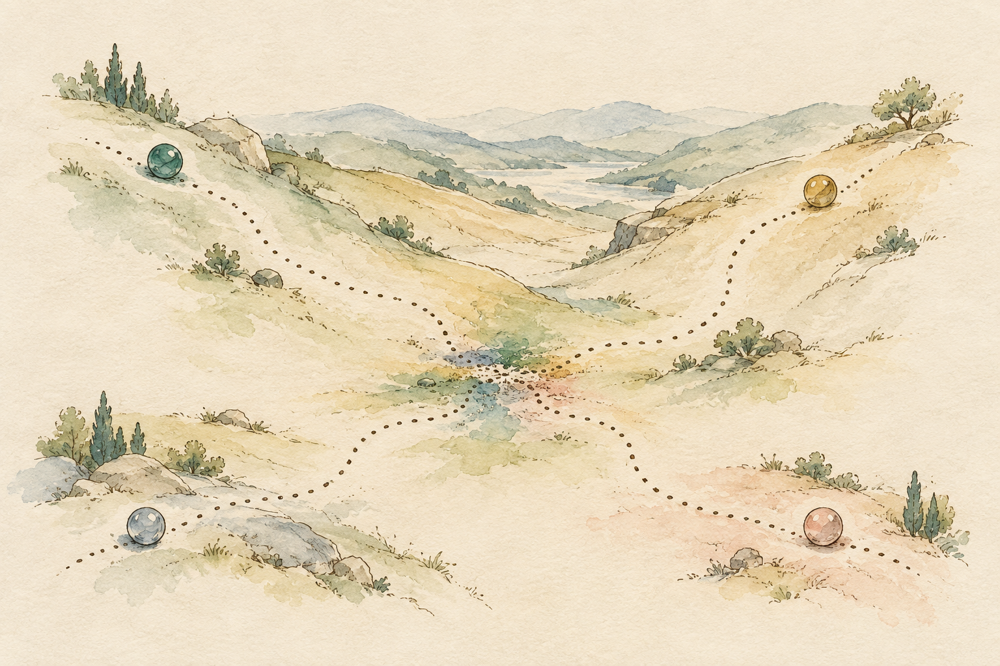
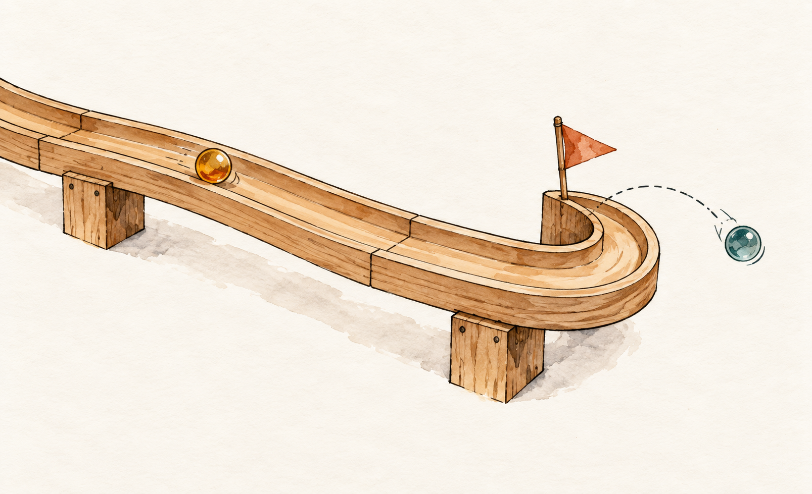
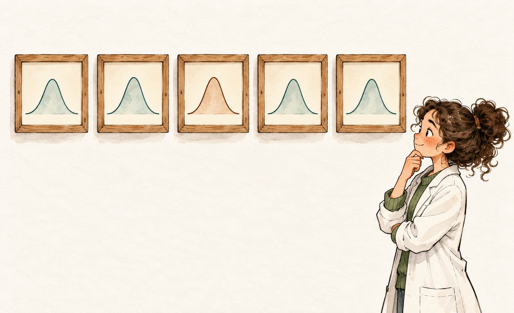

# MCMC and model checking {#sec-mcmc-model-checking}

```{r}
#| include: false

library(ggplot2)

Plot_theme <- source("functions/plot_theme.R")
Plot_theme <- Plot_theme$value
```

Let's take stock of where we actually stand. @sec-intro-applied-modeling gave us a first posterior for the ischemia effect on GFAP intensity, built on a prior that had no opinion at all. @sec-bayesian-core-workflow opened up what that posterior even *is* (credibility, reallocated from prior to data via the likelihood) and used a fake dataset with a known true answer to convince ourselves the machinery works. @sec-priors-regularization finally gave that model something to actually believe going in: a prior built from real reasoning about what a GFAP number can plausibly be, defended with real arguments, refit on the same fifteen animals.

That's three chapters of careful, deliberate model-building. And yet, if I'm honest with you, we still haven't asked the one question a skeptical reviewer would ask first: **does any of this actually describe the data we collected?** We've checked that the model's *machinery* runs correctly: the sampler converges, the recovery exercise in @sec-bayesian-core-workflow found the truth we'd hidden in simulated data. We have not checked whether the *fitted* model, the one built on real GFAP measurements, produces predictions that look anything like those real measurements. Those are genuinely different questions, and conflating them is exactly the kind of thing that gets discovered during peer review instead of before it. This chapter closes that gap, and with it, closes Part 1 of the book.

It's worth pausing on why that question deserves a whole chapter instead of a shrug. Go all the way back to @sec-intro-applied-modeling, where I asked you to think of statistical modeling not as a search for asterisks, but as the recognition that our data is the product of an underlying biological process, and that our job is to propose a theoretically motivated candidate for that process, not just a line that happens to fit. A model built on that premise makes an implicit promise: if this really is a plausible story for how cerebral ischemia produces a given GFAP reading, then running that story forward should produce data that looks like the data we actually collected. A posterior predictive check is nothing more exotic than cashing in that promise. It's the same question we opened the book with, asked one more time, now that we have a specific fitted model to hold to it: not "is this difference significant," but "could this model have plausibly generated what I measured." Everything in this chapter, the MCMC diagnostics and the predictive checks alike, is in service of answering that one question honestly, rather than stopping at a coefficient table and calling it a day.

## What is MCMC actually doing?

We've been using the term "MCMC" since @sec-intro-applied-modeling, in the loosest possible way: "the machinery that draws thousands of plausible parameter values and lets them accumulate into the posterior's shape." That's true, but it's also the kind of description that lets you nod along without actually picturing anything. Let's fix that now, because understanding what's happening under the hood is the only way the diagnostics you're about to read stop being a checklist you follow on faith.

Picture the posterior as a landscape, with one twist that I'll explain in a moment: every possible combination of parameter values (an intercept, a slope, a residual noise level) is a point on a map, and the *depth* of the terrain at that point reflects how plausible that combination is, given the priors and the data. Plausible combinations sit at the bottom of a valley; implausible ones sit high up on its steep walls. (Stan builds its landscape from the negative logarithm of the posterior density, which is simply the posterior turned upside down: the tallest peak of the density becomes the deepest point of the basin. I'm telling you this now so the physics in a few paragraphs makes sense: marbles roll *downhill*.) Most of that map is high, steep, and uninteresting: wildly implausible parameter combinations, contributing almost nothing. Somewhere on it, though, there's a basin of plausible combinations, clustered together, and our entire goal is to characterize the shape of that basin: where its deepest point sits, how wide it is, whether it's a single smooth bowl or something stranger.

The most naive way to explore that landscape is a blind random walk: stand somewhere, propose a random nearby step, and go there if it's deeper into the basin, mostly (with some probability of accepting a step toward shallower ground too, so you don't just settle at the very bottom and ignore the rest of the bowl). That's the classic Metropolis algorithm, and it works, in principle, on any landscape. In practice, on the many-dimensional landscapes a real model produces (even our simple two-group model has three dimensions, an intercept, a slope, and sigma, and hierarchical models later in the book will have dozens), a blind random walk spends most of its life wandering nowhere useful. It has no sense of *which direction* is downhill; it just tries steps and hopes.

Stan, the engine `brms` writes code for underneath the hood, uses something smarter: [Hamiltonian Monte Carlo]{style="color:green; font-weight:bold;"}. Think of it less like a blindfolded hiker taking random steps and more like a marble given a firm, randomly-aimed push and then left to roll, using the actual slope of the terrain to carry it efficiently across the landscape instead of stumbling across it one step at a time [@gelman2026]. The push is drawn anew at every iteration, which is what keeps the marble from simply sinking to the bottom and stopping: it keeps circulating through the basin, spending more time where the basin is deep (plausible) and less where it is shallow. Because it uses the *gradient* (literally, the slope of the terrain at the marble's current position), it can propose far larger, far better-informed moves than a blind random walk ever could, which is a large part of why `brms` models with dozens of parameters remain tractable at all.

Here's the part that matters for what comes next: `brms` doesn't send out one marble, it sends out several: by default, four independent **chains**, each starting from a different random position on the landscape, each rolling its own physics-informed path and reporting back the region it explored. If the landscape is well-behaved and all four marbles genuinely explored the same basin, we can trust that what they collectively mapped out *is* the posterior. If they didn't (if one marble got stuck on a ledge the others never visited, or the "gradient" broke down somewhere the physics simulation couldn't handle), we need to know that before we trust a single number that came out of the fit. That's exactly what the three diagnostics you've already glimpsed in @sec-intro-applied-modeling and @sec-bayesian-core-workflow are built to catch. Let's take them one at a time, properly, instead of as a checklist.

{#fig-mcmc-marbles fig-align="center" width="90%" fig-alt="Watercolor sketch of a rolling landscape of grassy hills and a distant lake, with four small glass marbles (teal, ochre, grey-blue and blush) at four corners. Each leaves a dotted trail down the slopes, and all four trails converge and overlap in the valley at the center."}

::: callout-tip
### Rhat: do the marbles agree with each other?

**Rhat** compares the *between-chain* variance to the *within-chain* variance for a given parameter. If all four marbles are honestly exploring the same terrain, they should each report roughly the same spread of values for, say, the ischemia effect, and Rhat should sit right around 1. If one chain got stuck somewhere the others didn't reach, that chain's reported values will look systematically different from the rest, inflating the between-chain variance relative to the within-chain variance, and Rhat climbs above 1. **Rhat < 1.01** is the modern threshold [@gelman2026], tighter than the "< 1.1, roughly" rule of thumb you'll find in some older references, because a value comfortably under 1.1 can still hide real disagreement between chains that a stricter, rank-based version of the statistic will catch. A high Rhat doesn't tell you *why* the chains disagree; it just tells you, honestly, that they do, and that nothing downstream of this parameter should be trusted until that's resolved.
:::

::: callout-tip
### Effective sample size: how many *independent* looks did you actually get?

Here's a subtlety worth sitting with. Each marble's next position depends on where it currently is; it doesn't teleport to a fresh, independent spot on the landscape every iteration. That means consecutive draws within a single chain are *autocorrelated*: draw number 501 looks a bit like draw number 500, which looks a bit like draw number 499. If you naively treated 4,000 MCMC draws as 4,000 independent observations of the posterior, you'd be overstating how much you actually know, in exactly the same way that counting the same animal's repeated measurements as independent replicates overstates your sample size in a pseudoreplication problem. **Effective sample size (ESS)** answers "given this autocorrelation, how many *genuinely independent-ish* draws did we effectively end up with?" It's reported separately for the bulk of the distribution (`ess_bulk`, governing how well you've pinned down the center) and the tails (`ess_tail`, governing how well you've pinned down the far edges, which matters directly for the width of a 95% credible interval). **Both above 400** is the standard we've used since @sec-bayesian-core-workflow [@gelman2026]. A low ESS with a fine-looking Rhat is a specific, informative failure pattern: the chains agree on roughly where the basin is, but each one is exploring it so sluggishly, taking such small, correlated steps, that you don't actually have enough *distinct* information to trust a precise summary.
:::

::: callout-important
### Divergent transitions: the sampler catching its own mistake

The first two diagnostics are both, in a sense, *summary statistics*: you compute them after the fact, from the finished chains, and they tell you about a pattern across many draws. A **divergent transition** is categorically different: it's Stan's own physics simulation flagging, in real time, that something went wrong on one specific proposed step. Recall the marble-rolling picture: Hamiltonian Monte Carlo works by numerically approximating a physical trajectory, in small discrete steps, across the landscape. In regions where the landscape's curvature changes very sharply (a steep-walled valley, a region where the terrain bends abruptly), that step-by-step approximation can become numerically unstable and diverge wildly from the trajectory it's supposed to be following: the marble effectively flies off the rails. Stan detects this and flags the transition as divergent, which means the region of the posterior near that transition wasn't reliably explored, and there's no way to know from the outside how much of the posterior's true shape that unreliable region is hiding. **Zero divergent transitions** is the standard, full stop: not "a handful, but the posterior looks fine anyway." A model with divergences needs a smaller step size (`adapt_delta` closer to 1) at minimum, and often a genuine rethink of the model or its priors if divergences persist.
:::

{#fig-mcmc-derail fig-align="center" width="85%" fig-alt="Watercolor sketch of a wooden marble-run track on two supports, curving into a sharp hairpin bend. An ochre marble rolls safely along the smooth section, a small rust-colored flag stands at the bend, and a teal marble has flown off the track in a dashed arc."}

## Revisiting the informed model from @sec-priors-regularization

With that mental model in hand, let's put it to work on the actual fit we care about: `informed_fit`, the model carrying the real, defended prior we built last chapter (the same formula, the same fifteen animals, cached exactly where @sec-priors-regularization left it).

```{r}
library(here)
library(brms)
library(posterior)

cell_data <- read.csv(here("project/AnalysisData/Cells_Gfap-Pdgfrb.csv"))
cell_data_sub <- subset(cell_data, DPI %in% c(0, 3))
cell_data_sub$Condition <- factor(cell_data_sub$Condition, levels = c("SHAM", "MCAO"))

priors_v1 <- c(
  prior(normal(30, 20), class = "Intercept"),
  prior(normal(0, 150), class = "b", coef = "ConditionMCAO"),
  prior(normal(0, 30), class = "sigma")
)

informed_fit <- brm(
  Gfap_Intensity ~ Condition,
  data = cell_data_sub,
  prior = priors_v1,
  seed = 123,
  file = "models/priors-regularization_fit2.rds",
  file_refit = "never"
)
```

@sec-priors-regularization already reported that this fit's Rhat and ESS looked clean, in passing, before moving on to the more interesting question of what the informed prior actually changed. Let's not let that be a drive-by claim anymore. Now that you know exactly what each number is checking, look at the full table:

```{r}
#| label: tbl-mcmc_diagnostics
#| tbl-cap: MCMC diagnostics for the informed ischemia model, one row per parameter

library(gt)

informed_diag <- summarise_draws(as_draws_df(informed_fit), "rhat", "ess_bulk", "ess_tail")
informed_diag <- subset(informed_diag, variable %in% c("b_Intercept", "b_ConditionMCAO", "sigma"))

n_divergent <- sum(subset(nuts_params(informed_fit), Parameter == "divergent__")$Value)

stopifnot(max(informed_diag$rhat) < 1.01, min(informed_diag$ess_bulk) > 400, min(informed_diag$ess_tail) > 400)

gt(informed_diag) |> fmt_number(columns = -variable, decimals = 3)
```

Every Rhat in that table sits at `r sprintf("%.3f", max(informed_diag$rhat))`, both effective sample sizes clear 400 for all three parameters, and we count `r n_divergent` divergent transitions across every chain. Given what you now know each of those numbers is actually checking (chain agreement, effective independence, the sampler's own error flag), that's a fit we can trust to have explored its posterior honestly.

Numbers in a table are one kind of evidence; a rank overlay plot is a more direct visual version of the same Rhat check, and it's worth seeing at least once so a table full of 1.00s isn't the only form this diagnostic ever takes for you. If the four chains are genuinely exploring the same landscape, each chain's draws, ranked and pooled together, should look uniformly scattered across the full range of ranks: no chain should be systematically stuck reporting only low or only high values relative to the others.

```{r}
#| label: fig-mcmc_rank_overlay
#| fig-cap: Rank overlay plot for the informed model's three parameters (each colored line is one chain's ranked draws, and they should overlap like this)
#| fig-width: 6.5
#| fig-height: 4

mcmc_plot(informed_fit, type = "rank_overlay", pars = c("b_Intercept", "b_ConditionMCAO", "sigma")) +
  Plot_theme +
  theme(axis.text.x = element_text(size = 10, angle = 45, hjust = 1))
```

Four roughly flat, overlapping lines, no chain systematically riding above or below the others, exactly the picture Rhat's single number was already telling us, just made visible instead of abstracted into a statistic.

::: callout-tip
### Frequentist equivalent

There isn't really a parallel step here: this whole diagnostic layer is specific to the Bayesian fit, a consequence of estimating the posterior by simulation rather than by a closed-form formula. `lm()` doesn't sample anything, so it has nothing analogous to converge or fail to converge; its "did the numbers come out right" question is answered by different machinery entirely (numerical stability of the underlying matrix algebra, which is rarely an issue for a model this simple). This is one of the real costs of the Bayesian approach, worth naming honestly rather than glossing over: you get a full posterior distribution and the flexibility to fold in real prior knowledge, but you also inherit a whole extra layer of "did my estimation procedure actually work" that a frequentist fit doesn't ask you to check.
:::

## Does the model actually describe our data? The posterior predictive check

Here's the thing about everything we've just verified: it tells us the sampler explored the posterior honestly. It says nothing at all about whether that posterior (however faithfully explored) actually describes the biology in front of us. A perfectly converged model can still be a bad model. MCMC diagnostics are quality control on the *exploration*; what we need now is quality control on the *destination*.

Think about how you'd actually settle this with a skeptical colleague. You wouldn't show them Rhat. You'd say: "here's what my fitted model thinks GFAP data should look like, and now here's what I actually measured. You tell me if you can spot the difference." That comparison, done properly and repeatedly rather than as a single eyeballed glance, is exactly what a **posterior predictive check (PPC)** is. Formally: draw a large number of parameter sets from the posterior, and for each one, simulate a brand-new dataset the same size and shape as the real one, using the model's own likelihood (the same generative move we practiced in @sec-bayesian-core-workflow, except now the parameters feeding it come from a posterior fit to real data instead of numbers we picked ourselves). If the fitted model is a reasonable description of reality, those simulated datasets, taken as a group, should be hard to tell apart from the real one. As McElreath puts it, a Bayesian model is generative by construction (it can always simulate new observations from its own parameters), and a posterior predictive check is simply that generative machinery, pointed at its own fit, as a form of self-criticism [@mcelreath2020].

{#fig-mcmc-lineup fig-align="center" width="90%" fig-alt="Watercolor sketch of five small wooden picture frames hung in a row on a pale wall, each holding a bell-shaped curve: four in teal and the third in rust-orange. A researcher in a white lab coat and green sweater stands at the right, chin on hand, studying them with a puzzled smile."}

::: callout-note
### A deliberate shortcut, for now

An honest posterior predictive check is, at its core, "compare two distributions visually", which is precisely what Part 2, coming right after this chapter, is going to teach you to do properly with `ggplot2` (@sec-eda-ggplot is where the plotting itself starts): density plots, overlaid distributions, the whole toolkit. We haven't gotten there yet, and I'd rather not ask you to half-learn distributional plotting on the fly, buried inside a chapter about something else. So for this chapter, we lean entirely on `brms`'s and `bayesplot`'s turnkey `pp_check()` function: it does exactly the comparison we need, out of the box, no custom plotting required. Once Part 2 has given you real `ggplot2` fluency with distributions, nothing stops a later chapter from coming back to this exact output and rebuilding it by hand, with more control over the presentation. That's a job for that future chapter, not this one.
:::

```{r}
#| label: fig-mcmc_ppc_dens
#| fig-cap: Posterior predictive check with simulated GFAP datasets from the fitted informed model (thin lines) against the real observed data (dark line)
#| fig-width: 6
#| fig-height: 4

pp_check(informed_fit, ndraws = 100) +
  labs(x = "GFAP intensity", y = "Density") +
  Plot_theme
```

The dark line is the density of our fifteen real GFAP measurements. Every thin line is a full dataset the fitted model simulated from one posterior draw. What we're looking for is exactly what a spot-the-difference puzzle asks of you: does the dark line sit comfortably inside that cloud of simulated curves, or does it stick out somewhere the model never predicted? Here, it sits right in the thick of the cloud, so the model isn't systematically missing the shape of what we actually measured.

But "eyeball the overall shape" is a coarse check, and @sec-priors-regularization left us with a specific, concrete worry we shouldn't let slide just because the overall density looks fine: our Gaussian model has no built-in knowledge that GFAP intensity can't be negative, and the *prior*-only simulation back in that chapter put real mass below zero. Has fitting the model to real data fixed that, or is it still lurking in the posterior predictions we'd actually report? Let's check it directly instead of assuming the dense-looking overlap above already answered it: we'll reload that same prior-only fit from @sec-priors-regularization (cached, no refitting) and compare its simulated negative values against the informed posterior's:

```{r}
prior_check_fit <- brm(
  Gfap_Intensity ~ Condition,
  data = cell_data_sub,
  prior = priors_v1,
  sample_prior = "only",
  seed = 123,
  file = "models/priors-regularization_fit1.rds",
  file_refit = "never"
)
```

```{r}
#| include: false

prior_draws_y <- posterior_predict(prior_check_fit, ndraws = 2000)
prop_negative_prior <- mean(prior_draws_y < 0)

post_draws_y <- posterior_predict(informed_fit, ndraws = 2000)
prop_negative_post <- mean(post_draws_y < 0)
```

Before any real data had spoken, about `r round(prop_negative_prior * 100, 1)`% of the values our priors alone were willing to propose were negative, a genuinely sizeable blind spot, which makes sense: a prior alone has nothing but our stated ranges to go on, and those ranges were deliberately generous. After fitting to the real fifteen animals, that fraction drops to `r round(prop_negative_post * 100, 1)`%. The data pulled the model's predictions decisively toward the plausible range, the same way it pulled the ischemia-effect estimate in @sec-priors-regularization, but a Gaussian likelihood still has no hard floor at zero, so the blind spot doesn't vanish entirely, it just shrinks by roughly a factor of five. We can see exactly where that shows up by checking the model's simulated *minimum* value against the real one, rather than just the shape of the whole curve:

```{r}
#| label: fig-mcmc_ppc_min
#| fig-cap: Posterior predictive check on the minimum simulated value, with the observed minimum (dark line) against the distribution of minimums from 2,000 simulated datasets
#| fig-width: 6
#| fig-height: 4

pp_check(informed_fit, type = "stat", stat = "min", ndraws = 2000) +
  labs(x = "Minimum simulated GFAP intensity", y = "Count") +
  Plot_theme
```

The real minimum sits inside the bulk of the simulated distribution rather than off in an extreme tail, so on the data we actually have (sham animals with a comfortable baseline, well clear of zero), this isn't a check that's currently failing us. But it's a check we should keep running on faith as-is, not one we've *solved*: shrink that sham baseline, or push into a dataset with genuinely low-intensity animals, and this exact same Gaussian assumption would start producing predictions no biologist would accept. Flagging that honestly here, rather than pretending a shrinking-but-nonzero fraction is the same as zero, is precisely the point of running this check at all.

Here's the question a careful reader should be asking right now: if the model is willing to generate physically impossible values at all, however rarely, why are we still using it? That deserves a real answer, not a shrug, because "the check found something" and "therefore abandon the model" are not the same move. Gelman and colleagues are explicit that a posterior predictive check is not a pass/fail gate: "the [usefulness of a model]{style="color:green; font-weight:bold;"} is not unitary but depends upon which inferences or predictions we wish to make. And this in turn influences how we critique and expand models" [@gelman2026]. A few chapters later in the same book, they put it even more plainly: "there is no universal way to decide when a check fails or whether failure requires adjustments to the model... we may tolerate that the model fails to capture certain aspects of the data, or it may be essential to invest in improving the model," depending on what's actually at stake for the question being asked [@gelman2026]. McElreath makes the identical point from the other side of the aisle: "the goal is not to test whether the model's assumptions are 'true,' because all models are false... you have to use your judgment... to decide whether any particular failure is or is not important" [@mcelreath2020]. Both are restating, in their own words, an idea usually credited to the statistician George Box: every model is a simplification by design, so the real question was never "is this model true," it's "is this model wrong in a way that actually matters here."

For our GFAP model, it doesn't. Our inferential target is the ischemia effect itself, the shift in group means we've been estimating since @sec-intro-applied-modeling, not a literal simulation of every possible GFAP reading down to its physical boundary. Gelman and colleagues describe almost this exact situation directly, fitting a normal model to exam scores bounded between 0 and 20 and finding that the posterior predictive distribution occasionally proposes scores above 20. Their verdict: "for our purposes we are not so concerned about these occasional out-of-range predictions, just as we are not concerned here that the model makes continuous predictions even though the data are discrete" [@gelman2026]. Swap "exam score" for "GFAP intensity" and "above 20" for "below 0," and that's precisely our situation: sham animals sit comfortably around 30 units with a spread of about 20, far enough from the zero boundary that the handful of simulated draws dipping below it are a tail artifact of an unbounded family, not a sign that the model has misjudged where the real data actually lives.

That's not a blanket license to ignore every PPC failure, and the same sources are just as explicit about when a misspecification *does* force your hand: when it visibly shifts the location or width of the posterior you actually care about, not just its unused tails. Gelman and colleagues walk through a case where a Gaussian model fit to strictly positive time-to-event data pushed real negative predictive mass into the fit and distorted both the mean trajectory and the uncertainty around it; at that point, switching to a Gamma or lognormal family stopped being optional [@gelman2026]. Ours isn't that case: the shrinkage story from @sec-priors-regularization, the clean MCMC diagnostics earlier in this chapter, and the dens_overlay check above all point to a posterior that's already doing its job on the question we're actually asking. If a future chapter pushes this same kind of model into a regime where the boundary genuinely matters (a dataset with animals near zero intensity, say, or one of the strictly-positive outcomes @sec-count-regression and @sec-beta-robust-regression take on directly), that's exactly the point where tolerating the Gaussian stops being defensible, and a bounded family, reached through the kind of link-function "doorway" @sec-glm-intro introduces, becomes the right call, not a nicety.

::: callout-tip
### Frequentist equivalent

The structurally equivalent step on the frequentist side is residual diagnostics: does the pattern of leftover variation, once the model's fitted values are subtracted out, look the way the model assumes it should? For our `lm()` fit, that means a residuals-vs-fitted plot (checking for patterns the model's structure should have captured but didn't) and a Q-Q plot (checking the normality assumption the model's inference leans on).

```{r}
#| label: fig-mcmc_lm_diagnostics
#| fig-cap: Frequentist residual diagnostics for the same ischemia model
#| fig-width: 7
#| fig-height: 3.5

library(parsnip)
library(broom)

parsnip_model <- linear_reg() %>%
  set_engine("lm") %>%
  fit(Gfap_Intensity ~ Condition, data = cell_data_sub)

lm_diag <- augment(parsnip_model$fit)

p1 <- ggplot(lm_diag, aes(x = .fitted, y = .resid)) +
  geom_hline(yintercept = 0, linetype = "dashed", color = "grey40") +
  geom_point(color = "#0072B2", size = 2) +
  labs(x = "Fitted value", y = "Residual") +
  Plot_theme

p2 <- ggplot(lm_diag, aes(sample = .resid)) +
  stat_qq(color = "#0072B2", size = 2) +
  stat_qq_line(color = "grey40", linetype = "dashed") +
  labs(x = "Theoretical quantiles", y = "Sample quantiles") +
  Plot_theme

library(patchwork)
p1 + p2
```

```{r}
#| include: false

lm_diag$Condition <- cell_data_sub$Condition
resid_range_sham <- range(lm_diag$.resid[lm_diag$Condition == "SHAM"])
resid_range_mcao <- range(lm_diag$.resid[lm_diag$Condition == "MCAO"])
```

Look at what those two panels are actually showing, point by point, rather than taking "the diagnostics look fine" on faith. The residual-vs-fitted plot has exactly two clusters of points, not a scatter spread across a continuous x-axis, because our model has a single two-level categorical predictor: every sham animal shares the same fitted value (the sham group's intercept), and every ischemic animal shares the same fitted value (intercept plus slope). So what that panel is actually letting us compare isn't a left-to-right trend, it's the *spread* of each cluster against the other. The sham cluster sits tight, residuals bunched between `r round(resid_range_sham[1], 1)` and `r round(resid_range_sham[2], 1)`. The ischemic cluster is visibly wider, stretching from `r round(resid_range_mcao[1], 1)` to `r round(resid_range_mcao[2], 1)`, more than double the sham group's range. That's not a subtle pattern to squint at: it's exactly the kind of unequal-variance signal @sec-linear-regression-assumptions will teach you to name formally as heteroscedasticity, sitting in plain view the moment you actually look at a residual plot instead of stopping at a coefficient table. It also tracks the biology: a sham animal's GFAP reading is mostly measurement noise around a stable baseline, while an ischemic animal's reading reflects a genuinely variable injury response riding on top of that same noise, so of course it swings around more.

The Q-Q plot is asking a different question of those same residuals: sort them smallest to largest, and compare each one to where a perfectly normal distribution would expect it to fall. Here, the bulk of the points, from roughly theoretical quantile −1 to +1, track the dashed reference line closely, which is the reassuring part: ordinary-sized residuals behave the way the model's normality assumption expects. The two most extreme points, the one near the bottom-left and the one near the top-right, are exactly the `r round(resid_range_mcao[1], 1)` and `r round(resid_range_mcao[2], 1)` residuals contributed by that wider ischemic cluster we just flagged, and they still sit close enough to the line that this isn't a badly misbehaving tail, just the two points carrying the most spread. With only fifteen animals total, that's about as well-behaved a Q-Q plot as you should expect; it wouldn't take a much larger ischemic-group variance before this same plot started bowing visibly away from the line at precisely those extremes.

Both diagnostics are asking essentially the same underlying question a posterior predictive check asks (does the fitted model's account of the noise match the noise we actually observe?), just from the frequentist side of the fence, using a single fitted line and its leftovers rather than an entire posterior of simulated datasets. What the Bayesian PPC buys you that a residual plot alone can't: a *distribution* over how extreme a statistic like "the minimum simulated value" could plausibly be, rather than one fixed set of residuals to eyeball. That difference matters more the smaller and noisier your data gets, which is exactly the situation @sec-priors-regularization showed you a prior can help with, and this chapter has now shown you how to actually check.
:::

## When a check fails: closing the loop

We got lucky, in a sense: every check in this chapter came back clean enough to trust. It's worth being explicit about what happens when one doesn't, because it will, eventually, on some model in your own work, and I don't want the only example you've seen to be one where everything just worked.

Go back to the model-infer-check-improve loop from @sec-bayesian-core-workflow. A failed posterior predictive check isn't a dead end, and it isn't a verdict that Bayesian modeling "doesn't work"; it's the **check** step doing exactly its job, catching a mismatch between what your model assumes and what your data actually looks like, so that you can act on it before anyone downstream trusts a number that doesn't deserve it. The specific fix depends entirely on what the check revealed: a systematically bad group-wise tail might call for a different response family (@sec-glm-intro opens up that framework properly, with Poisson and negative binomial for counts in @sec-count-regression and beta regression for proportions in @sec-beta-robust-regression, all built for outcomes a plain Gaussian can't honestly represent); a mismatch concentrated in one particular subgroup might point to a missing predictor rather than the wrong family entirely. We're not solving that here (our checks didn't demand it), but naming the next move now means you'll recognize it as a normal, expected part of the workflow the first time a check of your own comes back genuinely unhappy, rather than something to be embarrassed about.

## Closing Part 1

Look back at the arc these four chapters actually walked. We started with a single worked example and a model that didn't know anything going in (a deliberately naive first pass, so we'd have something honest to improve on). We opened up what a posterior really represents, and used a positive control with a known answer to earn our trust in the fitting machinery itself. We replaced that model's flat default with a prior built from real reasoning, and watched it do real work exactly where a frequentist fit has no equivalent lever to pull: a small, noisy sample. And in this chapter, we finally asked the question we'd been quietly deferring since @sec-intro-applied-modeling: not just "did the sampler behave," but "does the fitted model actually look like the data we collected". And we now know precisely what each of the standard MCMC diagnostics is protecting us from, not just that we're supposed to check them.

That's the whole apparatus of Bayesian inference, built once, on one small dataset, so that every applied chapter from here forward can lean on it without re-deriving it. What we still haven't done, on purpose, is *really* look at `cell_data`: no formal distributions, no relationships between variables, no hunting for the kind of structure that would make you rethink a model before you've even fit it. That's exactly where we're headed next. Part 2 opens the dataset back up and teaches you to see it properly, with the `ggplot2` fluency this chapter deliberately borrowed against by leaning on `pp_check()` instead, and everything you learn there will, eventually, loop right back around to sharpening the very posterior predictive checks this chapter just introduced.
