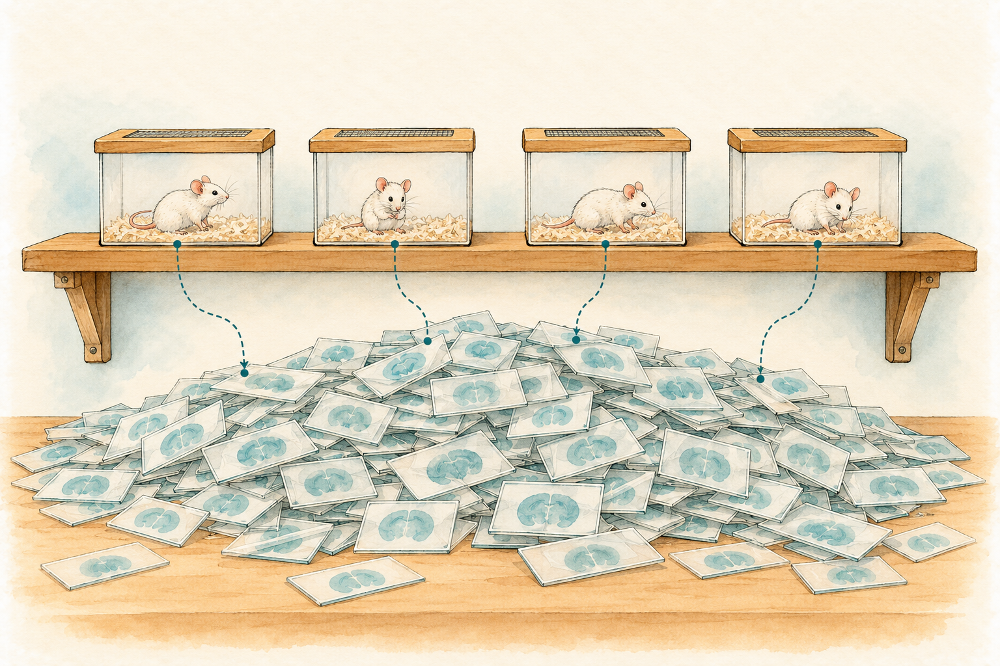

# Untangling cells, sections and animals {#sec-multilevel-varying-intercepts}

```{r}
#| include: false

library(ggplot2)
library(here)
library(brms)
library(lme4)
library(ggdist)
library(patchwork)

# The book's shared plot theme (this also loads the legend helpers)
Plot_theme <- source("functions/plot_theme.R")
Plot_theme <- Plot_theme$value

# Okabe-Ito colors used for the four days after ischemia and the two hemispheres
col_dpi <- c("0D" = "#000000", "5D" = "#E69F00", "15D" = "#D55E00", "30D" = "#0072B2")
col_hemi <- c("Right" = "#0072B2", "Left" = "#D55E00")

# Sampler settings for the multilevel fits (a higher adapt_delta, as the section on checks explains)
ml_control <- list(adapt_delta = 0.95)

# Median and 95% credible interval of a vector of draws, as text for the prose
qi <- function(x, digits = 2) {
  q <- unname(quantile(x, c(0.5, 0.025, 0.975)))
  sprintf("%s (95%% credible interval %s to %s)", round(q[1], digits), round(q[2], digits), round(q[3], digits))
}
```

If you have ever counted cells in brain sections, you know the moment I am going to describe. You have stained, imaged and counted, and the spreadsheet in front of you has four hundred rows. A reviewer, a labmate or your own conscience asks the innocent question: *how many animals is that?* The honest answer is thirty-one, and the number in the column that your software reports as the sample size is four hundred. This gap is the problem that started this book. In the linear models I told you that `cell_data` has one row per animal by design, and that the moment you go below the animal level the rows stop being independent evidence (@sec-linear-regression-assumptions). In the generalized linear models I treated independent what was not, again and again, and wrote down the debt (@sec-beta-robust-regression). This is the chapter where the debt gets paid, with the data that created it: brain regions, inside brain sections, inside mice.

The question is one a stroke lab asks every week. **Does cerebral ischemia reduce the density of NeuN-positive neurons in the injured cortex, and how fast does it happen?** NeuN is a protein found in the nucleus of mature neurons, and a stained section lets you count the cells that carry it inside any region you draw. A caveat that matters for the wording of everything that follows: a neuron that dies is no longer counted, but so is one that is alive and has stopped expressing NeuN, and a count of NeuN-positive cells cannot tell the two apart. So what I will estimate is the density of NeuN-positive neurons, not neuron survival.

## The experiment and the file {#sec-neun-data}

The data come from a study of the glial scar after cerebral ischemia [@manriquecastano2024], and they are public [@manriquecastano2024osf]. Brains were sectioned, stained for NeuN and imaged by widefield microscopy at 5x. Each tissue section was aligned to a reference atlas with ABBA, an extension for Fiji, and every brain region of the atlas that appears in the section was outlined and its NeuN-positive cells counted. There are 31 mice. They were taken at 0, 5, 15 and 30 days post-ischemia (DPI), and the 0 D mice are animals without ischemia, our baseline. There is a design fact that shapes everything in this chapter: to stain a brain you have to remove it, so **each mouse contributes to exactly one DPI**. Time is therefore a comparison *between* mice, not a change followed *within* mice (following animals through time is the job of @sec-longitudinal-timeseries). The hemisphere, in contrast, varies *within* each section: the left cortex, where the injury happened, and the right cortex, which serves as a within-animal reference.

```{r}
# Read the file as it came; check.names = FALSE keeps the original column names
neun_raw <- read.csv(here("project/AnalysisData/5x_NeuN_AnnotationsSummary.csv"), check.names = FALSE)

# The area column carries an encoding artifact in its name (micro sign), so find it by its start
area_col <- grep("^Area", names(neun_raw), value = TRUE)

# Keep the columns we need, with plain names (the file spells 'Negatie' for 'Negative')
neun <- data.frame(
  image = neun_raw$Image,
  structure = neun_raw$Name,
  class = neun_raw$Class,
  side_col = neun_raw$Side,
  detections = neun_raw[["Num Detections"]],
  negative = neun_raw[["Num Negatie"]],
  positive = neun_raw[["Num Positive"]],
  pos_pct = neun_raw[["Positive %"]],
  density = neun_raw[["Num Positive per mm^2"]],
  area_um2 = neun_raw[[area_col]]
)

# The image name carries the design: ECM_Exp2_<mouse>_<days>D_Scene<n>.tif
parts <- strsplit(sub("\\.tif$", "", neun$image), "_")
neun$mouse <- sapply(parts, `[`, 3)
neun$dpi_days <- as.integer(sub("D$", "", sapply(parts, `[`, 4)))
neun$scene <- sapply(parts, `[`, 5)
neun$scene_n <- as.integer(sub("Scene", "", neun$scene))

# Hemisphere comes from the Class column ("Left: CTX"); the Side column is not usable
neun$hemi <- sub(":.*$", "", neun$class)

# Section ids repeat across mice (every mouse has a Scene1), so build a unique one
neun$section <- paste(neun$mouse, neun$scene, sep = ":")
```

One row of `neun` is one brain **region** (a hemisphere and a structure) in one tissue section of one mouse, and the file has `r format(nrow(neun), big.mark = ",")` of them. The column `Image` is the one that holds the design: its name has the form `ECM_Exp2_M01_5D_Scene1.tif`, where the first two pieces are constants (study and experiment), `M01` is a mouse that is unique in the file, `5D` is the number of days after ischemia and `Scene1` is the section. Scene 1 is the most anterior section of a brain and scene 7 the most posterior. I derived `mouse`, `dpi_days` and `scene` from that name in code instead of typing them anywhere, which is the same habit as in @sec-eda-data-quality: the raw file stays exactly as it came, and every decision lives in code. `Class` says hemisphere and structure (`Left: CTX`), and `Name` the structure: cortex (CTX), cerebral nuclei (CNU), interbrain (IB), midbrain (MB) and fiber tracts. `Num Positive` is the number of NeuN-positive cells in the region, `Area` is in square micrometers and `Num Positive per mm^2` is the density.

### What the design guarantees, run as code

Before modeling anything I write down the facts that the *design* guarantees and make the computer check them, as in the open-field section of @sec-beta-robust-regression. A rule about the design catches errors that no look at a single row can find.

```{r}
#| label: tbl-neun_rules
#| tbl-cap: Rules that the design guarantees, run on the raw file. A count of zero means the rule holds.

# Mice that appear in more than one DPI
r_dpi <- sum(tapply(neun$dpi_days, neun$mouse, function(x) length(unique(x))) > 1)

# Image and class pairs that appear more than once
r_dup <- sum(duplicated(neun[, c("image", "class")]))

# Rows where the density is not the count over the area in mm2 (the file rounds to 2 decimals)
r_dens <- sum(abs(neun$positive / (neun$area_um2 / 1e6) - neun$density) > 0.06)

# Rows where positive plus negative cells do not add up to the detections
r_sum <- sum(neun$positive + neun$negative != neun$detections)

# Cortex sections that lack one of the two hemispheres
cx_all <- neun[neun$structure == "CTX", ]
r_hemi <- sum(tapply(cx_all$hemi, cx_all$section, function(x) length(unique(x))) != 2)

# Annotated regions in which no NeuN-positive cell was counted
absent <- neun[neun$positive == 0, ]

rules <- data.frame(
  Rule = c("Each mouse belongs to one DPI (mice that break it)",
           "Each image and class pair appears once (duplicates)",
           "Density equals positive cells over area in mm2 (rows that break it)",
           "Positive plus negative cells equal detections (rows that break it)",
           "Every cortex section has both hemispheres (sections that break it)",
           "An outlined region contains NeuN-positive cells (rows with zero)"),
  Count = c(r_dpi, r_dup, r_dens, r_sum, r_hemi, nrow(absent))
)
knitr::kable(rules, row.names = FALSE)
```

@tbl-neun_rules says that five of the six rules hold: every mouse has one DPI (`r length(unique(neun$mouse[neun$dpi_days == 0]))`, `r length(unique(neun$mouse[neun$dpi_days == 5]))`, `r length(unique(neun$mouse[neun$dpi_days == 15]))` and `r length(unique(neun$mouse[neun$dpi_days == 30]))` mice at 0, 5, 15 and 30 D), nothing is duplicated, the density is the count over the area, the counts add up, and the `r nrow(cx_all)` cortex rows are `r length(unique(cx_all$section))` sections times two hemispheres. The sixth rule is the finding. `r nrow(absent)` outlined regions have no NeuN-positive cell, and when I look at them, `r sum(absent$detections == 0)` have no detected cell at all: the left and right cerebral nuclei of one mouse (M16, 15 D) and the left and right midbrain of another (M25, 30 D), in a section where the structure is barely present or absent. The fifth (the left cerebral nuclei of mouse M10 at 30 D, scene 6) has `r absent$detections[absent$detections > 0]` detections, none of them positive, in an area of `r round(absent$area_um2[absent$detections > 0] / 1e6, 3)` mm². An absent region is a missing region, not a true zero: a zero density would say that the tissue was there and had no neurons, which is a claim about the brain that these rows do not support. I treated all five as not measured and left them out, and for the fifth I want you to know that it is a judgment call I cannot settle from the file. None of them is in the cortex, so none can change what follows.

Two more columns are useless, and it is worth saying so. `Side` is `r unique(neun$side_col)` in every row, so the hemisphere has to come from `Class`. `Positive %` is `r unique(neun$pos_pct[!is.na(neun$pos_pct)])` in every row where it is not missing, and missing in `r sum(is.na(neun$pos_pct))`, exactly the five empty regions: it carries no information and I do not use it. Finally, I leave the fiber tracts out. They are white matter, a bundle of axons with very few neuronal cell bodies, so a NeuN density there measures stray cells and the way the outline was drawn, not neurons.

### Sections that are missing

The question uses the cortex only: the structure that is present in every section, with `r nrow(cx_all) / 2` sections and a left and a right hemisphere in each of them.

```{r}
# The cortex, with factors in the order that makes the comparisons natural
cortex <- cx_all
cortex$dpi <- factor(paste0(cortex$dpi_days, "D"), levels = c("0D", "5D", "15D", "30D"))
cortex$hemi <- factor(cortex$hemi, levels = c("Right", "Left"))
cortex$log_dens <- log(cortex$density)

# Numbers used in the text
n_mice <- length(unique(cortex$mouse))
n_sect <- length(unique(cortex$section))
n_rows <- nrow(cortex)
sect_per_mouse <- table(unique(cortex[, c("mouse", "scene_n")])$mouse)
rows_mouse <- n_rows / n_mice
sect_mouse <- n_sect / n_mice
```

The design is not balanced, and @fig-neun_nesting shows how. Each mouse has between `r min(sect_per_mouse)` and `r max(sect_per_mouse)` sections in the file (`r sum(sect_per_mouse == 7)` of the `r n_mice` have all seven), and the later scenes are the ones that go missing: scene 7 exists in `r length(unique(cortex$mouse[cortex$scene_n == 7]))` mice. The numbers of mice per day are not equal either.

```{r}
#| label: fig-neun_nesting
#| fig-cap: "The nesting and the imbalance of the cortex data. Each row is a mouse, grouped by days post-ischemia; each column is a section from anterior (1) to posterior (7). A filled dot is a section where both cortices were measured, an open dot a section that is missing."
#| fig-alt: "Four stacked panels, one per day post-ischemia (0 D with 5 mice, 5 D with 8, 15 D with 8, 30 D with 10). In each panel every mouse has a row with seven positions. Most positions are filled black dots. Open grey circles mark the missing sections, which are concentrated in column 7 (the most posterior) and are scattered in columns 4 to 6 for a few mice."
#| fig-width: 6.5
#| fig-height: 8
#| warning: false

# One row per mouse (ordered by DPI) and one position for each of the seven scenes
mice_info <- unique(cortex[, c("mouse", "dpi")])
mice_info <- mice_info[order(mice_info$dpi, mice_info$mouse), ]
grid <- expand.grid(mouse = mice_info$mouse, scene_n = 1:7, stringsAsFactors = FALSE)
grid$dpi <- mice_info$dpi[match(grid$mouse, mice_info$mouse)]

# A position is filled when that section exists for that mouse
grid$present <- paste(grid$mouse, grid$scene_n) %in% paste(cortex$mouse, cortex$scene_n)
grid$present <- factor(ifelse(grid$present, "Section measured", "Section missing"),
                       levels = c("Section measured", "Section missing"))

# Panel titles carry the number of mice of each DPI
n_by_dpi <- table(mice_info$dpi)
grid$panel <- factor(paste0(grid$dpi, " (", n_by_dpi[as.character(grid$dpi)], " mice)"),
                     levels = paste0(names(n_by_dpi), " (", n_by_dpi, " mice)"))
grid$mouse <- factor(grid$mouse, levels = rev(mice_info$mouse))

# Filled dot = measured, open dot = missing; shape and color say the same thing
ggplot(grid, aes(x = scene_n, y = mouse, shape = present, color = present)) +
  geom_point(size = 2.6) +
  scale_shape_manual(values = c("Section measured" = 16, "Section missing" = 1)) +
  scale_color_manual(values = c("Section measured" = "black", "Section missing" = "grey55")) +
  scale_x_continuous(breaks = 1:7) +
  facet_grid(panel ~ ., scales = "free_y", space = "free_y") +
  labs(x = "Section (1 = anterior, 7 = posterior)", y = "Mouse", shape = NULL, color = NULL) +
  Plot_theme +
  theme(axis.text.y = element_text(size = 9), strip.text = element_text(size = 11)) +
  legend_top()
```

I drew @fig-neun_nesting as a grid of dots, one mark per section, because the point of the figure is the *structure*: mice contain sections, and the sections are not evenly spread. A table of "sections per mouse" would give the totals and hide that the holes sit in the posterior end of the brain. The design tip to keep is to show missingness as a shape you can see (an open dot), not as a blank.

::: {.callout-tip title="How to read this figure"}
Read it by rows first: each row is one mouse, and the dots in it are rows of the data that share that animal. Then read it by panels: the four panels are four groups of *different* mice, so the day-to-day comparison in this chapter is a comparison between panels, never within a row. Last, look for the open dots. A missing section is not a measured zero: it is a section that, for tissue or processing reasons, did not make it into the file.
:::

What should we do about the open dots? The same as with any other missing value in the book (@sec-eda-missing-data): ask why, and then say what the model assumes. Sections go missing when the tissue is small, damaged or cut badly, and that can be related to the injury itself, so I will not call it harmless. What I can say is what a multilevel model needs: it uses every section that exists, it does not need the same number from every mouse, and a mouse with fewer sections is simply a mouse about which we know a bit less. If the missing sections depend on something that the model includes, here the day, the inference is still valid; if they depend on the density itself, we cannot tell from these data, and @sec-missing-data-measurement-error is where that thread continues. Because the sections are ordered from anterior to posterior, I also checked whether position matters, and I will come back to it after the model.

### Every row, and the mice behind it

I draw every row before any model, with the mouse averages on top, because the structure of the data is what the rest of the chapter is about (@fig-neun_raw). I used `ggplot2::geom_point()` with `position_jitterdodge()` for the individual regions and bigger points for the average of each mouse in each hemisphere. A bar plot of mean density with asterisks would show one number per day and hide two things at once: that there are many rows per mouse, and that the mice themselves differ.

```{r}
#| label: fig-neun_raw
#| fig-cap: "NeuN-positive density in the cortex by day after ischemia and hemisphere. Small faint points are individual regions (a section's cortex in one hemisphere); large points are the average of one mouse in that hemisphere. The vertical axis is on a log scale."
#| fig-alt: "Four groups of paired points along days 0, 5, 15 and 30. In each group the blue points are the right hemisphere and the orange triangles the left. Right hemisphere densities stay around 850 cells per mm2 on every day. Left hemisphere densities are about 950 at day 0 and fall to roughly 650 at day 5, 550 at day 15 and 680 at day 30. Large points for mouse averages sit inside clouds of small points for single regions."
#| fig-width: 8
#| fig-height: 4.6
#| warning: false

# Average of each mouse in each hemisphere (62 large points)
mouse_means <- aggregate(density ~ mouse + dpi + hemi, data = cortex, FUN = mean)

# All 396 regions in the background, 62 mouse averages in front
ggplot(cortex, aes(x = dpi, y = density, color = hemi, shape = hemi)) +
  geom_point(position = position_jitterdodge(jitter.width = 0.15, dodge.width = 0.7, seed = 1),
             alpha = 0.3, size = 1.3) +
  geom_point(data = mouse_means,
             position = position_jitterdodge(jitter.width = 0.1, dodge.width = 0.7, seed = 2),
             size = 3.2, stroke = 0.6) +
  scale_color_manual(values = col_hemi, labels = c(Right = "Right (uninjured side)", Left = "Left (injured side)")) +
  scale_shape_manual(values = c(Right = 16, Left = 17), labels = c(Right = "Right (uninjured side)", Left = "Left (injured side)")) +
  scale_y_log10(breaks = c(100, 200, 400, 800, 1600)) +
  labs(x = "Days after ischemia", y = "NeuN+ cells per mm² (log scale)", color = NULL, shape = NULL) +
  Plot_theme +
  legend_top()
```

@fig-neun_raw already contains the answer to the scientific question, and the problem I am about to show you. The answer: the right hemisphere stays where it was, around 850 cells per mm² on every day, while the left one, the injured side, is denser than the right at 0 D (about 13% in these mice) and then drops to a level well below the right from 5 D on. The problem: look at how the large points of one color spread inside a group. Mice differ from each other, and each of them contributed a dozen of the small points around it.

::: {.callout-tip title="How to read this figure"}
Compare, within each day, the blue cloud with the orange cloud: that is the injury effect, and it is measured within the same sections. Then compare the same color across days: that is the day effect, and it is measured between different mice. Keep in mind that the *large* points are the units that carry the independent information about days: there are only 5, 8, 8 and 10 of each color. The small points are what a spreadsheet would let you count.
:::

One more fact in the figure matters for how I will phrase the result. At 0 D there are no ischemic animals, and yet the left cortex is somewhat denser than the right. That gap cannot be injury. It is what the method itself produces: where the outline was drawn, how the atlas was fitted, how the cells were detected. I will treat it as the measurement error that comes with the method, and I will measure the injury as the change in the left-minus-right difference *relative to the baseline*, not as a raw difference between hemispheres. This is a difference of differences, and it is the kind of comparison that is easy to get wrong when you only look for stars [@nieuwenhuis2011].

## Priors on the log scale {#sec-neun-priors}

Densities are positive, they span a few hundred to a bit over a thousand cells per mm², and an effect like "a third fewer neurons" is a *ratio*, so I model the logarithm of the density with a Gaussian likelihood. A difference on the log scale is a ratio on the density scale, and the spread of the residuals is more nearly constant on that scale. There is a more careful model for counts: a negative binomial with the area as an offset, as in @sec-count-regression, and it is the natural next step. I do not take it here for two reasons. Every region has thousands of cells, so there are no zeros to protect and the count is large enough for a continuous model to be a good approximation. And I want this chapter to be about one idea, the structure of the data, without a change of family at the same time. The counts return, with the mouse as a level, in @sec-multilevel-glmm. I check the choice with predictive checks later in this chapter, and I will say what they show.

The priors follow the book's recipe (@sec-priors-regularization). With the day and the hemisphere coded as 0D and Right, the intercept is the log density of the right cortex of a mouse without ischemia. In @fig-neun_raw most densities lie between 400 and 1,400 cells per mm² (a handful of very low sections fall far below), so I center the intercept at 6.7 (about 800 cells per mm²) with a standard deviation of 0.5, which covers from roughly 300 to 2,200. A coefficient is a log ratio, and a prior with standard deviation 0.5 considers a 40% loss or a 65% gain ordinary and anything beyond that increasingly unlikely. For the standard deviations of the groups and of the residual I use an exponential distribution with rate 3, which has a mean of a third and leaves finite density at zero, so that if the mice do not differ the data can say so [@gelman2006; @gelman2026].

```{r}
# Priors for the population-level part and the residual spread (log scale)
priors_fixed <- c(
  prior(normal(6.7, 0.5), class = "Intercept"),
  prior(normal(0, 0.5), class = "b"),
  prior(exponential(3), class = "sigma")
)

# The same plus an exponential prior on the standard deviation of every varying intercept
priors_ml <- c(priors_fixed, prior(exponential(3), class = "sd"))

# One identifier per section, unique across mice
cortex$section <- factor(cortex$section)
```

Before the real data enter, a prior predictive check (@sec-priors-regularization): I let `brms` simulate data from the priors alone, with the multilevel model that I will fit at the end, and ask whether the densities it proposes are the densities a cortex could have.

```{r}
#| label: fig-neun_prior_pred
#| fig-cap: "Prior predictive check on the log scale. Faint curves are datasets simulated from the priors alone; the dark curve is the observed log density."
#| fig-alt: "Density plot of log density. About a hundred faint light-blue curves are much wider than the dark observed curve, which is a narrower curve with its peak near 6.8 and a thin tail to the left.The faint curves are centered on the same value and extend from about 4 to 9."
#| fig-width: 6
#| fig-height: 3.8
#| warning: false
#| message: false

# sample_prior = "only" ignores the likelihood: draws come from the priors alone
fit_prior <- brm(
  log_dens ~ dpi * hemi + (1 | mouse) + (1 | section),
  data = cortex, prior = priors_ml, sample_prior = "only",
  chains = 4, cores = 4, seed = 123,
  file = "models/multilevel-varying-intercepts_fit1.rds", file_refit = "never"
)

# Share of simulated densities between 100 and 3000 cells per mm2
sim <- posterior_predict(fit_prior, ndraws = 500)
share_ok <- mean(exp(sim) > 100 & exp(sim) < 3000)

# 100 simulated datasets against the observed data; the legend sits in the empty upper right
pp_check(fit_prior, ndraws = 100) +
  labs(x = "log(NeuN+ cells per mm²), simulated from the priors only", y = "Density") +
  coord_cartesian(xlim = c(3, 10)) +
  Plot_theme +
  legend_inside(0.85, 0.8)
```

@fig-neun_prior_pred shows priors that are wider than the data and centered in the right place: `r round(100 * share_ok)`% of the simulated densities fall between 100 and 3,000 cells per mm², and the rest are not absurd enough to worry me, which is what I want from a weakly informative prior. I will check at the end how much the conclusions depend on the prior of the group-level standard deviations, the one that matters most here.

## What goes wrong when 396 rows are counted as 396 animals

Think of a survey in which you want to know what households think about a new bus line. You knock on twelve doors, and at each door you interview every member of the family, which gives you forty-odd opinions. Nobody would say that you asked forty-odd independent people. People in one house share a street, a commute and, often, an opinion. Your forty answers carry the information of something between twelve and forty, and a standard error that pretends otherwise will be too optimistic. The cortex rows of one mouse are the family members, and they all share the animal's brain, its stroke, its staining day and its slicer. Analyzing them as if every row were a separate animal has a name, [pseudoreplication]{style="color:green; font-weight:bold;"}, and it is common enough in neuroscience that Lazic wrote a paper about how often it affects an analysis [@lazic2010]: the replicates are real measurements, but they are not replicates of the *experiment*, whose unit is the animal.

{#fig-neun-doors fig-align="center" width="90%" fig-alt="Watercolor sketch of a street of fourteen small terraced houses in teal and ochre, with a small group of three faceless figures circled by a dotted line at each front door, and an empty teal clipboard at the lower left."}

I will fit the model that treats them as strangers on purpose, so you can see what it says. The formula `log_dens ~ dpi * hemi` has a coefficient for each day, one for the left hemisphere and one for each day-by-hemisphere combination.

```{r}
# Naive model: all rows are independent observations
fit_naive <- brm(
  log_dens ~ dpi * hemi,
  data = cortex, prior = priors_fixed,
  chains = 4, cores = 4, seed = 123,
  file = "models/multilevel-varying-intercepts_fit2.rds", file_refit = "never"
)
```

::: panel-tabset
### brms

```{r}
# Population-level coefficients (log scale) of the naive model
fixef(fit_naive)
```

### lm

```{r}
# The same model by ordinary least squares
lm_naive <- lm(log_dens ~ dpi * hemi, data = cortex)
round(summary(lm_naive)$coefficients, 3)
```
:::

Reading these coefficients takes a little care, because every one is a log ratio relative to the right cortex of a 0 D mouse. `dpi5D`, `dpi15D` and `dpi30D` are the changes of the *right* (uninjured) hemisphere from 0 D, so they describe the change in density of the side without injury, between mice. `hemiLeft` is the left-minus-right difference at 0 D, the baseline gap of the method. The three `dpi:hemiLeft` terms are the ones that carry the answer to our question: how much the left-minus-right difference changes relative to that baseline at each day. Exponentiated, each is the density ratio of the injured side compared with what the baseline gap predicts.

The naive model says that the density of the injured side at 15 D is `r round(exp(fixef(fit_naive)["dpi15D:hemiLeft", "Estimate"]), 2)` times what the baseline predicts, and it reports a standard error for the change in the *uninjured* side between 0 and 15 D of `r round(fixef(fit_naive)["dpi15D", "Est.Error"], 3)` on the log scale. That is a narrow interval for a comparison between 5 mice and 8 mice, and it is narrow because the model believes it has 396 independent measurements to compare. The rest of the chapter is about how much of that belief is justified.

## How much variation lives where {#sec-neun-variance}

A good way to feel what the model ignored is to ask the data how they are organized. Cortex densities vary because mice differ, because sections of one mouse differ (the slice is more or less anterior, a little torn, sectioned at a slightly different angle) and because of everything else at the level of a single outlined region. A model with an intercept and two [varying intercepts]{.ix ix="varying intercept"} (one per mouse, one per section) splits the variance of the log density into those three parts. I fit it with no predictors yet, so that the shares are the ones the raw data show.

A word on the grouping first, because it will matter for the formula. The sections of different mice share a name (every mouse has a scene 1) but have nothing in common: the slice 1 of M01 is a different piece of tissue from the slice 1 of M02. A section exists only inside one mouse, which makes it a [nested grouping]{style="color:green; font-weight:bold;"}: sections inside mice, regions inside sections. This is not the same as [crossed grouping]{style="color:green; font-weight:bold;"}, where the levels of one factor appear across several levels of the other. In McElreath's chimpanzee experiment every animal (`actor`) is tested in every experimental block, so animals and blocks are crossed [@mcelreath2020]; in Inchausti's example students are classified by a primary and a secondary school, and a primary school feeds several secondary ones [@inchausti2023]. In `lme4` and `brms` nesting is written `(1 | mouse/scene)`, which expands into `(1 | mouse) + (1 | mouse:scene)`, and crossing is written `(1 | actor) + (1 | block)`. Because I built a section id that is already unique across mice, I can write the nesting out as `(1 | mouse) + (1 | section)`, which is the same model. Is `scene` crossed with `mouse`, then, since scene 1 is anterior in every brain? As a *position* it is, and I will test it as a predictor; as a *piece of tissue* it is not, and the piece of tissue is what the varying intercept describes.

{#fig-neun-boxes fig-align="center" width="85%" fig-alt="Watercolor sketch of a large open wooden box containing three smaller open boxes, each holding two glass slides stained pale teal, with dotted arrows running from the large box to each small box and from each small box to its two slides."}

@fig-neun-boxes pictures the order of the boxes: the model has one deviation for each box, and each deviation is drawn from the boxes of its kind.

```{r}
# Variance partition without predictors: one intercept, a varying intercept per mouse and per section
fit_null <- brm(
  log_dens ~ 1 + (1 | mouse) + (1 | section),
  data = cortex, prior = priors_ml[priors_ml$class != "b", ],
  chains = 4, cores = 4, seed = 123, iter = 4000, control = ml_control,
  file = "models/multilevel-varying-intercepts_fit3.rds", file_refit = "never"
)

# Variances from every posterior draw, and their shares of the total
dr0 <- as_draws_df(fit_null)
v_mouse <- dr0$sd_mouse__Intercept^2
v_sect <- dr0$sd_section__Intercept^2
v_res <- dr0$sigma^2
v_tot <- v_mouse + v_sect + v_res
share <- data.frame(
  level = rep(c("Between mice", "Between sections\n(same mouse)", "Within a section\n(hemispheres and noise)"),
              each = length(v_tot)),
  share = c(v_mouse / v_tot, v_sect / v_tot, v_res / v_tot)
)
share$level <- factor(share$level, levels = rev(unique(share$level)))

# Two intraclass correlations, from the draws
icc_mouse <- v_mouse / v_tot
icc_section <- (v_mouse + v_sect) / v_tot
```

The share of each level has a posterior distribution like any other parameter, so I draw it as one (@fig-neun_variance). I use `ggdist::stat_halfeye()`, as in @sec-bayesian-core-workflow, because I want the interval and the shape: with 31 mice, the share of the variance that lies between mice is not going to be pinned down tightly, and a single point estimate of an intraclass correlation would hide that.

```{r}
#| label: fig-neun_variance
#| fig-cap: "Share of the variance of the log density that lies at each level, from a model with no predictors. Each half-eye is the posterior of the share; the point is the median and the thick and thin bars are the 66% and 95% credible intervals."
#| fig-alt: "Three half-eye densities on a horizontal axis from 0 to 1. The share within a section is far to the right, centered near 0.77. The share between mice is centered near 0.15 and the share between sections of the same mouse near 0.08, piled up against zero. The two small shares are broad, and the between-mice share spans from about 0.06 to 0.27."
#| fig-width: 7
#| fig-height: 3.4
#| warning: false

# Half-eye of each share: shape, median and intervals in one glyph
ggplot(share, aes(x = share, y = level)) +
  stat_halfeye(point_interval = median_qi, .width = c(0.66, 0.95), fill = "grey75") +
  scale_x_continuous(limits = c(0, 1), breaks = seq(0, 1, 0.25)) +
  labs(x = "Share of the variance of log density", y = NULL) +
  Plot_theme +
  legend_none()
```

::: {.callout-tip title="How to read this figure"}
Each shape is a belief about a *proportion*, so the horizontal axis runs from 0 to 1. Read the position first: where the mass sits tells you which level carries most of the variation. Then read the width: a wide shape says the data do not pin the share down. A share can be small and still matter, because what hurts an analysis is not how big the between-mouse share is but how many rows each mouse has, and that is what the design effect below puts in numbers. The mistake to avoid is to read the median alone.
:::

The variance between mice is about `r round(100 * median(icc_mouse))`% of the total (`r qi(icc_mouse)`), and the variance that two regions of the *same section* share, which is the mouse plus the section, is `r round(100 * median(icc_section))`% (`r qi(icc_section)`). Those are two [intraclass correlations]{.ix ix="intraclass correlation"}, the ones the book defined in the part opener ([the introduction to the part](multilevel-intro.qmd#sec-multilevel-intro) has the wire-data version). They are modest, and it is tempting to read "`r round(100 * median(icc_mouse))`%" as "small enough to ignore". It is not, and the design effect shows why. A mouse has on average `r round(rows_mouse, 1)` rows in `r round(sect_mouse, 1)` sections. The variance of the average of one mouse's rows is $\tau^2_{\text{mouse}} + \tau^2_{\text{section}}/s + \sigma^2/n$, with $s$ sections and $n$ rows: the mouse part does not shrink at all with the number of rows, and the section part only with the number of sections. Dividing by what the same average would have under independence, $(\tau^2_{\text{mouse}} + \tau^2_{\text{section}} + \sigma^2)/n$, gives the factor by which clustering inflates the variance of an average (the generalization of $1 + (m-1)\rho$ to three levels).

```{r}
# Design effect for the average of a mouse, with variances at their posterior medians
vm <- median(v_mouse); vs <- median(v_sect); vr <- median(v_res)
design_effect <- rows_mouse * (vm + vs / sect_mouse + vr / rows_mouse) / (vm + vs + vr)

# The simple two-level version of the part opener, for comparison
kish <- 1 + (rows_mouse - 1) * median(icc_mouse)
n_eff <- n_rows / design_effect
```

The result is a design effect of about `r round(design_effect, 1)` (the two-level formula of the opener would give `r round(kish, 1)`, a bit less, because it ignores that rows in one section share even more). The `r n_rows` rows therefore carry about as much information about a mouse-level quantity as `r round(n_eff)` independent ones. That is still far more than the 31 mice, and the design effect is only an average: a comparison between groups of mice is limited by the number of mice, which the end of the chapter returns to.

## A varying intercept for each mouse, and then for each section {#sec-neun-models}

Now the fix. Think of the [varying intercept]{.ix} as giving every mouse its own baseline: each mouse starts at its own height, drawn from the population of mice, and the day and hemisphere effects are measured from *that* baseline. The model keeps the same predictors and adds, in parentheses, one extra term. For the mice only:

```{r}
# Varying intercept for mouse: every mouse has its own baseline density
fit_mouse <- brm(
  log_dens ~ dpi * hemi + (1 | mouse),
  data = cortex, prior = priors_ml,
  chains = 4, cores = 4, seed = 123, iter = 4000, control = ml_control,
  file = "models/multilevel-varying-intercepts_fit4.rds", file_refit = "never"
)
```

::: panel-tabset
### brms

```{r}
# Population-level coefficients and the spread of the mouse intercepts
fixef(fit_mouse)
VarCorr(fit_mouse)$mouse$sd
```

### lme4

```{r}
# The same model by restricted maximum likelihood
lmer_mouse <- lmer(log_dens ~ dpi * hemi + (1 | mouse), data = cortex)
round(summary(lmer_mouse)$coefficients, 3)
print(VarCorr(lmer_mouse), comp = "Std.Dev.")
```
:::

A mouse term is a good first step, but the two hemispheres of a section also share something that the other sections of the same mouse do not: the slice itself. So the model I will use has a varying intercept for the mouse and, nested inside it, one for the section. In words: each mouse has a baseline, each of its sections deviates from the mouse's baseline, and each region deviates from its section's. In symbols, with $i$ a region, $j$ a section and $k$ a mouse, that is @eq-neun-model:

$$
\begin{aligned}
y_{ijk} &\sim \text{Normal}(\mu_{ijk},\, \sigma), \\
\mu_{ijk} &= \alpha + \beta_{d[k]} + \gamma_{h[i]} + \delta_{d[k]\,h[i]} + u_k + v_{jk}, \\
u_k &\sim \text{Normal}(0,\, \tau_{\text{mouse}}), \qquad v_{jk} \sim \text{Normal}(0,\, \tau_{\text{section}}).
\end{aligned}
$$ {#eq-neun-model}

The first line is the Gaussian model you know. The second has the part you already know (the day $\beta$, the hemisphere $\gamma$ and their interaction $\delta$, which is our answer) plus two new terms, the deviation $u_k$ of mouse $k$ and the deviation $v_{jk}$ of its section $j$. The third line says that these deviations are themselves drawn from distributions whose spreads, $\tau_{\text{mouse}}$ and $\tau_{\text{section}}$, are parameters of the model, and the exponential prior of the previous section is what these two parameters get.

```{r}
# Nested varying intercepts: mouse, and section inside mouse (the model of the chapter)
fit_nested <- brm(
  log_dens ~ dpi * hemi + (1 | mouse) + (1 | section),
  data = cortex, prior = priors_ml,
  chains = 4, cores = 4, seed = 123, iter = 4000, control = ml_control,
  file = "models/multilevel-varying-intercepts_fit5.rds", file_refit = "never"
)
```

::: panel-tabset
### brms

```{r}
# Full summary of the nested model
summary(fit_nested)
```

### lme4

```{r}
# The same model by restricted maximum likelihood; the two terms are the nested version
lmer_nested <- lmer(log_dens ~ dpi * hemi + (1 | mouse) + (1 | section), data = cortex)
round(summary(lmer_nested)$coefficients, 3)
print(VarCorr(lmer_nested), comp = "Std.Dev.")
isSingular(lmer_nested)
```
:::

```{r}
# Spread of each level and conditional variance shares, after day and hemisphere are in the model
dr5 <- as_draws_df(fit_nested)
v5_mouse <- dr5$sd_mouse__Intercept^2
v5_sect <- dr5$sd_section__Intercept^2
v5_res <- dr5$sigma^2
v5_tot <- v5_mouse + v5_sect + v5_res
```

Both fits tell the same story about the structure. The standard deviation between mice is `r qi(dr5$sd_mouse__Intercept)` on the log scale, between sections of one mouse `r qi(dr5$sd_section__Intercept)`, and the residual `r qi(dr5$sigma)`. Compare those with the model without predictors: once the hemisphere is in the model, a large part of what looked like noise within a section turns out to be the hemisphere difference, so the section level now carries `r round(100 * median(v5_sect / v5_tot))`% of the variance and the residual only `r round(100 * median(v5_res / v5_tot))`%. That a model with predictors changes the shares is no contradiction: an intraclass correlation always answers "how much of what is left", and what is left depends on what the model already explains. `isSingular()` is `FALSE` for the `lme4` fit, so the maximum-likelihood fit did not collapse any variance to zero; I will say what that would look like in the last section.

### A frequentist equivalent, and where it differs

The `lme4` fit agrees with `brms` on what matters. The three standard deviations are the same to the second decimal, and the population-level coefficients are close: for `dpi15D:hemiLeft` the estimate is `r round(fixef(lmer_nested)["dpi15D:hemiLeft"], 3)` in `lme4` and `r round(fixef(fit_nested)["dpi15D:hemiLeft", "Estimate"], 3)` in `brms`. The gap is the Normal(0, 0.5) prior, which pulls every coefficient a little toward zero, and with 396 rows the pull is small. Both are doing partial pooling by the same mechanism, which the part opener showed with the wire data: each mouse and each section is pulled toward the average, harder when it has little information. What differs is what each fit says about uncertainty. `lme4` estimates the variance components once and treats them as known when it computes the standard errors of the coefficients, which is fair when they are well estimated and optimistic when they are not (here, `r n_mice` mice is not a lot for $\tau_{\text{mouse}}$). `brms` carries the uncertainty of the variance components into every coefficient, because they are parameters with posteriors like the others. The Wald interval of `lme4` for the change of the right cortex at 15 D is `r round(diff(unname(confint(lmer_nested, parm = "dpi15D", method = "Wald")[1, ])), 2)` wide on the log scale; the 95% credible interval of the Bayesian model is `r round(diff(unname(quantile(dr5$b_dpi15D, c(0.025, 0.975)))), 2)` wide. They are close, and with a bigger gap, or fewer mice, the difference would grow. The other practical difference is the boundary: when a group-level spread is small, `lme4` can return exactly zero and warn that the fit is *singular*, while `brms`, with its prior on $\tau$, returns a posterior with some mass near zero, which is a more honest answer to "how different are the mice?".

## What changed, in both directions {#sec-neun-compare}

The thing to look for now is not whether the coefficients moved (they barely did) but whether their *intervals* did. I collect, for the three models, the three comparisons *between* mice (the change of the uninjured right cortex at each day) and the three comparisons *within* sections (the injury effect: how much the left-minus-right gap changes at each day relative to the baseline gap).

```{r}
# Parameters: three between-mouse day effects and three within-section injury effects
pars <- c("b_dpi5D", "b_dpi15D", "b_dpi30D",
          "b_dpi5D:hemiLeft", "b_dpi15D:hemiLeft", "b_dpi30D:hemiLeft")

# Median and 66% and 95% intervals from the posterior draws of a fit
get_intervals <- function(fit, label) {
  dr <- as_draws_df(fit)
  do.call(rbind, lapply(pars, function(p) {
    x <- dr[[p]]
    q <- unname(quantile(x, c(0.025, 0.17, 0.5, 0.83, 0.975)))
    data.frame(model = label, par = p, lo95 = q[1], lo66 = q[2], med = q[3], hi66 = q[4], hi95 = q[5])
  }))
}

# The three models side by side
ints <- rbind(
  get_intervals(fit_naive, "Rows independent"),
  get_intervals(fit_mouse, "Mouse"),
  get_intervals(fit_nested, "Mouse and section")
)
ints$model <- factor(ints$model, levels = c("Rows independent", "Mouse", "Mouse and section"))

# Panel and label for each parameter
ints$kind <- ifelse(grepl("hemiLeft", ints$par),
                    "Within sections: injury effect (left vs right, relative to 0 D)",
                    "Between mice: right cortex relative to 0 D")
ints$day <- factor(sub("b_dpi", "", sub(":hemiLeft", "", ints$par)), levels = c("30D", "15D", "5D"))
ints$width <- ints$hi95 - ints$lo95
```

```{r}
#| label: fig-neun_compare
#| fig-cap: "Estimates and credible intervals (thick: 66%, thin: 95%) for the change in log density at each day, under three models. Top: comparisons between mice (the uninjured right cortex relative to 0 D). Bottom: comparisons within sections (the injury effect). The model that treats rows as independent is too confident in the top panel and too cautious in the bottom one."
#| fig-alt: "Two panels with the days 30, 15 and 5 on the vertical axis and the log ratio on the horizontal axis. In the top panel the intervals of the naive model (grey squares) are the narrowest, those with a mouse intercept (blue triangles) are wider, and those with mouse and section (orange circles) are similar to the mouse model; all are centered near zero. In the bottom panel the intervals are centered between -0.4 and -0.65 and the naive model's intervals are the widest, those with mouse and section the narrowest."
#| fig-width: 8
#| fig-height: 5.6
#| warning: false

# Point range: thin line = 95% interval, thick line = 66% interval
dodge <- position_dodge(width = 0.7)
ggplot(ints, aes(y = day, x = med, color = model, shape = model)) +
  geom_vline(xintercept = 0, linetype = "dashed", color = "grey40") +
  geom_linerange(aes(xmin = lo95, xmax = hi95), position = dodge, linewidth = 0.6) +
  geom_linerange(aes(xmin = lo66, xmax = hi66), position = dodge, linewidth = 1.8) +
  geom_point(position = dodge, size = 2.6) +
  scale_color_manual(values = c("Rows independent" = "grey35", "Mouse" = "#0072B2", "Mouse and section" = "#D55E00")) +
  scale_shape_manual(values = c("Rows independent" = 15, "Mouse" = 17, "Mouse and section" = 16)) +
  facet_wrap(~ kind, ncol = 1, scales = "free_x") +
  labs(x = "Change in log density (0 = no change)", y = "Days after ischemia", color = NULL, shape = NULL) +
  guides(color = guide_legend(reverse = TRUE), shape = guide_legend(reverse = TRUE)) +
  Plot_theme +
  theme(strip.text = element_text(size = 12, face = "bold")) +
  legend_top()
```

I drew @fig-neun_compare as a figure of intervals, one per model and comparison, with `ggplot2::geom_linerange()` and two line widths (66% and 95%), because here the *width* is the result, and a table of estimates with p-values would put the attention on the wrong number. The same effect, estimated three times, should be drawn three times next to each other. The design tip is to put what you compare on adjacent lines, in one panel, with the same axis.

::: {.callout-tip title="How to read this figure"}
Read one panel at a time and one day at a time. In each row three marks give the same effect under three models. First check that the centers are close: they are, so the models agree about the *size* of the effect. Then compare the lengths: the model that has a mouse term is the one to trust, and any difference from the naive model in length is the correction that the structure of the data demands. A longer interval is not a worse result, it is a more honest one; a shorter one is not a better result, it is the same result with a better design behind it.
:::

```{r}
#| label: tbl-neun_widths
#| tbl-cap: Width of the 95% credible interval (log scale) of each comparison under the three models, and the ratio to the model that treats rows as independent.

# Widths of the 95% intervals, by comparison and model, and the ratio to the naive model
w <- reshape(ints[, c("kind", "day", "model", "width")], idvar = c("kind", "day"),
             timevar = "model", direction = "wide")
names(w) <- c("Comparison", "Day", "Independent", "Mouse", "Mouse and section")
w$Comparison <- ifelse(grepl("^Between", w$Comparison), "Between mice", "Within sections")
w$`Ratio, mouse` <- w$Mouse / w$Independent
w$`Ratio, mouse and section` <- w$`Mouse and section` / w$Independent
w <- w[order(w$Comparison, rev(as.character(w$Day))), ]
w[, 3:7] <- round(w[, 3:7], 2)
knitr::kable(w, row.names = FALSE)
```

@tbl-neun_widths puts numbers on the picture, and it is the main message of the chapter. For the comparison *between mice*, a multilevel model makes the intervals about `r round(mean(w$"Ratio, mouse and section"[w$Comparison == "Between mice"]), 2)` times as wide as the naive ones: the model knows that a day contains 5 to 10 mice, not hundreds of regions. For the comparison *within sections* the intervals get about `r round(mean(w$"Ratio, mouse and section"[w$Comparison == "Within sections"]), 2)` times as wide, which means *narrower*: each section has both hemispheres, so the model compares each section with itself, and everything that differs between sections and between mice drops out of the comparison. The naive model was wrong in both directions, too confident where the rows pretended to be more mice than they are and too cautious where the design had already paired the data. A multilevel model does not just inflate uncertainty. It puts it where it belongs.

This is the same logic that made the random intercept per neuron *narrower* for the within-neuron comparison in @sec-count-regression. The textbook version of it is that a predictor that varies only between groups has its standard error determined by the number of groups, while one that varies within groups profits from the model absorbing the differences between groups [@gelman2020; @lazic2010].

### Does the position of the section matter?

Scenes run from anterior to posterior, and a gradient along that axis would be a within-mouse predictor with a real meaning. I added the scene number as a factor to the maximum-likelihood fit (the cheapest way to look) and asked whether it changes anything.

```{r}
# Add the section position as a factor and compare the injury effects with the model without it
lmer_scene <- lmer(log_dens ~ dpi * hemi + factor(scene_n) + (1 | mouse) + (1 | section), data = cortex)
scene_coef <- fixef(lmer_scene)[grep("scene_n", names(fixef(lmer_scene)))]
inj_with <- fixef(lmer_scene)[grep(":hemiLeft", names(fixef(lmer_scene)))]
inj_without <- fixef(lmer_nested)[grep(":hemiLeft", names(fixef(lmer_nested)))]
```

The scene coefficients (relative to scene 1, log scale) are `r paste(round(scene_coef, 2), collapse = ", ")` for scenes 2 to 7: small, all on the same side of zero, and with no steady anterior-posterior gradient. The three injury effects do not move at all (the largest change is `r format(max(abs(inj_with - inj_without)), digits = 1)`). That is not luck. Both hemispheres of every section share its position, so a position effect cancels in the left-minus-right comparison, and the injury effect compares like with like by construction. I leave position out of the main model.

## Shrinkage with real, unbalanced groups {#sec-neun-shrinkage}

The part opener drew shrinkage for wire attempts. Here the groups are real and unbalanced, so I can look at what the fitted model did to each mouse and each section. Two pictures answer different questions. The first, a [caterpillar plot]{style="color:green; font-weight:bold;"}, shows the intercept that the model estimated for each mouse, with its interval, ordered from lowest to highest: *how different are the mice, and how sure are we of each?*

```{r}
# Posterior of the varying intercept of every mouse (deviation from the population level)
re_mouse <- ranef(fit_nested)$mouse[, , "Intercept"]
cat_df <- data.frame(mouse = rownames(re_mouse), re_mouse, row.names = NULL)
cat_df$dpi <- mice_info$dpi[match(cat_df$mouse, mice_info$mouse)]
cat_df$n_rows <- as.numeric(table(cortex$mouse)[cat_df$mouse])
cat_df <- cat_df[order(cat_df$Estimate), ]
cat_df$rank <- seq_len(nrow(cat_df))
```

```{r}
#| label: fig-neun_caterpillar
#| fig-cap: "Intercept of each mouse (deviation from the average mouse, log scale) with its 95% credible interval, ordered from lowest to highest. Color and shape give the day of the mouse."
#| fig-alt: "Thirty-one points in increasing order from left to right, each with a vertical line for its 95 percent interval, around a dashed horizontal line at zero. The estimates run from about -0.3 to +0.15. Most intervals cross zero and the intervals are about as long as the range of the points; only the lowest mouse has an interval that lies entirely below zero. Colors and shapes for the four days are mixed along the whole range."
#| fig-width: 8
#| fig-height: 4.2
#| warning: false

# One interval per mouse, in order of the estimate; colors and shapes are the four days
ggplot(cat_df, aes(x = rank, y = Estimate, color = dpi, shape = dpi)) +
  geom_hline(yintercept = 0, linetype = "dashed", color = "grey40") +
  geom_linerange(aes(ymin = Q2.5, ymax = Q97.5), linewidth = 0.6) +
  geom_point(size = 2.6) +
  scale_color_manual(values = col_dpi) +
  scale_shape_manual(values = c("0D" = 15, "5D" = 16, "15D" = 17, "30D" = 18)) +
  labs(x = "Mice (ordered by their estimate)", y = "Mouse intercept (log scale)", color = "Day", shape = "Day") +
  Plot_theme +
  theme(axis.text.x = element_blank(), axis.ticks.x = element_blank()) +
  legend_top()
```

@fig-neun_caterpillar is a plain `ggplot2` figure (`geom_linerange()` over the median of `ranef()`), not a package-specific plot, because what I want is control over the ordering and the coding. It shows each mouse's estimated deviation from the average mouse with an interval, which a table of 31 numbers could not do, and it avoids the usual mistake of reading the ranking as a ranking of *true* mouse quality when the intervals overlap almost entirely.

::: {.callout-tip title="How to read this figure"}
Read the dashed line as "the average mouse". Look first at how far the points spread from it: that is the between-mouse spread $\tau_{\text{mouse}}$ made visible. Then at the vertical lines: if most of them cross the dashed line, we cannot say that a particular mouse is above or below the average, only that the mice *as a population* differ. Last, check the colors: if one day clustered at one end, the day effect would not be fully captured by the model. The mistake to avoid is picking the extreme mouse at either end and calling it special: extremes of a set of noisy estimates are partly luck.
:::

The second picture, a shrinkage plot, compares what each mouse (and each section) would get *without* pooling with what the model gives, as in the opener: an open circle for the raw average of the residuals, a filled one for the partially pooled estimate, and an arrow between them.

```{r}
# Population-level prediction of every row, and the residual left once it is removed
cortex$fixed_pred <- fitted(fit_nested, re_formula = NA)[, "Estimate"]
cortex$resid_fixed <- cortex$log_dens - cortex$fixed_pred

# No pooling: the plain average of those residuals per mouse and per section
raw_mouse <- tapply(cortex$resid_fixed, cortex$mouse, mean)
raw_sect <- tapply(cortex$resid_fixed, cortex$section, mean)

# Partial pooling: what the model estimates (a section total is its mouse plus its own deviation)
re_sect <- ranef(fit_nested)$section[, "Estimate", "Intercept"]
sect_owner <- sub(":.*$", "", names(re_sect))
pool_mouse <- re_mouse[, "Estimate"]
pool_sect <- re_sect + pool_mouse[sect_owner]

# Tables for the figure: mice and sections, with the number of rows each is based on
shr_mouse <- data.frame(level = "Mice (31)", id = names(raw_mouse), raw = as.numeric(raw_mouse),
                        pooled = pool_mouse[names(raw_mouse)],
                        n = as.numeric(table(cortex$mouse)[names(raw_mouse)]))
shr_mouse$few <- ifelse(shr_mouse$n < 12, "Fewer than 12 rows", "12 or 14 rows")
shr_sect <- data.frame(level = "Sections (198)", id = names(raw_sect), raw = as.numeric(raw_sect),
                       pooled = pool_sect[names(raw_sect)], n = 2, few = "Two rows")
shr <- rbind(shr_mouse, shr_sect)
shr$level <- factor(shr$level, levels = c("Mice (31)", "Sections (198)"))
shr$few <- factor(shr$few, levels = c("12 or 14 rows", "Fewer than 12 rows", "Two rows"))
shr <- shr[order(shr$level, shr$raw), ]
shr$rank <- ave(shr$raw, shr$level, FUN = function(x) rank(x, ties.method = "first"))

# How far each estimate moved: ratio of the pooled to the raw deviation
mv_mouse <- median(abs(shr_mouse$pooled) / abs(shr_mouse$raw))
mv_sect <- median(abs(shr_sect$pooled) / abs(shr_sect$raw))
# Share of its raw deviation kept by the mice with fewer than 12 rows
mv_few <- abs(shr_mouse$pooled[shr_mouse$n < 12]) / abs(shr_mouse$raw[shr_mouse$n < 12])
```

```{r}
#| label: fig-neun_shrinkage
#| fig-cap: "Raw deviation (open circles) and partially pooled estimate (filled circles) of each mouse (left) and each section (right), on the log scale. Arrows run from raw to pooled and all point toward zero, the average. Orange arrows are mice with fewer than 12 rows."
#| fig-alt: "Two panels. On the left, 31 mice ordered by raw deviation from about -0.6 to +0.25, each with an open circle and a filled circle connected by an arrow pointing toward zero; most arrows are short and the one at the far left, an orange arrow for a mouse with fewer rows, is the longest. On the right, 198 sections ordered the same way with raw deviations from about -1.8 to +0.5; the arrows are short in the middle and long at the low end, where a few sections lie far below the rest and are pulled up substantially but remain the lowest."
#| fig-width: 9
#| fig-height: 4.2
#| warning: false

# Arrows from the raw deviation (open) to the partially pooled one (filled)
ggplot(shr, aes(x = rank, color = few)) +
  geom_hline(yintercept = 0, linetype = "dashed", color = "grey35") +
  geom_segment(aes(y = raw, yend = pooled), linewidth = 0.4,
               arrow = arrow(length = unit(0.1, "cm"), type = "closed")) +
  geom_point(aes(y = raw), shape = 1, size = 1.8) +
  geom_point(aes(y = pooled), shape = 16, size = 1.4) +
  scale_color_manual(values = c("12 or 14 rows" = "grey45", "Fewer than 12 rows" = "#D55E00", "Two rows" = "grey45"),
                     breaks = c("12 or 14 rows", "Fewer than 12 rows")) +
  facet_wrap(~ level, scales = "free_x") +
  labs(x = "Ordered by raw deviation", y = "Deviation from the average (log scale)", color = NULL) +
  Plot_theme +
  theme(axis.text.x = element_blank(), axis.ticks.x = element_blank(), strip.text = element_text(size = 12, face = "bold")) +
  legend_top()
```

In @fig-neun_shrinkage the left panel is the picture of the opener with real, unbalanced mice, and the right panel is what happens with groups of two rows (the two hemispheres of a section). I used arrows again because the movement *is* the result, and I put mice and sections side by side because they teach different things.

::: {.callout-tip title="How to read this figure"}
Start with the dashed line, the average. Every arrow must end closer to it than it began, since that is what pooling does. Then compare the two panels: the arrows of the sections are longer in absolute terms, mostly because the raw deviations of sections are far more spread than those of mice, and the longest arrows sit at the low end, where a few sections lie far below the rest. Then look for the orange arrow or arrows in the left panel: the mice with fewer rows. The mistake to avoid is to read the filled circles as corrected data: they are estimates of a mouse's or a section's own level, with the information of the other mice and sections lent to them.
:::

The median mouse kept `r round(100 * mv_mouse)`% of its raw deviation and the median section `r round(100 * mv_sect)`%. The sections look more dramatic because their raw deviations are bigger, down to `r round(min(shr_sect$raw), 1)` on the log scale, but the pull is of the same order: both levels lean on the group by about a third to two fifths of what they would otherwise claim for themselves. The `r sum(shr_mouse$n < 12)` mice with fewer rows (`r paste(sort(unique(shr_mouse$n[shr_mouse$n < 12])), collapse = " and ")` rows) kept `r paste(round(100 * mv_few), collapse = "% and ")`% of theirs. That is partial pooling working as designed, and it is the reason a multilevel model does not need balanced data: a mouse with four sections is still a mouse, it just gets less weight from its own measurements.

## Can we trust the model?

I fitted the models with the machinery of @sec-mcmc-model-checking, so the checks come in the same order: first the sampler, then whether the model can reproduce the data that it saw, then whether the assumptions behind each level hold.

```{r}
#| label: tbl-neun_mcmc
#| tbl-cap: MCMC diagnostics for the models fitted in this chapter (Rhat below 1.01, effective sample sizes above 400, no divergences).

# mcmc_check() reports Rhat, effective sample sizes and divergences per model
source("functions/mcmc_check.R")
neun_checks <- mcmc_check(list(
  "Rows independent" = fit_naive,
  "No predictors, mouse and section" = fit_null,
  "Mouse" = fit_mouse,
  "Mouse and section" = fit_nested
))
neun_checks[, 2:4] <- round(neun_checks[, 2:4], 3)
knitr::kable(neun_checks, row.names = FALSE)
```

@tbl-neun_mcmc has the three sampler checks for each model. The nested model is the one that could have caused trouble, because every varying intercept is a parameter (`r length(unique(cortex$mouse))` mice and `r length(unique(cortex$section))` sections, so `r length(unique(cortex$mouse)) + length(unique(cortex$section))` more than the naive model), and the sampler can struggle when a group-level spread is close to zero. The table is clean, but it was not clean the first time. With the default 2,000 iterations and `adapt_delta = 0.8`, my first fit of the model without predictors had one divergent transition, and the first nested fit had a tail effective sample size of 338 for the spread between mice, under the book's threshold of 400. Neither is dramatic, and neither is something to ignore. I followed the sequence of @sec-mcmc-model-checking: I raised `adapt_delta` to 0.95 and doubled the iterations (`ml_control` and `iter = 4000` in every multilevel fit above), and both problems disappeared. The reason such models are fragile is the funnel: when $\tau$ is small, the intercepts of all the groups are squeezed together, the posterior narrows to a neck, and the sampler's steps fail there (a divergent transition). `brms` already protects you by fitting varying effects with a [non-centered parameterization]{style="color:green; font-weight:bold;"} by default: instead of sampling each mouse's intercept directly, it samples a standardized deviation and multiplies it by $\tau$ afterward [@gelman2026]. With very many rows per group and a strongly identified $\tau$ a centered parameterization can work better, but that is a decision for the case where the default fails. If you still get divergences after this, look at the prior of $\tau$ and at whether there are too few groups, and do not trust a posterior with divergences.

```{r}
#| label: fig-neun_ppc
#| fig-cap: "Posterior predictive checks of the model with mouse and section. Left: 100 replicated datasets (faint) against the observed log density (dark). Right: the same by day, for 50 replicated datasets."
#| fig-alt: "Left panel: an observed density curve for log density, a bell-shaped curve with a slightly heavy left tail, inside a band of about a hundred faint replicated curves that match it closely. Right panel: four small panels, one per day, each with the observed curve inside the replicated curves; the 15 D panel is lower and broader than the 0 D panel, and the replicated curves follow."
#| fig-width: 10
#| fig-height: 4
#| warning: false
#| message: false

# Overall check, and the same check split by day
p_all <- pp_check(fit_nested, ndraws = 100) +
  labs(x = "log(NeuN+ cells per mm²)", y = "Density") + Plot_theme + legend_none()
p_dpi <- pp_check(fit_nested, type = "dens_overlay_grouped", group = "dpi", ndraws = 50) +
  labs(x = "log(NeuN+ cells per mm²)") + Plot_theme + legend_none() +
  theme(axis.text.x = element_text(size = 10), axis.text.y = element_blank(),
        axis.ticks.y = element_blank(), strip.text = element_text(size = 11))
p_all + p_dpi + plot_layout(widths = c(1, 1.3))
```

A predictive check (@sec-mcmc-model-checking) asks whether datasets simulated from the fitted model look like the real one. @fig-neun_ppc says that they do, but only partly. The centers and the broad shape are right, and the replicates follow the shift of the 15 D panel. What the model does not reproduce is the *shape*: the observed log densities pile up in a sharper peak around 6.8 and trail off into a long tail to the left, while the replicated curves are symmetric and broader. The tail is made of a handful of sections, mostly in the injured cortex, with densities of 70 to 130 cells per mm², far below the typical 500 to 900. They are real tissue, not errors (ischemia kills neurons, and some sections lost most of them), and a Gaussian likelihood has no room for them: to accommodate them it has to inflate its spread, which is why the replicates are too wide. Look at where they are. `r sum(cortex$density < 250)` regions have fewer than 250 cells per mm², and `r sum(cortex$density < 250 & cortex$hemi == "Left")` of them are in the left cortex. That is a clue about the *model*, and not only about the likelihood: a varying intercept moves the left and the right cortex of a section together, but these sections are low on the left side only. What varies from section to section is not the baseline, it is the *size of the injury*, and an intercept cannot say that. The model that lets the effect itself vary is the subject of @sec-multilevel-varying-slopes; for now I will say how far this misfit goes.

```{r}
#| label: fig-neun_levels
#| fig-cap: "Normal quantile plots for each level of the model: the intercepts of the mice, the intercepts of the sections and the residuals of the regions. Points close to the line mean that the level is close to normal."
#| fig-alt: "Three panels of normal quantile-quantile plots with a diagonal reference line. The mouse intercepts (31 points) and the section intercepts (198 points) fall close to the line. The residuals (396 points) also follow the line, with a slight departure of a few points at the low end."
#| fig-width: 9
#| fig-height: 3.4
#| warning: false

# Mouse and section intercepts and region residuals of the nested model, one table for the three levels
lv <- rbind(
  data.frame(level = "Mouse intercepts", v = re_mouse[, "Estimate"]),
  data.frame(level = "Section intercepts", v = re_sect),
  data.frame(level = "Residuals", v = residuals(fit_nested)[, "Estimate"])
)
lv$level <- factor(lv$level, levels = c("Mouse intercepts", "Section intercepts", "Residuals"))

# Normal quantile plots; the line passes through the quartiles
ggplot(lv, aes(sample = v)) +
  stat_qq(size = 1.2, alpha = 0.7) +
  stat_qq_line(color = "#D55E00") +
  facet_wrap(~ level, scales = "free") +
  labs(x = "Theoretical quantiles", y = "Estimated values") +
  Plot_theme +
  theme(strip.text = element_text(size = 12, face = "bold"))
```

The varying intercepts of @eq-neun-model are assumed to be normal, and I checked each level in @fig-neun_levels with a normal quantile plot (`ggplot2::stat_qq()`): read the points against the line, from the middle outward. The mouse intercepts follow the line well, with the lowest mouse a little below it. The section intercepts and the residuals do not: a tail of points falls far below the line at the low end, and they are the same sections that the predictive check pointed to. So the structure of mice and sections holds up for the mice, and strains for the sections: a few of them lose far more than the rest, on one side only. I will not pretend this is harmless, and I do not want to throw those sections away: they are the injury. The book's tool for this is a heavier-tailed likelihood, the Student-t of @sec-beta-robust-regression, which gives an extreme value some probability and lets the rest of the data set the spread. I refit the same model with it, and with the standard `brms` prior for the degrees of freedom of the book (Gamma(2, 0.1)).

```{r}
# Same multilevel model with a Student-t likelihood: the tails get their own parameter (nu)
fit_t <- brm(
  log_dens ~ dpi * hemi + (1 | mouse) + (1 | section),
  family = student(),
  data = cortex, prior = c(priors_ml, prior(gamma(2, 0.1), class = "nu")),
  chains = 4, cores = 4, seed = 123, iter = 4000, control = ml_control,
  file = "models/multilevel-varying-intercepts_fit9.rds", file_refit = "never"
)

# How often does a replicated dataset contain a value as low as the lowest observed one?
obs_min <- min(cortex$log_dens)
min_gauss <- mean(apply(posterior_predict(fit_nested, ndraws = 1000), 1, min) <= obs_min)
min_t <- mean(apply(posterior_predict(fit_t, ndraws = 1000), 1, min) <= obs_min)
nu_t <- as_draws_df(fit_t)$nu

# Injury effect at 15 D (log scale) under the Gaussian and the Student-t model, for the text below
f_inj_gauss <- sprintf("%.2f", median(dr5$`b_dpi15D:hemiLeft`))
f_inj_t <- sprintf("%.2f", median(as_draws_df(fit_t)$`b_dpi15D:hemiLeft`))
```

```{r}
#| label: fig-neun_ppc_t
#| fig-cap: "Posterior predictive check of the same model with a Student-t likelihood: 100 replicated datasets (faint) against the observed log density (dark)."
#| fig-alt: "A density plot of log density like the left panel of the previous predictive check, with a dark observed curve peaking near 6.8 with a tail to the left, and faint replicated curves that are now narrower and more peaked than before, with heavier tails on both sides."
#| fig-width: 5.5
#| fig-height: 3.6
#| warning: false
#| message: false

# Same check as before, now for the Student-t fit
pp_check(fit_t, ndraws = 100) +
  labs(x = "log(NeuN+ cells per mm²)", y = "Density") +
  coord_cartesian(xlim = c(4, 8.5)) +
  Plot_theme +
  legend_none()
```

The degrees of freedom of the t come out at `r qi(nu_t, 1)`, which is far from the hundreds that would mean "Gaussian is fine". A replicated dataset from the Gaussian model contains a density as low as the lowest we saw in `r round(100 * min_gauss, 1)`% of the draws; from the Student-t model, in `r round(100 * min_t, 1)`%. @fig-neun_ppc_t shows the same check as @fig-neun_ppc for the new fit. Does anything of what we care about change? That is the best question to ask of a check that fails, and the answer, in @tbl-neun_sensitivity, has two halves. The headline survives: the injury effect at 15 D goes from `r f_inj_gauss` to `r f_inj_t` on the log scale, a density ratio of `r sprintf("%.2f", exp(as.numeric(f_inj_gauss)))` against `r sprintf("%.2f", exp(as.numeric(f_inj_t)))`, so the same conclusion with a somewhat deeper and tighter estimate. The variance partition does not survive. With a heavy-tailed likelihood the spread between sections falls from `r sprintf("%.2f", median(dr5$sd_section__Intercept))` to `r sprintf("%.2f", median(as_draws_df(fit_t)$sd_section__Intercept))` and the spread between mice from `r sprintf("%.2f", median(dr5$sd_mouse__Intercept))` to `r sprintf("%.2f", median(as_draws_df(fit_t)$sd_mouse__Intercept))`, because the t sends the extreme sections to its tails instead of to the section variance. So "sections carry about a third of the variance" is a statement about the Gaussian model, and about those few sections, and I will report it with that warning. I keep the Gaussian model as the model of the chapter because its structure is the easiest to read and the comparisons of the previous sections do not depend on it, and I report the Student-t as what it is: a sensitivity analysis, which exists not to rescue a result but to say where it would have to bend.

## What the model cannot do {#sec-neun-limits}

A multilevel model puts the uncertainty where it belongs, and this is also its limit: it cannot manufacture animals. The comparison between days is a comparison between groups of 5, 8, 8 and 10 mice, and no number of regions per mouse changes that. To see it, I take the most honest analysis that exists: one number per mouse. For the right cortex, I average the log density of each mouse across its sections, which leaves 31 independent numbers, and compare the days with a plain `lm`.

{#fig-neun-cages fig-align="center" width="90%" fig-alt="Watercolor sketch of a wooden shelf with four small clear mouse cages, each holding one white mouse, with dotted arrows from each cage down to a very large pile of glass slides stained pale teal on the bench below."}

```{r}
#| label: tbl-neun_nmice
#| tbl-cap: Uncertainty (standard deviation of the posterior, or standard error for lm) of the change in the right cortex between 0 and 15 D, on the log scale, by the way the rows are treated.

# One independent number per mouse: the average log density of its right cortex
mouse_right <- aggregate(log_dens ~ mouse + dpi, data = subset(cortex, hemi == "Right"), FUN = mean)
lm_mouse <- lm(log_dens ~ dpi, data = mouse_right)

# Uncertainty of the 15 D vs 0 D change under each way of treating the data
se_tab <- data.frame(
  Analysis = c("396 rows independent (brms)", "Varying intercept per mouse (brms)",
               "Mice and sections (brms)", "31 mouse averages (lm)"),
  `Uncertainty of the 15 D effect` = round(c(fixef(fit_naive)["dpi15D", "Est.Error"],
                                             fixef(fit_mouse)["dpi15D", "Est.Error"],
                                             fixef(fit_nested)["dpi15D", "Est.Error"],
                                             summary(lm_mouse)$coefficients["dpi15D", "Std. Error"]), 3),
  check.names = FALSE
)
knitr::kable(se_tab, row.names = FALSE)
```

@tbl-neun_nmice shows that the multilevel estimates land close to the one-number-per-mouse analysis, and that the analysis with 396 independent rows is the odd one. This is a useful rule of thumb for any design like this one: if a multilevel model's answer for a between-group comparison is far from the answer of the group averages, one of the two is wrong. The effective sample size of a day-to-day contrast is the number of mice, and a design with 5 mice in a group will not give a tight interval whatever the model, which is the point that @sec-appendix-assumption-tests makes with simulation, and that is the message of Lazic and colleagues: the number of animals is the sample size, and the cells, sections and regions are the measurements within them [@lazic2010; @lazic2018].

Small numbers of groups also make the group-level spread itself hard to estimate. I refit the model with only the five mice of 0 D, which have `r nrow(subset(cortex, dpi == "0D"))` rows between them, and compare what each fit knows about the spread between mice.

```{r}
# The five baseline mice alone: hemisphere as the only predictor
cortex0 <- subset(cortex, dpi == "0D")
fit_0d <- brm(
  log_dens ~ hemi + (1 | mouse) + (1 | section),
  data = cortex0, prior = priors_ml,
  chains = 4, cores = 4, seed = 123, iter = 4000, control = ml_control,
  file = "models/multilevel-varying-intercepts_fit8.rds", file_refit = "never"
)

# Spread between mice: all 31 mice against the 5 baseline mice (95% interval widths)
sd_all <- dr5$sd_mouse__Intercept
sd_0d <- as_draws_df(fit_0d)$sd_mouse__Intercept
```

With all `r n_mice` mice, the standard deviation between mice is `r qi(sd_all)`; with only the five baseline mice it is `r qi(sd_0d)`, an interval `r round(diff(quantile(sd_0d, c(0.025, 0.975))) / diff(quantile(sd_all, c(0.025, 0.975))), 1)` times as wide. A frequentist fit of the same five mice (`lmer(log_dens ~ hemi + (1 | mouse) + (1 | section)`) is the kind of fit that can collapse the mouse variance to the boundary; here it returned `r round(attr(VarCorr(lmer(log_dens ~ hemi + (1 | mouse) + (1 | section), data = cortex0))$mouse, "stddev"), 2)` and was `r ifelse(isSingular(lmer(log_dens ~ hemi + (1 | mouse) + (1 | section), data = cortex0)), "singular", "not singular")`. I looked for a singular fit in this chapter and did not find one in the data as they are: it takes a grouping factor that has much less variation than the mice here, or very few groups. When you do meet one, the summary says `boundary (singular) fit` and one standard deviation is exactly zero, and what you have learned is that the data cannot distinguish the groups, not that they are identical. The prior on $\tau$ is the safeguard in `brms`, and it is worth checking how much the answers depend on it.

```{r}
# Same model with a tighter and a wider prior on the group-level standard deviations
fit_tight <- brm(
  log_dens ~ dpi * hemi + (1 | mouse) + (1 | section),
  data = cortex, prior = c(priors_fixed, prior(exponential(10), class = "sd")),
  chains = 4, cores = 4, seed = 123, iter = 4000, control = ml_control,
  file = "models/multilevel-varying-intercepts_fit6.rds", file_refit = "never"
)
fit_wide <- brm(
  log_dens ~ dpi * hemi + (1 | mouse) + (1 | section),
  data = cortex, prior = c(priors_fixed, prior(exponential(0.5), class = "sd")),
  chains = 4, cores = 4, seed = 123, iter = 4000, control = ml_control,
  file = "models/multilevel-varying-intercepts_fit7.rds", file_refit = "never"
)
```

```{r}
#| label: tbl-neun_sensitivity
#| tbl-cap: Sensitivity of the main results to the prior of the group-level standard deviations and to the likelihood (posterior median and 95% credible interval). The model of the chapter is the Exponential(3) row.

# For each prior: the two spreads, a between-mouse effect and the injury effect at 15 D
sens_row <- function(fit, label) {
  dr <- as_draws_df(fit)
  f <- function(x) sprintf("%.2f (%.2f to %.2f)", median(x), quantile(x, 0.025), quantile(x, 0.975))
  data.frame(`Model` = label,
             `SD between mice` = f(dr$sd_mouse__Intercept),
             `SD between sections` = f(dr$sd_section__Intercept),
             `Right cortex, 15 D vs 0 D` = f(dr$b_dpi15D),
             `Injury effect at 15 D` = f(dr$`b_dpi15D:hemiLeft`), check.names = FALSE)
}
knitr::kable(rbind(sens_row(fit_tight, "Exponential(10), tight"),
                   sens_row(fit_nested, "Exponential(3), used"),
                   sens_row(fit_wide, "Exponential(0.5), wide"),
                   sens_row(fit_t, "Exponential(3), Student-t likelihood")), row.names = FALSE)
```

```{r}
# Sampler checks for the fits that were not in the earlier table; stop the render if one fails
extra_checks <- mcmc_check(list("Five baseline mice" = fit_0d, "Tight prior" = fit_tight,
                                "Wide prior" = fit_wide, "Student-t likelihood" = fit_t))
stopifnot(all(neun_checks$ok), all(extra_checks$ok))
```

@tbl-neun_sensitivity answers the question the book asks of every prior and of the likelihood. The first three rows are the prior: the spreads and the effects barely move across a prior that expects almost no variation between mice and one that expects a great deal, which is what I would hope for with 31 mice and 198 sections. The last row is the likelihood, which matters more, as the previous section explained. All four fits in the table, and the fit of the five baseline mice, pass the same sampler checks as the main model (largest Rhat `r round(max(extra_checks$max_rhat), 3)`, smallest effective sample size `r round(min(extra_checks$min_ess_bulk, extra_checks$min_ess_tail))`, `r sum(extra_checks$divergences)` divergences). The prior is not the thing to worry about here. The thing to worry about is the number of mice per day.

## Reporting the result {#sec-neun-report}

```{r}
# Density ratios from the posterior of the nested model
ratio_inj <- sapply(c("5D", "15D", "30D"), function(d) exp(dr5[[paste0("b_dpi", d, ":hemiLeft")]]))
ratio_lr <- sapply(c("5D", "15D", "30D"), function(d) exp(dr5$b_hemiLeft + dr5[[paste0("b_dpi", d, ":hemiLeft")]]))
base_lr <- exp(dr5$b_hemiLeft)
fmt_ratio <- function(x) sprintf("%.2f (%.2f to %.2f)", median(x), quantile(x, 0.025), quantile(x, 0.975))
pr_below <- round(100 * colMeans(ratio_inj < 1), 1)

# Probability that the ratio at 30 D is higher than at 15 D (a partial recovery), and the Student-t ratio at 15 D
pr_rebound <- round(100 * mean(ratio_inj[, "30D"] > ratio_inj[, "15D"]), 1)
ratio_t15 <- exp(as_draws_df(fit_t)$`b_dpi15D:hemiLeft`)
icc_m5 <- median(v5_mouse / v5_tot); icc_ms5 <- median((v5_mouse + v5_sect) / v5_tot)
```

::: {.callout-note title="How to report it"}
**Results.** In the left (injured) cortex, the density of NeuN-positive neurons relative to the right cortex, and relative to the same ratio at 0 D, was `r fmt_ratio(ratio_inj[, "5D"])` at 5 days post-ischemia, `r fmt_ratio(ratio_inj[, "15D"])` at 15 days and `r fmt_ratio(ratio_inj[, "30D"])` at 30 days (posterior median and 95% credible interval), which corresponds to a reduction of `r round(100 * (1 - median(ratio_inj[, "15D"])))`% at 15 days; the posterior probability that the ratio is below 1 was `r ifelse(min(pr_below) >= 99.95, "above 99.9", paste("at least", min(pr_below)))`% at every day, and the ratio at 30 days was higher than at 15 days with posterior probability `r pr_rebound`%. At 0 D the left cortex was `r fmt_ratio(base_lr)` times as dense as the right, which we took as the baseline asymmetry of the method. The right cortex did not change measurably from 0 D (`r qi(dr5$b_dpi15D)` on the log scale at 15 days). The standard deviation of the log density was `r qi(dr5$sd_mouse__Intercept)` between mice, `r qi(dr5$sd_section__Intercept)` between sections of the same mouse and `r qi(dr5$sigma)` within a section, after accounting for day and hemisphere (intraclass correlations of `r sprintf("%.2f", icc_m5)` for mouse and `r sprintf("%.2f", icc_ms5)` for mouse and section together). The analysis used `r n_rows` cortex regions from `r n_sect` sections of `r n_mice` mice.

**Methods.** NeuN-positive cells were counted in the cortex of each hemisphere in every available section, after aligning the sections to an atlas with ABBA (Fiji) on widefield images. The log of the density (cells per mm²) was modeled with a Gaussian multilevel model in `brms`, with day post-ischemia, hemisphere and their interaction as population-level terms and varying intercepts for mouse and for section nested within mouse. Priors were Normal(6.7, 0.5) for the intercept, Normal(0, 0.5) for the coefficients and Exponential(3) for the residual and group-level standard deviations; four chains of 4,000 iterations were run (`adapt_delta` 0.95), with Rhat below 1.01, effective sample sizes above 400 and no divergent transitions. Each mouse contributed to a single day, so the day effects are comparisons between mice (5, 8, 8 and 10 mice at 0, 5, 15 and 30 days); the hemisphere effect is a comparison within sections. Missing sections were not imputed. A posterior predictive check showed that a Gaussian likelihood on the log scale does not reproduce a long lower tail made of a few very sparse sections of the injured cortex. With a Student-t likelihood the injury effect at 15 days was somewhat larger (ratio `r fmt_ratio(ratio_t15)`) and the group-level standard deviations were smaller, so the variance partition should be read as conditional on the Gaussian model; the injury effect did not change with a prior on the group-level standard deviations ten times tighter or six times wider.
:::

What I would add in a paper is the figure of the raw data (@fig-neun_raw) next to this paragraph, because it shows what a model summary cannot: every mouse, and every region.

## What the chapter settled, and what comes next

We started with a spreadsheet of 396 cortex rows and an honest answer of 31 mice. The model that counted rows as animals was too confident about what happens *between* mice and too cautious about what happens *within* sections; the model with a varying intercept per mouse and per section corrected both, with the same estimates and honest intervals. The injury effect is large: it is already there at 5 days, it is deepest at 15 days, and at 30 days the injured cortex has recovered a little (the posterior probability that the 30 day ratio is higher than the 15 day one is `r pr_rebound`%) but is still about a third below what the baseline predicts. The three habits to keep are to write down what the design guarantees and check it by code, to ask of every comparison whether it is made between groups or within them, and to treat the number of animals as the sample size of anything that varies between animals.

Two things in this chapter were left on purpose for the next ones. Here every mouse had the same injury effect, plus its own baseline; but the checks showed a handful of sections of the injured cortex that lost far more than the rest, and the section intercept could only absorb that as noise. Mice and sections may *respond* differently to the injury, and the varying slope that lets each have its own response is the subject of @sec-multilevel-varying-slopes. And the log-Gaussian model for the density was a choice made to keep the chapter about one idea: the family that respects that these are counts with an area, and that brings the mouse back as a level, is the generalized multilevel model of @sec-multilevel-glmm.
