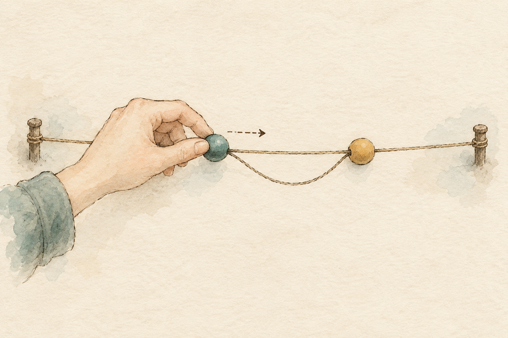
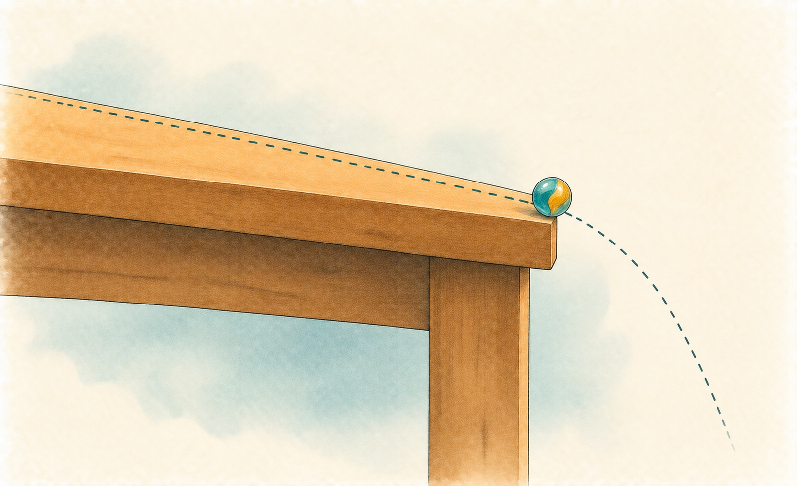

# Letting each animal have its own response {#sec-multilevel-varying-slopes}

```{r}
#| include: false

library(ggplot2)
library(here)
library(brms)
library(lme4)
library(ggdist)
library(patchwork)

# The book's shared plot theme (this also loads the legend helpers)
Plot_theme <- source("functions/plot_theme.R")
Plot_theme <- Plot_theme$value

# Okabe-Ito colors: four days after ischemia, two hemispheres, two genotypes
col_dpi <- c("0D" = "#000000", "5D" = "#E69F00", "15D" = "#D55E00", "30D" = "#0072B2")
col_hemi <- c("Right" = "#0072B2", "Left" = "#D55E00")
col_geno <- c(WT = "#D55E00", KO = "#0072B2")

# Sampler settings for the multilevel fits (as in the previous chapter)
ml_control <- list(adapt_delta = 0.95)

# Median and 95% credible interval of a vector of draws, as text for the prose
qi <- function(x, digits = 2) {
  q <- unname(quantile(x, c(0.5, 0.025, 0.975)))
  sprintf("%s (95%% credible interval %s to %s)", round(q[1], digits), round(q[2], digits), round(q[3], digits))
}

# The same, in the short form "median [lower, upper]" for tables and tight sentences
qs <- function(x, digits = 2) {
  q <- unname(quantile(x, c(0.5, 0.025, 0.975)))
  sprintf(paste0("%.", digits, "f [%.", digits, "f, %.", digits, "f]"), q[1], q[2], q[3])
}

# Outline that holds 95% of a bivariate normal cloud with standard deviations sd1, sd2 and correlation rho
ell <- function(sd1, sd2, rho, level = 0.95, n = 100) {
  t <- seq(0, 2 * pi, length.out = n)
  r <- sqrt(qchisq(level, 2))
  x <- r * sd1 * cos(t)
  y <- r * sd2 * (rho * cos(t) + sqrt(1 - rho^2) * sin(t))
  data.frame(x = x, y = y)
}

# Compact summary of a brms fit: population effects, standard deviations, correlations and sigma
show_brms <- function(fit) {
  ps <- posterior_summary(fit)
  keep <- grepl("^b_|^sd_|^cor_|^sigma", rownames(ps))
  round(ps[keep, c("Estimate", "Q2.5", "Q97.5")], 2)
}
```

You run an ischemia experiment, you stain the brains, you count the neurons, and the lab meeting asks for one sentence: *by how much does the injured cortex lose neurons?* In the last chapter I gave you that sentence, and I gave it with the honest interval, after untangling regions, sections and animals (@sec-multilevel-varying-intercepts). It was a statement about the average mouse. Someone at the back of the room, there is always someone, asks the next question: **does every mouse lose about the same amount, or do some animals respond a lot more than others?**

That question cannot be answered by an average, and the model of the previous chapter could not answer it either. It let every mouse start at its own height, but it gave every mouse the same injury effect, and then checked itself and found that a handful of sections had lost far more than the rest. This chapter lets the *effect itself* vary from animal to animal. I will show you three things. The first is that a baseline and a response belong to the same animal, so they are not independent, and the model should treat them as a pair (a correlated pair, with a covariance structure). The second is that the model learns *how much* animals differ in their response, a standard deviation that is often the most interesting number in the experiment. The third is what to predict for a mouse you have not seen yet, and what the population-level effect means once responses vary.

## One line per mouse {#sec-slopes-spaghetti}

I want to start from a picture that does not come from the injury data, because the idea is easiest to see when time is on the horizontal axis. It is the hanging wire test of @sec-beta-robust-regression: mice of two genotypes cross a wire three times a day for three days, and we record how long each completed crossing took. Mice practice, so crossing times fall from day to day. **Does every mouse improve at the same rate?** @fig-slopes_spaghetti draws one line per mouse (the average log crossing time of that mouse on each day) and, on top, the single line that a model with one slope per genotype would say describes them all.

```{r}
#| label: data-wire

# The hanging wire test: one row per mouse and day, three attempts per row (Klf4-KO and controls only)
wire_raw <- read.csv(here("project/AnalysisData/Wire_TrainingSum.csv"))
wire_raw <- wire_raw[wire_raw$Genotype %in% c("Klf4-KO", "WildType-Control"), ]

# One row per attempt, with the same codes as in the earlier chapters
attempts <- do.call(rbind, lapply(1:3, function(k) {
  data.frame(
    mouse = wire_raw$ReCode,
    genotype = factor(ifelse(wire_raw$Genotype == "Klf4-KO", "KO", "WT"), levels = c("WT", "KO")),
    day = wire_raw$Day,
    attempt = k,
    position = wire_raw[[paste0("Trial", k, "_Position")]],
    wire = wire_raw[[paste0("Trial", k, "_Wire")]],
    success = wire_raw[[paste0("Trial", k, "_Success")]]
  )
}))

# Completed attempts only, on the log scale; day and attempt centered at their middle value
crossings <- attempts[attempts$success == 1 & attempts$wire > 0, ]
crossings$log_wire <- log(crossings$wire)
crossings$day_c <- crossings$day - 2
crossings$attempt_c <- crossings$attempt - 2

# One record is impossible by the file's own logic: the total time (1 s) is shorter than the time
# to get into position (4 s). It has a known cause, so I leave it out of the models of this chapter
impossible <- crossings[crossings$position > crossings$wire, ]
wire_cr <- crossings[crossings$position <= crossings$wire, ]
n_wire_mice <- length(unique(wire_cr$mouse))
```

```{r}
# Average log crossing time of each mouse on each day
mouse_day <- aggregate(log_wire ~ mouse + genotype + day, data = wire_cr, FUN = mean)

# Complete pooling: one straight line per genotype that ignores which mouse is which
lm_pool <- lm(log_wire ~ genotype + day, data = wire_cr)
pool_lines <- expand.grid(genotype = factor(c("WT", "KO"), levels = c("WT", "KO")), day = 1:3)
pool_lines$fit <- predict(lm_pool, pool_lines)
```

```{r}
#| label: fig-slopes_spaghetti
#| fig-cap: "Crossing time of each of 63 mice over the three training days in the hanging wire test. Each thin line is one mouse (the average of its completed attempts per day, geometric scale); thick lines are the single straight line per genotype that a model with one common slope would draw."
#| fig-alt: "Sixty-three thin lines in orange (wild type) and blue (Klf4-KO) run across days 1, 2 and 3, on a logarithmic vertical axis from about 5 to 50 seconds. Most lines fall from left to right, but they start at very different heights and fall by very different amounts: some drop steeply, some are almost flat and a few rise. Two thick straight lines, one per genotype, fall gently through the middle of the bundle."
#| fig-width: 7
#| fig-height: 4.6
#| warning: false

# Thin line per mouse, thick line per genotype; the geometric scale makes a ratio a fixed vertical step
ggplot(mouse_day, aes(x = day, y = exp(log_wire), group = mouse, color = genotype)) +
  geom_line(alpha = 0.45, linewidth = 0.5) +
  geom_line(data = pool_lines, aes(y = exp(fit), group = genotype), linewidth = 2) +
  scale_color_manual(values = col_geno, labels = c(WT = "Control", KO = "Klf4-KO")) +
  scale_x_continuous(breaks = 1:3) +
  scale_y_log10(breaks = c(5, 10, 20, 40)) +
  labs(x = "Training day", y = "Crossing time (s, log scale)", color = NULL) +
  Plot_theme +
  legend_top()
```

A plain spaghetti plot (`ggplot2::geom_line()` with `group = mouse`) is the honest way to draw repeated measures, because every animal stays visible. The bar plot with asterisks that most papers would show here has one bar per day and genotype, and it would erase exactly what is interesting: that the lines are not parallel to the thick one, and not parallel to each other. The design tip: when the unit is an animal followed over time, draw the animals, and put the model's summary *on top* of them, never in place of them.

::: {.callout-tip title="How to read this figure"}
Read the thick lines first: that is the one slope per genotype that the models of the last two parts would estimate, and it says "practice makes crossings about 20% faster per day". Then look at the thin lines and ask whether they run parallel to the thick one. They do not. Some start high and fall far, some start low and barely move, a few rise. That fan is what a *varying slope* describes. Last, look at where the lines start: the animals that start at the top are not necessarily the ones that fall the most. Whether baseline and change go together is what the correlation in this chapter measures. The mistake to avoid is to read a single line as that animal's true curve: three days is not many points for a line.
:::

The picture asks for a model in which every mouse has two numbers, not one: where it is (an intercept) and how fast it moves (a slope). The rest of the chapter builds that model on the injury data, where the question is more consequential, and returns to the wire at the end of the chapter with everything in place. I will say now what the wire cannot give: three days is a very short series for a line, which is precisely why the model will have to borrow strength across mice.

{#fig-slopes-hands fig-align="center" width="85%" fig-alt="Watercolor sketch of a sheet of graph paper seen from above, with seven hands in different skin tones coming in from its edges, each holding a pencil at the end of a thin teal line, so that the lines fan out from the left axis at different slopes, and a thicker ochre line running through the middle of the bundle."}

@fig-slopes-hands is the whole chapter in a sketch: one chart, many hands, and a line that is the middle of the hands.

## A single slope is a claim {#sec-slopes-claim}

The data of the injury question are the ones of the previous chapter: the NeuN-positive neurons of the cortex of 31 mice, taken at 0, 5, 15 and 30 days after ischemia, counted in the left (injured) and right (uninjured) cortex of up to seven sections per mouse [@manriquecastano2024; @manriquecastano2024osf]. I do not repeat the description or the data-quality checks (@sec-neun-data has them, with what was left out and why). What I need is the same table, built by the same rules: cortex only, regions with no NeuN-positive cell removed (there is none in the cortex), fiber tracts left out, and the outcome is the logarithm of the density. Each mouse is observed on one day only, so the day is a comparison between mice; the hemisphere varies within every section, so every mouse has its *own* left-minus-right contrast, and that contrast is a slope that can differ from mouse to mouse.

```{r}
#| label: data-neun

# Read the file as it came, then derive mouse, day and section from the image name (as in the previous chapter)
neun_raw <- read.csv(here("project/AnalysisData/5x_NeuN_AnnotationsSummary.csv"), check.names = FALSE)
parts <- strsplit(sub("\\.tif$", "", neun_raw$Image), "_")
neun <- data.frame(
  mouse = sapply(parts, `[`, 3),
  dpi_days = as.integer(sub("D$", "", sapply(parts, `[`, 4))),
  scene = sapply(parts, `[`, 5),
  structure = neun_raw$Name,
  class = neun_raw$Class,
  positive = neun_raw[["Num Positive"]],
  density = neun_raw[["Num Positive per mm^2"]]
)

# Same rules as before: cortex only, regions with no positive cell removed; log density as the outcome
cortex <- neun[neun$structure == "CTX" & neun$positive > 0, ]
cortex$hemi <- factor(sub(":.*$", "", cortex$class), levels = c("Right", "Left"))
cortex$dpi <- factor(paste0(cortex$dpi_days, "D"), levels = c("0D", "5D", "15D", "30D"))
cortex$section <- factor(paste(cortex$mouse, cortex$scene, sep = ":"))
cortex$log_dens <- log(cortex$density)

# The table must be the one of the previous chapter: 396 regions, 198 sections, 31 mice
stopifnot(nrow(cortex) == 396, nlevels(cortex$section) == 198, length(unique(cortex$mouse)) == 31)
n_mice <- length(unique(cortex$mouse))
n_sect <- nlevels(cortex$section)
n_rows <- nrow(cortex)
```

The model of the previous chapter, `log_dens ~ dpi * hemi + (1 | mouse) + (1 | section)`, contains a claim that is easy to miss. The term `dpi:hemiLeft` is a single number for each day, and it applies to every mouse of that day. Imagine a rehabilitation clinic that reports "the program improves walking speed by 0.2 m/s" and never mentions whether the improvement is similar for everyone, or whether half of the patients improve a lot and the other half do not at all. The average is the same in both clinics and the clinics are very different. A model with one slope is the first clinic's report, and the data can tell us whether it is believable, because every mouse has its own contrast. I computed it directly: for every section, the left minus the right log density, and for every mouse the average over its sections, with a 95% interval from the variation among those sections.

```{r}
# Left minus right log density in every section, then the average per mouse and its standard error
sec_w <- reshape(cortex[, c("mouse", "section", "dpi", "hemi", "log_dens")],
                 idvar = c("mouse", "section", "dpi"), timevar = "hemi", direction = "wide")
sec_w$diff <- sec_w$log_dens.Left - sec_w$log_dens.Right
mouse_raw <- do.call(rbind, lapply(split(sec_w, sec_w$mouse), function(s) {
  data.frame(mouse = s$mouse[1], dpi = s$dpi[1], n_sect = nrow(s),
             contrast = mean(s$diff), se = sd(s$diff) / sqrt(nrow(s)))
}))
mouse_raw$lo <- mouse_raw$contrast - qt(0.975, mouse_raw$n_sect - 1) * mouse_raw$se
mouse_raw$hi <- mouse_raw$contrast + qt(0.975, mouse_raw$n_sect - 1) * mouse_raw$se
mouse_raw <- mouse_raw[order(mouse_raw$contrast), ]
mouse_raw$rank <- seq_len(nrow(mouse_raw))

# Spread of the mouse contrasts within each day, against the spread their own standard errors would give
spread_obs <- sqrt(sum(tapply(mouse_raw$contrast, mouse_raw$dpi, function(x) sum((x - mean(x))^2))) /
                     (n_mice - nlevels(mouse_raw$dpi)))
spread_se <- sqrt(mean(mouse_raw$se^2))
```

I drew every mouse as a dot with its interval, ordered from the largest loss to the smallest (@fig-slopes_raw_contrast). The vertical order is the point: a dot plot of 31 values (`ggplot2::geom_point()` and `geom_linerange()`) shows each animal's own result, and a bar of the day means with asterisks would hide that there is a range at all.

```{r}
#| label: fig-slopes_raw_contrast
#| fig-cap: "Left-minus-right difference of log density in each of the 31 mice (the average over its sections), with its 95% interval from the variation among sections, ordered from the largest loss to the smallest. Color and shape give the day after ischemia. The dashed line marks no difference between hemispheres."
#| fig-alt: "Thirty-one points in increasing order from left to right, each with a vertical interval, around a dashed horizontal line at zero. The values run from about -0.9 on the left to about +0.3 on the right. Black squares (0 D) are at the right end, mostly above zero. Points for 5, 15 and 30 days are mixed along the left and middle of the figure, with the deepest losses mostly at 15 days. Many intervals are as long as 0.3 and several overlap zero."
#| fig-width: 8
#| fig-height: 4.4
#| warning: false

# One dot and one interval per mouse; day coded by color and shape
ggplot(mouse_raw, aes(x = rank, y = contrast, color = dpi, shape = dpi)) +
  geom_hline(yintercept = 0, linetype = "dashed", color = "grey40") +
  geom_linerange(aes(ymin = lo, ymax = hi), linewidth = 0.6) +
  geom_point(size = 2.6) +
  scale_color_manual(values = col_dpi) +
  scale_shape_manual(values = c("0D" = 15, "5D" = 16, "15D" = 17, "30D" = 18)) +
  labs(x = "Mice (ordered by their own contrast)", y = "Left minus right (log density)",
       color = "Day", shape = "Day") +
  Plot_theme +
  theme(axis.text.x = element_blank(), axis.ticks.x = element_blank()) +
  legend_inside(0.1, 0.8)
```

::: {.callout-tip title="How to read this figure"}
Each mark is one *mouse*. The dot is its average left-minus-right difference on the log scale, so a value of -0.5 means the left cortex has about 60% of the density of the right ($e^{-0.5} \approx 0.61$), and zero means no difference. The thin line is how far that mouse's own sections let us trust the dot. Read it in three steps. First, find the dashed line and see which mice lie below it: the injured hemisphere is poorer in neurons. Second, compare the *range* of the dots within a color with the *length* of the lines: if all the mice of one day had the same true contrast, their dots would scatter only as much as the lines allow, and most intervals would cover the same value. Third, look for the black squares at the right: those mice had no ischemia, and their contrast is the baseline asymmetry of the method, not an injury. The mistake to avoid is reading the order as a ranking of mice (extremes of noisy dots are partly luck).
:::

@fig-slopes_raw_contrast says that the contrasts are not all alike. The dots of the injured days range from about -0.9 to near zero, and within a day they scatter by `r round(spread_obs, 2)` on the log scale (the pooled standard deviation of the mouse contrasts around the average of their own day), whereas the standard error of a single mouse's contrast is about `r round(spread_se, 2)`. If every mouse of a day had the same true effect, the dots would scatter by about the second number; they scatter by `r round(spread_obs / spread_se, 1)` times as much. So there is something beyond the noise: mice differ in their response. How much, and in what way, is what the model is for. Notice also what the figure cannot say: the black squares at the right are mice without ischemia, and their contrast is not zero (the left cortex is denser than the right at 0 D, a baseline asymmetry of the method that I discussed in the previous chapter). Part of what I will call the response of a mouse is that baseline asymmetry, with its own mouse-to-mouse scatter, and I will say so again when I interpret the standard deviation.

## The varying slope {#sec-slopes-model}

The varying intercept of the last chapter gave every mouse its own starting height. A [varying slope]{style="color:green; font-weight:bold;"} gives every mouse its own *response* as well. The picture to hold is a pair of numbers per mouse: a baseline (how dense its right cortex is, relative to the other mice of its day) and a response (how much lower or higher its left cortex lies, relative to the other mice of its day). The population of mice is then a cloud of such pairs. Whether the two numbers of a mouse go together is a biological question: a mouse with a dense uninjured cortex may have more to lose, or a healthier brain may resist better, and the data may say either or neither.

{#fig-slopes-thread fig-align="center" width="80%" fig-alt="Watercolor sketch of a teal bead and an ochre bead on a thin string tied between two small posts. A hand with a green sleeve pulls the teal bead to the right along a dashed arrow, while the ochre bead stays almost where it was and a loose loop of slack hangs in the string between them."}

@fig-slopes-thread pictures what the correlation of the two numbers means: how much of the one moves when you pull the other.

Because the two numbers belong to the same animal, I do not model them separately. I model them *together*, as a pair drawn from a joint distribution whose spread is described by a covariance structure. In `brms` and `lme4` the change from the previous chapter is one term in the formula, and @eq-slopes-model shows it in notation. With $i$ a region, $j$ a section and $k$ a mouse, and $L_i$ equal to 1 for a left-cortex region and 0 for a right-cortex one:

$$
\begin{aligned}
y_{ijk} &\sim \text{Normal}(\mu_{ijk},\, \sigma), \\
\mu_{ijk} &= \alpha + \beta_{d[k]} + \gamma_{h[i]} + \delta_{d[k]\,h[i]} + u_k + z_k L_i + v_{jk}, \\
\begin{pmatrix} u_k \\ z_k \end{pmatrix} &\sim \text{MVNormal}\!\left(\begin{pmatrix} 0 \\ 0 \end{pmatrix},\, \boldsymbol{\Sigma}\right), \qquad
\boldsymbol{\Sigma} = \begin{pmatrix} \tau_u & 0 \\ 0 & \tau_z \end{pmatrix}
\begin{pmatrix} 1 & \rho \\ \rho & 1 \end{pmatrix}
\begin{pmatrix} \tau_u & 0 \\ 0 & \tau_z \end{pmatrix}, \\
v_{jk} &\sim \text{Normal}(0,\, \tau_{\text{section}}).
\end{aligned}
$$ {#eq-slopes-model}

The first two lines are the model of the previous chapter (@eq-neun-model) with one new term, $z_k L_i$: the extra left-minus-right contrast of mouse $k$, added only in the left cortex. The third line is the new idea. The pair $(u_k, z_k)$ is the baseline deviation and the response deviation of mouse $k$, and it is drawn from a bivariate normal distribution: both have mean zero (they are deviations from the average mouse), they have standard deviations $\tau_u$ and $\tau_z$, and the number $\rho$ between $-1$ and $1$ is their [correlation]{.ix ix="correlated varying effects"}. The three numbers ($\tau_u$, $\tau_z$, $\rho$) are parameters of the model with their own posterior, like any other. In formula syntax the third line is `(1 + hemi | mouse)`: an intercept *and* a hemisphere effect for each mouse, correlated, which is the default meaning of a single bar. The same structure is the varying-slopes model of the café example (waiting time in the morning and the afternoon) in McElreath and of the schools example (gain in mathematics against initial knowledge) in Inchausti [@mcelreath2020; @inchausti2023]. A double bar, `(1 + hemi || mouse)`, sets $\rho = 0$ and is the *uncorrelated* version, which I fit too so that you can see what the correlation buys.

Why not leave the correlation out and keep the model simpler? Because the correlation is information. Think of two items on a restaurant bill: a table that orders expensive starters is more likely than not to order expensive mains, and a model that ignores this will think that tables with both are rarer than they are. In the same way, a baseline and a response that are correlated in the animals will be misjudged if the model forces them apart. The practical consequence is partial pooling in two dimensions: when one number of a mouse is known precisely, the correlation lets it inform the estimate of the other.

### Where zero sits changes the correlation

There is one subtlety to say now, because it decides how the correlation must be read, and many papers read it wrongly. The intercept of a mouse is its level *where the predictor is zero*. In `log_dens ~ dpi * hemi + (1 + hemi | mouse)` the hemisphere is coded Right = 0 and Left = 1, so $u_k$ is the baseline of the *right* cortex and $\rho$ is the correlation between the right-cortex level and the left-minus-right difference. If I coded the hemisphere as $-\tfrac{1}{2}$ and $+\tfrac{1}{2}$, the intercept would be the average of the two hemispheres and the correlation would be a different number, for the same data and the same model. Neither is the correct one: they answer different questions ("do mice with a denser right cortex lose more?" or "do mice with a denser cortex on average lose more?"), and I will compute the alternatives from the posterior after the fit. The rule to keep is that **a correlation of varying effects is a statement about the origin you chose**, and you should choose the origin that matches the question.

### Priors for the pair

The standard deviations get the same weakly informative prior as in the previous chapter, an exponential with rate 3, which has a mean of a third on the log scale and allows the data to say that the mice do not differ in their response (the density at zero is finite). The new piece is the prior for the correlation. A prior on a correlation needs a distribution on the interval from $-1$ to $1$, and for more than one pair, on whole correlation matrices; the standard choice is the [LKJ prior]{style="color:green; font-weight:bold;"} [@lewandowski2009], with one parameter, $\eta$ (eta).

The words come before the formula. Think of $\eta$ as how much you believe, *before seeing the data*, that a baseline and a response are tied together. With $\eta = 1$ you have no opinion: every correlation from $-1$ to $1$ is equally likely, including the extreme ones. With $\eta > 1$ you are mildly skeptical of extremes: correlations near zero are more likely than correlations near plus or minus 1, and the larger $\eta$ is, the stronger the skepticism. With $\eta < 1$ the prior would favor the extremes, which is almost never what you want. For a single pair ($2 \times 2$ matrix) the prior on $\rho$ has density proportional to $(1 - \rho^2)^{\eta - 1}$, which makes the shapes easy to draw (left panel of @fig-slopes_priors). I use $\eta = 2$: it still gives a correlation between $-0.5$ and $0.5$ a probability of `r round(pbeta(0.75, 2, 2) - pbeta(0.25, 2, 2), 2)` (against `r round(pbeta(0.75, 1, 1) - pbeta(0.25, 1, 1), 2)` for $\eta = 1$ and `r round(pbeta(0.75, 4, 4) - pbeta(0.25, 4, 4), 2)` for $\eta = 4$), but it does not let the sampler wander to a boundary when the data cannot say where $\rho$ is. McElreath introduces the same prior for his café example and describes LKJ(2) as a weakly informative prior that is skeptical of extreme correlations, a regularizing prior for correlation matrices whose single parameter says how skeptical it is [@mcelreath2020]. For $eta > 1$ the mode of the prior is a correlation of zero, with a sharper peak for larger $eta$, which is the shape of @fig-slopes_priors.

```{r}
# Priors for the population-level part and the residual spread (log scale), as in the previous chapter
priors_fixed <- c(
  prior(normal(6.7, 0.5), class = "Intercept"),
  prior(normal(0, 0.5), class = "b"),
  prior(exponential(3), class = "sigma")
)

# Standard deviations of every varying effect and an LKJ(2) prior for the correlation of mouse intercept and slope
priors_slopes <- c(priors_fixed,
                   prior(exponential(3), class = "sd"),
                   prior(lkj(2), class = "cor"))
```

Before the real data enter, I do what the book does for every prior (@sec-priors-regularization): simulate from the priors alone and look at the data they propose. I fit the model that I will use at the end with `sample_prior = "only"`, which ignores the likelihood. Two things are worth checking now. One is the same as before, whether the simulated densities are plausible. The other is new and specific to varying slopes: what spread of *mouse contrasts* the prior considers ordinary, because a prior on the slope standard deviation is a statement about how different the mice might be.

```{r}
# Prior predictive fit of the model of this chapter (priors only, no data likelihood)
fit_prior <- brm(
  log_dens ~ dpi * hemi + (1 + hemi | mouse) + (1 | section),
  data = cortex, prior = priors_slopes, sample_prior = "only",
  chains = 4, cores = 4, seed = 123,
  file = "models/multilevel-varying-slopes_fit1.rds", file_refit = "never"
)

# Share of simulated densities between 100 and 3000 cells per mm2
sim <- posterior_predict(fit_prior, ndraws = 500)
share_ok <- mean(exp(sim) > 100 & exp(sim) < 3000)

# Contrasts that single mice at 15 D could have under the priors: average contrast plus the mouse deviation
pr <- as_draws_df(fit_prior)
set.seed(1)
prior_contrast <- pr$b_hemiLeft + pr$`b_dpi15D:hemiLeft` + pr$sd_mouse__hemiLeft * rnorm(nrow(pr))
share_contrast <- mean(abs(prior_contrast) < 1.5)
```

```{r}
#| label: fig-slopes_priors
#| fig-cap: "Priors of the varying-slope model. Left: prior density of the correlation between baseline and response for three values of eta. Middle: prior predictive check on the log scale (faint curves are simulated datasets, dark curve is the observed log density). Right: contrast between hemispheres that a single mouse at 15 D could show under the priors (curve) against the 8 observed mice of that day (ticks)."
#| fig-alt: "Three panels. Left: three curves on a horizontal axis from -1 to 1; the eta equal to 1 curve is flat, the eta equal to 2 curve is a gentle dome and the eta equal to 4 curve is a narrow dome centered on zero. Middle: about a hundred faint curves much wider than a dark observed curve, centered near 6.8. Right: a broad bell-shaped curve from about -2 to 2 on the left-minus-right axis with eight short ticks bunched between -0.9 and -0.1."
#| fig-width: 11
#| fig-height: 3.8
#| warning: false
#| message: false

# Left: prior of the correlation for K = 2, which is a Beta(eta, eta) stretched to the interval -1 to 1
r_grid <- seq(-0.995, 0.995, length.out = 300)
lkj_df <- do.call(rbind, lapply(c(1, 2, 4), function(e) {
  data.frame(rho = r_grid, dens = dbeta((r_grid + 1) / 2, e, e) / 2, eta = paste("eta =", e))
}))
p_lkj <- ggplot(lkj_df, aes(x = rho, y = dens, linetype = eta, color = eta)) +
  geom_line(linewidth = 1.2) +
  scale_color_manual(values = c("eta = 1" = "grey45", "eta = 2" = "#D55E00", "eta = 4" = "#0072B2")) +
  labs(x = "Correlation (prior)", y = "Prior density", color = NULL, linetype = NULL) +
  Plot_theme + legend_inside(0.5, 0.2)

# Middle: 100 simulated datasets against the observed data
p_pp <- pp_check(fit_prior, ndraws = 100) +
  labs(x = "log(cells per mm²), priors only", y = "Density") +
  coord_cartesian(xlim = c(3, 10)) +
  Plot_theme + legend_none()

# Right: prior spread of the contrast of one mouse at 15 D, with the observed contrasts of those mice as ticks
p_con <- ggplot(data.frame(x = prior_contrast), aes(x = x)) +
  geom_density(fill = "grey85", color = "grey30") +
  geom_rug(data = mouse_raw[mouse_raw$dpi == "15D", ], aes(x = contrast), inherit.aes = FALSE,
           color = col_dpi["15D"], linewidth = 1) +
  coord_cartesian(xlim = c(-3, 3)) +
  labs(x = "Left minus right, one mouse (log)", y = "Prior density") +
  Plot_theme

p_lkj + p_pp + p_con
```

@fig-slopes_priors reads left to right. The first panel is the LKJ prior: the flat curve is the $\eta = 1$ prior that gives extreme correlations as much weight as zero; the dome of $\eta = 2$ is the one I use. The second panel is the check of the previous chapter, now with a slope in the prior: the simulated datasets are wider than the data and centered in the right place, with `r round(100 * share_ok)`% of the simulated densities between 100 and 3,000 cells per mm². The third panel is the new one. Under these priors a single mouse at 15 D could have any contrast between about -1.5 and 1.5 (`r round(100 * share_contrast)`% of the draws fall in that range), which on the density scale is a left cortex between 22% and 450% of the right one. The eight observed mice (the ticks) are well inside it. That is what I want of a weakly informative prior: it does not insist on where the effect is and it does not make the observed values look impossible.

## Building it up, step by step {#sec-slopes-steps}

I will fit three models in a row, each with one addition, so that you can see what every step buys. The first is the final model of the previous chapter (a varying intercept for mouse and for section, one injury effect for everyone), refit here with the same priors. The second adds a varying hemisphere effect per mouse but keeps it unrelated to the intercept. The third lets the two be correlated. Each is shown next to its `lme4` counterpart.

```{r}
# Step 1: varying intercepts only (the final model of the previous chapter)
fit_int <- brm(
  log_dens ~ dpi * hemi + (1 | mouse) + (1 | section),
  data = cortex, prior = priors_slopes[priors_slopes$class != "cor", ],
  chains = 4, cores = 4, seed = 123, iter = 4000, control = ml_control,
  save_pars = save_pars(all = TRUE),
  file = "models/multilevel-varying-slopes_fit2.rds", file_refit = "never"
)

# Step 2: a varying hemisphere effect per mouse, uncorrelated with the mouse intercept
fit_unc <- brm(
  log_dens ~ dpi * hemi + (1 + hemi || mouse) + (1 | section),
  data = cortex, prior = priors_slopes[priors_slopes$class != "cor", ],
  chains = 4, cores = 4, seed = 123, iter = 4000, control = ml_control,
  save_pars = save_pars(all = TRUE),
  file = "models/multilevel-varying-slopes_fit3.rds", file_refit = "never"
)

# Step 3: the same, with the intercept and the hemisphere effect correlated (the model of the chapter)
fit_corr <- brm(
  log_dens ~ dpi * hemi + (1 + hemi | mouse) + (1 | section),
  data = cortex, prior = priors_slopes,
  chains = 4, cores = 4, seed = 123, iter = 4000, control = ml_control,
  save_pars = save_pars(all = TRUE),
  file = "models/multilevel-varying-slopes_fit4.rds", file_refit = "never"
)
```

A numeric 0/1 version of the hemisphere is needed for the uncorrelated version in `lme4`, because its double bar splits a factor into one column per level and would give a different model from the one `brms` fits. This is the kind of detail that makes the same formula mean two things in two packages, and it is worth checking against the printed variance components rather than trusting the syntax.

```{r}
# Numeric indicator of the left cortex, so that the double bar means "uncorrelated" in lme4 as well
cortex$left <- as.numeric(cortex$hemi == "Left")

# lme4 versions of the three steps (restricted maximum likelihood)
lmer_int <- lmer(log_dens ~ dpi * hemi + (1 | mouse) + (1 | section), data = cortex)
lmer_unc <- lmer(log_dens ~ dpi * hemi + (1 | mouse) + (0 + left | mouse) + (1 | section), data = cortex)
lmer_corr <- lmer(log_dens ~ dpi * hemi + (1 + hemi | mouse) + (1 | section), data = cortex)
```

::: panel-tabset
### brms: correlated slope

```{r}
# Population-level effects, standard deviations, the correlation and sigma
show_brms(fit_corr)
```

### lme4: correlated slope

```{r}
# The same model by restricted maximum likelihood
round(summary(lmer_corr)$coefficients, 3)
print(VarCorr(lmer_corr), comp = "Std.Dev.")
isSingular(lmer_corr)
```
:::

```{r}
# Draws of the final model, for the text and the figures that follow
dr <- as_draws_df(fit_corr)
sd_u <- dr$sd_mouse__Intercept
sd_z <- dr$sd_mouse__hemiLeft
rho <- dr$cor_mouse__Intercept__hemiLeft

# Standard deviation of the mouse intercepts in the model without the slope, for comparison
dr_int <- as_draws_df(fit_int)
```

::: panel-tabset
### brms: uncorrelated slope

```{r}
# Step 2: the slope varies, but is forced to be unrelated to the intercept
show_brms(fit_unc)
```

### lme4: uncorrelated slope

```{r}
# The same model by restricted maximum likelihood
print(VarCorr(lmer_unc), comp = "Std.Dev.")
```
:::

::: panel-tabset
### brms: varying intercepts only

```{r}
# Step 1: the model of the previous chapter, one injury effect for every mouse
show_brms(fit_int)
```

### lme4: varying intercepts only

```{r}
# The same model by restricted maximum likelihood
print(VarCorr(lmer_int), comp = "Std.Dev.")
```
:::

Comparing the three fits answers what each step buys. The standard deviation of the hemisphere effect across mice is `r qi(sd_z)` on the log scale: it is clearly above zero, and the model says that a mouse's contrast typically lies about a sixth of a log unit above or below the contrast of the average mouse of its day. The correlation of baseline and response is `r qi(rho)`, which I will take apart in a moment. What changed elsewhere is small and informative at the same time. The residual standard deviation falls from `r round(median(dr_int$sigma), 2)` in the first model to `r round(median(dr$sigma), 2)` in the third: part of what looked like noise in a region was a mouse responding differently, which the extra term now explains. And the standard deviation of the section intercepts stays at `r round(median(dr$sd_section__Intercept), 2)` (`r round(median(dr_int$sd_section__Intercept), 2)` before), which says that the extreme sections of the last chapter are not explained by mice responding differently.

### A frequentist equivalent, and where it differs

The two fits tell the same story on what matters: the standard deviations are close (`r round(attr(VarCorr(lmer_corr)$mouse, "stddev")["hemiLeft"], 2)` for the hemisphere effect in `lme4` and `r round(median(sd_z), 2)` in `brms`), the population effects agree to the second decimal, and both fits shrink the mouse-level deviations toward the average of their day by the same mechanism as in the previous chapter. What differs is the *uncertainty* of the quantities that matter in this chapter. `lme4` reports a point estimate of the correlation, `r round(attr(VarCorr(lmer_corr)$mouse, "correlation")[1, 2], 2)`, and nothing else; getting an interval needs profiling, which is slower and can fail. `brms` hands the whole posterior of $\rho$, which I draw in the next section and which turns out to be wide: a correlation estimated from 31 mice is a loose quantity, and a point estimate hides that. The same applies to the standard deviations: the interval of $\tau_z$ is a by-product of the posterior in `brms` and an extra computation in `lme4`.

## What the model learned {#sec-slopes-learned}

### Do baseline and response go together?

The model gives every mouse a pair, and I want to see the pairs. I plot, for every mouse, the deviation of its baseline from the average mouse of its day (horizontal) against the deviation of its response (vertical), twice: the raw deviations that each mouse would claim on its own (open circles) and the partially pooled ones from the model (filled circles). A line joins the two. Around them I draw 100 outlines of the population of mice that the model believes in, one for each of 100 posterior draws of ($\tau_u$, $\tau_z$, $\rho$): the spread of the outlines is the uncertainty of the covariance structure, and drawing them keeps me from reading the correlation as an exact number.

```{r}
# Population level of the right cortex and of the left-minus-right contrast, by day (posterior medians)
b_med <- fixef(fit_corr)[, "Estimate"]
dpi_levels <- levels(cortex$dpi)
pop_right <- b_med["Intercept"] + c(0, b_med[c("dpi5D", "dpi15D", "dpi30D")])
pop_contrast <- b_med["hemiLeft"] + c(0, b_med[c("dpi5D:hemiLeft", "dpi15D:hemiLeft", "dpi30D:hemiLeft")])
names(pop_right) <- names(pop_contrast) <- dpi_levels

# Raw deviations of each mouse: its own mean right-cortex level and its own contrast, minus its day's population value
mean_right <- tapply(cortex$log_dens[cortex$hemi == "Right"], cortex$mouse[cortex$hemi == "Right"], mean)
mouse_dev <- data.frame(mouse = mouse_raw$mouse, dpi = mouse_raw$dpi)
mouse_dev$raw_u <- as.numeric(mean_right[mouse_dev$mouse]) - pop_right[as.character(mouse_dev$dpi)]
mouse_dev$raw_z <- mouse_raw$contrast - pop_contrast[as.character(mouse_dev$dpi)]

# Partially pooled deviations from the fitted model
re_m <- ranef(fit_corr)$mouse
mouse_dev$pool_u <- re_m[mouse_dev$mouse, "Estimate", "Intercept"]
mouse_dev$pool_z <- re_m[mouse_dev$mouse, "Estimate", "hemiLeft"]

# 100 outlines of the population of mice, one per posterior draw
set.seed(2)
pick <- sample(nrow(dr), 100)
ells <- do.call(rbind, lapply(seq_along(pick), function(i) {
  e <- ell(sd_u[pick[i]], sd_z[pick[i]], rho[pick[i]])
  e$id <- i
  e
}))
```

```{r}
#| label: fig-slopes_cloud
#| fig-cap: "Baseline and response of each of the 31 mice. Horizontal: deviation of the right-cortex level from the average mouse of the same day. Vertical: deviation of the left-minus-right contrast from the average mouse of the same day. Open circles are each mouse's own raw values, filled circles the partially pooled estimates, and the faint outlines (left panel) are 95% contours of the population of mice for 100 posterior draws. Right: posterior of the correlation, with the LKJ(2) prior as a dashed curve."
#| fig-alt: "Left: a scatter of 31 open circles and 31 filled circles joined by short segments, with the filled circles closer to the center. Around them a bundle of 100 faint elliptical outlines, wider vertically than horizontally and slightly tilted upward to the right. Right: a broad half-eye of the correlation from about -0.6 to 0.8, centered near 0.1, with a dashed dome-shaped prior curve of similar breadth."
#| fig-width: 11
#| fig-height: 4.6
#| warning: false

# Left: each mouse as a pair (baseline, response); raw (open) joined to pooled (filled)
p_cloud <- ggplot() +
  geom_path(data = ells, aes(x = x, y = y, group = id), color = "grey70", alpha = 0.35, linewidth = 0.3) +
  geom_hline(yintercept = 0, color = "grey70") + geom_vline(xintercept = 0, color = "grey70") +
  geom_segment(data = mouse_dev, aes(x = raw_u, y = raw_z, xend = pool_u, yend = pool_z),
               color = "grey50", linewidth = 0.35) +
  geom_point(data = mouse_dev, aes(x = raw_u, y = raw_z, shape = dpi), color = "grey30", fill = NA, size = 2.2) +
  geom_point(data = mouse_dev, aes(x = pool_u, y = pool_z, color = dpi, shape = dpi), size = 2.6) +
  scale_shape_manual(values = c("0D" = 15, "5D" = 16, "15D" = 17, "30D" = 18)) +
  scale_color_manual(values = col_dpi) +
  labs(x = "Baseline: right cortex (deviation, log)", y = "Response: left minus right (deviation, log)",
       color = "Day", shape = "Day") +
  Plot_theme + legend_top()

# Right: posterior of the correlation, with the prior drawn over it
prior_rho <- data.frame(rho = r_grid, dens = dbeta((r_grid + 1) / 2, 2, 2) / 2)
p_rho <- ggplot(data.frame(rho = rho), aes(x = rho)) +
  stat_halfeye(point_interval = median_qi, .width = c(0.66, 0.95), fill = "grey75", normalize = "none") +
  geom_line(data = prior_rho, aes(y = dens), linetype = "dashed", color = "#D55E00", linewidth = 1) +
  coord_cartesian(xlim = c(-1, 1)) +
  labs(x = "Correlation of baseline and response", y = "Density") +
  Plot_theme

p_cloud + p_rho + plot_layout(widths = c(1.15, 1))
```

I drew the left panel as a scatter of pairs (`ggplot2::geom_point()` with `geom_segment()`) because the object of interest is a *pair* per animal, which no bar or boxplot can show, and the right panel as a half-eye (`ggdist::stat_halfeye()`, as in @sec-neun-variance) because with 31 mice the correlation is a wide distribution, and its shape is the result.

::: {.callout-tip title="How to read this figure"}
In the left panel, the origin is the average mouse of the mouse's own day. A mouse to the right has a denser right cortex than its day-mates; a mouse above has a smaller loss (or a larger gain) in the left cortex than its day-mates. First look at the arrows: every filled circle is closer to the center than the open circle it comes from, and the mice with fewer sections are pulled more. Then look at the cloud of circles and the outlines around it. If the cloud is a round blob, baseline and response are unrelated; if it is a tilted ellipse, they go together (up and to the right: a high baseline comes with a smaller loss; down and to the right: with a larger loss). In the right panel read the median and the interval of the correlation: where is the mass, and does it exclude zero? Then compare it with the dashed prior to see how much the data moved belief. A conclusion looks like "the correlation is probably small, and either sign cannot be excluded". The mistake to avoid is to read the sign of the median as a finding when the interval spans both.
:::

What does the figure say? The cloud is only slightly tilted, and the posterior of the correlation is `r qi(rho)`: centered close to zero with an interval that runs from clearly negative to clearly positive, and it is only a little narrower than the prior that I gave it (the data moved it, but not much). The probability that the correlation is positive is `r round(100 * mean(rho > 0))`%. With `r n_mice` mice a correlation is estimated loosely, and I will not turn a median of `r round(median(rho), 2)` into a biological story. What I can say is what each value would have meant. A correlation near zero says that how dense a mouse's uninjured cortex is tells you nothing about how much it loses. A correlation near $+1$ would say that mice with a denser right cortex lose less, with essentially the same ranking on both numbers: baseline and response would be one trait seen twice. A correlation near $-1$ says the opposite: the denser the uninjured cortex, the larger the loss, as if there were more to lose. These data do not choose among them.

```{r}
# Correlation under three choices of where zero sits (computed from the same posterior draws).
# u = right-cortex level, z = left-minus-right contrast; left-cortex level = u + z; mean of both = u + z / 2
cc <- function(a, b) {
  # correlation of the combinations a (of u and z) and b, per draw, from the variances and the covariance
  su <- sd_u; sz <- sd_z; cov_uz <- rho * su * sz
  va <- a[1]^2 * su^2 + 2 * a[1] * a[2] * cov_uz + a[2]^2 * sz^2
  vb <- b[1]^2 * su^2 + 2 * b[1] * b[2] * cov_uz + b[2]^2 * sz^2
  cab <- a[1] * b[1] * su^2 + (a[1] * b[2] + a[2] * b[1]) * cov_uz + a[2] * b[2] * sz^2
  cab / sqrt(va * vb)
}
rho_right <- cc(c(1, 0), c(0, 1))
rho_mean <- cc(c(1, 0.5), c(0, 1))
rho_left <- cc(c(1, 1), c(0, 1))

# Rows of the table for the injury data; the wire rows are added after that model is fitted
tbl_zero_neun <- data.frame(
  Dataset = "Injury",
  `Where zero sits (the intercept is...)` = c("the right cortex (used)", "the average of both hemispheres", "the left cortex"),
  Correlation = c(qs(rho_right), qs(rho_mean), qs(rho_left)),
  check.names = FALSE
)
```

### How much do animals differ in their response?

The posterior of the correlation was loose, but the one of the *spread of the responses* is not. The standard deviation $\tau_z$ says how far, on the log scale, a typical mouse's contrast lies from the contrast of the average mouse of its day, and to read it I compare it with the thing it is a spread *around*. At 15 D the population contrast (left minus right, log scale) is `r qi(dr$b_hemiLeft + dr$"b_dpi15D:hemiLeft")`, and $\tau_z$ is `r qi(sd_z)`. As a ratio, the spread is `r qs(sd_z / abs(dr$b_hemiLeft + dr$"b_dpi15D:hemiLeft"), 2)` of the size of the effect: the typical mouse at 15 D lies within about a third of the effect's own size from the average mouse, on either side. In terms a bench scientist uses, an average mouse at 15 D has a left cortex with `r round(100 * exp(median(dr$b_hemiLeft + dr$"b_dpi15D:hemiLeft")))`% of the density of its right cortex, and a mouse one standard deviation above or below has `r round(100 * exp(median(dr$b_hemiLeft + dr$"b_dpi15D:hemiLeft" + sd_z)))`% or `r round(100 * exp(median(dr$b_hemiLeft + dr$"b_dpi15D:hemiLeft" - sd_z)))`%.

A word of care about what $\tau_z$ contains. The mice of 0 D have had no ischemia, and they too have a contrast that varies (the left cortex is somewhat denser than the right in most of them, by an amount that differs between mice). The model gives *all* days one common $\tau_z$, so the spread of the injury response is not separated from the mouse-to-mouse scatter of the method's own asymmetry. In @fig-slopes_raw_contrast the 0 D mice scatter less than the injured ones, which suggests that part of the spread is a real difference in the response. A model that gives each day its own spread is a model of the *variance* and not only of the mean, and that is the job of @sec-multivariate-distributional-regression.

### The average mouse, and a mouse you have not seen {#sec-slopes-newmouse}

Once responses vary, the population-level coefficient needs a more careful reading. The coefficient for the left cortex at 15 D is the contrast of the *average mouse*: a statement about the centre of the distribution of responses. It says nothing about the mouse that will come into the lab tomorrow, whose response is a draw from the whole distribution. Think of the weather. The average temperature in a city in October is a precise number, and you can know it to a fraction of a degree after enough years, but the temperature *tomorrow* varies around it by several degrees. The average is precise because the number of years is large; the day is uncertain because the day-to-day spread does not shrink with the number of years. The two statements have two different intervals, and both are right. For a Gaussian model with an identity link, as here, the average of the mice's effects equals the population coefficient, so the interpretation is simple; for models with a link (counts, proportions) the average mouse and the average of the mice's effects differ, and @sec-multilevel-glmm will have to say which one is meant.

```{r}
# Contrast (left minus right, log scale) at 15 D: the average mouse, and a new mouse drawn from the population
avg15 <- dr$b_hemiLeft + dr$"b_dpi15D:hemiLeft"
set.seed(3)
new15 <- avg15 + sd_z * rnorm(length(sd_z))
p_loss_new <- mean(new15 < 0)
ratio_new <- exp(new15)

# Plot data: two distributions in one frame
pred_df <- rbind(data.frame(x = avg15, who = "Average mouse"),
                 data.frame(x = new15, who = "A new mouse"))
pred_df$who <- factor(pred_df$who, levels = c("A new mouse", "Average mouse"))
```

```{r}
#| label: fig-slopes_newmouse
#| fig-cap: "Left-minus-right contrast (log scale) at 15 D. Top: where a mouse that has not been seen yet would fall (the average mouse plus the spread between mice). Bottom: the average mouse. Half-eyes show the posterior; the bars are the 66% and 95% intervals. Vertical ticks are the raw contrasts of the 8 mice measured at 15 D (they include the noise of their own sections). The dashed line marks no difference between hemispheres."
#| fig-alt: "Two horizontal half-eye densities on an axis from -1.5 to 0.5. The lower one, for the average mouse, is narrow and centered near -0.5. The upper one, for a new mouse, is about three times as wide, centered at the same value, and its upper 95 percent bound reaches near zero. Eight vertical ticks below the half-eyes mark the observed mouse contrasts, between about -0.9 and -0.1. A dashed vertical line sits at zero."
#| fig-width: 8
#| fig-height: 3.4
#| warning: false

# Half-eye of each of the two predictions, with the observed mice of 15 D as ticks along the bottom
ggplot(pred_df, aes(x = x, y = who)) +
  geom_vline(xintercept = 0, linetype = "dashed", color = "grey40") +
  stat_halfeye(point_interval = median_qi, .width = c(0.66, 0.95), fill = "grey75") +
  geom_point(data = mouse_raw[mouse_raw$dpi == "15D", ], aes(x = contrast, y = 0.55),
             inherit.aes = FALSE, shape = "|", size = 5, color = col_dpi["15D"]) +
  labs(x = "Left minus right (log density) at 15 D", y = NULL) +
  Plot_theme +
  legend_none()
```

I used half-eyes again (`ggdist::stat_halfeye()`) because the point of the figure is the *width* of two intervals for what looks like the same quantity, and I put them on the same axis so that the reader sees the width ratio, not two numbers in a table.

::: {.callout-tip title="How to read this figure"}
Both shapes are centered on the same value: the model's best guess for a mouse at 15 D is the average mouse. What differs is the width. The narrow shape is the *average mouse*: how well we know the centre of the distribution of responses, which depends on how many mice there are. The wide shape is *a mouse we have not seen*: the centre plus the real spread between animals, which does not shrink with more mice. Look at the ticks, the mice we did see: they scatter inside the wide shape, as they should, and several lie outside the narrow one, as they should too. A conclusion looks like "the average mouse loses about `r round(100 * (1 - exp(median(avg15))))`%, and a new mouse would have between `r round(100 * quantile(ratio_new, 0.025))` and `r round(100 * quantile(ratio_new, 0.975))`% of the density of its right cortex". The mistake to avoid is to report the narrow interval when the question is about an animal.
:::

The narrow interval is the one for the question "what does ischemia do, on average?", and its width is `r round(diff(quantile(avg15, c(0.025, 0.975))), 2)` on the log scale (95% credible interval). The wide one answers "what would I expect from the next mouse?", and its width is `r round(diff(quantile(new15, c(0.025, 0.975))), 2)`. The probability that a new mouse at 15 D has a *lower* density in the left cortex than in the right one is `r round(100 * p_loss_new)`%, which is the kind of number a clinician or a reviewer asks for and which a population-level coefficient cannot give. The two intervals exist because there are two sources of uncertainty, the one about the centre and the one about the spread; reporting only the first implies that every animal responds like the average one.

### Shrinkage again, with a caution {#sec-slopes-shrinkage}

The part opener drew shrinkage for intercepts, and the previous chapter did it for mice and sections. For slopes the picture is the same and the temptation is greater, because a slope looks like an individual's result. @fig-slopes_caterpillar shows the contrast of every mouse (left minus right, log scale) as the model estimates it, with its 95% interval, next to the raw contrast it would have claimed on its own, grouped by day. I drew it as a [caterpillar plot]{.ix} of arrows and intervals (`ggplot2::geom_segment()` and `geom_linerange()`) because each mouse is a unit, and because the thing I want you to see is the *movement* from the raw to the pooled estimate, which a table of 31 numbers cannot show.

```{r}
# Pooled contrast of each mouse: population contrast of its day plus its own deviation, with an interval from the draws
dpi_term <- c("0D" = 0, "5D" = "b_dpi5D:hemiLeft", "15D" = "b_dpi15D:hemiLeft", "30D" = "b_dpi30D:hemiLeft")
pool_con <- do.call(rbind, lapply(mouse_raw$mouse, function(m) {
  d <- as.character(mouse_raw$dpi[mouse_raw$mouse == m])
  base <- dr$b_hemiLeft + (if (d == "0D") 0 else dr[[dpi_term[[d]]]])
  x <- base + dr[[paste0("r_mouse[", m, ",hemiLeft]")]]
  q <- unname(quantile(x, c(0.025, 0.5, 0.975)))
  data.frame(mouse = m, dpi = d, lo = q[1], pooled = q[2], hi = q[3], raw = mouse_raw$contrast[mouse_raw$mouse == m],
             n_sect = mouse_raw$n_sect[mouse_raw$mouse == m])
}))
pool_con$dpi <- factor(pool_con$dpi, levels = dpi_levels)
pool_con <- pool_con[order(pool_con$dpi, pool_con$raw), ]
pool_con$pos <- ave(pool_con$raw, pool_con$dpi, FUN = function(x) rank(x, ties.method = "first"))

# Population contrast of each day, drawn as a dashed line in each panel
pop_line <- data.frame(dpi = factor(dpi_levels, levels = dpi_levels), pop = as.numeric(pop_contrast))

# How far each mouse moved: share of its raw deviation from the day's population value that the model kept
dev_raw <- pool_con$raw - pop_contrast[as.character(pool_con$dpi)]
dev_pool <- pool_con$pooled - pop_contrast[as.character(pool_con$dpi)]
kept <- sd(dev_pool) / sd(dev_raw)
```

```{r}
#| label: fig-slopes_caterpillar
#| fig-cap: "Left-minus-right contrast (log scale) of each mouse, by day after ischemia. Open circles are the raw contrasts of each mouse, filled circles the partially pooled estimates with 95% credible intervals, and arrows run from raw to pooled. The dashed line in each panel is the population contrast of that day."
#| fig-alt: "Four panels for 0, 5, 15 and 30 days. In each panel the mice are ordered along the horizontal axis by raw contrast. Each mouse has an open circle, an arrow to a filled circle and a vertical interval around the filled circle. Arrows point toward a dashed horizontal line that marks the population contrast of the day. The filled circles are packed closer to the dashed line than the open ones, and the intervals overlap each other and the line in most mice."
#| fig-width: 10
#| fig-height: 4.4
#| warning: false

# Raw (open) to pooled (filled), with the interval of the pooled estimate, one panel per day
ggplot(pool_con, aes(x = pos, color = dpi)) +
  geom_hline(data = pop_line, aes(yintercept = pop), linetype = "dashed", color = "grey35") +
  geom_linerange(aes(ymin = lo, ymax = hi), linewidth = 0.6) +
  geom_segment(aes(y = raw, yend = pooled), linewidth = 0.4,
               arrow = arrow(length = unit(0.1, "cm"), type = "closed")) +
  geom_point(aes(y = raw), shape = 1, size = 2) +
  geom_point(aes(y = pooled), shape = 16, size = 2) +
  scale_color_manual(values = col_dpi) +
  facet_grid(. ~ dpi, scales = "free_x", space = "free_x") +
  labs(x = "Mice (ordered by raw contrast within each day)", y = "Left minus right (log density)") +
  Plot_theme +
  theme(axis.text.x = element_blank(), axis.ticks.x = element_blank(), strip.text = element_text(size = 12, face = "bold")) +
  legend_none()
```

::: {.callout-tip title="How to read this figure"}
Each panel is one day, and the dashed line is the contrast of the average mouse of that day. The open circle of each mouse is what it would claim from its own sections alone; the filled circle is the estimate that borrows from the other mice. Read the arrows first: they all point toward the dashed line, and they are longer where a mouse's own raw value is far from it and where the mouse has few sections. Then read the intervals: if the interval of a mouse crosses the dashed line, we cannot say that this mouse responds more or less than its day-mates, only that the mice as a population differ. The mistake to avoid is to take the mouse at either extreme and call it a "super-responder" or a "non-responder": the extremes of noisy estimates are partly luck, and the pooling has already removed some of the luck, not all of it.
:::

The spread of the mouse contrasts around the contrast of their day is `r round(sd(dev_raw), 2)` for the raw values and `r round(sd(dev_pool), 2)` for the pooled estimates: the model kept about `r round(100 * kept)`% of the spread that the mice claim for themselves. That is partial pooling working as designed, and the reason a multilevel model does not need the same number of sections for every mouse. But the figure also tells you what you must not do with the numbers. The filled circles are *estimates of each mouse's response, with the information of the other mice lent to them*: they are not individual truths. A mouse's shrunken contrast is not proof that it "responds more", and you should not rank or classify animals by it, for three reasons. The intervals overlap almost completely; the ranking of estimates is much less reliable than the estimates themselves; and a mouse with few sections is pulled harder, so the order mixes information about the animal with information about how many sections it had. The model estimates *how much animals differ* well. Who is who is a much weaker statement. The caution is not only mine: individual-level estimates rest on the few observations that each individual contributes, so they tend to be noisier than the model-level summaries built on all of them [@huntingtonklein2021], and a spread of slopes between clusters is a statement about clusters, which does not by itself say what produced it.

## Back to the wire: baseline, practice and the correlation between them {#sec-slopes-wire}

The wire test brings the same ideas to a time course, with the advantage that the mice differ more and the disadvantage that each has a handful of points. The attempts of one mouse are the rows, the day is the predictor that can have a slope per mouse, and I keep the genotype and the attempt number as in @sec-beta-robust-regression. I use the completed attempts only (a failed attempt has no crossing time; the censored version is a topic of @sec-missing-data-measurement-error), on the log scale, with the day centered at day 2 so that the intercept describes a mid-training attempt. The one record that is impossible by the file's own logic, mouse `r impossible$mouse` on day `r impossible$day` (a total time of `r impossible$wire` second against `r impossible$position` seconds to get into position), I leave out. In @sec-beta-robust-regression I kept it and let a Student-t likelihood absorb it. Here I remove it for a reason that comes from this chapter: with only three days per mouse, a single wild attempt is a large part of that mouse's slope, and a varying slope is much more exposed to one bad point than a common slope is. It has a known cause, which is the condition the book sets for excluding a value.

```{r}
# Priors on the log-time scale (those of the previous chapter on the wire), plus the varying-effect priors of this chapter
priors_wire <- c(
  prior(normal(3, 0.7), class = "Intercept"),
  prior(normal(0, 0.5), class = "b"),
  prior(exponential(2), class = "sigma"),
  prior(exponential(3), class = "sd"),
  prior(lkj(2), class = "cor")
)

# Intercept only, uncorrelated slope, and correlated slope (the wire version of the three steps)
fit_w_int <- brm(
  log_wire ~ genotype + day_c + attempt_c + (1 | mouse),
  data = wire_cr, prior = priors_wire[priors_wire$class != "cor", ],
  chains = 4, cores = 4, seed = 123, iter = 4000, control = ml_control,
  save_pars = save_pars(all = TRUE),
  file = "models/multilevel-varying-slopes_fit9.rds", file_refit = "never"
)
fit_w_unc <- brm(
  log_wire ~ genotype + day_c + attempt_c + (1 + day_c || mouse),
  data = wire_cr, prior = priors_wire[priors_wire$class != "cor", ],
  chains = 4, cores = 4, seed = 123, iter = 4000, control = ml_control,
  save_pars = save_pars(all = TRUE),
  file = "models/multilevel-varying-slopes_fit10.rds", file_refit = "never"
)
fit_w_corr <- brm(
  log_wire ~ genotype + day_c + attempt_c + (1 + day_c | mouse),
  data = wire_cr, prior = priors_wire,
  chains = 4, cores = 4, seed = 123, iter = 4000, control = ml_control,
  save_pars = save_pars(all = TRUE),
  file = "models/multilevel-varying-slopes_fit11.rds", file_refit = "never"
)

# lme4 counterparts (restricted maximum likelihood)
lmer_w_int <- lmer(log_wire ~ genotype + day_c + attempt_c + (1 | mouse), data = wire_cr)
lmer_w_unc <- lmer(log_wire ~ genotype + day_c + attempt_c + (1 | mouse) + (0 + day_c | mouse), data = wire_cr)
lmer_w_corr <- lmer(log_wire ~ genotype + day_c + attempt_c + (1 + day_c | mouse), data = wire_cr)
```

::: panel-tabset
### brms: correlated slope

```{r}
# Population-level effects, standard deviations, the correlation and sigma
show_brms(fit_w_corr)
```

### lme4: correlated slope

```{r}
# The same model by restricted maximum likelihood
round(summary(lmer_w_corr)$coefficients, 3)
print(VarCorr(lmer_w_corr), comp = "Std.Dev.")
isSingular(lmer_w_corr)
```
:::

```{r}
# Draws of the wire model, for the text and the figures
dw <- as_draws_df(fit_w_corr)
w_sd_u <- dw$sd_mouse__Intercept
w_sd_z <- dw$sd_mouse__day_c
w_rho <- dw$cor_mouse__Intercept__day_c
w_slope <- dw$b_day_c
p_slower <- mean(w_slope + w_sd_z * rnorm(length(w_slope)) > 0)

# Sensitivity of the population practice effect to the impossible record (maximum likelihood, for speed)
lmer_w_all <- lmer(log_wire ~ genotype + day_c + attempt_c + (1 + day_c | mouse), data = crossings)
```

The population practice effect is `r qi(w_slope, 3)` on the log scale per day, a reduction of the crossing time of `r round(100 * (1 - exp(median(w_slope))))`% per day for the average mouse. The standard deviation of the slopes across mice is `r qi(w_sd_z)`, as large as the effect itself (a ratio of `r qs(w_sd_z / abs(w_slope), 2)`), and that is why the lines of @fig-slopes_spaghetti fan out. The model says that, if mice are drawn from this distribution, about `r round(100 * p_slower)`% of them would get *slower* from one day to the next. The standard deviation of the intercepts, the spread of mouse levels at mid-training, is `r qi(w_sd_u)`, and the correlation between the mid-training level and the practice slope is `r qi(w_rho)`. Putting back the impossible record in the `lme4` fit moves the population practice effect from `r round(fixef(lmer_w_corr)["day_c"], 3)` to `r round(fixef(lmer_w_all)["day_c"], 3)` and the slope standard deviation from `r round(attr(VarCorr(lmer_w_corr)$mouse, "stddev")["day_c"], 2)` to `r round(attr(VarCorr(lmer_w_all)$mouse, "stddev")["day_c"], 2)`: almost no change, in the average or in the spread, which is what I expected of a record that touches the one mouse that owns it. The exclusion matters for that mouse's own line, not for the population.

Three days is few points for a line, and the way to see what the model did about it is to put the mouse's own lines next to the model's. @fig-slopes_wire_lines does for the wire what the part opener did for intercepts: on the left, each mouse's own straight line fitted to its attempts (no pooling); on the right, the line the model gives that mouse (partial pooling); the thick lines are the population lines of the two genotypes in each case.

```{r}
# Each mouse alone: an ordinary line through its own attempts (no pooling)
ols <- do.call(rbind, lapply(split(wire_cr, wire_cr$mouse), function(s) {
  f <- lm(log_wire ~ day_c, data = s)
  data.frame(mouse = s$mouse[1], genotype = s$genotype[1], int = unname(coef(f)[1]), slope = unname(coef(f)[2]),
             n_days = length(unique(s$day)))
}))

# Partial pooling: the intercept and slope of each mouse from the correlated model (attempt held at its middle value)
cf <- coef(fit_w_corr)$mouse
fx <- fixef(fit_w_corr)
pooled <- data.frame(mouse = rownames(cf), p_int = cf[, "Estimate", "Intercept"], p_slope = cf[, "Estimate", "day_c"])
ols <- merge(ols, pooled, by = "mouse")
ols$p_int_g <- ols$p_int + ifelse(ols$genotype == "KO", fx["genotypeKO", "Estimate"], 0)

# One line per mouse over the three days, for both versions, plus the population line of each genotype
lines_df <- do.call(rbind, lapply(1:nrow(ols), function(i) {
  rbind(data.frame(mouse = ols$mouse[i], genotype = ols$genotype[i], day = 1:3,
                   y = ols$int[i] + ols$slope[i] * (1:3 - 2), panel = "Each mouse alone"),
        data.frame(mouse = ols$mouse[i], genotype = ols$genotype[i], day = 1:3,
                   y = ols$p_int_g[i] + ols$p_slope[i] * (1:3 - 2), panel = "Partially pooled"))
}))
pop_df <- expand.grid(genotype = factor(c("WT", "KO"), levels = c("WT", "KO")), day = 1:3)
pop_df$y <- fx["Intercept", "Estimate"] + ifelse(pop_df$genotype == "KO", fx["genotypeKO", "Estimate"], 0) +
  fx["day_c", "Estimate"] * (pop_df$day - 2)
pop_df <- rbind(transform(pop_df, panel = "Each mouse alone"), transform(pop_df, panel = "Partially pooled"))
lines_df$panel <- factor(lines_df$panel, levels = c("Each mouse alone", "Partially pooled"))
pop_df$panel <- factor(pop_df$panel, levels = c("Each mouse alone", "Partially pooled"))

# How much the spread of slopes shrank: standard deviation of the own slopes against that of the pooled slopes
sd_slope_raw <- sd(ols$slope)
sd_slope_pool <- sd(ols$p_slope)
```

```{r}
#| label: fig-slopes_wire_lines
#| fig-cap: "Practice lines of the 63 mice in the hanging wire test. Left: a straight line fitted to each mouse's own attempts. Right: the line the correlated varying-slope model gives each mouse. Thick lines are the population lines of the two genotypes. Orange: control; blue: Klf4-KO."
#| fig-alt: "Two panels with the days 1, 2 and 3 on the horizontal axis and log crossing time on the vertical axis. In the left panel sixty-three thin lines fan out widely, with slopes from steeply falling to steeply rising, and some very steep ones. In the right panel the thin lines are visibly less spread, bunched closer to the two thick lines, and almost all fall from left to right."
#| fig-width: 9.5
#| fig-height: 4.4
#| warning: false

# Thin lines per mouse, thick population lines by genotype; same vertical range in both panels
ggplot(lines_df, aes(x = day, y = y, group = mouse, color = genotype)) +
  geom_line(alpha = 0.4, linewidth = 0.5) +
  geom_line(data = pop_df, aes(group = genotype), linewidth = 2) +
  scale_color_manual(values = col_geno, labels = c(WT = "Control", KO = "Klf4-KO")) +
  scale_x_continuous(breaks = 1:3) +
  coord_cartesian(ylim = c(1.2, 4.6)) +
  facet_wrap(~ panel) +
  labs(x = "Training day", y = "log(crossing time in s)", color = NULL) +
  Plot_theme +
  theme(strip.text = element_text(size = 12, face = "bold")) +
  legend_top()
```

The picture says what partial pooling does to *slopes*: the standard deviation of the own slopes is `r round(sd_slope_raw, 2)` and that of the pooled slopes `r round(sd_slope_pool, 2)`. A mouse with three points makes a line that can be steep from noise alone, and the model, which knows the slopes of the other 62 mice, does not believe the steepest ones fully. At the same time, the thin lines have not collapsed onto the thick one: the mice truly differ, and the model keeps the difference it can defend. A reader who compares the left and right panels learns more about shrinkage than any formula teaches.

Now the correlation. The same figure as for the injury data (@fig-slopes_wire_cloud) shows, for each mouse, its level at mid-training against its slope, with the outlines of the population and the posterior of the correlation.

```{r}
# Deviations of each mouse from the population (genotype-specific intercept), raw and pooled
ols$raw_u <- ols$int - (fx["Intercept", "Estimate"] + ifelse(ols$genotype == "KO", fx["genotypeKO", "Estimate"], 0))
ols$raw_z <- ols$slope - fx["day_c", "Estimate"]
ols$pool_u <- ols$p_int - fx["Intercept", "Estimate"]
ols$pool_z <- ols$p_slope - fx["day_c", "Estimate"]

# 100 outlines of the population of mice, one per posterior draw
set.seed(4)
pick_w <- sample(nrow(dw), 100)
ells_w <- do.call(rbind, lapply(seq_along(pick_w), function(i) {
  e <- ell(w_sd_u[pick_w[i]], w_sd_z[pick_w[i]], w_rho[pick_w[i]])
  e$id <- i
  e
}))
```

```{r}
#| label: fig-slopes_wire_cloud
#| fig-cap: "Level and practice slope of each of the 63 mice. Horizontal: deviation of the mid-training level from the average mouse of the same genotype. Vertical: deviation of the practice slope from the average slope. Open circles are each mouse's own raw values, filled circles the partially pooled estimates; faint outlines are 95% contours of the population of mice for 100 posterior draws. Right: posterior of the correlation, with the LKJ(2) prior as a dashed curve."
#| fig-alt: "Left: sixty-three open circles widely scattered and sixty-three filled circles clustered closer to the center, joined by short segments, inside a bundle of faint ellipses elongated along the vertical axis and tilted slightly upward to the right. Right: a half-eye of the correlation from about -0.4 to 0.7 centered near 0.15 with a dashed dome-shaped prior of broader spread."
#| fig-width: 11
#| fig-height: 4.6
#| warning: false

# Left: raw (open) to pooled (filled) pairs, with the population outlines; color is the genotype
p_cloud_w <- ggplot() +
  geom_path(data = ells_w, aes(x = x, y = y, group = id), color = "grey70", alpha = 0.35, linewidth = 0.3) +
  geom_hline(yintercept = 0, color = "grey70") + geom_vline(xintercept = 0, color = "grey70") +
  geom_segment(data = ols, aes(x = raw_u, y = raw_z, xend = pool_u, yend = pool_z), color = "grey50", linewidth = 0.3) +
  geom_point(data = ols, aes(x = raw_u, y = raw_z), shape = 1, color = "grey30", size = 1.8) +
  geom_point(data = ols, aes(x = pool_u, y = pool_z, color = genotype, shape = genotype), size = 2.2) +
  scale_color_manual(values = col_geno, labels = c(WT = "Control", KO = "Klf4-KO")) +
  scale_shape_manual(values = c(WT = 16, KO = 17), labels = c(WT = "Control", KO = "Klf4-KO")) +
  labs(x = "Level at mid-training (deviation, log)", y = "Practice slope (deviation, log per day)",
       color = NULL, shape = NULL) +
  Plot_theme + legend_top()

# Right: posterior of the correlation and the prior
p_rho_w <- ggplot(data.frame(rho = w_rho), aes(x = rho)) +
  stat_halfeye(point_interval = median_qi, .width = c(0.66, 0.95), fill = "grey75", normalize = "none") +
  geom_line(data = prior_rho, aes(y = dens), linetype = "dashed", color = "#D55E00", linewidth = 1) +
  coord_cartesian(xlim = c(-1, 1)) +
  labs(x = "Correlation of level and slope", y = "Density") +
  Plot_theme

p_cloud_w + p_rho_w + plot_layout(widths = c(1.15, 1))
```

I read this figure as in the previous one, and the answer is similarly loose: the correlation between the mid-training level and the practice slope is `r qi(w_rho)`, with a probability of being positive of `r round(100 * mean(w_rho > 0))`%. A positive value would mean that mice that are slower in the middle of training also improve *less* (their slope is closer to zero or positive). But "mid-training" is where I put zero, and the question a trainer asks is different: **do mice that start slow improve more?** That is the correlation between the level on *day 1* and the slope. Moving the origin changes it, and I do not need a new fit to see how, because the variances and the covariance of the level at day 1 follow from those of the level at day 2 and the slope (the level at day 1 is the level at day 2 minus one slope). @tbl-slopes_zero gives the correlations for both datasets under the different origins.

```{r}
# Level at day 1 = level at day 2 minus one slope; level at day 3 = level at day 2 plus one slope
rho_day1 <- {
  su <- w_sd_u; sz <- w_sd_z; cv <- w_rho * su * sz
  (cv - sz^2) / sqrt((su^2 - 2 * cv + sz^2) * sz^2)
}
rho_day3 <- {
  su <- w_sd_u; sz <- w_sd_z; cv <- w_rho * su * sz
  (cv + sz^2) / sqrt((su^2 + 2 * cv + sz^2) * sz^2)
}

# One table for both datasets
tbl_zero <- rbind(
  tbl_zero_neun,
  data.frame(Dataset = "Wire",
             `Where zero sits (the intercept is...)` = c("day 1 (the start)", "day 2 (used)", "day 3 (the end)"),
             Correlation = c(qs(rho_day1), qs(w_rho), qs(rho_day3)), check.names = FALSE)
)
```

```{r}
#| label: tbl-slopes_zero
#| tbl-cap: Correlation of the varying intercept and the varying slope under different choices of where the predictor equals zero (posterior median and 95% credible interval). The data and the model are the same in every row.

# The same fit, three ways of reading the correlation
knitr::kable(tbl_zero, row.names = FALSE)
```

@tbl-slopes_zero shows that the same data and the same fit give a different correlation for every origin, as I said they would. For the wire, the correlation between the level at day 1 and the slope is `r qi(rho_day1)`, and the probability that it is negative, that mice which start slow improve *more*, is `r round(100 * mean(rho_day1 < 0), 1)`%. That is the number that answers the trainer's question, and it is a different number from the one in the figure. I would still hold it loosely: the level at day 1 and the slope both contain the noise of the day-1 attempts, in opposite directions, so some negative correlation is expected even among mice with no real link. The model separates that noise from the latent level (the residual standard deviation is its own parameter), but with three days per mouse that separation is weak, and the posterior probability above is a statement of the model, not a measurement of the biology. For the injury data the table shows something that looks like a finding and is not: the correlation is `r qs(rho_right)` for the right cortex, but `r qs(rho_mean)` for the average of both hemispheres and `r qs(rho_left)` for the left cortex. Nothing biological happened between the rows. The left-cortex level of a mouse is its right-cortex level *plus* its contrast, so the contrast is a component of the quantity it is being correlated with, and the correlation is high whenever the contrasts vary as much as they do here. The same arithmetic produces the `r qs(rho_day3)` of the wire at day 3 and part of the negative value at day 1. A correlation between a level and a slope is only informative when the level does not contain the slope, and the right cortex is the one origin of the three in which it does not. The lesson is practical: say in the paper what the zero of your predictor is, and report the correlation for the zero that matches the question. The same point is made for the simplest regression by Kruschke: when zero lies far from the data, a tiny change of slope moves the intercept a lot, which creates a strong correlation between the two that is an artifact of the origin, and sliding the axis so that zero falls under the mean removes it [@kruschke2015]. Gelman, Hill and Vehtari recommend centering for the same reason, intercepts that can be interpreted [@gelman2020], and McElreath treats centering as the default because the intercept then becomes the average outcome [@mcelreath2020]. Centering at the mean is a good default, but it is not the only legitimate origin: the trainer who asks whether slow starters improve more needs day 1 as zero, which is why @tbl-slopes_zero reports several.

### The practice effect for an average mouse and for a new one

The same distinction as in the injury data applies here, and the wire is the best place to *draw* it, because time is the horizontal axis. @fig-slopes_wire_pred shows, for a control mouse over the three days, three nested intervals: the average mouse (how well we know the population line), a new mouse's expected crossing time (add the spread of intercepts and slopes between mice) and a new attempt by a new mouse (add the spread among attempts of a mouse).

```{r}
# Predictions at the middle attempt for a control mouse over the three days
nd_w <- data.frame(genotype = factor("WT", levels = c("WT", "KO")), day_c = -1:1, attempt_c = 0, mouse = "new_mouse")

# Average mouse: population-level line only (no varying effects)
epred_avg <- posterior_epred(fit_w_corr, newdata = nd_w, re_formula = NA)

# A new mouse: expected crossing time of a mouse drawn from the population of mice
epred_new <- posterior_epred(fit_w_corr, newdata = nd_w, re_formula = NULL, allow_new_levels = TRUE,
                             sample_new_levels = "gaussian")

# A new attempt of a new mouse: adds the attempt-to-attempt noise
pred_new <- posterior_predict(fit_w_corr, newdata = nd_w, re_formula = NULL, allow_new_levels = TRUE,
                              sample_new_levels = "gaussian")

# 95% bands for the three levels, and their median
band <- function(m, label) {
  data.frame(day = 1:3, lo = apply(m, 2, quantile, 0.025), mid = apply(m, 2, median),
             hi = apply(m, 2, quantile, 0.975), who = label)
}
bands <- rbind(band(pred_new, "A new attempt of a new mouse"),
               band(epred_new, "A new mouse (expected time)"),
               band(epred_avg, "The average mouse"))
bands$who <- factor(bands$who, levels = c("A new attempt of a new mouse", "A new mouse (expected time)", "The average mouse"))
wt_days <- mouse_day[mouse_day$genotype == "WT", ]
```

```{r}
#| label: fig-slopes_wire_pred
#| fig-cap: "Predicted log crossing time of a control mouse over the training days. Three nested 95% bands: the average mouse (dark), the expected time of a new mouse (medium) and a single new attempt of a new mouse (light). Points are the daily averages of the 28 control mice in the data."
#| fig-alt: "Over days 1, 2 and 3 on the horizontal axis, three bands in grey shades around a falling line on a log crossing time axis. The innermost, darkest band is narrow. The middle band is several times as wide. The lightest band is wider again and covers almost all of the grey dots, which are the daily means of the control mice and scatter widely around the line."
#| fig-width: 7.5
#| fig-height: 4.6
#| warning: false

# Nested bands, widest first so that the narrower ones sit on top; data points on top of all
ggplot(bands, aes(x = day)) +
  geom_ribbon(aes(ymin = lo, ymax = hi, fill = who), alpha = 1) +
  geom_line(data = bands[bands$who == "The average mouse", ], aes(y = mid), linewidth = 1.2, color = "black") +
  geom_point(data = wt_days, aes(x = day, y = log_wire), color = "#D55E00", alpha = 0.6, size = 1.6,
             position = position_jitter(width = 0.04, height = 0, seed = 1)) +
  scale_fill_manual(values = c("A new attempt of a new mouse" = "grey90", "A new mouse (expected time)" = "grey75",
                               "The average mouse" = "grey45")) +
  scale_x_continuous(breaks = 1:3) +
  labs(x = "Training day", y = "log(crossing time in s)", fill = NULL) +
  guides(fill = guide_legend(reverse = TRUE)) +
  Plot_theme + legend_top()
```

I drew the bands (`ggplot2::geom_ribbon()`) as nested grey layers because the point is a *width ratio* between three intervals that answer three different questions, and a graded fill makes the reader see that every layer contains the previous one.

::: {.callout-tip title="How to read this figure"}
Read from the inside out. The darkest band is the uncertainty about the *population line* (the average mouse). The next band adds the spread between mice (their different levels and different slopes), and is the answer to "where would the next mouse's typical time be?". The lightest band adds the scatter among attempts of one mouse, and is the answer to "what will one attempt of the next mouse take?". The dots are real mice, and most of them lie inside the medium band, as they should. A conclusion looks like "the average mouse falls from about `r round(exp(median(epred_avg[, 1])))` s on day 1 to `r round(exp(median(epred_avg[, 3])))` s on day 3, but a new mouse's expected time on day 3 could be anywhere from `r round(exp(quantile(epred_new[, 3], 0.025)))` to `r round(exp(quantile(epred_new[, 3], 0.975)))` s". The mistake to avoid is to quote the dark band as if it were the range of animals.
:::

On day 3, the 95% band of the average control mouse runs from `r round(exp(quantile(epred_avg[, 3], 0.025)), 1)` to `r round(exp(quantile(epred_avg[, 3], 0.975)), 1)` s; that of a new mouse's expected time from `r round(exp(quantile(epred_new[, 3], 0.025)), 1)` to `r round(exp(quantile(epred_new[, 3], 0.975)), 1)` s; and a single new attempt from `r round(exp(quantile(pred_new[, 3], 0.025)), 1)` to `r round(exp(quantile(pred_new[, 3], 0.975)), 1)` s. The three intervals are all correct, and they answer three different questions: how well we know the centre, how different mice are, and how variable one mouse is. McElreath makes the same distinction when he predicts for an actor with an average intercept and, separately, for the marginal of actors [@mcelreath2020]. With an identity link, as here, the average mouse and the average over mice coincide in the center and differ in the width; with a log or logit link they differ in the center too, because averaging a curved function over the spread of the groups is not the same as evaluating it at the average group, and @sec-multilevel-glmm returns to this.

## Does the extra structure earn its place? {#sec-slopes-compare}

Three checks follow, in the order of @sec-mcmc-model-checking: the model comparison, the posterior predictive checks and the sampler. A varying slope has more parameters than a varying intercept, and the comparison has to say whether they pay for themselves. I use leave-one-out cross-validation [@vehtari2017] on both datasets. One caution on what it asks: leaving one *row* out asks how well the model predicts a held-out region of a mouse whose other regions it has seen. That is the right question for "is the mouse's own slope helpful?", and not the question "how well does the model predict a mouse it has never seen?", which would need the whole animal to be left out.

```{r}
# A heavier-tailed version of the model of the chapter: same structure, Student-t likelihood with a Gamma(2, 0.1) prior for nu
fit_t <- brm(
  log_dens ~ dpi * hemi + (1 + hemi | mouse) + (1 | section),
  family = student(),
  data = cortex, prior = c(priors_slopes, prior(gamma(2, 0.1), class = "nu")),
  chains = 4, cores = 4, seed = 123, iter = 4000, control = ml_control,
  save_pars = save_pars(all = TRUE),
  file = "models/multilevel-varying-slopes_fit17.rds", file_refit = "never"
)

# Leave-one-out comparison of the three steps, injury data and wire data (moment matching repairs high Pareto k)
loo_int <- loo(fit_int, moment_match = TRUE)
loo_unc <- loo(fit_unc, moment_match = TRUE)
loo_corr <- loo(fit_corr, moment_match = TRUE)
loo_w_int <- loo(fit_w_int, moment_match = TRUE)
loo_w_unc <- loo(fit_w_unc, moment_match = TRUE)
loo_w_corr <- loo(fit_w_corr, moment_match = TRUE)

# Table: elpd difference from the best model, its standard error, and the number of observations with a problematic Pareto k
loo_table <- function(ll, dataset) {
  cmp <- loo_compare(ll)
  k_bad <- sapply(ll, function(x) sum(x$diagnostics$pareto_k > 0.7))
  data.frame(Dataset = dataset, Model = rownames(cmp), `elpd difference` = round(cmp[, "elpd_diff"], 1),
             `SE of difference` = round(cmp[, "se_diff"], 1), `Pareto k above 0.7` = unname(k_bad[rownames(cmp)]),
             check.names = FALSE, row.names = NULL)
}
cmp_neun <- loo_table(list("Varying intercepts" = loo_int, "Slope, uncorrelated" = loo_unc,
                           "Slope, correlated" = loo_corr), "Injury")
cmp_wire <- loo_table(list("Varying intercepts" = loo_w_int, "Slope, uncorrelated" = loo_w_unc,
                           "Slope, correlated" = loo_w_corr), "Wire")

# The Gaussian and the Student-t version of the model of the chapter, on the same outcome
loo_t <- loo(fit_t, moment_match = TRUE)
cmp_t <- loo_table(list("Gaussian" = loo_corr, "Student-t" = loo_t), "Injury")
dr_t <- as_draws_df(fit_t)
```

```{r}
#| label: tbl-slopes_loo
#| tbl-cap: Leave-one-out comparison of the three steps in each dataset. The elpd difference is relative to the best model (zero) and is read against its own standard error. The last column counts observations whose Pareto k exceeds 0.7.

# Both comparisons in one table
knitr::kable(rbind(cmp_neun, cmp_wire), row.names = FALSE)
```

@tbl-slopes_loo gives the comparison. For the injury data, the best model is the `r cmp_neun$Model[1]` model; the `r cmp_neun$Model[2]` model is `r abs(cmp_neun[2, "elpd difference"])` elpd units behind it, against a standard error of `r cmp_neun[2, "SE of difference"]`, and the `r cmp_neun$Model[3]` one `r abs(cmp_neun[3, "elpd difference"])` behind, against `r cmp_neun[3, "SE of difference"]`. For the wire data the best is the `r cmp_wire$Model[1]` model, with `r abs(cmp_wire[2, "elpd difference"])` (standard error `r cmp_wire[2, "SE of difference"]`) between it and the `r cmp_wire$Model[2]` one, and `r abs(cmp_wire[3, "elpd difference"])` (standard error `r cmp_wire[3, "SE of difference"]`) between it and the `r cmp_wire$Model[3]` one. A difference smaller than about two standard errors does not separate two models, and the correlation, in particular, is a parameter that the data do not decide in either dataset: the correlated and uncorrelated models predict essentially equally well. That is a statement about *prediction*, and it does not make the correlation an uninteresting quantity; it makes it a quantity you should report with its interval and not build a conclusion on. A caution on the Pareto k column: the first pass of leave-one-out had 13 to 23 of the `r n_rows` regions of the injury data with a Pareto k above 0.7 (the extreme sections again, which no Gaussian model of this chapter predicts well), and a few in the wire data. For those points the importance-sampling approximation is unreliable. I therefore refit the models saving all parameters and used moment matching (`loo(..., moment_match = TRUE)`), which adjusts the posterior draws toward each left-out point instead of refitting; the column shows what is left (`r paste(cmp_neun[["Pareto k above 0.7"]], collapse = ", ")` regions in the three injury models, `r paste(cmp_wire[["Pareto k above 0.7"]], collapse = ", ")` observations in the three wire models, in the order of the table). The gap between the varying-intercept model and the two slope models is several standard errors, and I trust it; the gap between the two slope models is a fraction of one, and I do not read it either way. The comparison is also *relative*: it tells which of three candidates predicts best, and says nothing about whether any of them is a good model, which is what the predictive checks are for.

A predictive check for a multilevel model can be asked at each level. The first question, as in the previous chapter, is whether datasets simulated from the model look like the one we have. The new question is whether the model reproduces *how different animals are*. I check that by simulating datasets for **new** mice with the same design (same days, same sections, same number of rows) and computing, for the injury data, the pooled spread of the mouse contrasts within day (the quantity I read in @fig-slopes_raw_contrast), and for the wire data the spread of the per-mouse practice slopes. A model with only a varying intercept should be unable to reproduce them.

```{r}
# Index of the paired left and right region of every section, and its mouse and day
sec_id <- as.character(cortex$section)
iL <- which(cortex$hemi == "Left"); iL <- iL[order(sec_id[iL])]
iR <- which(cortex$hemi == "Right"); iR <- iR[order(sec_id[iR])]
sec_mouse <- as.character(cortex$mouse[iL])
mice_ord <- sort(unique(sec_mouse))
mouse_dpi <- as.character(cortex$dpi[match(mice_ord, cortex$mouse)])
n_sec_mouse <- as.numeric(table(factor(sec_mouse, levels = mice_ord)))

# Statistic for the injury data: spread of the mouse contrasts around their day's mean (rows = datasets)
contrast_spread <- function(y) {
  con <- y[, iL, drop = FALSE] - y[, iR, drop = FALSE]
  mm <- t(rowsum(t(con), factor(sec_mouse, levels = mice_ord))) / rep(n_sec_mouse, each = nrow(con))
  for (g in unique(mouse_dpi)) {
    cols <- mouse_dpi == g
    mm[, cols] <- mm[, cols] - rowMeans(mm[, cols, drop = FALSE])
  }
  sqrt(rowSums(mm^2) / (length(mice_ord) - length(unique(mouse_dpi))))
}

# Replicated datasets for new mice and new sections, from the model with and without the varying slope
nd_n <- cortex
nd_n$mouse <- paste0("new_", cortex$mouse)
nd_n$section <- paste0("new_", cortex$section)
rep_new <- function(fit) posterior_predict(fit, newdata = nd_n, re_formula = NULL, allow_new_levels = TRUE,
                                           sample_new_levels = "gaussian", ndraws = 500)
stat_obs <- contrast_spread(matrix(cortex$log_dens, nrow = 1))
stat_int <- contrast_spread(rep_new(fit_int))
stat_corr <- contrast_spread(rep_new(fit_corr))

# The same for the wire data: spread of the ordinary least squares day slope of each mouse
w_mice <- sort(unique(as.character(wire_cr$mouse)))
w_g <- factor(as.character(wire_cr$mouse), levels = w_mice)
w_x <- wire_cr$day_c
w_n <- as.numeric(table(w_g)); w_sx <- as.numeric(rowsum(w_x, w_g)); w_sxx <- as.numeric(rowsum(w_x^2, w_g))
slope_spread <- function(y) {
  sy <- t(rowsum(t(y), w_g)); sxy <- t(rowsum(t(sweep(y, 2, w_x, "*")), w_g))
  slopes <- (sxy - sweep(sy, 2, w_sx / w_n, "*")) / rep((w_sxx - w_sx^2 / w_n), each = nrow(y))
  apply(slopes, 1, sd)
}
nd_w2 <- wire_cr
nd_w2$mouse <- paste0("new_", wire_cr$mouse)
rep_new_w <- function(fit) posterior_predict(fit, newdata = nd_w2, re_formula = NULL, allow_new_levels = TRUE,
                                             sample_new_levels = "gaussian", ndraws = 500)
stat_w_obs <- slope_spread(matrix(wire_cr$log_wire, nrow = 1))
stat_w_int <- slope_spread(rep_new_w(fit_w_int))
stat_w_corr <- slope_spread(rep_new_w(fit_w_corr))
```

```{r}
#| label: fig-slopes_ppc
#| fig-cap: "Posterior predictive checks. Left column: 100 replicated datasets (faint) against the observed log density or log crossing time (dark). Right column: spread of the per-mouse response in datasets simulated for new mice, from the model with varying intercepts only (grey) and from the varying-slope model (orange), against the observed spread (vertical line). Top: injury data (spread of the mouse contrasts within day). Bottom: wire data (spread of the per-mouse practice slopes)."
#| fig-alt: "A two-by-two grid. Top left: faint curves of simulated log density around a dark observed curve with a sharper peak and a tail to the left. Top right: two overlapping density curves; the grey one for the model with varying intercepts only is centered near 0.12, well below a vertical line at about 0.27, and the orange one for the varying-slope model is centered close to the line. Bottom left: faint curves around a dark observed curve of log crossing time. Bottom right: the grey curve for the intercept-only model lies far to the left of a vertical line near 0.31 and the orange curve straddles it."
#| fig-width: 10
#| fig-height: 7
#| warning: false
#| message: false

# Density overlays of the varying-slope models (left column)
p1 <- pp_check(fit_corr, ndraws = 100) + labs(x = "log(NeuN+ cells per mm²)", y = "Density") +
  Plot_theme + legend_none()
p3 <- pp_check(fit_w_corr, ndraws = 100) + labs(x = "log(crossing time in s)", y = "Density") +
  Plot_theme + legend_none()

# Level checks (right column): replicated spread for new mice under the two models, observed spread as a line
stat_plot <- function(s_int, s_corr, s_obs, xlab) {
  d <- rbind(data.frame(v = s_int, m = "Varying intercepts only"), data.frame(v = s_corr, m = "Varying slope"))
  ggplot(d, aes(x = v, fill = m, color = m)) +
    geom_density(alpha = 0.45) +
    geom_vline(xintercept = s_obs, linewidth = 1.2) +
    scale_fill_manual(values = c("Varying intercepts only" = "grey60", "Varying slope" = "#D55E00")) +
    scale_color_manual(values = c("Varying intercepts only" = "grey30", "Varying slope" = "#D55E00")) +
    labs(x = xlab, y = "Density", fill = NULL, color = NULL) +
    Plot_theme + legend_top()
}
p2 <- stat_plot(stat_int, stat_corr, stat_obs, "Spread of mouse contrasts within day")
p4 <- stat_plot(stat_w_int, stat_w_corr, stat_w_obs, "Spread of per-mouse practice slopes")

(p1 + p2) / (p3 + p4)
```

I used the density overlay of `bayesplot` (through `brms::pp_check()`) on the left, as in the previous chapters, and a replicated-statistic plot (the same idea as `bayesplot::ppc_stat()`, written by hand because the statistic needs new mice) on the right, with a vertical line where the real data fall. A check that shows a single statistic against its replicated distribution is the cheapest way to ask whether a model captures a particular feature (here, how different the animals are), and the design tip is to choose the statistic *before* looking and to make it the thing your model was built to capture.

::: {.callout-tip title="How to read this figure"}
In each right-hand panel, the vertical line is the real data and the shaded curves are what each model expects to see. If the line sits in the middle of a curve, the model can produce data like the real ones for this feature. If it sits in a tail, the model has trouble with it. The grey curve is the model that gives every mouse the same response: it should sit to the left of the line, because it believes animals differ less than they do. The left-hand panels are the usual check (@sec-mcmc-model-checking): compare the dark curve with the faint ones in the middle and in the tails.
:::

```{r}
# How often the replicated spread is as large as the observed one, under each model
p_int <- mean(stat_int >= stat_obs)
p_corr <- mean(stat_corr >= stat_obs)
p_w_int <- mean(stat_w_int >= stat_w_obs)
p_w_corr <- mean(stat_w_corr >= stat_w_obs)
```

The right-hand panels of @fig-slopes_ppc say what the comparison table could not. The model with varying intercepts only produces a spread of the mouse contrasts as large as the one observed in `r round(100 * p_int)`% of the replicates; the varying-slope model, in `r round(100 * p_corr)`%. For the wire the figures are `r round(100 * p_w_int)`% and `r round(100 * p_w_corr)`%. The varying slope is what makes the model able to produce animals that differ in their response, and that is its purpose. The left-hand panels show the other side: the shape of the distribution of log density still has the sharp peak and the tail to the left that the previous chapter found, and the Gaussian replicates are broader and more symmetric. The varying slope per mouse did not repair that, and could not: the tail is made of sections of the injured cortex with a very low left density, which is variation at the level of the *section*, and the response can only vary at the level where the predictor is repeated, which is the mouse (see the end of the chapter). The heavier-tailed likelihood of @sec-neun-compare is still the tool for that tail, and since a varying slope and a heavy tail are not alternatives, I fitted both together: the same model with a Student-t likelihood (`fit_t`, Gamma(2, 0.1) for the degrees of freedom, as in the previous chapter).

```{r}
# Summaries of the Student-t version, and how often a replicated dataset reaches the lowest density we saw
obs_min <- min(cortex$log_dens)
min_gauss <- mean(apply(posterior_predict(fit_corr, ndraws = 1000), 1, min) <= obs_min)
min_t <- mean(apply(posterior_predict(fit_t, ndraws = 1000), 1, min) <= obs_min)
con15_t <- dr_t$b_hemiLeft + dr_t$"b_dpi15D:hemiLeft"
```

The degrees of freedom come out at `r qi(dr_t$nu, 1)`, far from the hundreds that would say that the Gaussian is fine. A replicated dataset from the Gaussian model reaches a density as low as the lowest observed one in `r round(100 * min_gauss, 1)`% of the draws, and from the Student-t model in `r round(100 * min_t, 1)`%. What matters for this chapter is whether the answers about the *animals* survive. The standard deviation of the hemisphere effect is `r qi(dr_t$sd_mouse__hemiLeft)` (against `r qi(sd_z)` in the Gaussian model), the correlation is `r qi(dr_t$cor_mouse__Intercept__hemiLeft)` (against `r qi(rho)`), and the contrast of the average mouse at 15 D is `r qi(con15_t)` (against `r qi(avg15)`). In leave-one-out terms (@tbl-slopes_loo_t) the Student-t version predicts the held-out regions better than the Gaussian by `r abs(cmp_t[2, "elpd difference"])` elpd units, with a standard error of `r cmp_t[2, "SE of difference"]`: about one standard error, so prediction alone does not separate them, although moment matching leaves `r cmp_t[2, "Pareto k above 0.7"]` regions with an unreliable Pareto k in the Gaussian model and none in the Student-t. The result that matters most is the first one. With the tails handled by the likelihood, the spread of the responses between mice shrinks: the Gaussian model was partly assigning the extreme sections to mouse-level differences in response, because it had nowhere else to put them. Read the standard deviation of `r round(median(sd_z), 2)` of the main model as the upper end of what the data support. The interval under the Student-t still excludes the largest values but now reaches close to zero, so the claim that mice differ in their response is weaker than the Gaussian model makes it sound, and the figure of `r qs(sd_z / abs(avg15), 2)` of the size of the effect should be quoted with the Student-t figure beside it. I keep the Gaussian model as the model of the chapter because its structure is the easiest to read and it is the one of the previous chapter, and I report the Student-t version as the sensitivity analysis that it is.

```{r}
#| label: tbl-slopes_loo_t
#| tbl-cap: Leave-one-out comparison of the correlated varying-slope model of the injury data with a Gaussian and with a Student-t likelihood, using moment matching. The elpd difference is relative to the best model.

# The two likelihoods, same structure
knitr::kable(cmp_t, row.names = FALSE)
```

```{r}
# Estimated varying effects and residuals of each level, from both models, for the normal quantile plots
re_n <- ranef(fit_corr)
lv <- rbind(
  data.frame(panel = "Injury: mouse intercepts", v = re_n$mouse[, "Estimate", "Intercept"]),
  data.frame(panel = "Injury: mouse slopes", v = re_n$mouse[, "Estimate", "hemiLeft"]),
  data.frame(panel = "Injury: section intercepts", v = re_n$section[, "Estimate", "Intercept"]),
  data.frame(panel = "Injury: residuals", v = residuals(fit_corr)[, "Estimate"]),
  data.frame(panel = "Wire: mouse intercepts", v = ranef(fit_w_corr)$mouse[, "Estimate", "Intercept"]),
  data.frame(panel = "Wire: mouse slopes", v = ranef(fit_w_corr)$mouse[, "Estimate", "day_c"]),
  data.frame(panel = "Wire: residuals", v = residuals(fit_w_corr)[, "Estimate"])
)
lv$panel <- factor(lv$panel, levels = unique(lv$panel))
```

```{r}
#| label: fig-slopes_qq
#| fig-cap: "Normal quantile plots for each level of the two varying-slope models: the intercepts and slopes of the mice, the intercepts of the sections (injury data) and the residuals. Points close to the line mean that the level is close to normal."
#| fig-alt: "Seven small panels of normal quantile-quantile plots with a diagonal line. The mouse intercepts and slopes of both datasets follow the line in the middle, with one or a few points off it at the ends. The injury section intercepts and the injury residuals bend away from the line with a tail of points at the low end. The wire residuals follow the line with a slight S-shaped bend."
#| fig-width: 11
#| fig-height: 5.6
#| warning: false

# Quantile plots; the line passes through the quartiles
ggplot(lv, aes(sample = v)) +
  stat_qq(size = 1.1, alpha = 0.7) +
  stat_qq_line(color = "#D55E00") +
  facet_wrap(~ panel, scales = "free", ncol = 4) +
  labs(x = "Theoretical quantiles", y = "Estimated values") +
  Plot_theme +
  theme(strip.text = element_text(size = 11, face = "bold"))
```

@fig-slopes_qq reads as in the previous chapter. The varying slopes follow the line in the middle, which is where the multivariate normal of @eq-slopes-model matters most, with a few mice at the ends: one mouse at the low end of the injury slopes (a much larger loss than its day-mates) and three or four at the high end of the wire slopes (the mice that got slower). With 31 and 63 points a check can only see gross departures, and I read these as mild. The tail of the section intercepts and of the residuals in the injury data is the same one as before.

Then the sampler, with the same function and thresholds as in the previous chapter.

```{r}
#| label: tbl-slopes_mcmc
#| tbl-cap: MCMC diagnostics for the models of this chapter (Rhat below 1.01, effective sample sizes above 400, no divergences).

# Rhat, effective sample sizes and divergences for every fit of the varying-slope models
source("functions/mcmc_check.R")
slopes_checks <- mcmc_check(list(
  "Injury: varying intercepts" = fit_int,
  "Injury: slope, uncorrelated" = fit_unc,
  "Injury: slope, correlated" = fit_corr,
  "Injury: slope, correlated, Student-t" = fit_t,
  "Wire: varying intercepts" = fit_w_int,
  "Wire: slope, uncorrelated" = fit_w_unc,
  "Wire: slope, correlated" = fit_w_corr
))
slopes_checks[, 2:4] <- round(slopes_checks[, 2:4], 3)
knitr::kable(slopes_checks, row.names = FALSE)
```

@tbl-slopes_mcmc has the three checks for the six models. Adding a slope adds, for every mouse, a parameter whose spread is itself a parameter, and a correlation on top, so the geometry that the sampler must explore has more necks than the one of the previous chapter. The thing to watch is the same funnel: when the standard deviation of the slopes is close to zero, every mouse's slope is squeezed against the average slope, the posterior narrows to a neck, and the sampler may fail there, which shows as a divergent transition. `brms` fits all varying effects, the correlated pair included, with a [non-centered parameterization]{.ix ix="non-centered parameterization"} by default: it samples standardized deviations and a Cholesky factor of the correlation matrix, and builds each mouse's pair from them, which is why a model like this one rarely diverges unless the data cannot tell the spread from zero. The practical rule is the one of the previous chapter: if a fit shows divergences, first raise `adapt_delta`, then look at the prior and at the number of groups, and do not trust a posterior with divergences.

### How much do the priors matter?

The two new priors of this chapter, the one on the standard deviation of the slopes and the LKJ, are the ones that a skeptical reviewer will ask about, and they deserve the check that the book gives every prior. I refit the correlated model of each dataset with an LKJ prior of $\eta = 1$ and $\eta = 4$, and with a tighter (rate 10) and a wider (rate 0.5) exponential prior on all group-level standard deviations.

```{r}
# Injury data: LKJ(1), LKJ(4), tight and wide prior on the group-level standard deviations
fit_n_lkj1 <- brm(
  log_dens ~ dpi * hemi + (1 + hemi | mouse) + (1 | section),
  data = cortex, prior = c(priors_fixed, prior(exponential(3), class = "sd"), prior(lkj(1), class = "cor")),
  chains = 4, cores = 4, seed = 123, iter = 4000, control = ml_control,
  file = "models/multilevel-varying-slopes_fit5.rds", file_refit = "never"
)
fit_n_lkj4 <- brm(
  log_dens ~ dpi * hemi + (1 + hemi | mouse) + (1 | section),
  data = cortex, prior = c(priors_fixed, prior(exponential(3), class = "sd"), prior(lkj(4), class = "cor")),
  chains = 4, cores = 4, seed = 123, iter = 4000, control = ml_control,
  file = "models/multilevel-varying-slopes_fit6.rds", file_refit = "never"
)
fit_n_tight <- brm(
  log_dens ~ dpi * hemi + (1 + hemi | mouse) + (1 | section),
  data = cortex, prior = c(priors_fixed, prior(exponential(10), class = "sd"), prior(lkj(2), class = "cor")),
  chains = 4, cores = 4, seed = 123, iter = 4000, control = ml_control,
  file = "models/multilevel-varying-slopes_fit7.rds", file_refit = "never"
)
fit_n_wide <- brm(
  log_dens ~ dpi * hemi + (1 + hemi | mouse) + (1 | section),
  data = cortex, prior = c(priors_fixed, prior(exponential(0.5), class = "sd"), prior(lkj(2), class = "cor")),
  chains = 4, cores = 4, seed = 123, iter = 4000, control = ml_control,
  file = "models/multilevel-varying-slopes_fit8.rds", file_refit = "never"
)

# The same four variations for the wire data
fit_w_lkj1 <- brm(
  log_wire ~ genotype + day_c + attempt_c + (1 + day_c | mouse),
  data = wire_cr, prior = c(priors_wire[priors_wire$class != "cor", ], prior(lkj(1), class = "cor")),
  chains = 4, cores = 4, seed = 123, iter = 4000, control = ml_control,
  file = "models/multilevel-varying-slopes_fit12.rds", file_refit = "never"
)
fit_w_lkj4 <- brm(
  log_wire ~ genotype + day_c + attempt_c + (1 + day_c | mouse),
  data = wire_cr, prior = c(priors_wire[priors_wire$class != "cor", ], prior(lkj(4), class = "cor")),
  chains = 4, cores = 4, seed = 123, iter = 4000, control = ml_control,
  file = "models/multilevel-varying-slopes_fit13.rds", file_refit = "never"
)
priors_wire_sd <- function(rate) c(priors_wire[!priors_wire$class %in% c("sd"), ], prior_string(paste0("exponential(", rate, ")"), class = "sd"))
fit_w_tight <- brm(
  log_wire ~ genotype + day_c + attempt_c + (1 + day_c | mouse),
  data = wire_cr, prior = priors_wire_sd(10),
  chains = 4, cores = 4, seed = 123, iter = 4000, control = ml_control,
  file = "models/multilevel-varying-slopes_fit14.rds", file_refit = "never"
)
fit_w_wide <- brm(
  log_wire ~ genotype + day_c + attempt_c + (1 + day_c | mouse),
  data = wire_cr, prior = priors_wire_sd(0.5),
  chains = 4, cores = 4, seed = 123, iter = 4000, control = ml_control,
  file = "models/multilevel-varying-slopes_fit15.rds", file_refit = "never"
)
```

```{r}
#| label: tbl-slopes_sens
#| tbl-cap: Sensitivity of the slope standard deviation, the correlation and the population effect to the LKJ prior and to the prior of the group-level standard deviations (posterior median and 95% credible interval). The model of the chapter is the second row (LKJ(2), Exponential(3)).

# One row per prior; for each dataset the slope sd, the correlation and the population effect of interest
sens_row <- function(fn, fw, label) {
  a <- as_draws_df(fn); b <- as_draws_df(fw)
  data.frame(Prior = label,
             `Injury: slope sd` = qs(a$sd_mouse__hemiLeft), `Injury: correlation` = qs(a$cor_mouse__Intercept__hemiLeft),
             `Injury: contrast at 15 D` = qs(a$b_hemiLeft + a$`b_dpi15D:hemiLeft`),
             `Wire: slope sd` = qs(b$sd_mouse__day_c), `Wire: correlation` = qs(b$cor_mouse__Intercept__day_c),
             `Wire: practice effect` = qs(b$b_day_c, 3),
             check.names = FALSE)
}
sens <- rbind(
  sens_row(fit_n_lkj1, fit_w_lkj1, "LKJ(1), Exponential(3)"),
  sens_row(fit_corr, fit_w_corr, "LKJ(2), Exponential(3), used"),
  sens_row(fit_n_lkj4, fit_w_lkj4, "LKJ(4), Exponential(3)"),
  sens_row(fit_n_tight, fit_w_tight, "LKJ(2), Exponential(10)"),
  sens_row(fit_n_wide, fit_w_wide, "LKJ(2), Exponential(0.5)")
)
knitr::kable(sens, row.names = FALSE)
```

```{r}
# Sampler checks of the sensitivity fits; stop the render if one fails
extra <- mcmc_check(list("n lkj1" = fit_n_lkj1, "n lkj4" = fit_n_lkj4, "n tight" = fit_n_tight, "n wide" = fit_n_wide,
                         "w lkj1" = fit_w_lkj1, "w lkj4" = fit_w_lkj4, "w tight" = fit_w_tight, "w wide" = fit_w_wide))
stopifnot(all(slopes_checks$ok), all(extra$ok))
```

@tbl-slopes_sens answers the question in two parts. The population effects (the contrast at 15 D and the practice effect) and the standard deviations of the slopes barely move across the five priors, which is what I want from a weakly informative choice. The correlation is different: its median moves with the LKJ parameter and its interval stays wide in every row, which is what a correlation that the data barely inform looks like. That is the sensitivity analysis that a correlated varying effect needs, and what you should say about it is that the *conclusions that matter* (the average response, and how much animals differ in it) do not depend on the prior, whereas the correlation does, and is therefore a quantity to report with its interval and to interpret cautiously. All the fits of this section pass the same sampler checks as the main ones (largest Rhat `r round(max(c(slopes_checks$max_rhat, extra$max_rhat)), 3)`, smallest effective sample size `r round(min(c(slopes_checks$min_ess_bulk, slopes_checks$min_ess_tail, extra$min_ess_bulk, extra$min_ess_tail)))`, `r sum(c(slopes_checks$divergences, extra$divergences))` divergences).

## The trap on the frequentist side: singular fits {#sec-slopes-singular}

The varying slopes of the main models were estimated by `lme4` without trouble, and I looked for a singular fit in them and did not find one. But the way to meet one is easy, and it is worth meeting here, in a controlled setting, because you will meet it at some point on your own data. The recipe is to give a mouse a varying slope for a predictor that has nothing to vary. In the wire models, the attempt number (first, second or third attempt of the day) has a population effect that is almost zero (about `r round(fixef(lmer_w_corr)["attempt_c"], 2)` per attempt), and I let it vary across mice: `(1 + attempt_c | mouse)`. The question that model asks is whether mice differ in how an attempt changes the next one, which the data barely inform.

{#fig-slopes-marble fig-align="center" width="80%" fig-alt="Watercolor sketch of a wooden tabletop sloping down to a square edge, with a teal and ochre glass marble resting on the lip, a dashed line along the slope leading to it, and a dashed curve continuing past the edge into empty air."}

```{r}
# Give every mouse a varying slope for the attempt number: the data can hardly support it
lmer_att <- lmer(log_wire ~ genotype + day_c + attempt_c + (1 + attempt_c | mouse), data = wire_cr)
vc_att <- VarCorr(lmer_att)$mouse
sd_att_ml <- attr(vc_att, "stddev")["attempt_c"]
rho_att_ml <- attr(vc_att, "correlation")[1, 2]

# The same model in brms, with the same priors as the other wire fits
fit_w_att <- brm(
  log_wire ~ genotype + day_c + attempt_c + (1 + attempt_c | mouse),
  data = wire_cr, prior = priors_wire,
  chains = 4, cores = 4, seed = 123, iter = 4000, control = ml_control,
  file = "models/multilevel-varying-slopes_fit16.rds", file_refit = "never"
)
da <- as_draws_df(fit_w_att)
```

::: panel-tabset
### lme4

```{r}
# Standard deviations and correlation of the maximum likelihood fit; look at the correlation
print(VarCorr(lmer_att), comp = "Std.Dev.")
```

### brms

```{r}
# The same quantities from the posterior
show_brms(fit_w_att)
```
:::

```{r}
#| label: tbl-slopes_singular
#| tbl-cap: A varying slope for the attempt number in the wire data, by maximum likelihood (lme4) and by the Bayesian model with priors (brms). The data cannot tell whether mice differ in this slope.

# Slope sd and correlation from each fit; the lme4 value is a single number, the brms value a distribution
knitr::kable(data.frame(
  Fit = c("lme4 (restricted maximum likelihood)", "brms (posterior median and 95% interval)"),
  `SD of the attempt slope` = c(sprintf("%.3f", sd_att_ml), qs(da$sd_mouse__attempt_c, 3)),
  `Correlation of level and slope` = c(sprintf("%.3f", rho_att_ml), qs(da$cor_mouse__Intercept__attempt_c)),
  check.names = FALSE
), row.names = FALSE)
```

@tbl-slopes_singular shows the trap. The maximum-likelihood fit reports a standard deviation of the attempt slope of `r round(sd_att_ml, 3)` and a correlation of `r round(rho_att_ml, 3)` between the mouse's level and that slope: exactly on the edge of what a correlation can be. `isSingular()` says `r isSingular(lmer_att)` at its default tolerance, because the fit has not collapsed one variance to zero, but a correlation pinned at plus or minus 1 is the same phenomenon: the model has more parameters in the covariance structure than the data can estimate, and the likelihood found its maximum on the boundary of the allowed values. A correlation of $\pm 1$ says that the intercept and the slope are exact linear functions of each other, which is a claim no one would make about mice. The Bayesian fit, with the same data, gives a posterior for the correlation that is `r qs(da$cor_mouse__Intercept__attempt_c)`, wide and well inside the interval, and a standard deviation of `r qs(da$sd_mouse__attempt_c, 3)` that is small but is a distribution, not a number at the boundary. The reason is the one of the complete separation in @sec-logistic-regression: a likelihood that keeps improving toward a boundary has its maximum there, and a prior that gives no weight to the boundary keeps the posterior away from it. In the logistic case, the boundary was an infinite slope; here it is a correlation of 1. The finite answer of the prior is not a discovery, it is a regularization, and what it tells you is that the data cannot decide.

This is the practical source of an old argument about how complex the varying part of a model should be. One school says to give every group-level slope that makes design sense its own varying effect and its correlations (a *maximal* structure, so that the model is not overconfident about fixed effects), and the other says to simplify the structure until the fit is not singular (a *parsimonious* one, so that the model does not chase what the data cannot support) [@barr2013; @matuschek2017]. The Bayesian books this one follows lean toward the second answer only when the data force it, and otherwise toward a third: keep the structure and regularize it. A weakly informative prior on the standard deviations together with an LKJ prior with $eta > 1$ keeps the posterior away from the singular boundary [@gelman2006; @gelman2026; @mcelreath2020], and Inchausti points out that maximum-likelihood fits are the ones that return boundary variances, while weakly informative priors act as regularizing constraints [@inchausti2023]. What I do in the book follows from what you have just seen. I start from the structure the design asks for, I fit it with weakly informative priors, which keeps it finite, and I look at the posterior of every standard deviation and correlation. If a standard deviation is close to zero and a correlation fills its interval, I say so, and I do not read anything into those parameters. If the model matters for a decision, I simplify it, and I tell the reader which version I took and what the other one gave.

## Reporting the result {#sec-slopes-report}

```{r}
# Numbers for the report: ratios of density at 15 D, the spread between mice, the correlation, and the wire
con15 <- avg15
ratio15 <- exp(con15)
fmt_ratio <- function(x) sprintf("%.2f (%.2f to %.2f)", median(x), quantile(x, 0.025), quantile(x, 0.975))
n_att <- nrow(wire_cr)
```

::: {.callout-note title="How to report it"}
**Results.** In the injured (left) cortex of mice 15 days after ischemia, the density of NeuN-positive neurons relative to the right cortex was `r fmt_ratio(ratio15)` (posterior median and 95% credible interval) for the average mouse. Animals differed in their response: the standard deviation of the left-minus-right contrast across mice was `r qi(sd_z)` on the log scale, `r qs(sd_z / abs(avg15), 2)` of the size of the effect at 15 days, so that a mouse measured for the first time would be expected to show a left-to-right density ratio between `r sprintf("%.2f", quantile(ratio_new, 0.025))` and `r sprintf("%.2f", quantile(ratio_new, 0.975))` (95% prediction interval), and a posterior probability of `r round(100 * p_loss_new)`% of having fewer neurons on the injured side. The correlation between the baseline of the right cortex and the response was `r qi(rho)`, so the data do not support a relation between the two. The analysis used `r n_rows` cortex regions from `r n_sect` sections of `r n_mice` mice. In the hanging wire test, the average mouse shortened its crossing time by `r round(100 * (1 - exp(median(w_slope))))`% per day of practice (`r qi(w_slope, 3)` on the log scale), the standard deviation of the practice slopes between mice was `r qi(w_sd_z)`, and the correlation between the mid-training level and the slope was `r qi(w_rho)` (`r n_att` completed attempts of `r n_wire_mice` mice).

**Methods.** Log neuron density (cells per mm²) was modeled with a Gaussian multilevel model in `brms`, with day post-ischemia, hemisphere and their interaction as population-level terms, a varying intercept and a varying hemisphere effect for each mouse, correlated, and a varying intercept for section nested within mouse. Priors were Normal(6.7, 0.5) for the intercept, Normal(0, 0.5) for the coefficients, Exponential(3) for the residual and group-level standard deviations and LKJ(2) for the correlation; four chains of 4,000 iterations were run (`adapt_delta` 0.95), with Rhat below 1.01, effective sample sizes above 400 and no divergent transitions. The log crossing time of completed attempts of the hanging wire test (one record excluded because its total time was shorter than its time to get into position) was modeled with genotype, day and attempt as population-level terms and a varying intercept and day slope per mouse, correlated, with the same family of priors. With a Student-t likelihood the standard deviation of the hemisphere effect was smaller (`r qi(dr_t$sd_mouse__hemiLeft)`) and the average contrast at 15 days somewhat larger (`r qi(con15_t)`), so the spread between mice is reported as an upper estimate. Neither the standard deviations nor the effects changed with an LKJ prior of $\eta$ = 1 or 4 or with a prior on the standard deviations five times tighter or wider; the correlations were sensitive to the LKJ prior and are reported with their intervals.
:::

What I would add in a paper is @fig-slopes_caterpillar or @fig-slopes_wire_lines next to this paragraph: they show every animal, and a reader can see what "the animals differ" means.

## What the chapter settled, and what comes next {#sec-slopes-close}

We started from a question that an average cannot answer: does every mouse lose the same amount? The raw contrasts said no (@fig-slopes_raw_contrast), and a model with a varying slope per mouse gave the answer a number: the animals differ in their response by a standard deviation of `r round(median(sd_z), 2)` on the log scale, about a third of the size of the effect at 15 days (smaller, `r round(median(dr_t$sd_mouse__hemiLeft), 2)`, once a Student-t likelihood takes the extreme sections), and a mouse that we have not seen yet would respond between `r sprintf("%.0f", 100 * quantile(ratio_new, 0.025))`% and `r sprintf("%.0f", 100 * quantile(ratio_new, 0.975))`% of the density of its own right cortex. The baseline and the response of an animal belong to the same animal and are modeled as a pair, with a correlation that the data inform only loosely, and that depends on where you put zero. The three habits to keep are to say whether you are talking about the average animal or a new one, to report the spread between animals as a result in its own right, and not to read an animal's shrunken estimate as that animal's truth.

I owe you two things that this chapter could not deliver. The first is a section-level response. In the previous chapter the extreme sections of the injured cortex suggested that the injury varied from section to section. A varying slope at the level of the section is not something this data can support: every section has exactly two regions, a left and a right, so a section's own hemisphere effect is one number, which is not separable from the noise of that single difference (`lme4` refuses to fit the model with the message that the random effects are probably unidentifiable). The response can vary at the level of the mouse because each mouse has several sections to compare, and not at the level of the section because it has only one pair. Heavier tails, as in the Student-t sensitivity of the previous chapter, are the tool for what is left. The second is a different outcome: the log-Gaussian model was a choice to keep this chapter about one idea. The counts themselves, with the animal as a level and the area as an exposure, and trials inside neurons inside patients, are the job of @sec-multilevel-glmm. The time course of the animals, with the dependence between the days of an animal, which a straight line per mouse does not describe, is the job of @sec-longitudinal-timeseries. And the single $\sigma$ that I used for every day, which this chapter made visible again (the injured mice scatter more than the uninjured ones), becomes a model of its own in @sec-multivariate-distributional-regression.
