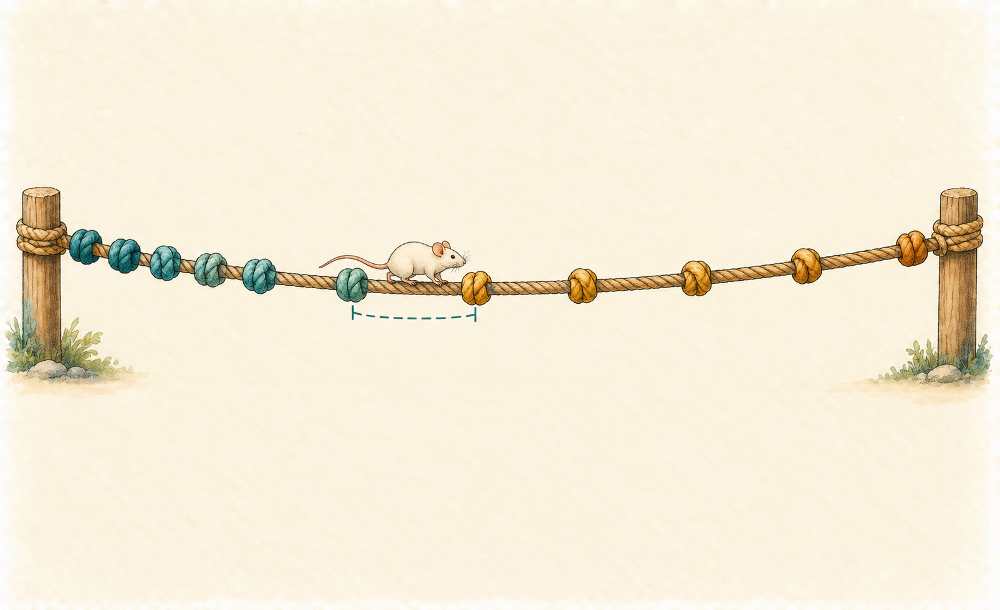
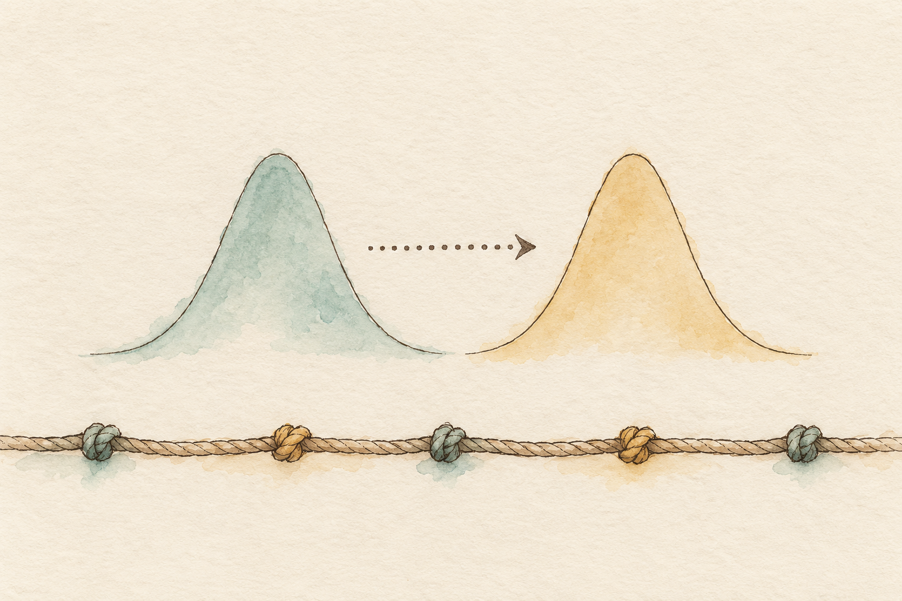

# Grading neurological deficit {#sec-ordinal-nominal-regression}

```{r}
#| label: setup
#| include: false

library(ggplot2)
library(here)
library(brms)
library(ordinal)
library(nnet)
library(glmmTMB)
library(ggdist)
library(patchwork)

# The book's shared plot theme (this also loads the legend helpers)
Plot_theme <- source("functions/plot_theme.R")
Plot_theme <- Plot_theme$value

# The sampler check used throughout the book
source("functions/mcmc_check.R")

# One color per genotype (as in the earlier wire chapters)
col_geno <- c(WT = "#D55E00", KO = "#0072B2")

# One color per group of the Parkinson data (colorblind safe, Okabe-Ito)
col_group <- c(HC = "#009E73", RBD = "#E69F00", PD = "#CC79A7")

# The highest score the modified scale allows (the highest observed is 12)
max_score <- 15

# Sampler settings for the multilevel fits (as in the previous chapters)
ml_control <- list(adapt_delta = 0.95)

# Median and 95% credible interval of a vector of draws, as text for the prose
summ <- function(x, digits = 2) {
  sprintf(paste0("%.", digits, "f [%.", digits, "f, %.", digits, "f]"),
          median(x), quantile(x, 0.025), quantile(x, 0.975))
}

# Width of the 95% interval of a vector of draws
wid <- function(x) diff(quantile(x, c(0.025, 0.975)))

# Probability of each grade from thresholds (draws x K-1), the linear predictor (one value per
# draw) and, optionally, the spread of the animal intercepts to average over animals
grade_probs <- function(tau, eta, sd_u = NULL, n_u = 100) {
  one <- function(shift) {
    cum <- plogis(tau - (eta + shift))
    cbind(cum, 1) - cbind(0, cum)
  }
  if (is.null(sd_u)) return(one(0))
  z <- qnorm((seq_len(n_u) - 0.5) / n_u)
  Reduce(`+`, lapply(z, function(zz) one(zz * sd_u))) / n_u
}

# Median and 95% interval of every column of a matrix of draws
col_summ <- function(P) {
  data.frame(med = apply(P, 2, median),
             lo = apply(P, 2, quantile, 0.025),
             hi = apply(P, 2, quantile, 0.975))
}
```

"The first mouse scored 6 and the second scored 3. Is the first one twice as impaired?" If you have ever scored animals after a stroke, you know the answer you give out loud (*well, no, not exactly*) and the answer your spreadsheet gives when you ask for the mean of the column (*yes, twice, and here is a standard error*). This chapter is about the gap between those two answers. Parts 3 and 4 dealt with measurements that sit on a number line, with counts, with proportions and with yes or no. But neurologists and behavioral scientists also *grade*. An observer looks at the animal and writes down a 0, a 1, a 2 or a 3; a clinician scores gait from 0 to 4. These are [ordinal outcomes]{style="color:green; font-weight:bold;"}, ordered categories: we know that 3 is worse than 2, but nobody has told us that the step from 2 to 3 is the same as the step from 0 to 1. And some outcomes are categories with no order at all (healthy, at risk, ill; or which of three behaviors the animal chose), which needs a different tool again. In the table of families of the [introduction to GLMs](glm-intro.qmd#sec-glm-intro) this was the last row, the one that said "ordered categories" and "later in the book". It is later now.

I will use two real datasets, both new to the book. The first is the neurological score of mice after cerebral ischemia, from my own doctoral work. The second is a clinical dataset of people: neurologist-graded items of the motor examination and automatically measured features of speech, in healthy controls and in patients with early Parkinson's disease or at high risk of developing it. I will not stop at fitting a cumulative model. Whether a score is ordinal, a count or "just a number" is a modeling choice, so I will let the posterior predictive checks decide between them, as the book has done for every family so far.

## The score as it comes {#sec-score-data}

The data are the neurological score of 23 mice, scored on three occasions. The score is a modified version of the scale that Clark and colleagues proposed for mice with a middle cerebral artery occlusion [@clark1997], and the numbers are the neurological score of a paper from my doctoral study on the role of tenascin-C in the ischemic brain [@dzyubenko2022]. An observer rates the animal, the ratings are added, and the total runs from 0 (no deficit) to 15 (the worst deficit the scale allows). No mouse in this file reached more than 12. The mice are of two genotypes: wild type (WT) and a tenascin-C knockout (KO). Each mouse was scored on days 1, 3 and 7 after the ischemic lesion. There is no sham group in this file.

```{r}
# Read the file as it came; the genotype and the trial are numeric codes
score_raw <- read.csv(here("project/AnalysisData/Figure1C-NeurologicalScore.csv"))

# Give the codes their meaning (1 = wild type, 2 = tenascin-C knockout; trials are days after ischemia)
mice <- data.frame(
  animal = factor(score_raw$Animal),
  genotype = factor(score_raw$Genotype, levels = 1:2, labels = c("WT", "KO")),
  trial = factor(score_raw$Trial, levels = 1:3, labels = c("D1", "D3", "D7")),
  score = score_raw$Score
)

# The score as an ordered factor with every possible grade from 0 to 15 (brms will use only the grades that occur)
mice$grade <- factor(mice$score, levels = 0:max_score, ordered = TRUE)
```

As in the earlier chapters I check what the design guarantees before modeling anything, and the check is a few lines of code on the raw file.

```{r}
#| label: tbl-score_rules
#| tbl-cap: Rules that the design guarantees for the neurological score file. A count of zero means the rule holds.

# Animals that do not have exactly three rows (one per trial)
r_rows <- sum(table(score_raw$Animal) != 3)

# Animals recorded with more than one genotype
r_geno <- sum(tapply(score_raw$Genotype, score_raw$Animal, function(x) length(unique(x))) > 1)

# Scores that are not whole numbers from 0 to 15, and missing values
r_range <- sum(score_raw$Score < 0 | score_raw$Score > max_score | score_raw$Score != round(score_raw$Score))
r_na <- sum(is.na(score_raw))

rules <- data.frame(
  Rule = c("Each animal has three rows, one per trial (animals that break it)",
           "Each animal has one genotype (animals that break it)",
           "Every score is a whole number from 0 to 15 (rows that break it)",
           "No value is missing (missing cells)"),
  Count = c(r_rows, r_geno, r_range, r_na)
)
knitr::kable(rules, row.names = FALSE)
```

@tbl-score_rules says that all four rules hold: `r nlevels(mice$animal)` animals (`r sum(unique(mice[, c("animal", "genotype")])$genotype == "WT")` WT and `r sum(unique(mice[, c("animal", "genotype")])$genotype == "KO")` KO), three trials each, and `r nrow(mice)` scores. Notice what the design is. **Genotype varies between animals**, because a mouse is born one or the other, and **the trial varies within animals**, because every mouse is scored three times. That one sentence will decide which intervals get wider and which get narrower when we give each mouse its own baseline, exactly as in @sec-multilevel-varying-intercepts.

Before any model, I draw every animal. @fig-score_raw has one line per mouse across the three trials, with the 0 to 15 axis in full, because the first thing to know about a grade is where the animals actually are on the scale.

```{r}
#| label: fig-score_raw
#| fig-cap: "Neurological score of every mouse on days 1, 3 and 7 after ischemia (0 is no deficit, 15 the worst deficit the scale allows). Each thin line is one mouse; the points are its three scores, nudged apart a little where scores coincide. Left, wild type; right, tenascin-C knockout."
#| fig-alt: "Two panels, wild type on the left and knockout on the right, with the trials on the horizontal axis and the score from 0 to 15 on the vertical axis. Thin lines join the three scores of each mouse. In both panels most lines start between 3 and 8 on day 1, and fall to between 1 and 4 on days 3 and 7. A few wild type mice start high, at 9 to 12."
#| fig-width: 10
#| fig-height: 5
#| warning: false

# One line per mouse; a small vertical jitter keeps equal scores from hiding each other
set.seed(11)
mice$score_j <- mice$score + runif(nrow(mice), -0.15, 0.15)
ggplot(mice, aes(x = trial, y = score_j, group = animal, color = genotype)) +
  geom_line(alpha = 0.5, linewidth = 0.6) +
  geom_point(size = 1.8, alpha = 0.8) +
  scale_color_manual(values = col_geno) +
  scale_y_continuous(limits = c(0, max_score), breaks = seq(0, max_score, 3)) +
  facet_wrap(~ genotype) +
  labs(x = "Trial (days after ischemia)", y = "Neurological score (0 best, 15 worst)") +
  Plot_theme +
  legend_none() +
  theme(strip.text = element_text(size = 12, face = "bold"))
```

I drew @fig-score_raw with `ggplot2::geom_line()` and `geom_point()`, one line per animal, for a reason that matters more here than in the earlier chapters: with only 11 and 12 animals per group, every animal can be shown, and a bar of group means would hide that the same mouse is measured three times. The design tip is to draw the line that joins the repeated measures of one animal whenever there are some.

::: {.callout-tip title="How to read this figure"}
Read one line at a time first: where does this mouse start, and where does it end? Then read the bundle. Most lines fall between day 1 and day 3 and then flatten, so the story of the experiment is mostly a recovery that happens in the first days. Look at the height of the bundle on day 1 against day 7: the lines are spread out on day 1 and packed together near the floor on day 7, which means the spread depends on the level. A third thing: the scores are whole numbers, so many lines end at exactly the same height.
:::

### What a spreadsheet would say

```{r}
#| label: tbl-score_spreadsheet
#| tbl-cap: "What a spreadsheet gives for the score: mean and standard deviation by genotype and trial, with the number of mice."

# Mean, standard deviation and number of mice for each genotype and trial
cells <- expand.grid(trial = levels(mice$trial), genotype = levels(mice$genotype))
cells$n <- mapply(function(g, t) sum(mice$genotype == g & mice$trial == t), cells$genotype, cells$trial)
cells$mean <- mapply(function(g, t) mean(mice$score[mice$genotype == g & mice$trial == t]), cells$genotype, cells$trial)
cells$sd <- mapply(function(g, t) sd(mice$score[mice$genotype == g & mice$trial == t]), cells$genotype, cells$trial)
tab <- cells[order(cells$genotype, cells$trial), c("genotype", "trial", "n", "mean", "sd")]
tab$mean <- round(tab$mean, 2)
tab$sd <- round(tab$sd, 2)
names(tab) <- c("Genotype", "Trial", "Mice", "Mean", "SD")
knitr::kable(tab, row.names = FALSE)
```

@tbl-score_spreadsheet is the table that most papers would print, and it would tempt a sentence such as "the mean score of KO mice was `r tab$Mean[tab$Genotype == "KO" & tab$Trial == "D7"]` on day 7 against `r tab$Mean[tab$Genotype == "WT" & tab$Trial == "D7"]` in WT". Five things are wrong with it, and you can see all of them without fitting anything. The score has a **floor** at 0, so a mean near 2 cannot have symmetric noise around it. Its **ceiling** at 15 is reached by nobody (the highest score here is 12, and only a few mice get above 8), so we know very little about the upper grades. The **gaps between grades are unequal** as far as we can tell: is the step from 2 to 3 (a mouse that starts to circle) the same as the step from 8 to 9 (a mouse that is barely moving)? Nobody calibrated that. The **spread depends on the mean**: the standard deviation of the KO mice is `r tab$SD[tab$Genotype == "KO" & tab$Trial == "D1"]` on day 1 and `r tab$SD[tab$Genotype == "KO" & tab$Trial == "D7"]` on day 7, as the mean drops. And the scores are **integers**, so a mean of `r tab$Mean[tab$Genotype == "WT" & tab$Trial == "D3"]` is not a score any mouse can have.

```{r}
#| label: fig-score_counts
#| fig-cap: "How many mouse-trials received each score, by trial. Every grade from 0 to 15 is shown, including those that nobody received. Bars start at zero because they are counts."
#| fig-alt: "Three panels, one per trial, each a bar chart with the score from 0 to 15 on the horizontal axis and the number of mice on the vertical axis. Day 1 is spread widely with a peak between 2 and 6 and a long tail up to 11. Days 3 and 7 are packed at 1 to 5, with almost nothing above 5. Several high grades have a bar of height 1 or no bar."
#| fig-width: 10
#| fig-height: 5
#| warning: false

# Counts of each grade within each trial, with empty grades kept (a count of zero is information)
cnt <- as.data.frame(table(grade = mice$grade, trial = mice$trial))
cnt$score <- as.integer(as.character(cnt$grade))  # grades 13 to 15 are kept: nobody got them
ggplot(cnt, aes(x = score, y = Freq)) +
  geom_col(fill = "grey60", width = 0.8) +
  scale_x_continuous(breaks = 0:max_score) +
  facet_wrap(~ trial, ncol = 3) +
  labs(x = "Neurological score", y = "Number of mice") +
  Plot_theme +
  theme(strip.text = element_text(size = 12, face = "bold"), axis.text.x = element_text(size = 10))
```

@fig-score_counts shows what the lines hid: the score is a small number of grades, and the high ones are barely visited. In total `r sum(table(mice$score) >= 1)` of the 16 possible grades (0 to 15) occur, and the last three never do. Grades 7, 9, 10 and 12 occur once each (`r paste(names(table(mice$score))[table(mice$score) == 1], collapse = ", ")` are the grades with a single mouse-trial). That fact will matter twice: for the model we choose, and for how much we can say about the top of the scale. I drew counts with `geom_col()` and kept the empty grades on the axis, because a grade that nobody got is a statement about the scale, and a plot that silently drops it would hide it. The models will treat the three empty grades at the top in a particular way, which I come back to when the cumulative model arrives.

## What kind of model for a 0 to 15 score? {#sec-score-families}

I have three candidates, and I will not pick one by decree. A **Gaussian** model, the one a spreadsheet implies, treats the score as a measurement on a number line. A **beta-binomial** model (the family of @sec-beta-robust-regression) treats it as a bounded count, as if the animal had 15 chances to "show" the deficit; it is the family a bounded sum score invites, since it respects both ends of the scale and lets the variance exceed the binomial's. I use it as an approximation, because I do not claim that the score is made of fifteen independent yes-or-no items (a total of graded ratings is not a count of trials). And the **cumulative logit** model, which I explain in the next section, treats the score as ordered categories whose spacing is estimated from the data, not assumed; it will use the 13 grades that occur. Literature has an opinion on the Gaussian shortcut. Liddell and Kruschke showed that treating ordinal data as metric can find differences that are not there, miss ones that are, and even reverse the order of two groups when their spreads differ [@liddell2018]; their argument is the same one Kruschke makes in his textbook for rating scales [@kruschke2015]. A tutorial for psychologists [@burkner2019] shows the same models in `brms`, and I follow its code.

To compare the three on equal terms I fit each with the same predictors: the genotype, the trial and their interaction, with no animal effect yet. The trial is a factor with three levels, because three days are too few to draw a line through, and the interaction is there because the question is whether the two genotypes recover at the same speed. The priors are weakly informative, and I explain the ones on the ordinal model in the next sections: a Normal(0, 1.5) on the coefficients and, for the Gaussian, a Normal(3, 3) on the intercept and an Exponential(0.5) on `sigma`, which put the typical score between about 0 and 9 and the spread between 0 and a few points.

```{r}
# Gaussian: the score is a number on a line
fit1 <- brm(
  score ~ genotype * trial, data = mice, family = gaussian(),
  prior = c(prior(normal(3, 3), class = "Intercept"),
            prior(normal(0, 1.5), class = "b"),
            prior(exponential(0.5), class = "sigma")),
  chains = 4, cores = 4, seed = 123,
  file = "models/ordinal-nominal-regression_fit1.rds", file_refit = "never"
)

# Beta-binomial: the score is the number of "successes" out of 15
fit2 <- brm(
  score | trials(15) ~ genotype * trial, data = mice, family = beta_binomial(),
  prior = c(prior(normal(-1, 1.5), class = "Intercept"),
            prior(normal(0, 1.5), class = "b"),
            prior(gamma(2, 0.1), class = "phi")),
  chains = 4, cores = 4, seed = 123,
  file = "models/ordinal-nominal-regression_fit2.rds", file_refit = "never"
)

# Cumulative logit: the score is one of the ordered grades that occur (the model of the next section)
prior_cum <- c(prior(normal(0, 1.5), class = "b"),
               prior(normal(0, 2), class = "Intercept"))
fit3 <- brm(
  grade ~ genotype * trial, data = mice, family = cumulative("logit"),
  prior = prior_cum,
  chains = 4, cores = 4, seed = 123,
  file = "models/ordinal-nominal-regression_fit3.rds", file_refit = "never"
)
```

::: panel-tabset
### brms

```{r}
# The three Bayesian fits: coefficients of the Gaussian and of the beta-binomial (the cumulative one is read in the next section)
fixef(fit1)
fixef(fit2)
```

### Frequentist

```{r}
# The same Gaussian model by least squares, and the beta-binomial by maximum likelihood (glmmTMB)
round(summary(lm(score ~ genotype * trial, data = mice))$coefficients, 3)
tmb_bb <- glmmTMB(cbind(score, max_score - score) ~ genotype * trial, data = mice, family = betabinomial())
round(summary(tmb_bb)$coefficients$cond, 3)
```
:::

The coefficients of the first two models are on different scales (points of score, and log-odds), so they cannot be compared, and I will not try. What can be compared is what each model thinks a dataset looks like. A [posterior predictive check]{.ix} asks each model to simulate new scores and sets them beside the real ones (@sec-mcmc-model-checking). For a discrete outcome the natural picture is the count of animals at each grade: the dots are the real counts, the bars are what each model expects, and I add two bins for the impossible scores, below 0 and above 15, because a Gaussian model will produce them.

```{r}
# Count the simulated scores in each bin from "below 0" (-1) to "above 15" (16), after rounding
bin_counts <- function(yrep) {
  y <- pmin(pmax(round(yrep), -1), max_score + 1)
  t(apply(y, 1, function(r) tabulate(r + 2, nbins = max_score + 3)))
}

# 500 simulated datasets from each model (ordinal predictions come back as category numbers 1 to 13)
set.seed(21)
rep1 <- posterior_predict(fit1, ndraws = 500)
rep2 <- posterior_predict(fit2, ndraws = 500)
rep3 <- posterior_predict(fit3, ndraws = 500) - 1

# Median and 95% interval of the count in each bin, for the three models
bins <- c("<0", 0:max_score, ">15")
ppc_df <- do.call(rbind, lapply(
  list("Gaussian" = rep1, "Beta-binomial" = rep2, "Cumulative logit" = rep3),
  function(r) cbind(bin = factor(bins, levels = bins), col_summ(bin_counts(r)))
))
ppc_df$model <- factor(rep(c("Gaussian", "Beta-binomial", "Cumulative logit"), each = max_score + 3),
                       levels = c("Gaussian", "Beta-binomial", "Cumulative logit"))

# The observed counts, including zeros for the impossible bins
obs_counts <- tabulate(mice$score + 2, nbins = max_score + 3)
ppc_df$obs <- rep(obs_counts, times = 3)

# Share of Gaussian replicated scores outside 0 to 15, for the text
out_of_range <- mean(round(rep1) < 0 | round(rep1) > max_score)
```

```{r}
#| label: fig-score_ppc
#| fig-cap: "Posterior predictive check of three models for the score. Black dots are the observed number of mouse-trials at each score; the grey bars are the 95% interval of the number each model expects (500 simulated datasets). The first and last bins count simulated scores below 0 and above 15."
#| fig-alt: "Three panels, one per model, with the bins below 0, 0 to 15 and above 15 on the horizontal axis and the number of mouse-trials on the vertical axis. For the Gaussian model the intervals are wide and flat across 0 to 6, there is an interval of about 5 to 15 below 0, and the observed dots at 0 and 1 and at 2 sit outside the intervals. For the beta-binomial and cumulative logit models the black dots lie within or close to the intervals, and the cumulative intervals are the narrowest."
#| fig-width: 10
#| fig-height: 5
#| warning: false

# Interval = what the model expects; dot = what we saw
ggplot(ppc_df, aes(x = bin)) +
  geom_linerange(aes(ymin = lo, ymax = hi), linewidth = 3.5, color = "grey70") +
  geom_point(aes(y = med), shape = 95, size = 6, color = "grey30") +
  geom_point(aes(y = obs), size = 2.4) +
  facet_wrap(~ model, ncol = 1) +
  labs(x = "Score (rounded; <0 and >15 are impossible)", y = "Mouse-trials (of 69)") +
  Plot_theme +
  theme(strip.text = element_text(size = 12, face = "bold"), axis.text.x = element_text(size = 11))
```

I used a bar-and-dot check instead of the default density overlay of `pp_check()` because a density curve is the wrong picture for a variable with 16 possible values: it smooths over the empty grades, which are exactly where the models differ. The `bayesplot` function `ppc_bars()` draws the same kind of picture for ordered categories (we will use it later in the chapter). The tip to keep: for a discrete outcome, compare counts per value, not a smoothed curve.

::: {.callout-tip title="How to read this figure"}
Each panel is one model. The grey bar is where that model thinks the count at each score should fall, and the black dot is the real count. A model is doing well where the dots sit inside the bars, and it is *overconfident* where the bars are short and the dots miss them; it is *vague* where the bars are long enough to cover everything. Start with the outer bins: a model that has bars at "below 0" or "above 12" is predicting scores that no mouse can have. Then look at the dots at the low scores, where most of the data are.
:::

The Gaussian model fails in the way a spreadsheet would never tell you. About `r round(100 * out_of_range, 1)`% of the scores it simulates are impossible (below 0 or above 15), and in @fig-score_ppc the bin below zero has a bar where the real count is zero. The beta-binomial respects the limits and the check is acceptable, and the cumulative logit tracks the real counts grade by grade, because it has a parameter for each of them. That last sentence deserves a caution: a model with 12 free thresholds *can* reproduce the counts, and that is not evidence for it by itself, since it was given a parameter for each of them. A fairer comparison is predictive, and it is the one that [leave-one-out cross-validation]{.ix ix="leave-one-out cross-validation"} measures (@sec-count-regression, @sec-beta-robust-regression).

```{r}
#| warning: false

# Leave-one-out comparison of the two models that give a probability to each integer score
loo2 <- loo(fit2)
loo3 <- loo(fit3)
cmp_fam <- loo_compare(list("Beta-binomial" = loo2, "Cumulative logit" = loo3))

# Number of observations with Pareto k above 0.7 in each
k2 <- sum(loo::pareto_k_values(loo2) > 0.7)
k3 <- sum(loo::pareto_k_values(loo3) > 0.7)
```

I compare only two of the three, and the reason is a technical point worth knowing. Leave-one-out compares how much *probability* each model gave to the score that was left out. A beta-binomial and a cumulative model give a probability to each integer they can produce (the beta-binomial to every score from 0 to 15, the cumulative one to the grades it has seen, 0 to 12). A Gaussian model gives a probability *density* on a continuous line, a different kind of quantity, so its number is not comparable with theirs, even if the software prints one. (One can discretize the Gaussian, but then it is no longer the model a spreadsheet implies.) The difference in expected log predictive density between the two discrete models is `r round(abs(cmp_fam[2, "elpd_diff"]), 1)` with a standard error of `r round(cmp_fam[2, "se_diff"], 1)`, in favor of the `r rownames(cmp_fam)[1]` model. Pareto k is above 0.7 for `r k2` observations in the beta-binomial and `r k3` in the cumulative model, so I would not read the difference to a decimal. A difference of that size relative to its standard error says that the data cannot separate the two by predictive accuracy alone, which is what I expected: with 69 scores of which a handful are in the upper grades, there is little to tell a family with one extra parameter for the spread from one with a threshold for each grade. So the choice between them is not a statistical one. It is a question of what each model lets me *say*.

::: {.callout-tip title="What each family is for"}
The beta-binomial is a good description of the score as a bounded count, and its answer is about the **expected score**. The cumulative logit is the model that treats the grades as a scale whose spacing is unknown, and its answer is a **probability for each grade**: the chance of a score of at most 3, the chance of a score above 6. Those are the quantities a neurologist or a reviewer asks about, and the only model of the three that gives them without further assumptions is the third. That is the reason I continue with it. If your question is only "how much does the average score change", the beta-binomial is a perfectly honest alternative, and a Gaussian model is not.
:::

## A latent severity and the grades it produces {#sec-cumulative}

Imagine a mouse whose *true* severity could be read off a perfect instrument that nobody owns: a number on a line, higher for worse. The observer does not see that number. The observer looks at the animal and, depending on where the true severity falls, writes down a grade. Between "0" and "1" there is a cut, between "1" and "2" another, and so on up the scale. Think of a rope with knots at uneven distances (@fig-score-rope): the rope is the severity, which is continuous and invisible; the knots are the [thresholds]{style="color:green; font-weight:bold;"} (also called cut points); the grade is the number of the segment where the animal sits. The segments need not have the same length, which is the whole point.

{#fig-score-rope fig-align="center" width="90%" fig-alt="Watercolor sketch of a rope stretched between two wooden posts, with eleven knots at uneven distances, teal on the left and ochre on the right, and a small white mouse standing on the rope between the sixth and the seventh knot, with a dashed teal bracket under the gap between those two knots."}

That picture is the [cumulative logit model]{style="color:green; font-weight:bold;"}, also called the proportional odds model. In symbols, a hidden severity $z_i$ equals the linear predictor $\eta_i$ plus a logistic error, and the grade is $k$ when $z_i$ falls between thresholds $\tau_{k-1}$ and $\tau_k$. The probability of a grade *up to and including* $k$ is then @eq-cumulative:

$$
\Pr(Y_i \le k) = \text{logistic}(\tau_k - \eta_i), \qquad \eta_i = \beta_1 x_{1i} + \beta_2 x_{2i} + \dots
$$ {#eq-cumulative}

The textbooks motivate it in three ways that turn out to be the same model: Kruschke and Gelman, Hill and Vehtari through the latent variable and its thresholds [@kruschke2015; @gelman2020], and McElreath by stacking the counts of each grade into cumulative proportions and taking their log-odds [@mcelreath2020]. The sign convention matters, and `brms` uses the one in @eq-cumulative: a *positive* coefficient pushes the animal toward *higher* grades, which here means more deficit. The thresholds are not nuisance parameters. They are the model's description of the scale itself, and the 13 grades that occur need 12 of them. What about the three grades that the scale allows and nobody received (13 to 15)? `brms` drops unused levels of an ordered factor, so the model has no thresholds for them and gives them probability zero. That is a modeling statement, not a neutral default: for this model the highest possible score is 12, because 12 is the highest score it has seen. I come back to what that costs when I report probabilities.

Let me show it with the model's own estimates. The pooled cumulative fit gives 12 thresholds and five coefficients, and @fig-score_latent draws, for each trial, the latent distribution of each genotype (a logistic curve centered at that group's $\eta$) against the thresholds.

```{r}
# Draws of the thresholds and of the coefficients of the pooled cumulative model
dr3 <- as_draws_df(fit3)
tau3 <- as.matrix(dr3[, grep("^b_Intercept\\[", names(dr3))])
beta3 <- fixef(fit3)[-(1:12), "Estimate"]
tau_med <- apply(tau3, 2, median)

# Linear predictor (posterior median) of each genotype and trial
cell_grid <- expand.grid(genotype = levels(mice$genotype), trial = levels(mice$trial))
X <- model.matrix(~ genotype * trial, cell_grid)[, -1]
cell_grid$eta <- as.numeric(X %*% beta3[colnames(X)])

# The logistic density of the hidden severity in every group, on a grid
z <- seq(-9, 8, length.out = 400)
lat <- do.call(rbind, lapply(seq_len(nrow(cell_grid)), function(i)
  data.frame(z = z, dens = dlogis(z - cell_grid$eta[i]),
             genotype = cell_grid$genotype[i], trial = cell_grid$trial[i])))

# Where to write each grade: halfway between its two thresholds
mid <- c(tau_med[1] - 1, (tau_med[-1] + tau_med[-12]) / 2, tau_med[12] + 1)
grade_labels <- data.frame(z = mid, grade = 0:12, trial = "D1")
```

```{r}
#| label: fig-score_latent
#| fig-cap: "The hidden severity, drawn with the posterior medians of the pooled cumulative model. Each curve is the distribution of the latent severity of one genotype in one trial. The vertical dashed lines are the 12 thresholds; the grade a mouse receives is the number written between the two lines where its severity falls. To the right is worse."
#| fig-alt: "Three stacked panels for days 1, 3 and 7, each with a horizontal axis of latent severity and vertical dashed lines at twelve thresholds. Grade numbers from 0 to 12 are written between the lines at the top of the first panel; the lines are far apart on the left (grades 0 to 3) and crowded between grades 6 and 10. Two bell shaped curves, orange for wild type and blue for knockout, sit in each panel. On day 1 the curves are centered over grade 5; on days 3 and 7 both are shifted to the left, over grades 2 and 3."
#| fig-width: 10
#| fig-height: 5
#| warning: false

# Curves for the groups, thresholds as dashed lines, grade numbers along the top of the first panel
ggplot(lat, aes(x = z, y = dens, color = genotype)) +
  geom_vline(xintercept = tau_med, linetype = "dashed", color = "grey60") +
  geom_line(linewidth = 1.1) +
  geom_text(data = grade_labels, aes(x = z, y = 0.27, label = grade), inherit.aes = FALSE, size = 3.4) +
  scale_color_manual(values = col_geno) +
  scale_x_continuous(breaks = seq(-6, 6, 2)) +
  coord_cartesian(ylim = c(0, 0.28)) +
  facet_wrap(~ trial, ncol = 1) +
  labs(x = "Latent severity (higher is worse); numbers at the top are the grades", y = "Density", color = NULL) +
  Plot_theme +
  legend_inside(0.92, 0.45) +
  theme(strip.text = element_text(size = 12, face = "bold"), axis.text.x = element_text(size = 10))
```

I drew @fig-score_latent with `ggplot2::geom_line()` over a grid of values and `geom_vline()` for the thresholds, because the *idea* of the model is a picture and the posterior table is not. A table of 12 intercepts hides the one thing the figure shows at a glance: the segments have unequal widths. A bar plot with asterisks hides it too, since it has no concept of the scale being cut in unequal places.

::: {.callout-tip title="How to read this figure"}
Read the dashed lines as the knots of the rope and the numbers at the top as the grades they delimit. Then read a curve: the share of its area that lies between two lines is the probability of that grade for that group. A curve that moves to the right shifts the mass toward higher grades (more deficit), and a curve that moves to the left does the opposite; the *shape* of the curve does not change, because the model assumes the same logistic spread for everyone. The things to look at are (1) how far the two genotypes are from each other within a panel, which is the genotype effect, and (2) how far each curve moves between panels, which is the trial effect. The mistake to avoid is to read the horizontal distance between thresholds as a distance in "points of score": it is the opposite of a ruler. A segment is wide when many mice receive that grade and narrow when few do, so the crowded lines between grades 6 and 10 say that these grades are rare, not that they are mild.
:::

The first thing that jumps out in @fig-score_latent is how unevenly spaced the knots are. The segments of the grades 1 to 4, where most mice are, are wide, and the segments of the grades 6 to 10 are crowded together, because each of those grades was given to a few mice, and the area of a segment under the curve is the probability of that grade. This is the cumulative model doing what it should, and it carries a warning: the spacing of the knots is the model's way of reproducing how often each grade is used, so it is not a measurement of how different a 7 is from an 8. The thresholds of the rare grades also rest on very few mice, which is why the Normal(0, 2) prior that I defend in the next section does real work there.

Now the numbers. The thresholds and the shifts of the pooled model, with the frequentist counterpart (`ordinal::clm`, which fits the same cumulative logit by maximum likelihood [@christensen2023]):

::: panel-tabset
### brms

```{r}
# Thresholds ("Intercept[k]") and coefficients of the pooled cumulative logit model
fixef(fit3)
```

### clm

```{r}
# The same model by maximum likelihood; clm names each threshold by the two grades it separates ("0|1", "1|2", ...)
clm3 <- clm(grade ~ genotype * trial, data = mice)
round(summary(clm3)$coefficients, 3)
```
:::

The coefficients read as *shifts of the latent severity* on the logit scale. With the day-1 WT mice as the baseline, `genotypeKO` is the KO minus WT difference on day 1: `r summ(dr3$b_genotypeKO, 2)`, which on this scale means the KO curve sits to the right of the WT curve on day 1, and the interval comfortably includes zero. `trialD3` and `trialD7` are the changes of the WT mice from day 1 (`r summ(dr3$b_trialD3, 2)` and `r summ(dr3$b_trialD7, 2)`), and the interaction terms say how the KO recovery differs from the WT one. Exponentiated, a coefficient is an odds ratio of the *cumulative* odds, the same at every threshold (that is the "proportional odds"): `r summ(exp(dr3$b_trialD3), 2)` for day 3 against day 1 in WT means that, at every cut of the scale, the odds of being above the cut are multiplied by that factor. I give that as a secondary statement, because an odds ratio does not tell the neurologist how likely a grade is. The primary one is the probability of each grade, which I will report once the model has been through the checks it needs, because the pooled model still treats the three scores of a mouse as if they came from three mice.

## Priors for the thresholds {#sec-score-priors}

The coefficients get the same prior as in the logistic chapter, a Normal(0, 1.5) on the logit scale: an odds ratio of 20 (a coefficient of 3) is two standard deviations out, which covers every plausible effect of a genotype on a deficit score and rules out the absurd (@sec-logistic-regression, @sec-priors-regularization). The thresholds need more thought, because their prior is a statement about the *scale*: where the knots are. A flat prior on them is not neutral. It says that the knots could sit anywhere on the logit line, and because the logistic function saturates, a very wide prior puts almost all the probability on the first and last grades, with nothing in between. McElreath shows the same failure for the ordered outcomes of his trolley data [@mcelreath2020]; for the thresholds he suggests weakly informative priors on the log-cumulative-odds scale and, when one wants to speak about probabilities directly, a Dirichlet prior on the grade probabilities, which is the multivariate generalization of the beta. Rather than argue about it in the abstract, I do what the book does: I simulate from the priors and look at the *scores* they propose. For a typical animal, with no predictor effects, what probability does the prior give to each grade?

```{r}
# Prior-only fits: the likelihood is ignored, so the draws come from the priors alone
fit4 <- brm(
  grade ~ genotype * trial, data = mice, family = cumulative("logit"),
  prior = c(prior(normal(0, 1.5), class = "b"), prior(normal(0, 2), class = "Intercept")),
  sample_prior = "only", chains = 4, cores = 4, seed = 123,
  file = "models/ordinal-nominal-regression_fit4.rds", file_refit = "never"
)
fit5 <- brm(
  grade ~ genotype * trial, data = mice, family = cumulative("logit"),
  prior = c(prior(normal(0, 1.5), class = "b"), prior(normal(0, 10), class = "Intercept")),
  sample_prior = "only", chains = 4, cores = 4, seed = 123,
  file = "models/ordinal-nominal-regression_fit5.rds", file_refit = "never"
)

# Implied probability of each grade for a WT mouse on day 1, from each prior
newd <- data.frame(genotype = "WT", trial = "D1")
pp4 <- posterior_epred(fit4, newdata = newd)[, 1, ]
pp5 <- posterior_epred(fit5, newdata = newd)[, 1, ]
prior_probs <- rbind(
  cbind(prior = "Normal(0, 2) on the thresholds", grade = 0:12, col_summ(pp4)),
  cbind(prior = "Normal(0, 10) on the thresholds", grade = 0:12, col_summ(pp5))
)

# Share of draws that put more than 50% of the probability on a single grade
conc4 <- mean(apply(pp4, 1, max) > 0.5)
conc5 <- mean(apply(pp5, 1, max) > 0.5)
```

```{r}
#| label: fig-score_prior
#| fig-cap: "Prior predictive check for the cumulative model. For a WT mouse on day 1, the probability that the prior gives to each grade; points are medians and bars the 95% interval over prior draws. Top, the prior I use; bottom, a very wide one."
#| fig-alt: "Two panels with the grade from 0 to 12 on the horizontal axis and probability on the vertical axis. In the top panel every grade has a median of about 0.05 and an interval from near 0 to between 0.3 and 0.45. In the bottom panel the medians are near zero at the extreme grades and up to 0.1 in the middle, and the intervals reach 0.8 for grades 3 to 8: single draws put most of the probability on one grade."
#| fig-width: 10
#| fig-height: 5
#| warning: false

# Median and 95% interval of the prior probability of each grade
prior_probs$prior <- factor(prior_probs$prior, levels = unique(prior_probs$prior))
ggplot(prior_probs, aes(x = grade, y = med)) +
  geom_pointrange(aes(ymin = lo, ymax = hi), color = "grey30") +
  scale_x_continuous(breaks = 0:12) +
  facet_wrap(~ prior, ncol = 1) +
  labs(x = "Grade", y = "Prior probability of the grade") +
  Plot_theme +
  theme(strip.text = element_text(size = 12, face = "bold"))
```

@fig-score_prior shows what each prior believes before it sees a single mouse. The Normal(0, 2) prior puts a modest probability on every grade and never commits to one: in only `r round(100 * conc4)`% of the prior draws does a single grade get more than half of the probability. The very wide Normal(0, 10) prior is the one that looks "uninformative" on the logit scale and is the opposite: in `r round(100 * conc5)`% of its draws a single grade carries more than half of the probability, because with thresholds that far apart, the animal is nearly certain to land in one segment. That is the link-scale trap of @sec-priors-regularization in a new costume. The default prior of `brms` for thresholds, a Student-t with 3 degrees of freedom and a scale of 2.5, has much heavier tails than the Normal(0, 2), and I did not use it for that reason; I chose the first panel after looking at both, not by habit. One more thing worth saying: the Normal(0, 2) prior is symmetric around zero, so a priori the 13 grades are about equally likely, while the real data have most mice in grades 1 to 5. A prior that expected that would be a stronger statement than I want, and the data are enough to move it (the thresholds of the pooled fit are clearly not symmetric). I come back to how much it matters in the sensitivity table at the end of the chapter.

::: {.callout-note title="What a threshold prior says, in words"}
A prior on a threshold is a belief about *where the knot is on the rope*. Because a threshold sits on the log-cumulative-odds scale, a threshold at 0 means that a mouse with zero severity shift is equally likely to be below and above that cut. A prior with a standard deviation of 2 allows the cut to sit anywhere between about "very unlikely to be below" (+4) and "very likely to be below" (-4), which is most of what is plausible on a logit scale, and no more.
:::

## Each mouse is scored three times {#sec-score-animal}

The pooled model has a quiet flaw that you already know from @sec-multilevel-varying-intercepts. It treats the 69 scores as 69 independent mice, and they come from 23. A mouse that is severely affected on day 1 will, on average, still be worse than its neighbors on day 7, because it shares its brain, its lesion and its recovery. In the language of the rope: every mouse has its own baseline position on the severity line, and the three scores of one mouse are three reads of that same position plus the effects of the trial. That is a [varying intercept]{.ix ix="varying intercept"} per animal, and in a cumulative model it shifts the latent severity of the animal and leaves the thresholds alone. In `brms` it is the same term as before, `(1 | animal)`, added to the same formula. I expect it to matter, since that is what the NeuN data of that chapter taught. I will say now that this expectation turns out to be wrong here, and that the way it is wrong is worth a section.

For the standard deviation of the animal baselines I use an Exponential(1) prior, on the latent logit scale: it expects mice to differ by about one logit (an odds ratio of about 2.7 between a typical and a somewhat unusual mouse) and does not rule out much larger differences [@gelman2006; @gelman2026].

```{r}
# Priors of the main model: coefficients, thresholds and the spread of the animal baselines
prior_ml <- c(prior(normal(0, 1.5), class = "b"),
              prior(normal(0, 2), class = "Intercept"),
              prior(exponential(1), class = "sd"))

# The main model: cumulative logit with a varying intercept per mouse
fit6 <- brm(
  grade ~ genotype * trial + (1 | animal), data = mice, family = cumulative("logit"),
  prior = prior_ml,
  chains = 4, cores = 4, seed = 123, iter = 4000, control = ml_control,
  file = "models/ordinal-nominal-regression_fit6.rds", file_refit = "never"
)
```

::: panel-tabset
### brms

```{r}
# Thresholds, coefficients and the standard deviation of the animal baselines
summary(fit6)
```

### clmm

```{r}
# The same model by maximum likelihood with a random intercept per animal (Laplace approximation)
clmm6 <- clmm(grade ~ genotype * trial + (1 | animal), data = mice)
round(summary(clmm6)$coefficients[13:17, ], 3)
cat("Standard deviation of the animal intercepts:", round(sqrt(as.numeric(VarCorr(clmm6)$animal)), 2), "\n")
```
:::

`ordinal::clmm` fits the cumulative logit with random effects by maximum likelihood (a Laplace approximation by default, and adaptive quadrature when there is a single random intercept), and there is no way to put a prior on anything. `parsnip` has no engine for ordinal outcomes at all, so for this chapter the frequentist companion is `ordinal` for the cumulative family and `nnet` [@venables2002] for the nominal one. In the frequentist model nothing keeps the standard deviation of the animals away from a boundary if 23 mice are not enough to see it, and that is where a weakly informative prior earns its keep (@sec-multilevel-varying-intercepts).

```{r}
# The maximum likelihood fit and the Bayesian fit side by side (coefficients on the logit scale)
ml_vs_bayes <- data.frame(
  Coefficient = c("KO - WT, day 1", "Day 3 - day 1, WT", "Day 7 - day 1, WT"),
  `Maximum likelihood (clmm)` = round(unname(coef(clmm6)[13:15]), 2),
  `brms` = round(unname(fixef(fit6)[13:15, "Estimate"]), 2),
  check.names = FALSE
)
ml_sd <- sqrt(as.numeric(VarCorr(clmm6)$animal))
```

**The frequentist equivalent, and where it diverges.** The two fits agree about the structure and disagree about the numbers, and both disagreements are the ones this book has taught you to expect from small samples. `clmm` puts the standard deviation of the animals at `r round(ml_sd, 2)`, exactly on the boundary (the singular fit of @sec-multilevel-varying-slopes), while `brms` gives it a posterior with a median of `r round(median(as_draws_df(fit6)$sd_animal__Intercept), 2)`. And the maximum likelihood coefficients are larger in magnitude than the Bayesian ones (the day-1 genotype difference is `r ml_vs_bayes[1, 2]` against `r ml_vs_bayes[1, 3]`, the WT change from day 1 to day 7 `r ml_vs_bayes[3, 2]` against `r ml_vs_bayes[3, 3]`). With 17 parameters for 69 scores and several grades that almost nobody received, the likelihood alone is a poor guide, and the Normal(0, 1.5) prior on the coefficients keeps them from running away. It is the case for weakly informative priors that the multilevel chapters made, in a new family.

```{r}
# Spread of the animal baselines and the intraclass correlation on the latent logit scale
dr6 <- as_draws_df(fit6)
sd_u <- dr6$sd_animal__Intercept
icc_latent <- sd_u^2 / (sd_u^2 + pi^2 / 3)
```

```{r}
# How much does a mouse's score on one day tell you about its score on another? Rank correlations between the trials
wide <- reshape(data.frame(animal = mice$animal, trial = mice$trial, score = mice$score), idvar = "animal", timevar = "trial", direction = "wide")
rho_13 <- cor(wide$score.D1, wide$score.D3, method = "spearman")
rho_17 <- cor(wide$score.D1, wide$score.D7, method = "spearman")
rho_37 <- cor(wide$score.D3, wide$score.D7, method = "spearman")
```

The mice differ little: the standard deviation of their baselines is `r summ(sd_u, 2)` on the latent logit scale, which puts the share of the latent variance that lies between mice, the [intraclass correlation]{.ix ix="intraclass correlation"}, at `r summ(icc_latent, 2)` (the variance of a logistic error is fixed at $\pi^2/3 \approx 3.29$, which is what makes this share computable). Read those intervals with care. The upper end, 0.75 logits, is mostly what 23 mice cannot rule out, and the prior decides how far it extends (the sensitivity table at the end of the chapter shows how little it moves). The raw data say the same thing without a model. If a mouse had a severity of its own, the mice that scored high on day 1 would score high again on day 3 and day 7, and the rank correlations between trials would be clearly positive. They are `r round(rho_13, 2)` (day 1 with day 3), `r round(rho_17, 2)` (day 1 with day 7) and `r round(rho_37, 2)` (day 3 with day 7). The score of a mouse on day 1 predicts nothing about its later scores, and in the first days after a stroke that is not strange: the score at day 1 mostly reflects the immediate result of the lesion and of the surgery, and the later scores reflect the recovery. So the three scores of a mouse are *not* three reads of one stable position on the rope, and a single baseline per animal, which is the model I wrote down, finds almost nothing to absorb. What it cannot do is describe a mouse whose day-1 score is high and whose day-7 score is low, which the negative correlation between day 1 and day 7 hints at. That needs a model with structure over time, which @sec-longitudinal-timeseries builds for other animals and other measurements; I do not refit these 23 mice there, so the question stays open for this score.

### What the mouse term changes

@sec-multilevel-varying-intercepts taught that a multilevel model moves uncertainty to where it belongs: a comparison *between* groups of animals becomes wider, because the model knows it has 11 and 12 mice, not 33 and 36 independent scores, and a comparison *within* animals becomes narrower, because each mouse serves as its own control. Here genotype is between mice and trial is within mice, so on paper I expect the genotype comparisons to widen and the trial comparisons to tighten, by an amount that depends on how much the mice differ. I collect seven contrasts on the latent scale, three between genotypes (KO minus WT at each day) and four within genotype (the change from day 1 in each of the two genotypes).

```{r}
# Each contrast is a weighted sum of coefficients (names without the b_ prefix)
contr <- list(
  "KO - WT, day 1" = c(genotypeKO = 1),
  "KO - WT, day 3" = c(genotypeKO = 1, "genotypeKO:trialD3" = 1),
  "KO - WT, day 7" = c(genotypeKO = 1, "genotypeKO:trialD7" = 1),
  "Day 3 - day 1, WT" = c(trialD3 = 1),
  "Day 7 - day 1, WT" = c(trialD7 = 1),
  "Day 3 - day 1, KO" = c(trialD3 = 1, "genotypeKO:trialD3" = 1),
  "Day 7 - day 1, KO" = c(trialD7 = 1, "genotypeKO:trialD7" = 1)
)

# Median and 66% and 95% intervals of every contrast, for a fit
get_contrasts <- function(fit, label) {
  dr <- as.data.frame(as_draws_df(fit))
  do.call(rbind, lapply(names(contr), function(nm) {
    w <- contr[[nm]]
    x <- as.numeric(as.matrix(dr[, paste0("b_", names(w)), drop = FALSE]) %*% w)
    q <- unname(quantile(x, c(0.025, 0.17, 0.5, 0.83, 0.975)))
    data.frame(model = label, contrast = nm, lo95 = q[1], lo66 = q[2], med = q[3], hi66 = q[4], hi95 = q[5])
  }))
}

# The pooled and the multilevel model side by side
ints <- rbind(get_contrasts(fit3, "Scores independent"), get_contrasts(fit6, "Mouse intercept"))
ints$model <- factor(ints$model, levels = c("Scores independent", "Mouse intercept"))
ints$kind <- ifelse(grepl("^KO", ints$contrast), "Between mice: genotype", "Within mice: change from day 1")
ints$contrast <- factor(ints$contrast, levels = rev(names(contr)))
ints$width <- ints$hi95 - ints$lo95
```

```{r}
#| label: fig-score_compare
#| fig-cap: "Seven contrasts of the latent severity (logit scale), under a model that treats the 69 scores as independent and under one with a varying intercept per mouse. Thick bars are 66% and thin bars 95% credible intervals. Top, comparisons between mice; bottom, comparisons within mice."
#| fig-alt: "Two panels. The top panel has three rows for the KO minus WT difference at days 1, 3 and 7, with two intervals per row. The bottom panel has four rows for the changes from day 1 in each genotype, again with two intervals per row. Centers are between about minus 3 and 1 on the logit scale."
#| fig-width: 10
#| fig-height: 5
#| warning: false

# Point range: thin line = 95% interval, thick line = 66% interval
dodge <- position_dodge(width = 0.7)
ggplot(ints, aes(y = contrast, x = med, color = model, shape = model)) +
  geom_vline(xintercept = 0, linetype = "dashed", color = "grey40") +
  geom_linerange(aes(xmin = lo95, xmax = hi95), position = dodge, linewidth = 0.6) +
  geom_linerange(aes(xmin = lo66, xmax = hi66), position = dodge, linewidth = 1.8) +
  geom_point(position = dodge, size = 2.6) +
  scale_color_manual(values = c("Scores independent" = "grey35", "Mouse intercept" = "#0072B2")) +
  scale_shape_manual(values = c("Scores independent" = 15, "Mouse intercept" = 17)) +
  facet_wrap(~ kind, ncol = 1, scales = "free_y") +
  labs(x = "Difference in latent severity (logit scale; 0 = no difference)", y = NULL, color = NULL, shape = NULL) +
  guides(color = guide_legend(reverse = TRUE), shape = guide_legend(reverse = TRUE)) +
  Plot_theme +
  theme(strip.text = element_text(size = 12, face = "bold"), axis.text.y = element_text(size = 11)) +
  legend_top()
```

```{r}
# Ratio of the 95% interval widths, multilevel over independent, for the two kinds of comparison
w_ratio <- tapply(ints$width[ints$model == "Mouse intercept"] / ints$width[ints$model == "Scores independent"],
                  ints$kind[ints$model == "Mouse intercept"], mean)
```

I used the same figure of intervals as in @sec-multilevel-varying-intercepts, a thin and a thick line per model and per comparison, because the width is the result here, and a table of coefficients and stars would put the attention on the wrong number. In @fig-score_compare the comparison between mice (genotype) is on average `r round(w_ratio["Between mice: genotype"], 2)` times as wide under the model with a mouse intercept, and the comparison within mice (the change from day 1) is `r round(w_ratio["Within mice: change from day 1"], 2)` times as wide. In other words, nothing moved. The correction of the NeuN chapter was large because the mice there differed a lot and each contributed a dozen rows; here they barely differ, so there is little structure to correct for. I keep the varying intercept anyway. The design says that three scores come from one animal, the term costs nothing (the intervals did not change), and a reader should not have to take my word that the mice do not differ: the standard deviation, with its interval, is in the output. That is what a multilevel term is for in this chapter, a thing you *check* and report, not a trick that always changes the answer.

::: {.callout-tip title="How to read this figure"}
Compare each pair of lines in the same row: the *center* tells you the size of the effect, and the *length* its uncertainty. Here the two models give almost the same line, and that is the finding. In a design where mice differ strongly, the pair would separate, with the genotype lines longer and the trial lines shorter under the multilevel model. The two panels are the ones to compare when you read a figure like this in your own data: the between-mouse comparisons depend on how many mice there are, and the within-mouse comparisons profit from following the same mice.
:::

### Does the model describe the data?

A last check before we read anything. `bayesplot::ppc_bars_grouped()`, which `pp_check()` calls with `type = "bars_grouped"`, is the check for an ordered outcome: for each trial, the real count at every grade as a dot, and the model's expectation as a bar and an interval.

```{r}
#| label: fig-score_ppc_final
#| fig-cap: "Posterior predictive check of the main cumulative model, by trial. Bars are the median count the model expects at each grade (with a 95% interval) in 100 simulated datasets; dots are the observed counts. The grade axis counts from 1, so grade 1 is a score of 0."
#| fig-alt: "Three panels for days 1, 3 and 7 with grades 1 to 13 on the horizontal axis and counts on the vertical axis. The observed dots lie inside or very near the intervals at nearly all grades in all three panels."
#| fig-width: 10
#| fig-height: 5
#| warning: false

# Observed counts against 100 replicated datasets, trial by trial
pp_check(fit6, type = "bars_grouped", group = "trial", ndraws = 100) +
  labs(x = "Grade (1 = score 0, 13 = score 12)", y = "Mouse-trials") +
  Plot_theme +
  legend_top()
```

In @fig-score_ppc_final the dots lie inside the intervals trial by trial, including the narrow, packed day 7. The check does not tell us that the model is right; it tells us that none of the three trial-specific distributions is something the model finds surprising.

## Reading the result the way a paper would {#sec-score-report}

A cumulative model answers with a probability for each grade, and that is how I will report it. There are two ways to compute it, and the difference is the one @sec-multilevel-glmm taught. With the animal baseline set at zero, the model speaks about a **typical mouse**: the *conditional* reading. Averaging over the whole distribution of baselines, it speaks about the **population of mice**: the *marginal* reading. For a logit link they are not equal, because the logistic function is curved. For the grades of a score I report the marginal one, since the question is about the mice of a genotype, and I compute the conditional one alongside for anyone who wants the other reading.

```{r}
# Thresholds and coefficients of the main model, draw by draw
tau6 <- as.matrix(dr6[, grep("^b_Intercept\\[", names(dr6))])
beta_names <- c("b_genotypeKO", "b_trialD3", "b_trialD7", "b_genotypeKO:trialD3", "b_genotypeKO:trialD7")
B6 <- as.matrix(dr6[, beta_names])

# Probability of each grade for every genotype and trial: typical mouse and average over mice
cell_grid$cell <- paste(cell_grid$genotype, cell_grid$trial)
Xc <- model.matrix(~ genotype * trial, cell_grid)[, -1]
probs_typ <- list()
probs_pop <- list()
for (i in seq_len(nrow(cell_grid))) {
  eta <- as.numeric(B6 %*% Xc[i, sub("^b_", "", beta_names)])
  probs_typ[[cell_grid$cell[i]]] <- grade_probs(tau6, eta)
  probs_pop[[cell_grid$cell[i]]] <- grade_probs(tau6, eta, sd_u = sd_u, n_u = 60)
}

# Median and 95% interval of every grade, in long form for the plot
grade_df <- do.call(rbind, lapply(names(probs_pop), function(cl) {
  i <- match(cl, cell_grid$cell)
  rbind(cbind(reading = "Average over mice", genotype = cell_grid$genotype[i], trial = cell_grid$trial[i],
              grade = 0:12, col_summ(probs_pop[[cl]])),
        cbind(reading = "Typical mouse", genotype = cell_grid$genotype[i], trial = cell_grid$trial[i],
              grade = 0:12, col_summ(probs_typ[[cl]])))
}))
grade_df$genotype <- factor(grade_df$genotype, levels = c("WT", "KO"))
```

```{r}
#| label: fig-score_probs
#| fig-cap: "Probability of each grade by genotype and trial, averaged over the mice (main cumulative model). Points are posterior medians and bars are 95% credible intervals; WT in orange circles, KO in blue triangles."
#| fig-alt: "Three panels for days 1, 3 and 7 with the score from 0 to 12 on the horizontal axis and the probability on the vertical axis. On day 1 the probabilities are spread over many scores and are low for every score, with wide intervals. On days 3 and 7 the probability is concentrated at scores 1 to 4, and the two genotypes have intervals that overlap at nearly every score."
#| fig-width: 10
#| fig-height: 5
#| warning: false

# Probabilities by grade; the two genotypes side by side at each grade
pdat <- grade_df[grade_df$reading == "Average over mice", ]
ggplot(pdat, aes(x = grade, y = med, color = genotype, shape = genotype)) +
  geom_pointrange(aes(ymin = lo, ymax = hi), position = position_dodge(width = 0.6), size = 0.4) +
  scale_color_manual(values = col_geno) +
  scale_shape_manual(values = c(WT = 16, KO = 17)) +
  scale_x_continuous(breaks = 0:12) +
  facet_wrap(~ trial, ncol = 1) +
  labs(x = "Neurological score", y = "Probability of the score", color = NULL, shape = NULL) +
  Plot_theme +
  legend_inside(0.9, 0.85) +
  theme(strip.text = element_text(size = 12, face = "bold"), axis.text.x = element_text(size = 11))
```

I drew @fig-score_probs with `ggplot2::geom_pointrange()`, one point and one interval per grade, genotype and trial, because the thing we have estimated *is* a probability for each grade, and every one of them has its own uncertainty; a bar of means with asterisks has no way of showing a distribution that is shaped differently on day 1 and on day 7. The design tip is to dodge the groups at each grade so that two intervals can be compared without one hiding the other.

::: {.callout-tip title="How to read this figure"}
Each panel is a distribution over the 13 grades, so read it as you would read a histogram: where is the mass, and how spread out is it? Then compare the two genotypes grade by grade. If the points of one color are above the other at a grade, that genotype is more likely to receive that grade; if the intervals overlap broadly, the data do not separate them. A panel with many grades of wide intervals and no clear peak says that the data have little to say about the distribution on that day. The tempting mistake is to compare the *tallest* point of each genotype and call it a difference.
:::

The panels tell a story of recovery. On day 1 the probability is spread over a wide range of grades and no grade has more than about `r round(100 * max(pdat$med[pdat$trial == "D1"]))`%. On days 3 and 7 the probability concentrates at the low grades. To see the genotype difference, a single grade is the wrong unit, since the probabilities of neighboring grades are tied together. A better summary is a cumulative one: **the probability of a score of at most 3**, which a clinician reads as "little or no deficit". It is the sum of four of the probabilities, so it has a posterior of its own.

```{r}
# Probability of a score of at most 3 (grades 0 to 3), by genotype and trial: average over mice and typical mouse
le3 <- do.call(rbind, lapply(names(probs_pop), function(cl) {
  i <- match(cl, cell_grid$cell)
  rbind(data.frame(reading = "Average over mice", genotype = cell_grid$genotype[i], trial = cell_grid$trial[i],
                   p = rowSums(probs_pop[[cl]][, 1:4])),
        data.frame(reading = "Typical mouse", genotype = cell_grid$genotype[i], trial = cell_grid$trial[i],
                   p = rowSums(probs_typ[[cl]][, 1:4])))
}))
le3$genotype <- factor(le3$genotype, levels = c("WT", "KO"))

# Probability of at most 3 for one genotype, trial and reading (a vector of draws)
get_le3 <- function(g, tr, reading = "Average over mice") le3$p[le3$reading == reading & le3$genotype == g & le3$trial == tr]

# Difference KO - WT in the probability of a score of at most 3, in percentage points, by trial (average over mice)
diff_le3 <- sapply(levels(mice$trial), function(tr) 100 * (get_le3("KO", tr) - get_le3("WT", tr)))
```

```{r}
#| label: fig-score_le3
#| fig-cap: "Probability of a score of at most 3, by genotype and trial, averaged over mice (main cumulative model). Each half-eye is the posterior distribution; the point is the median and the bars are the 66% and 95% credible intervals."
#| fig-alt: "Six half-eye densities on a horizontal axis from 0 to 1, arranged in three rows for days 1, 3 and 7, with the two genotypes in each row. On day 1 both are far to the left and wide. On days 3 and 7 they are far to the right."
#| fig-width: 10
#| fig-height: 5
#| warning: false

# Half-eye of the probability: shape, median and intervals in one glyph
ggplot(le3[le3$reading == "Average over mice", ], aes(x = p, y = genotype, fill = genotype)) +
  stat_halfeye(point_interval = median_qi, .width = c(0.66, 0.95)) +
  scale_fill_manual(values = col_geno) +
  scale_x_continuous(limits = c(0, 1)) +
  facet_wrap(~ trial, ncol = 1) +
  labs(x = "Probability of a score of at most 3", y = NULL) +
  Plot_theme +
  legend_none() +
  theme(strip.text = element_text(size = 12, face = "bold"))
```

The picture is @fig-score_le3, and the numbers it carries are what a paper would say. On day 1, the probability of a score of at most 3 is `r summ(get_le3("WT", "D1"), 2)` in WT mice and `r summ(get_le3("KO", "D1"), 2)` in KO mice. On day 7 it is `r summ(get_le3("WT", "D7"), 2)` and `r summ(get_le3("KO", "D7"), 2)`. The KO minus WT difference at day 7 is `r summ(diff_le3[, "D7"], 0)` percentage points, with a posterior probability of `r round(100 * mean(diff_le3[, "D7"] > 0))`% that it is positive, which means that KO mice would more often recover to a score of 3 or lower. Note the width of the interval: with 11 and 12 mice, the data narrow a difference between groups to a range of tens of points, not a few.

To see the whole distribution in one picture, I stack the probabilities of the grades into bands (@fig-score_stacked). It has no uncertainty in it, so it is a summary of the previous figures, not a replacement.

```{r}
#| label: fig-score_stacked
#| fig-cap: "Expected distribution of the score by genotype and trial (posterior means, averaged over mice), with the grades grouped into five bands. Each column adds up to 100%."
#| fig-alt: "Two panels, WT on the left and KO on the right, with three stacked columns each for days 1, 3 and 7. Each column is divided into five bands from the lightest (scores 0 to 1) to the darkest (scores 9 to 12). On day 1 a large share of each column is in the darker bands, and on days 3 and 7 the lighter bands take most of the column."
#| fig-width: 10
#| fig-height: 5
#| warning: false

# Posterior mean probability of each grade, then summed into five bands
band_of <- cut(0:12, c(-1, 1, 3, 5, 8, 12), labels = c("0 to 1", "2 to 3", "4 to 5", "6 to 8", "9 to 12"))
stk <- do.call(rbind, lapply(names(probs_pop), function(cl) {
  i <- match(cl, cell_grid$cell)
  m <- tapply(colMeans(probs_pop[[cl]]), band_of, sum)
  data.frame(genotype = cell_grid$genotype[i], trial = cell_grid$trial[i], band = names(m), p = as.numeric(m))
}))
stk$band <- factor(stk$band, levels = rev(levels(band_of)))
stk$genotype <- factor(stk$genotype, levels = c("WT", "KO"))

# Stacked columns with a sequential palette (light = mild, dark = severe, in the order of the stack), readable in grayscale
ggplot(stk, aes(x = trial, y = p, fill = band)) +
  geom_col(width = 0.7, color = "white") +
  scale_fill_viridis_d(option = "mako", direction = 1, end = 0.9, name = "Score") +
  scale_y_continuous(labels = scales::percent, expand = c(0, 0)) +
  facet_wrap(~ genotype) +
  labs(x = "Trial", y = "Expected share of mice") +
  Plot_theme +
  legend_top() +
  theme(strip.text = element_text(size = 12, face = "bold"))
```

::: {.callout-tip title="How to read this figure"}
Each column is a distribution of the score at one trial, and its bands are shares that add up to 100%. Read the *lightest* band from left to right: it is the share of mice with little or no deficit. Compare the dark bands: they are the share that still scores 6 or more. A column cannot show how sure we are, so every share here has the uncertainty of @fig-score_probs and @fig-score_le3 behind it.
:::

One caution about the two readings. The probability of a score of at most 3 on day 7 for a typical KO mouse is `r summ(get_le3("KO", "D7", "Typical mouse"), 2)`, and for the average over KO mice it is `r summ(get_le3("KO", "D7"), 2)`. The typical mouse sits in the middle of the latent scale; averaging over mice pulls the probability toward 0.5, and it does so more when the probability is far from 0.5. That is why the shift in odds, which is conditional on a mouse, and the difference in probability, which here is averaged over mice, are not the same kind of number, and why the Results sentence below says which is which.

```{r}
# Numbers for the report: the shift of the latent severity (conditional) from day 1 to day 7 in each genotype
shift_wt <- dr6$b_trialD7
shift_ko <- dr6$b_trialD7 + dr6[["b_genotypeKO:trialD7"]]
n_wt <- sum(unique(mice[, c("animal", "genotype")])$genotype == "WT")
n_ko <- sum(unique(mice[, c("animal", "genotype")])$genotype == "KO")
```

::: {.callout-note title="How to report it"}
**Results.** In `r nlevels(mice$animal)` mice (`r n_wt` wild type and `r n_ko` tenascin-C knockout) scored on days 1, 3 and 7 after ischemia, the probability of a neurological score of at most 3 went from `r summ(100 * get_le3("WT", "D1"), 0)`% on day 1 to `r summ(100 * get_le3("WT", "D7"), 0)`% on day 7 in wild type mice, and from `r summ(100 * get_le3("KO", "D1"), 0)`% to `r summ(100 * get_le3("KO", "D7"), 0)`% in knockout mice (posterior median and 95% credible interval; average over mice). On day 7 the difference between genotypes was `r summ(diff_le3[, "D7"], 0)` percentage points, with a posterior probability of `r round(100 * mean(diff_le3[, "D7"] > 0))`% that knockout mice were more likely to have a score of at most 3. For a mouse with a typical baseline, the shift of the latent severity from day 1 to day 7 was `r summ(shift_wt, 2)` in wild type and `r summ(shift_ko, 2)` in knockout mice (logit scale; negative means less deficit), which multiplies the cumulative odds by `r summ(exp(shift_wt), 2)` and `r summ(exp(shift_ko), 2)`. Mice differed little in their baseline (standard deviation `r summ(sd_u, 2)` on the latent scale; intraclass correlation `r summ(icc_latent, 2)`).

**Methods.** The score (0 to 15; the highest observed was 12) was analyzed as an ordered outcome with a cumulative logit model in `brms`, with genotype, trial (a factor) and their interaction as predictors and a varying intercept per mouse. Priors were Normal(0, 1.5) for the coefficients, Normal(0, 2) for the 12 thresholds and Exponential(1) for the standard deviation of the mouse intercepts. Four chains of 4,000 iterations (`adapt_delta` 0.95) gave Rhat below 1.01, effective sample sizes above 400 and no divergent transitions. Probabilities of each grade are averages over the fitted distribution of mice. Scores above 12, which no mouse reached, have probability zero in this model. The score was modeled as ordered categories because its steps are not known to be equal.
:::

## The assumption that carries the model {#sec-score-po}

Everything above rests on one sentence that I have repeated without defending it: the shift is the *same at every threshold*. That is the [proportional odds assumption]{style="color:green; font-weight:bold;"}. In the language of the rope: moving to day 7 slides the entire latent distribution by the same amount, whichever knot you look at. @fig-score-slide pictures it. A treatment that makes mild deficits rarer but leaves severe ones untouched would break it, and so would a genotype that matters for the first recovery of the animal but not for its worst grades. The cumulative model is therefore a *choice*, one of several, and a researcher should know the others and look.

{#fig-score-slide fig-align="center" width="80%" fig-alt="Watercolor sketch of a teal bell curve on the left and an ochre bell curve of the same shape on the right, joined by a dotted arrow pointing to the right, above a horizontal rope with five knots that alternate teal and ochre."}

There are three kinds of alternative [@burkner2019; @harrell2015]. The **category-specific effect** (a partial proportional odds model) lets a predictor have a different coefficient at each threshold, and `brms` writes it `cs(genotype)`. The **adjacent-category** model (`acat`) describes the log-odds of grade $k$ against grade $k+1$, and fits when a person compares neighboring options. The **sequential** model (`sratio`) describes the chance of passing from grade $k$ to the next *given* that the animal has reached $k$, and fits processes in stages. Each has a different scientific story, and none is "more correct": the question is which story fits how the score is made.

With 69 scores, a model with 12 thresholds and a separate coefficient at each is hopeless (when I tried it the sampler diverged), and Harrell warns against collapsing sparse categories just to get a test to pass [@harrell2015]. So I take two steps in the open. First, I collapse the score into five grades, 0 to 1, 2, 3, 4 and 5 or more, which keeps at least `r min(table(cut(mice$score, c(-1, 1, 2, 3, 4, max_score))))` mice per grade, and I check that the collapse does not change the quantity I reported. Second, I check the assumption for one predictor at a time, with the genotype and the trial as main effects (the interaction would multiply the number of parameters by four) and without the animal term: its standard deviation is close to zero in the main model, and these models are already hard to fit without it (with the animal term on top, the sampling was no better).

```{r}
# Five grades: 0 to 1, 2, 3, 4 and 5 or more
mice$grade5 <- cut(mice$score, c(-1, 1, 2, 3, 4, max_score), labels = c("0-1", "2", "3", "4", "5+"), ordered_result = TRUE)

# The model of the chapter with the collapsed outcome
fit11 <- brm(
  grade5 ~ genotype * trial + (1 | animal), data = mice, family = cumulative("logit"),
  prior = prior_ml,
  chains = 4, cores = 4, seed = 123, iter = 4000, control = ml_control,
  file = "models/ordinal-nominal-regression_fit11.rds", file_refit = "never"
)

# The probability of a score of at most 3 is the probability of the first three grades of the collapsed outcome
dr11 <- as_draws_df(fit11)
tau11 <- as.matrix(dr11[, grep("^b_Intercept\\[", names(dr11))])
B11 <- as.matrix(dr11[, beta_names])
le3_5 <- sapply(seq_len(nrow(cell_grid)), function(i) {
  eta <- as.numeric(B11 %*% Xc[i, sub("^b_", "", beta_names)])
  P <- grade_probs(tau11, eta, sd_u = dr11$sd_animal__Intercept, n_u = 60)
  rowSums(P[, 1:3])
})
colnames(le3_5) <- cell_grid$cell
```

```{r}
#| label: tbl-score_collapse
#| tbl-cap: "Probability of a score of at most 3 (average over mice) with the 13 grades and with the five collapsed grades: posterior median and 95% credible interval."

# The same estimand from the two models, by genotype and trial
cmp_col <- data.frame(
  Group = cell_grid$cell,
  `13 grades` = sapply(cell_grid$cell, function(cl) summ(rowSums(probs_pop[[cl]][, 1:4]), 2)),
  `5 grades` = sapply(cell_grid$cell, function(cl) summ(le3_5[, cl], 2)),
  check.names = FALSE
)
knitr::kable(cmp_col, row.names = FALSE)
```

@tbl-score_collapse is the cost of collapsing, stated: for the quantity I reported, the probability of a score of at most 3, the two models give answers within a few points of each other (the largest gap is about 7 points, with intervals 30 points wide), so the thin grades at the top are not driving the result. They would drive a statement about a score of 9 or more, and I cannot make one. That is also the answer to the earlier question about thin categories: a category with a single mouse gets a threshold that is mostly prior; the model is honest about it (its interval is wide), but it cannot be read as knowledge. If I want to say something about the top of the scale, I need more mice at the top of the scale.

```{r}
# Priors for the checks: the same coefficients and thresholds as before, no animal term
prior_po <- c(prior(normal(0, 1.5), class = "b"), prior(normal(0, 2), class = "Intercept"))

# Constant effects (the proportional odds model), category-specific genotype, category-specific trial
fit12 <- brm(
  grade5 ~ genotype + trial, data = mice, family = cumulative("logit"),
  prior = prior_po,
  chains = 4, cores = 4, seed = 123, iter = 4000, control = ml_control,
  file = "models/ordinal-nominal-regression_fit12.rds", file_refit = "never"
)
fit13 <- brm(
  grade5 ~ cs(genotype) + trial, data = mice, family = cumulative("logit"),
  prior = prior_po,
  chains = 4, cores = 4, seed = 123, iter = 4000, control = list(adapt_delta = 0.99),
  file = "models/ordinal-nominal-regression_fit13.rds", file_refit = "never"
)
fit14 <- brm(
  grade5 ~ genotype + cs(trial), data = mice, family = cumulative("logit"),
  prior = prior_po,
  chains = 4, cores = 4, seed = 123, iter = 4000, control = list(adapt_delta = 0.99),
  file = "models/ordinal-nominal-regression_fit14.rds", file_refit = "never"
)

# Two other families for the same outcome: adjacent categories and sequential
fit15 <- brm(
  grade5 ~ genotype + trial, data = mice, family = acat("logit"),
  prior = prior_po,
  chains = 4, cores = 4, seed = 123, iter = 4000, control = ml_control,
  file = "models/ordinal-nominal-regression_fit15.rds", file_refit = "never"
)
fit16 <- brm(
  grade5 ~ genotype + trial, data = mice, family = sratio("logit"),
  prior = prior_po,
  chains = 4, cores = 4, seed = 123, iter = 4000, control = ml_control,
  file = "models/ordinal-nominal-regression_fit16.rds", file_refit = "never"
)
```

::: panel-tabset
### brms

```{r}
# Genotype effect at each of the four thresholds ("[1]" to "[4]") against the constant one
cs_geno <- as.data.frame(as_draws_df(fit13))[, paste0("bcs_genotypeKO[", 1:4, "]")]
const_geno <- as_draws_df(fit12)$b_genotypeKO
round(rbind(do.call(rbind, lapply(cs_geno, function(x) quantile(x, c(0.025, 0.5, 0.975)))),
            "constant" = quantile(const_geno, c(0.025, 0.5, 0.975))), 2)
```

### clm

```{r}
# The same check without the animal term: partial proportional odds for the genotype, and the likelihood ratio test
clm_po <- clm(grade5 ~ genotype + trial, data = mice)
clm_cs <- clm(grade5 ~ trial, nominal = ~ genotype, data = mice)
anova(clm_po, clm_cs)
nominal_test(clm_po)
```
:::

`ordinal` offers the frequentist version of the same question, the likelihood ratio test of a partial proportional odds model against the constant one (`nominal_test()`). I show it as one more number to look at, and I would not make it a gate: the table is sparse, 69 scores in 5 grades, and a nonsignificant test in a sparse table is weak reassurance, which is why the graphical and predictive checks come first [@harrell2015].

```{r}
# Category-specific effects of genotype and trial, one per cut of the five-grade score
cs_trial <- as.data.frame(as_draws_df(fit14))
cuts <- paste0("≤ ", c("0-1", "2", "3", "4"))
cs_df <- do.call(rbind, c(
  lapply(1:4, function(k) data.frame(term = "KO - WT", threshold = cuts[k], x = cs_geno[[k]])),
  lapply(1:4, function(k) data.frame(term = "Day 3 - day 1", threshold = cuts[k], x = cs_trial[[paste0("bcs_trialD3[", k, "]")]])),
  lapply(1:4, function(k) data.frame(term = "Day 7 - day 1", threshold = cuts[k], x = cs_trial[[paste0("bcs_trialD7[", k, "]")]]))
))
cs_df$threshold <- factor(cs_df$threshold, levels = cuts)
cs_df$term <- factor(cs_df$term, levels = c("KO - WT", "Day 3 - day 1", "Day 7 - day 1"))

# Median and 95% interval of each threshold-specific effect
cs_sum <- do.call(rbind, lapply(split(cs_df, list(cs_df$term, cs_df$threshold), drop = TRUE), function(d)
  data.frame(term = d$term[1], threshold = d$threshold[1],
             lo = quantile(d$x, 0.025), med = median(d$x), hi = quantile(d$x, 0.975))))

# The constant effect of the proportional odds model, for reference
dr12 <- as_draws_df(fit12)
const_df <- data.frame(term = factor(levels(cs_df$term), levels = levels(cs_df$term)),
                       med = c(median(dr12$b_genotypeKO), median(dr12$b_trialD3), median(dr12$b_trialD7)))
```

```{r}
#| label: fig-score_po
#| fig-cap: "Does the shift depend on the cut? Effect of the genotype and of the trial on the latent severity, estimated separately at each of the four cuts of the five-grade score (points and 95% credible intervals), against the single constant effect of the proportional odds model (dashed line, posterior median)."
#| fig-alt: "Three panels, one per effect, each with four intervals on the horizontal axis (cuts at 0 to 1, 2, 3 and 4) and the effect on the vertical axis. A horizontal dashed line shows the constant effect. The intervals are wide and the dashed line passes through all four of them in each panel."
#| fig-width: 10
#| fig-height: 5
#| warning: false

# One panel per predictor; the dashed line is what proportional odds says
ggplot(cs_sum, aes(x = threshold, y = med)) +
  geom_hline(yintercept = 0, color = "grey60") +
  geom_hline(data = const_df, aes(yintercept = med), linetype = "dashed", color = "#0072B2") +
  geom_pointrange(aes(ymin = lo, ymax = hi), color = "grey25") +
  facet_wrap(~ term, nrow = 1) +
  labs(x = "Cut of the score (score at or below)", y = "Effect on the latent severity (logit)") +
  Plot_theme +
  theme(strip.text = element_text(size = 12, face = "bold"), axis.text.x = element_text(size = 10))
```

@fig-score_po is the picture to look at first: for every predictor, four estimates, one for each cut, and the dashed line of the constant model. I used `geom_pointrange()` with the constant effect drawn as a reference line, because the question is "is each estimate compatible with one common value?", and that is a question about overlap with a line, not about significance.

::: {.callout-tip title="How to read this figure"}
Each interval is the effect of the predictor estimated using *only* the cut at that position. If proportional odds holds, the four intervals of a panel scatter around the same value, and the dashed line passes through all of them. A real violation looks like a trend: effects that grow, shrink or change sign as you move along the cuts. Wide intervals with a flat dashed line mean that the data have no power to see a violation, which is different from seeing none.
:::

```{r}
#| label: tbl-score_po_loo
#| tbl-cap: "Predictive comparison of five models of the five-grade score without an animal term (leave-one-out, differences in expected log predictive density against the best model, with their standard errors) the number of observations with Pareto k above 0.7 and the number of divergent transitions (out of 8,000 draws)."

# Leave-one-out comparison of the cumulative model with constant and category-specific effects, and of two other families
loos <- list("Cumulative, constant effects" = loo(fit12), "Cumulative, cs(genotype)" = loo(fit13),
             "Cumulative, cs(trial)" = loo(fit14), "Adjacent category" = loo(fit15), "Sequential" = loo(fit16))
fits_po <- list("Cumulative, constant effects" = fit12, "Cumulative, cs(genotype)" = fit13,
                "Cumulative, cs(trial)" = fit14, "Adjacent category" = fit15, "Sequential" = fit16)
cmp_po <- loo_compare(loos)
po_tab <- data.frame(
  Model = rownames(cmp_po),
  `elpd difference` = round(cmp_po[, "elpd_diff"], 1),
  `SE of the difference` = round(cmp_po[, "se_diff"], 1),
  `Pareto k > 0.7` = sapply(rownames(cmp_po), function(m) sum(loo::pareto_k_values(loos[[m]]) > 0.7)),
  `Divergent transitions` = sapply(rownames(cmp_po), function(m) sum(subset(nuts_params(fits_po[[m]]), Parameter == "divergent__")$Value)),
  check.names = FALSE
)
knitr::kable(po_tab, row.names = FALSE)
```

```{r}
#| label: tbl-score_po_prob
#| tbl-cap: "Probability of a score of at most 3 (posterior median and 95% credible interval; five-grade score, no animal term) under the proportional odds model and under two other families that sampled without problems."

# P(score <= 3) is the probability of the first three of the five grades, in each genotype and trial
p_le3_fit <- function(fit) {
  ep <- posterior_epred(fit, newdata = cell_grid[, c("genotype", "trial")])
  apply(ep[, , 1:3], c(1, 2), sum)
}
pe12 <- p_le3_fit(fit12)
pe15 <- p_le3_fit(fit15)
pe16 <- p_le3_fit(fit16)
po_prob <- data.frame(
  Group = cell_grid$cell,
  `Cumulative (proportional odds)` = sapply(seq_len(nrow(cell_grid)), function(i) summ(pe12[, i], 2)),
  `Adjacent category` = sapply(seq_len(nrow(cell_grid)), function(i) summ(pe15[, i], 2)),
  `Sequential` = sapply(seq_len(nrow(cell_grid)), function(i) summ(pe16[, i], 2)),
  check.names = FALSE
)
knitr::kable(po_prob, row.names = FALSE)
max_gap <- 100 * max(abs(apply(pe12, 2, median) - apply(pe16, 2, median)), abs(apply(pe12, 2, median) - apply(pe15, 2, median)))

# The frequentist partial proportional odds model for the trial, for one cell: does it behave?
clm_trial_cs <- suppressWarnings(clm(grade5 ~ genotype, nominal = ~ trial, data = mice))
p_clm_cs <- sum(as.numeric(predict(clm_trial_cs, newdata = data.frame(genotype = "WT", trial = "D1"), type = "prob")$fit)[1:3])
```

```{r}
# Numbers for the text: the effect of day 3 and day 7 against day 1 at the first and the last cut
d3 <- cs_sum[cs_sum$term == "Day 3 - day 1", ]
d7 <- cs_sum[cs_sum$term == "Day 7 - day 1", ]
n_div <- sapply(list(fit13, fit14), function(f) sum(subset(nuts_params(f), Parameter == "divergent__")$Value))
```

@fig-score_po shows a pattern and not a verdict, and a caution about the models behind it comes first. The two models with `cs()` did **not** sample cleanly: they had `r n_div[1]` and `r n_div[2]` divergent transitions in 8,000 draws (the last column of @tbl-score_po_loo), and `brms` itself labels category-specific effects for a cumulative family as experimental. I tried the usual remedies (a higher `adapt_delta`, a tighter prior) and the divergences stayed, so I use these two fits as a *visual guide* and never for a number I report. The frequentist partial proportional odds model for the trial (`clm` with `nominal = ~ trial`) is no better: it converges to a solution in which the probability of a score of at most 3 for WT mice on day 1 is `r round(p_clm_cs, 2)`, which no mouse supports, a sign that five grades, three trials and 69 scores are too sparse a table for this model.

With that said, the figure has a pattern. The genotype effect has no trend across the cuts: its four intervals scatter around the dashed line. The trial effect does: for day 3 against day 1 it grows from `r round(d3$med[1], 1)` at the first cut to `r round(d3$med[4], 1)` at the last, and for day 7 from `r round(d7$med[1], 1)` to `r round(d7$med[4], 1)`. That is the pattern a floor would produce. A mouse that recovers almost never gets a score of 0 or 1, so recovery shows up first as the move from the high grades into the range of 2 to 4, and much less as a move to the very bottom, and one common coefficient averages these two stories. But every interval is wide and they overlap broadly. A check that does sample cleanly is whether another *family* gives other probabilities (@tbl-score_po_prob): the adjacent-category and sequential models, which make different assumptions about how the shift acts across grades, give probabilities of a score of at most 3 that differ from the proportional odds ones by at most `r round(max_gap, 0)` percentage points, well within the intervals. And @tbl-score_po_loo shows that none of the alternatives predicts held-out scores better than another, within their standard errors.

What I conclude is therefore modest. With 23 mice and five grades there is **not enough information to detect a violation**, and there is a hint of one in the trial effect that fits a floor effect. The proportional odds model is a reasonable and parsimonious description of these data, and its probabilities are not distorted beyond what the intervals already say, which is the position Harrell takes when data are thin: keep the constrained model and say that it is a constraint [@harrell2015]. The adjacent-category and sequential families tell different stories about the same data and are not better at predicting them, so for a deficit score that is not a staged process, the cumulative model is the one that matches what the score is. If you have more animals, run this check before you trust a single odds ratio.

## Grades given by a neurologist {#sec-pk-data}

So far the grades came from my own scoring of mice. The next two sections use data of people, and a different sort of grade: the items of a motor examination that a neurologist scores from 0 to 4. The data come from a study of speech in early untreated Parkinson's disease (PD) and in people with REM sleep behaviour disorder (RBD), a condition that carries a high risk of later developing PD or another synucleinopathy [@hlavnicka2017]. The file is public in the UCI Machine Learning Repository [@hlavnicka2017uci], and the table is distributed under a Creative Commons Attribution 4.0 licence (CC BY 4.0). There are 130 participants: 30 patients with early untreated PD, 50 with RBD and 50 healthy controls (HC). A neurologist scored every patient clinically; every participant was examined by a speech specialist in one session, read a standardized text of 80 words and gave a monologue of about 90 seconds, and the speech features were computed automatically from the recordings. I use the anonymized participant codes of the file and nothing else: there is no way to identify anybody, and I did not try.

::: {.callout-warning title="What this analysis is not"}
Everything in the last two sections is a *statistical description* of a small research sample. It is not a diagnostic tool, and a model of this kind should never be used to tell a person whether they have, or will have, a disease. The reasons are in the text (30 patients, correlated features, a classifier's probabilities that nobody has validated in new people), and the last section comes back to them.
:::

The file has quirks, as most real files do, and I handle them in code, as in @sec-beta-robust-regression, without touching the CSV. It has a **two-row header**: the first row names a block of columns ("Demographic information", "UPDRS III motor scale: specific items", the two speech tasks) and the second row holds the real names, so I read it with `skip = 1`. The column names contain line breaks, runs of spaces and encoding artifacts, and the 12 speech features appear **twice** (once per task), so R renames the second set with a `.1`. The participant code carries the group (`HC`, `PD`, and `RB` for RBD). And the clinical items and the Hoehn and Yahr stage are `-` for people who were not examined by design: healthy controls had no neurological examination, and the Hoehn and Yahr stage exists only for the patients with PD. That `-` is *not applicable by design*, not a missing value, and it turns those columns into text.

```{r}
# Read with the second row as the header; the file is encoded in latin1
pk_raw <- read.csv(here("project/AnalysisData/Parkinson.csv"), skip = 1, check.names = FALSE, fileEncoding = "latin1")

# Clean the names: line breaks and runs of spaces become one space
nm <- gsub("\\s+", " ", names(pk_raw))

# Pick a column by the start of its name; "which" chooses the first (reading) or second (monologue) copy
pick <- function(pattern, which = 1) pk_raw[[grep(pattern, nm)[which]]]

# The columns of the UPDRS III items (numbered 18 to 31, some with a body side) and the Hoehn and Yahr stage
item_cols <- grep("^(1[89]|2[0-9]|3[01])\\.", nm)
items_raw <- pk_raw[, item_cols]

# A tidy table: group decoded (RB is RBD), age, sex, two items, and two speech features per task
pk <- data.frame(
  code = pk_raw[[1]],
  group = factor(c(HC = "HC", RB = "RBD", PD = "PD")[substr(pk_raw[[1]], 1, 2)], levels = c("HC", "RBD", "PD")),
  age = pk_raw[["Age (years)"]],
  sex = factor(pk_raw[["Gender"]], levels = c("M", "F")),
  gait = suppressWarnings(as.integer(pick("^29\\. Gait"))),
  posture = suppressWarnings(as.integer(pick("^28\\. Posture"))),
  rate_read = as.numeric(pick("^Rate of speech timing", 1)),
  pause_read = as.numeric(pick("^Duration of pause intervals", 1)),
  rate_mono = as.numeric(pick("^Rate of speech timing", 2)),
  pause_mono = as.numeric(pick("^Duration of pause intervals", 2))
)
```

```{r}
#| label: tbl-pk_rules
#| tbl-cap: Rules that the design guarantees for the Parkinson file, run on the raw data. A count of zero means the rule holds.

# Group codes that are not HC, PD or RB, and repeated codes
r_code <- sum(!substr(pk_raw[[1]], 1, 2) %in% c("HC", "PD", "RB")) + sum(duplicated(pk_raw[[1]]))

# Healthy controls with a clinical item that is not "-" (they were not examined)
is_hc <- substr(pk_raw[[1]], 1, 2) == "HC"
r_hc <- sum(apply(items_raw[is_hc, ], 1, function(r) any(r != "-")))

# Patients (PD or RBD) with a "-" in any item
r_pat <- sum(apply(items_raw[!is_hc, ], 1, function(r) any(r == "-")))

# Hoehn and Yahr: "-" for every HC and RBD, a stage for every PD
hy <- pick("^Hoehn")
r_hy <- sum(hy[pk$group != "PD"] != "-") + sum(hy[pk$group == "PD"] == "-")

# Items outside 0 to 4 among those that were scored
vals <- suppressWarnings(as.numeric(unlist(items_raw)))
r_item <- sum(vals < 0 | vals > 4, na.rm = TRUE)

# Missing or non-numeric speech features
r_feat <- sum(is.na(pk[, c("rate_read", "pause_read", "rate_mono", "pause_mono")]))

rules_pk <- data.frame(
  Rule = c("Every code starts with HC, PD or RB and is unique (rows that break it)",
           "Healthy controls have no clinical item scored (controls that break it)",
           "Every patient has every item scored (patients that break it)",
           "Hoehn and Yahr exists for the PD patients only (rows that break it)",
           "Scored items lie between 0 and 4 (values that break it)",
           "The speech features have no missing value (missing cells)"),
  Count = c(r_code, r_hc, r_pat, r_hy, r_item, r_feat)
)
knitr::kable(rules_pk, row.names = FALSE)
```

@tbl-pk_rules says that all six rules hold. The file has `r nrow(pk)` participants (`r sum(pk$group == "HC")` HC, `r sum(pk$group == "RBD")` RBD, `r sum(pk$group == "PD")` PD), `r length(item_cols)` columns of clinical items for 14 numbered items (several have one column per limb), and the speech features have no missing values. Age is similar in the three groups (means `r paste(round(tapply(pk$age, pk$group, mean), 1), collapse = ", ")` for HC, RBD and PD), and sex is mostly male in all of them (`r paste(tapply(pk$sex == "M", pk$group, sum), "of", table(pk$group), collapse = "; ")` men in HC, RBD and PD). I keep age and sex in the models as adjusters, and a note: with 27 women in the whole file, nothing about sex differences can be said here.

### Which items?

Healthy controls were not examined, so a model of an item has two groups, PD against RBD, `r sum(pk$group != "HC")` participants. Among the 14 items I look for ones with a graded answer in both groups, and I choose with the data in view. Gait (item 29) has three observed grades, and its top grade (2) was given to two patients, both with PD. Posture (item 28) has four grades, and the top one has `r sum(pk$posture == 3, na.rm = TRUE)` patients. Neither item has a lot of data in its high grades, which is a good place to see what the cumulative model does when the top of the scale is thin, as with the mouse score.

```{r}
# Patients only (PD and RBD); age in decades around 65 and the two items as ordered factors
pk2 <- droplevels(pk[pk$group != "HC", ])
pk2$age10 <- (pk2$age - 65) / 10
pk2$gait_f <- factor(pk2$gait, levels = 0:2, ordered = TRUE)
pk2$posture_f <- factor(pk2$posture, levels = 0:3, ordered = TRUE)

# Share of each group at each grade, for the two items
item_df <- do.call(rbind, lapply(c("gait", "posture"), function(it) {
  t <- table(pk2$group, pk2[[it]])
  data.frame(item = paste0(toupper(substring(it, 1, 1)), substring(it, 2)),
             group = rep(rownames(t), times = ncol(t)), grade = rep(as.integer(colnames(t)), each = nrow(t)),
             n = as.vector(t), share = as.vector(t / rowSums(t)))
}))
item_df$group <- factor(item_df$group, levels = c("RBD", "PD"))
```

```{r}
#| label: fig-pk_items
#| fig-cap: "Share of patients at each grade of two items of the motor examination, by group. The number above each bar is the number of patients (RBD, n = 50; PD, n = 30). Bars start at zero because they are shares of a group."
#| fig-alt: "Two panels, Gait with grades 0 to 2 and Posture with grades 0 to 3, each with paired bars for RBD in ochre and PD in pink. In both items RBD has most patients at grade 0 (84 percent for gait, 68 percent for posture) and PD has most at grade 1; the top grades have counts of 0 to 2 for gait and 1 to 3 for posture."
#| fig-width: 10
#| fig-height: 5
#| warning: false

# Bars of the share inside each group, with counts written on top
ggplot(item_df, aes(x = factor(grade), y = share, fill = group)) +
  geom_col(position = position_dodge(width = 0.8), width = 0.75) +
  geom_text(aes(label = n), position = position_dodge(width = 0.8), vjust = -0.4, size = 3.5) +
  scale_fill_manual(values = col_group) +
  scale_y_continuous(labels = scales::percent, limits = c(0, 1), expand = c(0, 0)) +
  facet_wrap(~ item, scales = "free_x") +
  labs(x = "Grade given by the neurologist", y = "Share of the group", fill = NULL) +
  Plot_theme +
  legend_inside(0.88, 0.85) +
  theme(strip.text = element_text(size = 12, face = "bold"))
```

I drew @fig-pk_items as bars with the count written on each one, because here the quantity *is* a share of a group, bars from zero are an honest encoding of it, and the counts show how little data stand behind the top grades. The usual error with ordinal items is to report the mean grade of each group; the picture shows what the mean would hide, that in PD the distribution shifts and in RBD it stays at the floor.

::: {.callout-tip title="How to read this figure"}
Compare the two bars at each grade: a group whose bars sit further to the right has more of its patients at higher grades. Then read the numbers on top: a grade with a count of 0, 1 or 2 is a grade the model will know almost nothing about. The figure does not adjust for age or sex; the models below do.
:::

### Cumulative logit against "grade as a number"

For each item I fit two models with the same predictors (group, age in decades and sex): a cumulative logit, and a Gaussian one that treats the grade as a number, which is what many clinical papers do with an item score. In both, `groupPD` is the difference between PD and RBD (the reference is RBD).

```{r}
# Priors: as in the mouse chapter (coefficients Normal(0, 1.5); thresholds Normal(0, 2)); the Gaussian gets a wide intercept
prior_pk <- c(prior(normal(0, 1.5), class = "b"), prior(normal(0, 2), class = "Intercept"))
prior_pk_g <- c(prior(normal(0.5, 1), class = "Intercept"), prior(normal(0, 1), class = "b"),
                prior(exponential(1), class = "sigma"))

# Gait: Gaussian and cumulative
fit17 <- brm(gait ~ group + age10 + sex, data = pk2, family = gaussian(), prior = prior_pk_g,
             chains = 4, cores = 4, seed = 123,
             file = "models/ordinal-nominal-regression_fit17.rds", file_refit = "never")
fit18 <- brm(gait_f ~ group + age10 + sex, data = pk2, family = cumulative("logit"), prior = prior_pk,
             chains = 4, cores = 4, seed = 123,
             file = "models/ordinal-nominal-regression_fit18.rds", file_refit = "never")

# Posture: Gaussian and cumulative
fit19 <- brm(posture ~ group + age10 + sex, data = pk2, family = gaussian(), prior = prior_pk_g,
             chains = 4, cores = 4, seed = 123,
             file = "models/ordinal-nominal-regression_fit19.rds", file_refit = "never")
fit20 <- brm(posture_f ~ group + age10 + sex, data = pk2, family = cumulative("logit"), prior = prior_pk,
             chains = 4, cores = 4, seed = 123,
             file = "models/ordinal-nominal-regression_fit20.rds", file_refit = "never")
```

::: panel-tabset
### brms

```{r}
# Gait: thresholds and coefficients of the cumulative model; coefficient of the PD group in the Gaussian one
fixef(fit18)
fixef(fit17)["groupPD", ]
```

### Frequentist

```{r}
# The same two models for gait by maximum likelihood: clm (cumulative) and lm (grade as a number)
clm_gait <- clm(gait_f ~ group + age10 + sex, data = pk2)
round(summary(clm_gait)$coefficients, 3)
round(summary(lm(gait ~ group + age10 + sex, data = pk2))$coefficients, 3)
```
:::

```{r}
# Shift of the latent severity for PD against RBD in each item, and the odds ratio it implies
dr18 <- as_draws_df(fit18)
dr20 <- as_draws_df(fit20)

# Probability of each grade if every patient belonged to RBD or to PD (average over the observed ages and sexes)
grade_by_group <- function(fit, K) {
  out <- lapply(c("RBD", "PD"), function(g) {
    nd <- pk2
    nd$group <- factor(g, levels = c("RBD", "PD"))
    ep <- posterior_epred(fit, newdata = nd)
    apply(ep, c(1, 3), mean)
  })
  names(out) <- c("RBD", "PD")
  out
}
gg18 <- grade_by_group(fit18, 3)
gg20 <- grade_by_group(fit20, 4)

# Probability of any deficit (a grade above 0) in each group, and the difference in percentage points
any18 <- lapply(gg18, function(P) 1 - P[, 1])
any20 <- lapply(gg20, function(P) 1 - P[, 1])
```

The cumulative model for gait puts PD on the severe side by `r summ(dr18$b_groupPD, 2)` logits (an odds ratio of `r summ(exp(dr18$b_groupPD), 1)` for being above any given grade), and for posture by `r summ(dr20$b_groupPD, 2)` (`r summ(exp(dr20$b_groupPD), 1)`). Read as probabilities, which is what a neurologist wants, the chance of *any* abnormality of gait (a grade above 0) is `r summ(100 * any18$RBD, 0)`% in RBD and `r summ(100 * any18$PD, 0)`% in PD, a difference of `r summ(100 * (any18$PD - any18$RBD), 0)` percentage points, and for posture `r summ(100 * any20$RBD, 0)`% and `r summ(100 * any20$PD, 0)`%, a difference of `r summ(100 * (any20$PD - any20$RBD), 0)` points (averages over the observed ages and sexes). @fig-pk_probs draws all the grades.

```{r}
# Probability of each grade by group, median and 95% interval, for the two items
pk_probs <- rbind(
  do.call(rbind, lapply(names(gg18), function(g) cbind(item = "Gait", group = g, grade = 0:2, col_summ(gg18[[g]])))),
  do.call(rbind, lapply(names(gg20), function(g) cbind(item = "Posture", group = g, grade = 0:3, col_summ(gg20[[g]]))))
)
pk_probs$group <- factor(pk_probs$group, levels = c("RBD", "PD"))
```

```{r}
#| label: fig-pk_probs
#| fig-cap: "Probability of each grade by group, from the cumulative models of gait and posture (adjusted for age and sex, averaged over the patients). Points are posterior medians and bars are 95% credible intervals."
#| fig-alt: "Two panels, Gait with grades 0 to 2 and Posture with grades 0 to 3. In each, ochre circles for RBD and pink triangles for PD with vertical interval bars. For gait, RBD has a high probability at grade 0 and PD at grade 1, and the interval for grade 2 is wide for PD and close to zero for RBD. For posture, the PD intervals are wider and cover the RBD points at grades 1 to 3."
#| fig-width: 10
#| fig-height: 5
#| warning: false

# Probability of every grade, the two groups side by side
ggplot(pk_probs, aes(x = factor(grade), y = med, color = group, shape = group)) +
  geom_pointrange(aes(ymin = lo, ymax = hi), position = position_dodge(width = 0.5), size = 0.5) +
  scale_color_manual(values = col_group) +
  scale_shape_manual(values = c(RBD = 16, PD = 17)) +
  facet_wrap(~ item, scales = "free_x") +
  labs(x = "Grade given by the neurologist", y = "Probability of the grade", color = NULL, shape = NULL) +
  Plot_theme +
  legend_inside(0.88, 0.85) +
  theme(strip.text = element_text(size = 12, face = "bold"))
```

I used the same dodged point-and-interval form as for the mice (@fig-score_probs), because the quantity is again a probability for each grade. The thing to read in @fig-pk_probs is the width at the top grades: the interval for grade 2 of gait in PD is wide, because only two patients are there, and the interval for RBD at that grade is pressed against zero, where the model, which has no information to tell otherwise, relies on its thresholds and its prior. This is the thin-category lesson of the mouse score on a second dataset.

What does the Gaussian model do with the same data? It estimates the difference between PD and RBD as `r summ(as_draws_df(fit17)$b_groupPD, 2)` grades for gait, and that number is not wrong as a description of means, but it does not respect the scale. @fig-pk_ppc asks both models to simulate gait grades and counts what they produce.

```{r}
# Simulated gait grades from the Gaussian and the cumulative model, counted from "below 0" to "above 2"
bin_counts2 <- function(yrep, top) {
  y <- pmin(pmax(round(yrep), -1), top + 1)
  t(apply(y, 1, function(r) tabulate(r + 2, nbins = top + 3)))
}
set.seed(31)
rg <- bin_counts2(posterior_predict(fit17, ndraws = 500), 2)
rc <- bin_counts2(posterior_predict(fit18, ndraws = 500) - 1, 2)
bins_g <- c("<0", 0:2, ">2")
ppc_pk <- rbind(cbind(model = "Gaussian", bin = bins_g, col_summ(rg)),
                cbind(model = "Cumulative logit", bin = bins_g, col_summ(rc)))
ppc_pk$obs <- rep(tabulate(pk2$gait + 2, nbins = 5), 2)
ppc_pk$bin <- factor(ppc_pk$bin, levels = bins_g)
ppc_pk$model <- factor(ppc_pk$model, levels = c("Gaussian", "Cumulative logit"))
```

```{r}
#| label: fig-pk_ppc
#| fig-cap: "Posterior predictive check of the gait models. Black dots are the observed number of patients at each grade (n = 80); the grey bars are the 95% interval of the number each model expects. The first and last bins count simulated grades below 0 and above 2."
#| fig-alt: "Two panels, Gaussian and cumulative logit, with bins below 0, 0, 1, 2 and above 2 on the horizontal axis. In the Gaussian panel there are intervals in the bins below 0 and above 2 where the observed count is zero, and the intervals at grades 0 and 1 are wider than in the cumulative panel. In the cumulative panel the dots are inside narrow intervals and there are no impossible values."
#| fig-width: 10
#| fig-height: 5
#| warning: false

# What each model expects (bar) against what we saw (dot)
ggplot(ppc_pk, aes(x = bin)) +
  geom_linerange(aes(ymin = lo, ymax = hi), linewidth = 6, color = "grey70") +
  geom_point(aes(y = obs), size = 2.6) +
  facet_wrap(~ model) +
  labs(x = "Gait grade (rounded; <0 and >2 are impossible)", y = "Patients (of 80)") +
  Plot_theme +
  theme(strip.text = element_text(size = 12, face = "bold"))
```

In @fig-pk_ppc the Gaussian model proposes `r round(100 * mean(round(posterior_predict(fit17, ndraws = 500)) < 0 | round(posterior_predict(fit17, ndraws = 500)) > 2), 1)`% impossible grades and is vaguer at the observed ones; the cumulative model proposes none. With three grades and 80 patients both fit the large picture, and the difference is not dramatic. It matters when someone predicts with the model, and in the sentence that a paper can write: "the difference in mean gait grade" is a number with no clinical meaning, and "the probability of any abnormality of gait" is one that a neurologist can check against a patient.

::: {.callout-note title="What changes between a sum score and an item"}
The mouse score is a *sum* of observer ratings, with 13 possible values of which most are crowded at the bottom. An item of the neurologist's examination is a *single* ordinal answer with 3 or 4 grades, each of which has a clinical definition. A sum score is closer to a count (the cumulative model, the beta-binomial and even a Gaussian model are all defensible approximations), and an item is an ordered category in the strict sense, so the cumulative model is the natural model and the Gaussian one is the shortcut.
:::

::: {.callout-note title="How to report it: the neurologist's items"}
**Results.** Among `r nrow(pk2)` patients with REM sleep behaviour disorder (`r sum(pk2$group == "RBD")`) or early Parkinson's disease (`r sum(pk2$group == "PD")`), the probability of any abnormality of gait (a grade above 0) was `r summ(100 * any18$RBD, 0)`% in RBD and `r summ(100 * any18$PD, 0)`% in PD, a difference of `r summ(100 * (any18$PD - any18$RBD), 0)` percentage points (posterior median and 95% credible interval; adjusted for age and sex, averaged over the patients). On the latent scale of the cumulative logit model, PD was `r summ(dr18$b_groupPD, 2)` logits more severe than RBD, an odds ratio of `r summ(exp(dr18$b_groupPD), 1)` for being above any given grade. For posture the corresponding difference in the probability of any abnormality was `r summ(100 * (any20$PD - any20$RBD), 0)` points.

**Methods.** Each item was analyzed as an ordered outcome with a cumulative logit model in `brms` with group, age (per decade, centered at 65 years) and sex as predictors, Normal(0, 1.5) priors for the coefficients and Normal(0, 2) priors for the thresholds. Four chains of 2,000 iterations met the sampler criteria (Rhat below 1.01, effective sample sizes above 400, no divergent transitions). The top grades of both items were given to fewer than five patients, so the model's statements about them are mostly prior.
:::

## Telling three groups apart from speech {#sec-nominal}

The second question has no order in it, or none that I want to assume yet. Take the speech features, which exist for all 130 participants, and ask what they say about the group of a person: healthy, RBD or PD. This is a *nominal* outcome, three classes, and a proper model for it is not a cumulative logit. It is the logistic regression of @sec-logistic-regression, generalized from two outcomes to many.

Think of three doors, with no order among them (@fig-pk-doors), and a person who walks toward one of them. Each door has its own "attractiveness" for that person, a number that depends on the person's features (the speech, the age). The person is more likely to go through the doors with the higher numbers, but the numbers are not probabilities: they can be negative and they do not add up. The [softmax]{style="color:green; font-weight:bold;"} turns them into probabilities that are positive and add up to one: the probability of door $k$ is $\exp(\lambda_k)$ divided by the sum of $\exp(\lambda)$ over all the doors. Adding any constant to all the numbers leaves the probabilities as they were, so the model needs an anchor: one door, the [reference category]{style="color:green; font-weight:bold;"}, is given a score of zero, and the others are measured against it. That is the [categorical logit model]{style="color:green; font-weight:bold;"} (also called the multinomial logit) [@kruschke2015].

{#fig-pk-doors fig-align="center" width="90%" fig-alt="Watercolor sketch with three closed doors side by side on the left, teal, ochre and grey-blue, with nothing connecting them, and a short staircase of four steps on the right with a small teal figure standing on the second step."}

The healthy-controls, RBD and PD labels *do* have a natural order by risk, and I take that up at the end of the section: ordering them is a scientific claim, and I will fit both models and compare them. For now I let the data say what the doors are like.

### The features

I use two features of the reading task, chosen with the data in view: the **rate of speech timing** (how quickly the syllables follow each other, per minute) and the **duration of pause intervals** (milliseconds). Their group means move in a sensible direction: speech is slower and pauses are longer when the group has more risk, with RBD between the healthy controls and PD. I standardize both (mean 0, standard deviation 1 across the 130 participants), so that a coefficient is a change per standard deviation and the two features are comparable.

```{r}
# Standardize the two features of each task (mean 0, SD 1 over the 130 participants), and age in decades around 65
pk$age10 <- (pk$age - 65) / 10
pk_read <- pk
pk_read$z_rate <- as.numeric(scale(pk$rate_read))
pk_read$z_pause <- as.numeric(scale(pk$pause_read))
pk_mono <- pk
pk_mono$z_rate <- as.numeric(scale(pk$rate_mono))
pk_mono$z_pause <- as.numeric(scale(pk$pause_mono))

# The correlation between the two features of the reading task (they are not independent)
cor_feat <- cor(pk$rate_read, pk$pause_read)
```

```{r}
#| label: fig-pk_features
#| fig-cap: "Two speech features of the reading task, every participant. Each point is one person (130 in total); the thick bar is the median and the thin bars the 50% and 95% ranges of the points. Left, rate of speech timing; right, duration of pause intervals."
#| fig-alt: "Two panels with the three groups on the horizontal axis (healthy controls in green, RBD in ochre, PD in pink). Left, rate of speech timing per minute: the healthy controls are highest (median near 345) and RBD and PD lower (near 320), with the three clouds overlapping a lot. Right, duration of pause intervals in milliseconds: healthy controls lowest (median near 150), RBD and PD higher (near 165 and 175), with a few PD and RBD points above 300."
#| fig-width: 10
#| fig-height: 5
#| warning: false

# Long format: one row per participant and feature
feat_long <- rbind(
  data.frame(group = pk$group, feature = "Rate of speech timing (per min)", value = pk$rate_read),
  data.frame(group = pk$group, feature = "Duration of pause intervals (ms)", value = pk$pause_read)
)
feat_long$feature <- factor(feat_long$feature, levels = unique(feat_long$feature))

# Every participant as a point, with the median and ranges on top
set.seed(5)
ggplot(feat_long, aes(x = group, y = value, color = group)) +
  geom_jitter(width = 0.18, alpha = 0.55, size = 1.6) +
  stat_pointinterval(point_interval = median_qi, .width = c(0.5, 0.95), color = "black", position = position_nudge(x = 0.32)) +
  scale_color_manual(values = col_group) +
  facet_wrap(~ feature, scales = "free_y") +
  labs(x = NULL, y = NULL) +
  Plot_theme +
  legend_none() +
  theme(strip.text = element_text(size = 11, face = "bold"))
```

I drew @fig-pk_features with `ggplot2::geom_jitter()` for every participant and `ggdist::stat_pointinterval()` for the median and the ranges, because with 30 to 50 people per group every person can be shown, and a boxplot would give the five numbers and hide that the three clouds overlap a great deal. A bar of means with asterisks would have told you that the groups "differ significantly" and nothing about how many healthy people sit in the middle of the PD cloud.

::: {.callout-tip title="How to read this figure"}
First look at the medians (the black dots) across the three groups: do they step in a direction? Then look at the clouds: if they overlap, no cut-off on one feature will classify people well, whatever the p-value of the group difference. The two features are also correlated with each other (`r round(cor_feat, 2)` over all participants), which will matter when I read the coefficients.
:::

### The categorical model

I take the healthy controls as the reference, because they are the group against which the others are measured: the model has one linear predictor for RBD and one for PD, each with its own intercept and its own slopes for the two features, age and sex. The priors are the book's: Normal(0, 1.5) for the slopes, on the logit scale, and Normal(0, 2) for the intercepts (@sec-priors-regularization). With 30 patients with PD the model has about 10 parameters for each non-reference group, so the prior is doing a real job, and I will show it in the sensitivity table at the end of the chapter.

```{r}
# Categorical (softmax) model: healthy controls are the reference class
prior_cat <- c(prior(normal(0, 1.5), class = "b", dpar = "muRBD"), prior(normal(0, 1.5), class = "b", dpar = "muPD"),
               prior(normal(0, 2), class = "Intercept", dpar = "muRBD"), prior(normal(0, 2), class = "Intercept", dpar = "muPD"))
fit21 <- brm(
  group ~ z_rate + z_pause + age10 + sex, data = pk_read, family = categorical(refcat = "HC"),
  prior = prior_cat,
  chains = 4, cores = 4, seed = 123, iter = 4000,
  file = "models/ordinal-nominal-regression_fit21.rds", file_refit = "never"
)
```

::: panel-tabset
### brms

```{r}
# One set of coefficients for RBD and one for PD, both against the healthy controls
fixef(fit21)
```

### multinom

```{r}
# The same model by maximum likelihood (nnet::multinom); the reference is the first level, HC
mn21 <- multinom(group ~ z_rate + z_pause + age10 + sex, data = pk_read, trace = FALSE)
round(summary(mn21)$coefficients, 2)
round(summary(mn21)$standard.errors, 2)
```
:::

Look at that table and try to say, in one sentence, what the model thinks of the speech rate. You cannot, and that is the point of the paragraph. A coefficient here is the change in the *log-odds of one group against the healthy controls* per standard deviation of a feature, adjusted for the other predictors. It says nothing about RBD against PD, it depends on the reference category (change the reference and every number changes), and a positive coefficient for one class does not even guarantee that the probability of that class goes up, since that probability also depends on what happens to the other two [@kruschke2015]. And the two speech features, correlated at `r round(cor_feat, 2)`, share some of their information, which makes each coefficient harder to isolate (@sec-linear-regression-assumptions). The coefficient table is therefore the least useful output of the model. The honest way to read it is to ask what it *predicts*.

**The frequentist equivalent, and where it diverges.** `nnet::multinom` fits the same softmax model by maximum likelihood, and the two tables agree closely for the features (for the pause duration and PD, `r round(coef(mn21)["PD", "z_pause"], 2)` by maximum likelihood against `r round(fixef(fit21)["muPD_z_pause", "Estimate"], 2)` in `brms`). They differ where the data are thinnest: the coefficient of sex for PD is `r round(coef(mn21)["PD", "sexF"], 2)` by maximum likelihood and `r round(fixef(fit21)["muPD_sexF", "Estimate"], 2)` with the prior, because only nine women have PD in the file, and the prior pulls an estimate that rests on nine people toward zero. With 30 patients the model has about ten free parameters per class, so such differences should be expected, and they are the reason to look at the interval, not the point estimate.

```{r}
# Predicted probabilities of the three groups along each feature: other features at their mean, a 65 year old man
grid_feat <- function(var, from, to) {
  v <- seq(from, to, length.out = 60)
  nd <- data.frame(z_rate = 0, z_pause = 0, age10 = 0, sex = factor("M", levels = c("M", "F")))
  nd <- nd[rep(1, 60), ]
  nd[[var]] <- v
  ep <- posterior_epred(fit21, newdata = nd)
  do.call(rbind, lapply(1:3, function(k)
    data.frame(feature = var, z = v, group = levels(pk$group)[k], col_summ(ep[, , k]),
               mean = colMeans(ep[, , k]))))
}
pred_df <- rbind(grid_feat("z_rate", -2, 2), grid_feat("z_pause", -1.5, 3))
pred_df$group <- factor(pred_df$group, levels = c("HC", "RBD", "PD"))

# Translate the standardized value back to the original unit for the axis
mu_sd <- list(z_rate = c(mean(pk$rate_read), sd(pk$rate_read)), z_pause = c(mean(pk$pause_read), sd(pk$pause_read)))
pred_df$x <- mapply(function(f, z) mu_sd[[f]][1] + z * mu_sd[[f]][2], pred_df$feature, pred_df$z)
pred_df$feature <- factor(pred_df$feature, levels = c("z_rate", "z_pause"),
                          labels = c("Rate of speech timing (per min)", "Duration of pause intervals (ms)"))
```

```{r}
#| label: fig-pk_nominal_probs
#| fig-cap: "Predicted probability of each group along each speech feature (categorical model; the other feature at its mean, a 65 year old man). Top, the three probabilities stacked (posterior means; they add up to 1); bottom, the same probabilities as lines with 95% credible bands."
#| fig-alt: "Four panels in two rows and two columns. In the top row, stacked areas in green (healthy controls), ochre (RBD) and pink (PD) along the rate of speech timing (left) and the pause duration (right). In the left panel the green share falls and the ochre and pink shares grow as the rate decreases; in the right panel the pink share grows with the pause duration. The bottom row shows the same probabilities as lines with wide shaded bands that overlap a lot, especially for the RBD line."
#| fig-width: 10
#| fig-height: 7
#| warning: false

# Top: stacked probabilities (posterior means); bottom: each probability with its 95% band
p_top <- ggplot(pred_df, aes(x = x, y = mean, fill = group)) +
  geom_area(position = "stack", alpha = 0.9, color = "white", linewidth = 0.3) +
  scale_fill_manual(values = col_group) +
  scale_y_continuous(labels = scales::percent, expand = c(0, 0)) +
  facet_wrap(~ feature, scales = "free_x") +
  labs(x = NULL, y = "Probability", fill = NULL) +
  Plot_theme + legend_top() +
  theme(strip.text = element_text(size = 11, face = "bold"))
p_bot <- ggplot(pred_df, aes(x = x, y = med, color = group, fill = group)) +
  geom_ribbon(aes(ymin = lo, ymax = hi), alpha = 0.2, color = NA) +
  geom_line(linewidth = 1) +
  scale_color_manual(values = col_group) +
  scale_fill_manual(values = col_group) +
  facet_wrap(~ feature, scales = "free_x") +
  labs(x = "Feature (original unit)", y = "Probability") +
  Plot_theme + legend_none() +
  theme(strip.text = element_blank())
p_top / p_bot
```

I used two views of the same prediction in @fig-pk_nominal_probs on purpose. The stacked areas (`ggplot2::geom_area()`) show the thing a nominal model is about, that the probabilities of the classes share one unit of probability and compete for it; but a stacked area has no uncertainty and its middle class is hard to read, because it sits on top of another. The lines with ribbons (`geom_ribbon()`) give each probability its own baseline and its uncertainty. A coefficient table could have shown neither.

::: {.callout-tip title="How to read this figure"}
Start with the top row: at any value on the horizontal axis, the height of each color is the probability that a person with that value belongs to that group, and the three heights add up to 100%. Move along the axis and watch which colors grow and which shrink. Then go to the bottom row to see how sure we are: wide, overlapping bands say that the data cannot tell the groups apart at that value. A pattern worth finding is the middle class: RBD takes a large share of the probability across the middle of each range, because it sits between the other two groups on both features and the model cannot separate it well from either neighbor.
:::

The top row says that speech with a slow rate and long pauses moves probability from the healthy controls toward PD, with RBD in between, and the bottom row says how loosely: the bands are wide, overlapping across most of the range. To summarize the effect of a feature in one number per class I use an [average predictive comparison]{.ix ix="average predictive comparison"}, as in @sec-logistic-regression: I move the feature from one standard deviation below the mean to one above for every participant in the file, keep their other characteristics, and average the change in the predicted probability of each group.

```{r}
# Average predictive comparison: change in each class probability when one feature goes from -1 SD to +1 SD
apc <- function(var) {
  lo <- hi <- pk_read
  lo[[var]] <- -1
  hi[[var]] <- 1
  e_lo <- posterior_epred(fit21, newdata = lo)
  e_hi <- posterior_epred(fit21, newdata = hi)
  100 * (apply(e_hi, c(1, 3), mean) - apply(e_lo, c(1, 3), mean))
}
apc_rate <- apc("z_rate")
apc_pause <- apc("z_pause")
```

```{r}
#| label: tbl-pk_apc
#| tbl-cap: "Change in the predicted probability of each group (percentage points) when a speech feature goes from one standard deviation below the mean to one above, averaged over the 130 participants (posterior median and 95% credible interval)."

# One row per feature and group
apc_tab <- data.frame(
  Feature = rep(c("Rate of speech timing", "Duration of pause intervals"), each = 3),
  Group = rep(c("HC", "RBD", "PD"), 2),
  Change = c(sapply(1:3, function(k) summ(apc_rate[, k], 1)), sapply(1:3, function(k) summ(apc_pause[, k], 1)))
)
knitr::kable(apc_tab, row.names = FALSE)
```

@tbl-pk_apc reads the way a paper can use. For example, a faster speech rate (+1 SD against -1 SD) changes the probability of being a healthy control by `r summ(apc_rate[, 1], 1)` points and the probability of PD by `r summ(apc_rate[, 3], 1)` points; and longer pauses change the probability of PD by `r summ(apc_pause[, 3], 1)` points. The changes add up to zero across the three groups, by construction. Whatever you conclude from it, do not conclude that one feature "predicts" a class; each is a modest shift in probability against a background of overlap.

### A caveat about the softmax: irrelevant alternatives

The softmax carries an assumption that is easy to miss, called the [independence of irrelevant alternatives]{style="color:green; font-weight:bold;"}: the odds between two classes depend only on the linear predictors of those two classes, never on which other classes are on offer. The classic picture is a commuter who chooses between a car and a red bus with even odds. A company then adds a blue bus that is identical to the red one in everything but its color. The softmax insists that the car and the red bus keep their even odds, so the three options get a third each, when in reality the commuters would split the same bus riders in two, and the car would keep its half. The model cannot know that two options are close substitutes.

In our data the worry is concrete: RBD is a near neighbor of PD, and some people with RBD develop PD. If the odds of PD against RBD depended on the presence of the healthy controls, the model would be misdescribing that pair. Formal tests of this assumption exist, but the handbooks that discuss them warn that they often give inconsistent answers, so I do an informal check that can be read directly: I compare the log-odds of PD against RBD that the model implies (the difference of its two sets of coefficients) with the same quantity from a logistic regression fitted *without* the healthy controls (maximum likelihood, for speed).

```{r}
# Log-odds of PD against RBD implied by the categorical model (difference of the two coefficient sets), and from a logistic model without HC
mn_diff <- coef(mn21)["PD", ] - coef(mn21)["RBD", ]
glm_sub <- glm(I(group == "PD") ~ z_rate + z_pause + age10 + sex, data = droplevels(subset(pk_read, group != "HC")), family = binomial)
iia_tab <- data.frame(Term = names(mn_diff), `All three groups` = round(as.numeric(mn_diff), 2),
                      `Healthy controls dropped` = round(as.numeric(coef(glm_sub)), 2), check.names = FALSE)
```

```{r}
#| label: tbl-pk_iia
#| tbl-cap: "Log-odds of PD against RBD for each predictor: implied by the categorical model on the three groups (maximum likelihood) and from a logistic model fitted on the 80 patients only."

# Two columns that should agree if the odds between the two classes do not depend on the third
knitr::kable(iia_tab, row.names = FALSE)
```

@tbl-pk_iia is the check. The two columns agree to within about `r round(max(abs(iia_tab[2:5, 2] - iia_tab[2:5, 3])), 2)` logits, against standard errors of 0.4 to 0.6 for these coefficients, so dropping the healthy controls does not change how the model separates PD from RBD. That is what the assumption predicts when it holds, and it is reassuring without being a proof: with 30 patients, a violation of the size that would matter could not be seen. I would not apply the model to a choice set with a fourth group (say, patients with another synucleinopathy) without asking the same question again.

### How well does it classify, and how should that be judged?

Nobody would use a classifier of three groups from two speech features and 130 people for anything but a research question, but the habit of asking "how accurate is it?" deserves a look, because the answer depends on how you ask. The honest way to evaluate it is out of sample: leave one participant out, fit on the rest and predict that person. Leave-one-out cross-validation does it without refitting 130 models, and it gives, for each participant, a probability for each class that the model assigned without having seen that person.

```{r}
# Leave-one-out predictions: the probability of each class for each person, without that person in the fit
loo21 <- loo(fit21, save_psis = TRUE)
ep21 <- posterior_epred(fit21)
loo_p <- sapply(1:3, function(k) loo::E_loo(ep21[, , k], loo21$psis_object)$value)
colnames(loo_p) <- levels(pk$group)

# Predicted class (the most probable one) and the confusion table; accuracy; the accuracy of always guessing the commonest group
pred_class <- factor(levels(pk$group)[max.col(loo_p)], levels = levels(pk$group))
conf <- table(Truth = pk$group, Predicted = pred_class)
acc <- mean(pred_class == pk$group)
acc_base <- max(table(pk$group)) / nrow(pk)

# Multiclass Brier score: the mean squared distance between the probabilities and the true class (0 is perfect)
y_mat <- model.matrix(~ 0 + group, pk)
brier <- mean(rowSums((loo_p - y_mat)^2))
brier_base <- mean(rowSums((matrix(table(pk$group) / nrow(pk), nrow(pk), 3, byrow = TRUE) - y_mat)^2))

# Average probability that the model assigned to each class, by true group (percent)
soft_conf <- round(100 * apply(loo_p, 2, function(p) tapply(p, pk$group, mean)), 0)
```

```{r}
#| label: tbl-pk_confusion
#| tbl-cap: "Out-of-sample (leave-one-out) predictions of the categorical model. Top, the average probability (in percent) that the model gave to each class, by true group; bottom, the number of participants classified into each group if the most probable class is chosen."

# Two tables: average probabilities by true group, and the usual confusion table
knitr::kable(soft_conf, caption = NULL)
knitr::kable(conf)
```

@tbl-pk_confusion has two views of the same predictions, and the first is the more informative. It gives the average probability that the model assigned to each class, by true group, for people it has not seen. For the healthy controls the model gave `r soft_conf["HC", "HC"]`% to healthy, `r soft_conf["HC", "RBD"]`% to RBD and `r soft_conf["HC", "PD"]`% to PD; for the people with PD, `r soft_conf["PD", "HC"]`%, `r soft_conf["PD", "RBD"]`% and `r soft_conf["PD", "PD"]`%. The rows are almost the same. Out of sample, a person with PD received a probability of PD of `r soft_conf["PD", "PD"]`%, against `r soft_conf["HC", "PD"]`% for a healthy control: the model moves the probabilities in the right direction, and by very little. The second table turns the probabilities into labels by taking the largest one, and the result is an accuracy of `r round(100 * acc)`%, against `r round(100 * acc_base)`% for always guessing the commonest group. Read side by side, the two tables say that the speech features carry some information, since the probabilities move, and that this information is not enough to classify a single person, since the labels are no better than the group frequencies. The multiclass Brier score says the same: `r round(brier, 3)` for the model against `r round(brier_base, 3)` for a model that gives everyone the group frequencies.

Two cautions follow. First, accuracy is the wrong yardstick even when it is higher than the base rate: it treats a participant at 51% for RBD and one at 99% as the same, it needs a decision rule (the largest probability) that nobody has justified for these costs, and it says nothing about calibration, that is, whether a "40%" from the model turns out true in 40% of people. Harrell lists these reasons and recommends judging the probabilities themselves with proper scoring rules, the log score and the Brier score [@harrell2015]. Calibration is the check I do not show: with 130 people in three classes, a calibration plot has bins of about ten people, and it would be noise. Second, the log score, which I compare in the next table, is where the small gain shows up, and its value is that it asks the right question: how much probability did the model give to what actually happened?

```{r}
# Reference models for the log score: only age and sex; the same model with the monologue features; and one with the order HC < RBD < PD
fit22 <- brm(
  group ~ age10 + sex, data = pk_read, family = categorical(refcat = "HC"),
  prior = prior_cat,
  chains = 4, cores = 4, seed = 123, iter = 4000,
  file = "models/ordinal-nominal-regression_fit22.rds", file_refit = "never"
)
fit23 <- brm(
  group ~ z_rate + z_pause + age10 + sex, data = pk_mono, family = categorical(refcat = "HC"),
  prior = prior_cat,
  chains = 4, cores = 4, seed = 123, iter = 4000,
  file = "models/ordinal-nominal-regression_fit23.rds", file_refit = "never"
)
fit25 <- brm(
  group ~ 1, data = pk_read, family = categorical(refcat = "HC"),
  prior = c(prior(normal(0, 2), class = "Intercept", dpar = "muRBD"), prior(normal(0, 2), class = "Intercept", dpar = "muPD")),
  chains = 4, cores = 4, seed = 123, iter = 4000,
  file = "models/ordinal-nominal-regression_fit25.rds", file_refit = "never"
)
pk_read$group_o <- factor(pk_read$group, ordered = TRUE)
fit24 <- brm(
  group_o ~ z_rate + z_pause + age10 + sex, data = pk_read, family = cumulative("logit"),
  prior = prior_pk,
  chains = 4, cores = 4, seed = 123, iter = 4000,
  file = "models/ordinal-nominal-regression_fit24.rds", file_refit = "never"
)
```

### Does it replicate on another task?

The same 130 people also gave a monologue, and the same 12 speech features were computed on it. That is not an independent sample (the participants are the same), but it is another measurement of the same people, with a different speaking task, and it tells me whether the pattern belongs to the reading passage or to the speech.

```{r}
# The coefficients of the two main features, for RBD and PD against HC, from the reading and the monologue fit
get_coefs <- function(fit, task) {
  dr <- as.data.frame(as_draws_df(fit))
  do.call(rbind, lapply(c("muRBD", "muPD"), function(m) do.call(rbind, lapply(c("z_rate", "z_pause"), function(f) {
    x <- dr[[paste0("b_", m, "_", f)]]
    data.frame(task = task, group = sub("mu", "", m), feature = f, lo = quantile(x, 0.025), med = median(x), hi = quantile(x, 0.975))
  }))))
}
coef_df <- rbind(get_coefs(fit21, "Reading"), get_coefs(fit23, "Monologue"))
coef_df$feature <- factor(coef_df$feature, levels = c("z_rate", "z_pause"), labels = c("Rate of speech timing", "Duration of pauses"))
coef_df$group <- factor(coef_df$group, levels = c("RBD", "PD"), labels = c("RBD against HC", "PD against HC"))
```

```{r}
#| label: fig-pk_replic
#| fig-cap: "Coefficients of the two speech features (log-odds per standard deviation, against healthy controls) in the categorical model, for the reading task and for the monologue. Points are posterior medians and bars 95% credible intervals."
#| fig-alt: "Four panels (rate and pause duration, for RBD and PD against healthy controls), each with two intervals for the reading task and the monologue. For the rate of speech timing the intervals are mostly below zero; for the duration of pauses they are above zero in PD and straddle zero in RBD. The reading and monologue intervals overlap in each panel."
#| fig-width: 10
#| fig-height: 5
#| warning: false

# Reading and monologue estimates side by side for each comparison
ggplot(coef_df, aes(x = med, y = task, color = task, shape = task)) +
  geom_vline(xintercept = 0, linetype = "dashed", color = "grey40") +
  geom_pointrange(aes(xmin = lo, xmax = hi), size = 0.6) +
  scale_color_manual(values = c(Reading = "#0072B2", Monologue = "#D55E00")) +
  facet_grid(group ~ feature) +
  labs(x = "Log-odds against healthy controls, per standard deviation", y = NULL) +
  Plot_theme +
  legend_none() +
  theme(strip.text = element_text(size = 11, face = "bold"))
```

I drew @fig-pk_replic as a small-multiples plot of intervals, with the two tasks next to each other and a dashed line at zero, because what I want to know is whether two estimates of the same quantity, from two measurements of the same people, point in the same direction with a comparable size. It is not a test of generalization; it is a look at whether the speech pattern is a quirk of one text.

::: {.callout-tip title="How to read this figure"}
Each panel is one coefficient. If the two intervals overlap and sit on the same side of the dashed zero line, the two tasks tell the same story; if they sit on opposite sides, the pattern is specific to the task. Do not look for "one significant and one not": compare the *sizes*.
:::

In @fig-pk_replic the signs agree across the two tasks: the coefficient of the rate is negative for both groups in both tasks (for RBD `r round(coef_df$med[coef_df$task == "Reading" & coef_df$group == "RBD against HC" & coef_df$feature == "Rate of speech timing"], 2)` in the reading and `r round(coef_df$med[coef_df$task == "Monologue" & coef_df$group == "RBD against HC" & coef_df$feature == "Rate of speech timing"], 2)` in the monologue), and the coefficient of the pause duration is positive. The intervals are wide, and the pattern is stronger in the monologue than in the reading, which is a task that most people perform in a similar way. I read this as the same direction of effect in two tasks and no more. These are the same 130 people, so this is not a replication in the sense of a new sample, and the features are not independent of each other.

### Ordered or unordered?

The question "is it nominal or ordinal?" is not a software option: it is a claim about the world. If healthy, RBD and PD sit along one dimension of risk, so that a feature moves the whole person up the scale, one cumulative model with a single shift should do the work of the two sets of coefficients of the categorical model. If RBD is not just "halfway" (some of the features may be altered in RBD and not in PD, or the reverse), the categorical model, which is free to give each class its own pattern, will predict better. The two models are comparable, since both assign a probability to the same three classes, and leave-one-out says how each does out of sample.

```{r}
#| label: tbl-pk_loo
#| tbl-cap: "Out-of-sample comparison of models of the group (leave-one-out, differences in expected log predictive density against the best model, with their standard errors), and the number of observations with Pareto k above 0.7. All the models use the 130 participants."

# Compare the categorical model, the ordinal model, a model with age and sex only, and the categorical model on the monologue features
loos_pk <- list("Categorical, reading features" = loo21, "Cumulative (HC < RBD < PD), reading features" = loo(fit24),
                "Only age and sex" = loo(fit22), "Intercept only (group frequencies)" = loo(fit25))
cmp_pk <- loo_compare(loos_pk)

# Categorical model with speech against the model with the group frequencies only
loo25 <- loo(fit25)
cmp_cb <- loo_compare(list(a = loo21, b = loo25))
pk_tab <- data.frame(
  Model = rownames(cmp_pk),
  `elpd difference` = round(cmp_pk[, "elpd_diff"], 1),
  `SE of the difference` = round(cmp_pk[, "se_diff"], 1),
  `Pareto k > 0.7` = sapply(rownames(cmp_pk), function(m) sum(loo::pareto_k_values(loos_pk[[m]]) > 0.7)),
  check.names = FALSE
)
knitr::kable(pk_tab, row.names = FALSE)
```

```{r}
# Numbers for the text: the cumulative model's shift per standard deviation of each feature (the whole ordered scale moves)
dr24 <- as_draws_df(fit24)
```

@tbl-pk_loo has two messages. The first is that the cumulative model, which has only one coefficient per predictor, is at least as good as the categorical one, which has two: the difference is `r abs(round(cmp_pk["Categorical, reading features", "elpd_diff"], 1))` with a standard error of `r round(cmp_pk["Categorical, reading features", "se_diff"], 1)`, so the data do not need two separate patterns for RBD and PD, and the description "one dimension of risk, with RBD in the middle" is as good as any I can estimate from 130 people. Under it, a standard deviation more of speech rate shifts the whole person by `r summ(dr24$b_z_rate, 2)` logits and a standard deviation more of pause duration by `r summ(dr24$b_z_pause, 2)` (positive means toward PD). The second message is that both models are ahead of the models without speech, but only by a few units of the log score: the categorical model beats the model with the group frequencies alone by `r round(abs(cmp_cb[2, "elpd_diff"]), 1)` with a standard error of `r round(cmp_cb[2, "se_diff"], 1)`, which is a hint of a gain, not evidence of one. Notice the contrast with the labels: a model whose accuracy is no better than the group frequencies can still move the probabilities a little in the right direction, and that is the difference between judging a labeled decision and judging a probability.

The choice between "ordinal" and "nominal" has not been decided by this comparison, and I would not claim that it has. The cumulative model rests on an order that I assumed from the clinical story (RBD is a stage on the way to PD for some patients) and that the data can neither confirm nor refute at this sample size; the categorical model assumes nothing about order and pays for it in parameters. The sentence for a paper is the conditional one: if the three groups are ordered by risk, a single shift per feature describes them as well as two, and the evidence for an order is that the simpler model predicts at least as well.

::: {.callout-note title="How to report it: the speech features"}
**Results.** In 130 participants (50 healthy controls, 50 with REM sleep behaviour disorder and 30 with early Parkinson's disease), a categorical model with the speech rate and the pause duration of a reading task, age and sex gave probabilities that were only slightly better than the group frequencies (difference in expected log predictive density against a model with the frequencies alone: `r round(abs(cmp_cb[2, "elpd_diff"]), 1)`, standard error `r round(cmp_cb[2, "se_diff"], 1)`; leave-one-out). One standard deviation more of pause duration moved the probability of PD by `r summ(apc_pause[, 3] / 2, 1)` percentage points per standard deviation (average predictive comparison; posterior median and 95% credible interval). Out of sample, the model assigned a probability of PD of `r soft_conf["PD", "PD"]`% to patients with PD and `r soft_conf["HC", "PD"]`% to healthy controls, and classifying each person by the most probable class gave an accuracy of `r round(100 * acc)`% against `r round(100 * acc_base)`% for the commonest class. These data do not support classifying individuals.

**Methods.** Group (HC, RBD, PD) was modeled with a categorical (softmax) model in `brms`, healthy controls as the reference, with the two standardized features, age (per decade) and sex as predictors and Normal(0, 1.5) priors for the coefficients and Normal(0, 2) for the intercepts. Predictions for each participant came from leave-one-out cross-validation. The same model with the monologue features gave coefficients with the same signs. Sampler checks were met (Rhat below 1.01, effective sample sizes above 400, no divergent transitions).
:::

## Can we trust the sampling, and how much do the priors matter? {#sec-ordinal-checks}

Every fit of the chapter goes through the same three checks as in the rest of the book (Rhat below 1.01, effective sample sizes above 400 and no divergent transitions), with `functions/mcmc_check.R`.

```{r}
#| label: tbl-ordinal_mcmc
#| tbl-cap: Sampler checks for the models of the chapter that use the data (the prior-only fits are left out). The thresholds are Rhat below 1.01, both effective sample sizes above 400 and no divergent transitions.

# One row per fit; the category-specific models are the ones to watch
chk <- mcmc_check(list(
  "Gaussian, score" = fit1, "Beta-binomial, score" = fit2, "Cumulative, score (pooled)" = fit3,
  "Cumulative, score, mouse intercept" = fit6, "Cumulative, 5 grades" = fit11,
  "Cumulative, 5 grades, constant" = fit12, "Cumulative, 5 grades, cs(genotype)" = fit13,
  "Cumulative, 5 grades, cs(trial)" = fit14, "Adjacent category" = fit15, "Sequential" = fit16,
  "Gaussian, gait" = fit17, "Cumulative, gait" = fit18, "Gaussian, posture" = fit19, "Cumulative, posture" = fit20,
  "Categorical, reading" = fit21, "Categorical, age and sex" = fit22, "Categorical, monologue" = fit23,
  "Cumulative, group order" = fit24, "Categorical, intercept only" = fit25
))
chk$max_rhat <- round(chk$max_rhat, 3)
chk$min_ess_bulk <- round(chk$min_ess_bulk)
chk$min_ess_tail <- round(chk$min_ess_tail)
knitr::kable(chk, row.names = FALSE)
```

@tbl-ordinal_mcmc is the place to look first when something in this chapter surprises you. The two models with category-specific effects are the ones that fail (`FALSE` in the last column), as the section on proportional odds said: they have many parameters for few mice, `brms` calls them experimental, and I used them as a visual guide only. Every model that carries a number in the chapter passes.

The last question is how much the answer depends on what I assumed. Two choices carry the mouse model: the prior of the thresholds and the prior of the spread of the animals. I refit the main model with a narrower and a wider version of each, and look at three outputs: the day-7 genotype difference in the probability of a score of at most 3, the latent shift from day 1 to day 7 in WT mice, and the standard deviation of the animals.

```{r}
# Four refits of the main model: thresholds Normal(0, 1) and Normal(0, 5); animal spread Exponential(2) and Exponential(0.3)
mk_prior <- function(thr, sd_rate) c(prior(normal(0, 1.5), class = "b"), set_prior(paste0("normal(0, ", thr, ")"), class = "Intercept"),
                                    set_prior(paste0("exponential(", sd_rate, ")"), class = "sd"))
fit7 <- brm(grade ~ genotype * trial + (1 | animal), data = mice, family = cumulative("logit"), prior = mk_prior(1, 1),
            chains = 4, cores = 4, seed = 123, iter = 4000, control = ml_control,
            file = "models/ordinal-nominal-regression_fit7.rds", file_refit = "never")
fit8 <- brm(grade ~ genotype * trial + (1 | animal), data = mice, family = cumulative("logit"), prior = mk_prior(5, 1),
            chains = 4, cores = 4, seed = 123, iter = 4000, control = ml_control,
            file = "models/ordinal-nominal-regression_fit8.rds", file_refit = "never")
fit9 <- brm(grade ~ genotype * trial + (1 | animal), data = mice, family = cumulative("logit"), prior = mk_prior(2, 2),
            chains = 4, cores = 4, seed = 123, iter = 4000, control = ml_control,
            file = "models/ordinal-nominal-regression_fit9.rds", file_refit = "never")
fit10 <- brm(grade ~ genotype * trial + (1 | animal), data = mice, family = cumulative("logit"), prior = mk_prior(2, 0.3),
             chains = 4, cores = 4, seed = 123, iter = 4000, control = ml_control,
             file = "models/ordinal-nominal-regression_fit10.rds", file_refit = "never")

# The three outputs for a fit: difference KO - WT in P(score <= 3) on day 7 (points), WT shift day 7 against day 1, and sd of animals
sens_row <- function(fit, label) {
  dr <- as_draws_df(fit)
  tau <- as.matrix(dr[, grep("^b_Intercept\\[", names(dr))])
  B <- as.matrix(dr[, beta_names])
  p <- sapply(c("WT D7", "KO D7"), function(cl) {
    i <- match(cl, cell_grid$cell)
    rowSums(grade_probs(tau, as.numeric(B %*% Xc[i, sub("^b_", "", beta_names)]), sd_u = dr$sd_animal__Intercept, n_u = 60)[, 1:4])
  })
  data.frame(Prior = label,
             `KO - WT, P(score <= 3) on day 7 (points)` = summ(100 * (p[, "KO D7"] - p[, "WT D7"]), 0),
             `WT shift, day 7 against day 1 (logit)` = summ(dr$b_trialD7, 2),
             `SD of the mouse baselines` = summ(dr$sd_animal__Intercept, 2), check.names = FALSE)
}
sens <- rbind(
  sens_row(fit6, "Thresholds N(0, 2), sd Exp(1) (main)"),
  sens_row(fit7, "Thresholds N(0, 1)"), sens_row(fit8, "Thresholds N(0, 5)"),
  sens_row(fit9, "Animal sd Exp(2) (narrow)"), sens_row(fit10, "Animal sd Exp(0.3) (wide)")
)
```

```{r}
#| label: tbl-ordinal_sens
#| tbl-cap: Sensitivity of the main mouse model to the prior of the thresholds and to the prior of the standard deviation of the animals (posterior median and 95% credible interval).

# The three outputs under five priors
knitr::kable(sens, row.names = FALSE)
```

```{r}
# Shift of the latent severity from day 1 to day 7 in WT mice under the three threshold priors, for the text
shift_by_prior <- sapply(list(fit7, fit6, fit8), function(f) median(as_draws_df(f)$b_trialD7))
```

@tbl-ordinal_sens says that the quantity I reported, the difference between genotypes in the probability of a score of at most 3, does not move with either prior (10 to 11 points in every row). The standard deviation of the mice does not move either, and its upper bound stays near 0.7 to 0.9 logits, the share of what 23 mice cannot rule out. What *does* move is the coefficient on the logit scale: the WT shift from day 1 to day 7 is `r round(shift_by_prior[1], 2)`, `r round(shift_by_prior[2], 2)` and `r round(shift_by_prior[3], 2)` under thresholds with a standard deviation of 1, 2 and 5. A tighter prior on the thresholds pulls the shift toward zero, and a wider one lets it grow. The reason is the thin top of the scale: the thresholds of the rare grades are almost prior, and the coefficient is estimated relative to them. This is the practical lesson of the thin categories. The *probabilities* of the grades that mice actually occupy are stable, and an odds ratio, which summarizes every cut at once, inherits the instability of the cuts that nobody visited. It is one more reason to report probabilities first, and an odds ratio second.

## What the chapter settled, and what comes next {#sec-ordinal-close}

We started with two mice, one scoring 6 and the other 3, and the question of whether the first was twice as impaired. The answer, after this chapter, is that nobody can say, because the score is a grade and the steps between grades have no size we can use. What we can say is how likely each grade is for a genotype on a given day, and a cumulative logit model says it without pretending that the grades are numbers. For the mice that was a probability of a score of at most 3 that rose from about a quarter on day 1 to about three quarters on day 7, with wide intervals and no clear difference between the genotypes (@fig-score_le3). The Gaussian model failed the way a spreadsheet would not have told us (@fig-score_ppc), the beta-binomial and the cumulative model were equally good predictors (so the choice was about what each lets you say), and the mouse term, which I expected to change the intervals, changed nothing because the scores of one mouse on different days were uncorrelated (@fig-score_compare). The proportional odds assumption could be neither confirmed nor rejected with 23 mice, and the prior on the thresholds moved the odds ratios while leaving the probabilities alone (@tbl-ordinal_sens).

For the people the story was different, and it is the useful one for a book about habits. A neurologist's item is an ordinal outcome in the strict sense, and the cumulative model gave probabilities of each grade that a clinician can check (@fig-pk_probs). A nominal outcome, the group of a person, asked for a model with a different structure, whose coefficients are close to unreadable and whose predictions are not (@fig-pk_nominal_probs). The same model that moved the probabilities slightly in the right direction did no better than the base rate in accuracy (@tbl-pk_confusion), which is why a classification model should be judged by the probabilities it gives and not by the labels it prints. And "ordinal or nominal?" turned out to be a scientific claim that the data could not settle at this sample size.

Three things are left open. Both datasets are small (23 mice, 30 patients with PD) and thin at the top of their scales, so every statement about the high grades is mostly prior. The scores of a mouse over days are not exchangeable, as the correlations showed, and the next chapters take up time: the variance that has been a single $\sigma$ so far (@sec-multivariate-distributional-regression), and the animals followed through the days after the lesion, where the sessions of an animal depend on each other and the question is in what way (@sec-longitudinal-timeseries). And the speech features, which are correlated and many, deserve more than two of them; I would want a sample of several hundred people and a reason to choose the features before looking at the means, which I did not have.
